# Abstract {#abstract}

Beating Substrate Theory (BST) proposes that the physical universe is a substrate whose motions can be described as waves, contacts or fluxes, depending on the resolution and the quantity measured. We examine this proposal by specifying the initial state, its dynamics and the measurement procedure for each test. On a uniform background, an echo clock and a clock based on an internal oscillation exhibit the same time dilation when the signal and the oscillating mode have the same characteristic speed. In a memory model, two preparations give the same readout at rest. A probe recovers the bit that distinguishes them in each of 72 simulated pairs with no added noise. The benchmark covers eleven domains and records 68 outcomes, 44 of them subject to explicit conditions. Of 576 combinations of models and parameters, 192 satisfy all 67 checks in the joint comparison. Published observations of memory and responses to commands help assess what the calculations might explain in living organisms. The origin of agency and the continuity of a person remain open questions.

# Introduction {#introduction}

A clock counts cycles. Elapsed time can also be measured by timing a signal’s round trip. Under what conditions do the two measurements agree when the clock is moving? Memory poses a related question. Two preparations indistinguishable at rest can respond differently to the same probe. In each case we need to know how the observed state produces the measured signal.

BST proposes that matter, its interactions and the instruments used to observe them belong to one substrate, the physical universe. A *beat* is a recurring motion. The *resolution* determines which differences a measurement can distinguish. The method consists in preparing a state, calculating its evolution and specifying what an instrument records.

The six bonds of one SF₆ molecule pose three questions for BST. Where do the atoms settle at equilibrium? Which motions can a field excite? How much of that motion registers in a spectrometer? The geometry can be compared with diffraction distances and the collective response with absorption-band areas. Reproducing a bond length leaves the line intensity an open question. Chapter 4 follows this approach across eleven domains, specifying the preparation, the readout and the data used for calibration. Appendix A maps the results to the benchmark requirements.

## Reading paths {#reading-paths}

**Physics.** Chapter 2 compares [signals and clocks](#common-cone). The [mathematical model of the substrate](#substrate-model) gives the laws used in [the eleven domains](#domain-tests). Readers can proceed directly to the [cosmological comparisons](#sky-comparison) and the [predictions at fixed parameters](#fixed-predictions).

**Neuroscience and cognition.** Chapter 6 can be read on its own. The [evidence from living systems](#living-evidence) identifies what studies of memory and command following actually measure. The [memory models](#memory-models) isolate the conditions under which a trace can persist and be read. The [proposed tests](#cognitive-tests) state what observations would be needed to connect these results to a person.

**Philosophy.** The [ontology](#ontology) states the postulates concerning the substrate, the beat and resolution. The chapter concludes with [origins and the choice of how to choose](#origin-choice). The discussion of [arbitration and personal identity](#agency-identity) develops the premises and implications of that argument.

\clearpage

# 1. Ontology of the beating substrate {#ontology}

A wave can retain its shape while water flows through it. BST uses the ocean analogy to frame a question about identity. If we recognize the same physical object at two different times, which features of its motion have persisted? BST proposes that matter, its interactions and the instruments that reveal it belong to a common substrate. The substrate is the physical universe itself. The images of an ocean and a fabric suggest how something can deform. Equations must specify the deformation, its propagation and the observations that could reveal it.

## The substrate and measured spacetime

How can an observer reconstruct the geometry of this substrate? The available evidence consists of measured distances, clock readings and signal paths. Assigning a metric to a substrate state requires us to specify the clocks and rulers used to measure those relations. A frame assigns coordinates to events. The observer is free to move relative to that frame.

The analogy with materials in three-dimensional simulations gives concrete meanings to the proposed properties. **Stiffness** relates deformation to a restoring response. **Inertia** enters the response to a force. **Shear** is a tangential deformation. **Latency** is the measured delay between excitation and response. **Memory** is present when two preparations with the same current readout respond differently to the same input because their histories differ. Resistance and reaction can thus be described by forces, couplings and characteristic times. Chapter 2 gives a restoring force and a mutual interaction that can both be calculated. The presence, law and magnitude of memory or anisotropy must be established for each realization.

## What beats and what persists

A *beat* is a recurring local or collective activity. BST proposes alternating contraction and dilation as its simplest geometric realization. In the rest frame of the centre, assume that only one boundary is resolved and that all directions are equivalent. The boundary then lies at the same radius in every direction. It is a sphere of variable radius. The **ball** is the enclosed region. The **mantle** is the deformable region through which this pattern can interact with another. One radius describes the ideal radial mode. Smoothness alone allows elongated shapes. Spherical symmetry follows from isotropy about the centre. A local oscillation propagates as a wave when coupling transmits the disturbance between neighbouring regions. Propagation speed and mantle radial speed then follow distinct laws.

*Primordial* is relative to the available observations. A wave is primordial here when the selected window treats its motion as elementary. A coarser window can represent several fine beats as one cycle. BST posits a common substrate without requiring a universal clock. The beat supplies activity. *Transverse closure* denotes the constraints that allow an organization to be recognized across readouts of differing resolution. Resolution determines which differences can be distinguished.

The expression “nothing is fixed, everything moves” captures an intuition about identity. A specified criterion may identify the same pattern while its constituents and instantaneous values change. *Tolerance* acquires physical meaning by specifying a perturbation, the relation that must survive it and the required duration. A numerical tolerance of 10% for agreement with a measurement serves a different purpose. In an organism the proposed continuity is maintained by activity. An oscillating crystal can also preserve its structure. Sustaining an oscillation alone is therefore insufficient to characterize life. Chapter 6 considers the stronger requirements for an agent's identity.

## From the whole to a window of resolution

First consider the physical universe as a whole, without resolving its parts. BST assigns **1** to this description. The model assumes that the capacity to distinguish parts grows without bound as the size of the detail under consideration tends to zero. Conversely, a description approaches unity when it encompasses the whole. Here 1 counts a totality. It assigns neither a measured diameter nor a unit of length to the universe. The finest detail resolved by an instrument depends on its bandwidth, sensitivity and preparation.

Consider a line of finite length $L$. Bisect every interval at each step. After $n$ steps there are $2^n$ cells, each of width $L/2^n$. At $n=0$, the line is one cell. An address of $n$ bits identifies a cell, and deleting its last bit recovers the parent cell. More generally, for successively finer descriptions $X_i,X_j,X_k$, compatible projections satisfy $P_{i\leftarrow k}=P_{i\leftarrow j}\circ P_{j\leftarrow k}$. This gives a mathematical hierarchy with no final level. Any finite set of observations would yield the same prefixes in a hierarchy that ended a few levels later. Binary subdivision illustrates the argument. It carries no physical assumption about how the Universe divides.

Three operations can vary independently in the calculations. The grid spacing $h$ sets **numerical resolution**. In the substrate field model the local length $\ell_x=\ell_*e^{s_x}$ enters the **dynamics**. The variable $s_x$ is dimensionless, and $\ell_*$ supplies its length scale. The **instrument window** determines which structures, frequencies or durations can be distinguished. A finer numerical grid can improve the approximation at fixed $\ell_x$ and instrument settings. A more sensitive instrument can reveal existing contrast in the same state. Neither operation alone implies a new physical property of the substrate.

### Does reconstructed length depend on scale?

Laurent Nottale's scale relativity sets a precedent for this issue. It postulates a continuous space-time whose fractal geometry is non-differentiable. In BST, we could fix a trajectory and compare the length that several windows are reconstructed. Claiming a fractal law would require predicting this variation over an announced range and distinguishing the result from the effect of the detector or mesh. The mere existence of several readings does not set any exponents. [Nottale, scale relativity](https://doi.org/10.1007/s10699-010-9170-2)

## In what sense is BST relativistic?

The ambition is relativistic in the following physical sense. Relatively moving observers should be able to link their readings of the same process, and the model should say which clocks and signals make this comparison. The scalar branch of the field model gives a first precise result. In the vicinity of a uniform state, for a small disturbance $u$, a constant local length and a reference speed $c_*$, the equation becomes $\partial_t^2 u=c_*^2\Delta_h u$. On a cubic mesh, a plane wave vector wave $\mathbf k$ and angular wave $\omega$ verifies

$$\omega^2=\frac{4c_*^2}{h^2}\sum_{i=1}^3\sin^2(k_i h/2).$$

For $h|\mathbf k|\ll1$, the first term is $c_*^2|\mathbf k|^2$. It defines an isotropic cone for this branch within the continuum limit. At finite spacing, the three directions of the mesh leave an imprint in the following terms. This can be checked by keeping the same wavelength in a periodic box with a side of $2\pi$ in reduced units. The two vectors $(3,0,0)$ and $(2,2,1)$ have the same standard 3. Only their direction differs. The table gives the speed of **phase** $v_\varphi=\omega/|\mathbf k|$ divided by $c_*$. The number of sites $N$ per fixed side $h=2\pi/N$.

\Needspace{8\baselineskip}

|Sites by side|Axis $(3,0,0)$|Oblique $(2,2,1)$|Defect in % of $c_*$|
|---:|---:|---:|---:|
| 16 | 0.943165 | 0.976635 | 3.3470 |
| 32 | 0.985605 | 0.994122 | 0.8517 |
| 64 | 0.996390 | 0.998528 | 0.2139 |
| 128 | 0.999097 | 0.999632 | 0.0535 |

The program applies the Laplacian to the six neighbours of a maximum of the cosine and compares the angular frequency to the above formula. The difference between directions decreases by about a factor of four at each division of the step by two. This is insulating a numerical effect for a known law. Chapter 2 constructs an echo and a beat transported, then gives them the condition that makes them measure the same time. It also shows how the static-background model links the rate at rest and the speed of light to the same resolution field. The identification of $c_*$ at the speed of measured light requires coupling to the electromagnetic field and physical clocks. Another requirement is the dynamics of the metric and its feedback with the substance. Chapter 4 gives the scope of gravitational tests. [Will, trials of local Lorentz relativity and invariance](https://doi.org/10.12942/lrr-2014-4)

### Does the Planck length define a final window of resolution?

Physical units enter through the speed of light $c$, the reduced Planck constant $\hbar$ and the gravitational constant $G$. The SI definition of the metre fixes $c=299\,792\,458\ \mathrm{m\,s^{-1}}$ exactly. Their combination $\ell_{\rm P}=\sqrt{\hbar G/c^3}$ is approximately $1.616\times10^{-35}$ m. This calculation alone measures neither a beat radius nor a minimum length. A length scale specific to BST would require an independent relation, such as a predicted dimensionless ratio between two measurable scales. A comparison involving area is also possible. In loop quantum gravity, Ashtekar and Lewandowski obtained a discrete spectrum for an area operator on kinematical states. A finite-resolution instrument may also distinguish a finite number of readouts. To identify the two constructions one would need to specify the corresponding operator and compare its spectrum. [BIPM, meter definition](https://www.bipm.org/fr/si-base-units/metre) · [Particle Data Group, constants](https://pdg.lbl.gov/2025/reviews/rpp2024-rev-astrophysical-constants.pdf) · [Hossenfelder, minimum length scenarios](https://doi.org/10.12942/lrr-2013-2) · [Ashtekar and Lewandowski, area operator](https://arxiv.org/abs/gr-qc/9602046)

## Waves, contacts and fluxes in an observer's description

The three languages ask different questions about a single state. The **wave language** follows substrate motion, amplitude, phase and propagation. The **contact language** identifies where two structures interact and which stresses or forces result. A contact can be transient. BST hypothesizes that a sufficiently persistent contact network can be described at another resolution in terms of matter or particles. Identifying a particular particle requires recovering its observable signatures, including its charge and response to a probe. Extracting filaments from a field also produces a graph. Which links appear depends on the extraction rule, making the signature test essential.

The **flux language** follows what crosses from one region or degree of freedom to another. A mantle deformation can transport energy. Across an oriented surface $\Sigma$, the local energy-current density $\mathbf j_E$ gives the flux $\Phi_E=\int_\Sigma\mathbf j_E\cdot\mathbf n\,dA$. If $\mathbf j_E$ has units of watts per square metre, $\Phi_E$ has units of watts. Reversing the normal reverses the sign. The pair in Chapter 2 provides another explicit balance. The radius measures the beat, the overlap $O$ measures contact, and the power $kO\dot d$ measures energy transferred per unit time to the separation motion. When $\dot d$ vanishes, contact can still exert a force while transferring zero power to that motion. Interpreting a flux as spacetime curvature would require a metric and a law connecting its curvature to the transported quantity.

The *Reader* is the rule which associates a state with a signal. The observation atlas distinguishes its coordinates, orientation, channel, resolution, detection and reconstruction. An internal observer of the system, an external device and a cluster-centric view do not necessarily have access to the same components. A camera centered on the middle of two focal points can read $d$ on an aligned axis and $d/2$ to 60 degrees. A detector that retains only the square of an amplitude loses its sign. To distinguish the states made identical by a reader, a second channel sensitive to difference is sought. Chapter 2 shows it for two beats and chapter 6 for two traces of preparation. An observation limit thus becomes a question to be tested on the specified reader.

## Origins and the choice of how to choose {#origin-choice}

An indefinitely fine hierarchy raises a question about origin. If each level admits finer structure, every finite investigation leaves some levels unexplored. In this sense BST leaves the question of an ultimate origin open. A finite law can nevertheless describe infinitely many cases. For example, the binary recurrence $a_{n+1}=1-a_n$ for all integers $n$ admits two complete histories, distinguished by the value of $a_0$. Both satisfy the law at every step, and neither has a first moment. Thus a law can apply throughout its domain without a first term or an external intervention in its rule. This example makes no claim about the origin of the physical universe.

The “choice of choice” raises this question on the agent. Choosing an action and being able to revise the preferred rule are two separate acts. An agent may, for example, give up what gives him an immediate gain, and then decide that in the future the gain itself will matter less in his choices. If a higher rule selects the first, where does it take its authority? A series of rules defers the question of origin of preference.

**An unending chain and the location of the arbiter.** Consider tracing control of a body through mechanisms at successively finer resolutions. If each mechanism reveals another, this procedure never singles out a final link to which initiative can be assigned. A stronger conclusion requires two additional premises. First, animal cognition must require an arbiter with free will. Second, every organization internal to the substrate, including a distributed one, must be incapable of fulfilling that role. Given these premises and an exhaustive internal–external distinction, the arbiter would be external to the substrate. The term *arbiter* must have the same meaning in both premises.

The difficulty relates in particular to the passage between “no last identifiable link” and “no possible internal control”. Commerement of internal contributions $b_n$ valuable 0 or 1 to each resolution $n\geq1$. Let's consider a distributed command $u=\sum_{n\geq1}2^{-n}b_n$. The observation of the first $N$ levels leaves an uncertainty of at most $2^{-N}$ over $u$. For an entire $N$, two extensions of these same values can give different commands. Yet the rule and all its contributions are internal. If the act is triggered for $u>1/3$, there is even, at any finite depth, a prefix compatible with both decisions. Just take the binary development of $1/3$, which does not end. This logical counter-example shows what a job search may lack. It lends itself to this sum neither lived experience nor freedom, nor does it require that an organization carry out an infinite number of operations in a finite time.

Chapter 6 establishes that distinguishing two acts that yield the same readout requires additional information. One controller uses an internal memory to correct movement. Another revises its own decision rule. Learning in animals establishes a functional capacity. The first premise would also require evidence that the capacity entails free initiative in the strong sense. The second would require ruling out all internal implementations, including distributed ones. A philosophical variant of BST proposes that an external source could direct physical processes and make life possible. Since the substrate denotes the entire physical universe, “external” here has an ontological meaning. On this account a choice is expressed through fluxes in the substrate. The origin of their orientation remains open. Chapter 6 states the sealed-vessel argument conditionally and examines what the measured fluxes can identify.

\clearpage

# 2. The beat, from contact to clock {#beat}

## Two beats and three readouts

Place two centres a distance $d$ apart on an axis. In the paired-mantle test a single variable $b$ describes their shared radial oscillation. Each radius is $R_0+b$ and their overlap is $O=\max(0,2(R_0+b)-d)$. The centres attract, but overlap produces a repulsive force. The internal degree of freedom responds to contact. In the sampled region, $d>0.06$, the reduced model has energy

$$ H=\frac{p_d^2}{2m}+\frac{p_b^2}{2\mu}-\frac{G}{d}
      +\frac{\kappa b^2}{2}+\frac{kO^2}{2}. $$

The equations of the script are $\dot d=p_d/m$, $\dot b=p_b/\mu$, $\dot p_d=-G/d^2+kO$ and $\dot p_b=-\kappa b-2kO$. The factor two in the last equation comes from the two rays that go into the overlap. The script regulates the denominator of the attraction for $d<0.05$ and stops a trajectory that reaches $d\leq0.06$. It is a model with one dimension in reduced units. The coefficient $G$ the potential is expressed in these reduced units.

**A period of the mantle.** Over an interval where $O=0$, the second force equation gives $\mu\ddot b+\kappa b=0$. The radius $R_0+b$ contracts when $\dot b<0$ and expands when $\dot b>0$. Its displacement is $b(t)=B\cos(\Omega_b t+\phi)$, with $\Omega_b=\sqrt{\kappa/\mu}$, an amplitude $B$ and a phase $\phi$ fixed by the preparation. For $\mu=0.3$ and $\kappa=2$, the free period $2\pi/\Omega_b$ is equal to $2.43347$ in units of time of the model. When the mantles touch, the term $-2kO$ modifies the cycle. To use a beat as a clock, it is therefore necessary to specify its preparation, its coupling, which counts as a cycle and the trajectory of the reader.

**A reproducible trajectory.** Set $d(0)=2$, $b(0)=p_d(0)=0$, $G=0.4$, $k=3$, $R_0=0.8$, $\kappa=2$, $m=1$ and $\mu=0.3$. Assign the beat an initial kinetic energy of $0.30$, giving $p_b(0)=\sqrt{2\mu\,0.30}$. The initial total energy is $0.10$. A Verlet integrator follows the system for 40,000 steps of $0.004$. Samples spaced by $0.1$ give separations between $1.8893$ and $2.5889$. The maximum absolute energy drift over all steps, rounded upwards, is $1.92\times10^{-4}$. In the reported preparations, all seven runs with zero initial internal energy collapsed. Fifteen of the twenty-eight with positive internal energy were classified as bound at the end of the integration. The earlier externally driven beat law gave different outcomes.

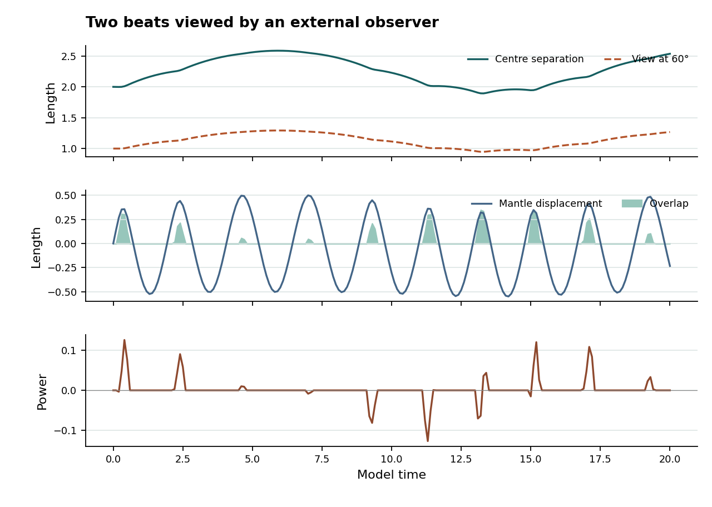

The wave can be read here in $b(t)$, the contact in $O(t)$, and the transfer of energy to the separation motion in the power $kO\dot d$. It can change its sign. The variation of the contact energy is $kO(2\dot b-\dot d)$ and compensates for the two contact powers exerted on the free degrees. An external camera, centered on the middle of the pair and seeing the axis at an angle of 60 degrees relative to its measurement axis, reads the component $d\cos 60^\circ=d/2$. An aligned camera is bed $d$. These two lengths describe the same movement. This illustrative geometric reader does not convert the unit of the calculation into meters. The tables, parameters and code are collated in appendix B.

## Does one separation determine the next?

Prepare two pairs at $d=2$ with zero separation velocity, mantle displacement $b=0$ and total energy $H=0.10$. Only the sign of the internal motion differs. In the first preparation, $p_b=+\sqrt{0.18}$ and the mantles expand initially. In the second, $p_b=-\sqrt{0.18}$ and they contract. An instrument recording centre separation and separation velocity assigns both pairs the same initial state. Its orientation is held fixed throughout.

\Needspace{7\baselineskip}

|Preparation|Distance at $t=1$|Distance at $t=2$|
|:---|---:|---:|
|Initially expanding mantles, active contact| 2.118257 | 2.235958 |
|Initially contracting mantles, active contact| 1.949576 | 1.930571 |
|Contact disabled, in both preparations| 1.949576 | 1.792792 |

Distances and times use reduced units. The table uses a Verlet step of $0.0005$. Steps of $0.004$, $0.002$ and $0.001$ also give a separation difference close to $0.169$ at $t=1$ with contact active. Setting the contact stiffness to zero removes that difference at every sampled time. With contact active, these preparations rule out an autonomous deterministic law that assigns a unique trajectory from the initial separation and separation velocity alone. Retaining the internal degree of freedom distinguishes the trajectories in the coupled pair. The geometry of physical spacetime requires a separate experimental test.

Chorin, Hald and Kupferman examine this closure problem using Mori–Zwanzig projected dynamics. Eliminating variables can introduce a dependence on the history of the retained quantities. The paired-mantle calculation demonstrates the loss of predictability for these two preparations when only the selected pair of variables is retained. Identifying a particular memory term would require deriving its form. [Chorin, Hald and Kupferman, projected dynamic](https://doi.org/10.1073/pnas.97.7.2968)

## What sustains a beat?

BST uses *vital* for the possibility that a pattern sustains its organization through activity while its constituents and exchanges change. Which observable would distinguish this from the repetition of a motion? The oscillating mantle isolates a first question. Can a preparation maintain a rhythm while energy flows through it in every cycle?

Consider a free beat outside contact, with inertia $\mu$ and stiffness $\kappa$. Its conservative mode energy $E_b=(\mu\dot b^2+\kappa b^2)/2$ is constant. To include external forcing $F(t)$ and viscous loss $\gamma\dot b$, write $\mu\ddot b+\gamma\dot b+\kappa b=F(t)$. Multiplying by $\dot b$ gives the power balance $dE_b/dt=F\dot b-\gamma\dot b^2$. Each term on the right has units of power. With $\Omega=\sqrt{\kappa/\mu}$ and $F=\gamma B\Omega\cos(\Omega t)$, the trajectory $b=B\sin(\Omega t)$ is an exact solution. The mean input and dissipated powers are both $\gamma B^2\Omega^2/2$.

The check keeps the preparation $b(0)=0$, $\dot b(0)=B\Omega$, with $\mu=0.3$, $\kappa=2$, $B=0.1$. After ten free periods, the conservative control kept its own initial energy of $0.0100$ in reduced units. With $\gamma=0.06$ and periodic input, the beat follows the same trajectory. However, it received and dissipated $0.04867$ units of energy, almost five times its initial energy. By cutting this input while keeping the loss, the remaining energy drops to $0.773$% of its initial value. Observing only the radius during the steady regime would not allow the choice between the first two preparations. A measure of work or a cut-off of the input of the separation.

In living organisms, a supplementary question is how the organization regulates and renews its own activity. Here force is prescribed from the outside. An experimental approximation specifies the scope of the word “beat”. Nakajima and his colleagues observed a circadian cycle of KaiC phosphorylation outside the cell in a reconstituted biochemical system. A mechanism-specific oscillation of living systems can thus be studied separately from the body. In BST, moving from maintaining a mode to that of an organism would require the identification of the boundary, renewal, regulation and recovery after disturbance. [Nakajima et al., reconstituted circadian oscillation](https://doi.org/10.1126/science.1108451)

## When do a signal and a beat measure the same time? {#common-cone}

Imagine a flash of light in a train. With each passing second its light reaches points farther away. Draw one direction in space horizontally and time vertically. Light travelling left and right traces a V, a cross-section of the *light cone*. Its edge marks the farthest the signal could have travelled. A clock aboard the train follows a path inside the cone.

Place one mirror on the carriage floor and another on the ceiling. A round trip of light counts as one tick. A passenger sees the light go up and down. From the platform, the light follows two diagonals because the mirrors move along the track. Both observers measure the same speed of light, so the platform measures a longer interval between ticks. BST asks what happens if a beat of the substrate replaces this clock. Adjust the beat and the light clock to agree at rest. Will they still agree in a moving train? The calculation below gives the condition for agreement. Setting the clocks at rest fixes a time unit. Comparing them in motion tests the geometry each clock measures.

**Two equations from the substrate dynamics.** Linearize the equations of motion about a uniform equilibrium. Choose a neutral orientation mode $u$ with no local restoring term, and a small perturbation $\sigma=s-s_0$ of the resolution field. To first order, $\sigma$ is the relative length change $\delta\ell/\ell(s_0)$. In the isotropic continuum regime the equations in Chapter 3 give

$$\begin{aligned}
\partial_t^2u-c_q^2\Delta u&=0,\\
\partial_t^2\sigma-c_s^2\Delta\sigma+\Omega_0^2\sigma&=0,
\qquad c_s^2=k_s/m_s,\quad\Omega_0^2=U_s''(s_0)/m_s.
\end{aligned}$$

The signal speed $c_q$ follows from the ratio of gradient stiffness to inertia for the orientation mode. It equals one in the units of the model. For the beat, $m_s>0$, $k_s>0$ and $U_s''(s_0)>0$ ensure positive inertia, a real propagation speed and a real rest frequency. The highest-order derivative terms determine the characteristic directions along which wavefronts propagate. The local restoring term sets the angular frequency $\Omega_0$ without changing those directions. **The two branches share a cone exactly when $k_s/m_s=c_q^2$** under the stated assumptions. The action permits other values of the ratio.

The model also supports a gauge signal. On the same neutral background the current force vanishes to first order for a freely perturbed link. In temporal gauge, choose a polarization $A_y(x,t)$ transverse to propagation. This mode satisfies the Gauss constraint and its link equation reduces to $m_A\partial_t^2 A_y-k_A\partial_x^2A_y=0$. Its characteristic speed is $c_A=\sqrt{k_A/m_A}$. The model electric readout follows $E_y=-\partial_t A_y$. Orientation, beat and gauge signal therefore share a cone when $c_q^2=k_s/m_s=k_A/m_A$ in common units. Coupling this gauge sector to a laboratory electromagnetic signal is a further physical identification.

**An echo clock.** Two ideal mirrors separated by a transverse distance $a$ move together at speed $v$ along $x$. Assume a stable transverse separation, instantaneous reflection and an isotropic signal speed $c_{\rm sig}$, equal to $c_A$ for the gauge signal or $c_q$ for the orientation mode. The signal travels $c_{\rm sig} t_1$ before it reaches the second mirror, which moves by $v t_1$ in the same time. The right triangle gives $(c_{\rm sig}t_1)^2=a^2+(vt_1)^2$. The return trip has identical geometry. With rest period $T_0=2a/c_{\rm sig}$, the period observed in motion is $T(v)=2t_1=T_0/\sqrt{1-v^2/c_{\rm sig}^2}$. The moving-to-rest cycle-rate ratio is $r_{\rm e}=T_0/T(v)=\sqrt{1-v^2/c_{\rm sig}^2}$. The elapsed time assigned by this clock thus depends on the chosen signal. [Construction of the light clock](https://www.einstein-online.info/en/spotlight/light-clocks-time-dilation/)

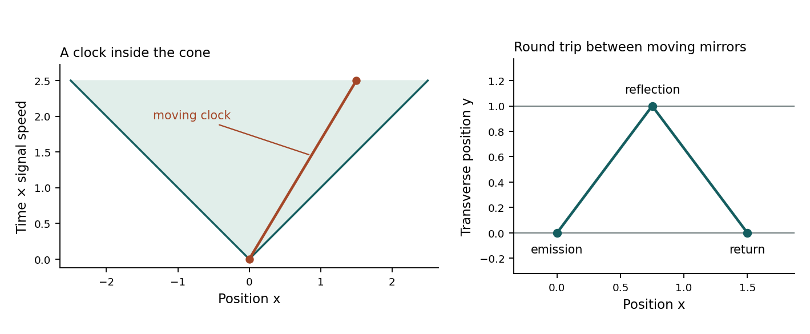

**An internal cycle as a second clock.** A small resolution perturbation satisfies $\omega^2=\Omega_0^2+c_s^2 k^2$. Prepare a narrow-band superposition around wavenumber $k$. Its envelope travels at group velocity $v=d\omega/dk=c_s^2 k/\omega$. A probe sensitive to the real field $\sigma$ counts oscillations along $x=vt$ and measures the phase $\omega t-kx$ up to an overall sign. Its angular frequency per unit laboratory time is

$$\omega-kv=\frac{\Omega_0^2}{\omega}
  =\Omega_0\sqrt{1-v^2/c_s^2}.$$

The relative beat rate is $r_s=\sqrt{1-v^2/c_s^2}$. The equality $r_s=r_{\rm e}$ holds at every inertial speed allowed by both branches if their stiffness-to-inertia ratios define a common characteristic speed. Conversely, in this isotropic family, equality of the two rates at one nonzero speed requires $c_s=c_{\rm sig}$. Normalizing the rest cycles then gives $d\tau=dt\sqrt{1-v^2/c_{\rm sig}^2}$ for both constructions. The two waves used here are extended. Their crests provide a phase whose cycles can be counted. A clock attached to a localized object would require a wave packet or a bound mode that remains readable along its trajectory throughout the measurement. The period of the oscillating mantle uses that model’s integration time. Its transformation law needs an independent derivation.

### How do two distinct cones appear in the readouts?

The first calculation sends a pulse around a ring and records the time of the maximum at two sensors, first for the orientation field and then for the transverse electric component of the gauge model. The sensor separation divided by the delay estimates the signal speed in the continuum limit of the nondispersive branch. A second calculation integrates two neighbouring modes, measures their angular frequencies and tracks a crest of their envelope. Zero crossings in the same direction along that trajectory give the beat rate. The tabulated echo rate follows from the gauge signal’s flight time, the crest speed and the geometry of ideal mirrors. The simulations evolve the fields. The dynamics of the mirror material is an assumption of the setup.

Use reduced units with $c_q=m_s=m_A=\Omega_0=1$. The first preparation has $k_A=k_s=1$ and central wavenumber $3/4$. The scale control changes $k_s$ to $9/16$. Its central wavenumber is $16/9$ so that the envelope speed remains $0.6$ in the continuum limit. The gauge control retains the initial beat and changes only $k_A$ to $9/16$. The last two columns report rates relative to rest.

\Needspace{9\baselineskip}

|Preparation|Grid spacing|Crest speed|Echo rate|Beat rate|
|:---|---:|---:|---:|---:|
|Common| 1/4 | 0.596770 | 0.800051 | 0.802932 |
|Scale| 1/4 | 0.584192 | 0.809378 | 0.620199 |
|Gauge| 1/4 | 0.596770 | 0.599884 | 0.802932 |
|Common| 1/32 | 0.599950 | 0.800005 | 0.800046 |
|Scale| 1/32 | 0.599752 | 0.800153 | 0.600317 |
|Gauge| 1/32 | 0.599950 | 0.600009 | 0.800046 |

At $v=0.6$ both clocks in the common preparation approach the rate $0.8$. Only the beat approaches $0.6$ in the scale control. Only the gauge echo approaches $0.6$ in the gauge control. The orientation-field echo approaches $0.8$ in all three cases. Refining the discretization preserves these differences. Appendix B and the data include both directions of travel, a change of time step and a narrower band.

### How can one field govern light propagation and a clock at rest?

The static-background clock model asks whether a transverse wave and a matter clock yield compatible durations if the local resolution length changes. On a static isotropic background, choose units with reference speed one and write the interval as $d\mathcal S^2=-T(s)\,dt^2+H(s)\,d\mathbf x^2$. In a minimally coupled matter action, the quadratic spatial term has coefficient $\sqrt{TH}$ and the quartic term has coefficient $\sqrt{T/H}$. The volume element contributes $\sqrt{TH^3}$, with a factor of $H^{-1}$ for each contracted pair of spatial derivatives. This model identifies these weights with the energy coefficients $1$ and $e^{2s}$. Solving gives $T=e^{2s}$ and $H=e^{-2s}$, fixing a candidate metric within the chosen family.

The link coefficients are then $m_A=g^{-2}e^{-2s}$ and $k_A=g^{-2}e^{2s}$, where $g$ denotes the coupling. The coordinate speed of a transverse signal is $c_A=\sqrt{k_A/m_A}=e^{2s}$. A stationary clock accumulates $d\tau=e^s dt$, and the local proper length is $dL=e^{-s}|d\mathbf x|$. Combining these relations along a light ray gives $dL/d\tau=1$. Rulers and clocks obeying these laws therefore measure the same local light speed for every uniform value of $s$. Along a path with coordinate velocity $v$ the proposed metric would give $d\tau=e^s\sqrt{1-v^2/e^{4s}}\,dt$. The radial frequencies below test the factor for a stationary clock. Constructing a transportable length standard is a further requirement.

**What does the matter clock count?** The matter clock counts coupled radial oscillations of the orientation $q$ and resolution $s$, around localized configurations of two topological degrees. Two preparations are homologous when their profiles and their edges correspond under $s\mapsto s+\delta$, $x\mapsto e^\delta x$ and $t\mapsto e^{-\delta}t$. In the same phase, a coordinated period is therefore divided by $e^\delta$. For $\delta=0.12$, the calculated angular frequencies shall increase by a factor of $1.127497$, in agreement with $e^{0.12}$. A control with frozen links and its reference inertias gives $0.886920$, i.e. the opposite direction. The transverse signal provides an independent reading. At $s=0.12$, of 200 steps in two periods, its calculated coordinate speed is $1.27124898$, for $e^{0.24}=1.27124915$. The file makes it possible to repeat the 24 radial preparations and the twelve transverse trajectories, including the profiles and the original programs.

**A mode can remain inside the light cone.** In this long-range realization the field $s$ has a quartic gradient term and no linear restoring force in vacuum. On a static background its longitudinal perturbation speed satisfies $c_{s,\parallel}/c_A=\sqrt{(2+3X)/(8+4X)}$, with $X=\eta e^{2s}|\nabla s|^2\geq0$ and the benchmark value $\eta=1000$. On a uniform background the ratio is $1/2$. This freely propagating disturbance and the collective radial mode used as a rest clock are distinct preparations. The moving clock uses an oscillatory mode with $U_s''>0$. The comparison therefore does not assign a single front speed to every excitation. The gravitational question also requires a separate test. The intervals for the ratio of field source to translational inertia are disjoint for the two radial degrees examined. Section 8.3 of the source derivation considers the alternative inertia $m_s=c_A^{-2}(a+bX)$. The longitudinal front stays within the cone if $a+bX\geq2+3X$. On every background the fronts coincide only for $a=2$ and $b=3$. Even then the source-to-inertia intervals for the two radial profiles remain disjoint. Universal free fall requires an additional check.

**Laboratory measurement.** Under the weak-field identification $s=\Phi/c^2$, with Newtonian potential $\Phi$, the rate $e^s$ gives $\Delta f/f=\Delta\Phi/c^2$ to first order. Bothwell and colleagues measured the fractional frequency gradient of a strontium clock across a millimetre-scale sample. In their axis convention the result was $(-9.8\pm2.3)\times10^{-20}$ per millimetre, compared with the expected $-10.9\times10^{-20}$ per millimetre. General relativity gives the same prediction. The comparison constrains this model under the stated identification of $s$ with the potential. The next section reconstructs the transition from independent spectroscopic intervals and identifies the coupling that remains to be derived in BST. [Bothwell et al., gravitational gradient of an atomic clock](https://doi.org/10.1038/s41586-021-04349-7)

**Connecting the model to physical clocks.** A local cone fixes geometry up to a conformal factor. The metrics $g$ and $F(x)^2g$, with $F>0$, share the same null directions. Their proper-time increments along a trajectory differ by the factor $F(x)$ at each event. The static calculation supplies a way to fix this factor for two mode families. Tests in motion and in variable fields would require clocks of different material composition and a derivation of the coupling to the detected electromagnetic signal. D07.3 already transports a Sirius B atomic frequency in a specified metric. Chou and colleagues compared optical clocks at relative speeds below 10 m/s and height differences below one metre. A BST prediction would fix the coefficients using other observations and calculate both shifts with the same couplings. [Ehlers, Pirani and Schild, local cone structure](https://doi.org/10.1007/s10714-012-1353-4) · [Cabbage, optical clocks and relativity](https://doi.org/10.1126/science.1192720)

### What sets the frequency of an actual strontium clock?

The clock transition in neutral strontium-87 connects the ground state $g=5s^2\,{}^1S_0$ to the excited state $e=5s5p\,{}^3P_0$. Their relative phase accumulates at angular frequency $(E_e-E_g)/\hbar$ per unit proper time and is compared with the phase of an optical oscillator. One cycle corresponds to $2\pi$, giving proper frequency $\nu_0=(E_e-E_g)/h_{\rm P}$, where $h_{\rm P}$ is Planck’s constant.

**Reconstructing the energy gap from independent transitions.** For the same isotope and total angular momentum $F=9/2$, Courtillot and colleagues measured the ground-state transition to $p=5s5p\,{}^3P_1$, then the interval between $e$ and $p$. The first frequency is $434\,829\,343\,010$ kHz. The second, measured by coherent population trapping, is $5\,601\,338\,670$ kHz. Each has a reported uncertainty of 50 kHz. Because $E_e-E_g=(E_p-E_g)-(E_p-E_e)$, subtraction gives $429\,228\,004\,340$ kHz, with a reported uncertainty of 70 kHz for the indirect determination. Relative to the BIPM recommended frequency of $429\,228\,004\,229\,872.992$ Hz, the difference is $+110.127$ kHz, about $1.6$ times the uncertainty of the indirect estimate. Two measurements linking three levels of the same atom thus provide an external standard for the BST calculations. [Courtillot et al., Table I and Section V](https://doi.org/10.1140/epjd/e2005-00058-0) · [BIPM, strontium plug 87, adjustment 2025](https://www.bipm.org/documents/20126/288515313/87Sr_429THz_2025/bbd827f7-3e1e-5fbe-6bd8-0eadd9b5b674)

**Transporting the clock phase in the resolution field.** If both levels evolve in the same proper time and their rest energies are independent of $s$, the phase difference at rest satisfies $d\varphi=2\pi\nu_0\,d\tau=2\pi\nu_0 e^s dt$ in the static metric. The coordinate rate is $\nu_0 e^s$. With $s=\Phi/c^2$ to first order, the reference gradient along the vertical axis used by Bothwell is $-1.09\times10^{-19}$ per millimetre. Multiplication by the reconstructed frequency gives $-46.8$ microhertz per millimetre. The measured slope across the atomic cloud corresponds to $-42.1\pm9.9$ microhertz per millimetre. These slopes come from relative-frequency measurements. The BIPM value provides a separate check on the rest frequency.

If the field also changes the proper energy interval, define $K=\partial_s\ln(E_e-E_g)$ in the measured neighbourhood. The fractional slope of the coordinate frequency becomes $(1+K)\partial_z s$. Under the stated identification with the terrestrial potential and the experiment’s optical readout, the published slopes give $K_{\rm eff}=-0.10\pm0.21$ when the measurement uncertainty is propagated at fixed reference gravity gradient. This relative measurement is compatible with common coupling $K=0$. Discriminating between two BST realizations would require them to predict $K$ before comparison with the measurement. [Bothwell et al., frequency gradient through a millimeter sample](https://doi.org/10.1038/s41586-021-04349-7)

**What the atomic inputs determine.** The neutral strontium entry has 38 electrons and a first ionization threshold of $5.69486745$ eV. This threshold connects the ground state with the ionic continuum, whereas the clock transition connects two neutral levels separated by about $1.77514$ eV. In an effective Hamiltonian, adding $\lambda|e\rangle\langle e|$ shifts the excited state by $\lambda$ while preserving the ground state and threshold for shifts small enough to preserve level ordering. The clock frequency changes by $\lambda/h_{\rm P}$. The threshold alone therefore cannot identify that frequency. A microscopic BST prediction needs an operator on the neutral states, an identification of the two levels, and a computation of their energy difference using parameters fixed by other data. The reference frequency here comes from spectroscopy.

BST assigns a geometry and a contact-response operator to strontium. Chapter 4 reports the comparison with the clock line. [Appendix B](#sr-contact-detail) derives the operator and tests two choices of dynamics, distinguishing overall size, inertia and angular degrees of freedom.

# 3. Properties and dynamics of the substrate {#substrate-model}

BST postulates that the substrate is the physical universe. Its variational model specifies the degrees of freedom at each site, the energy of each state and the equations of motion. To connect those fields to a physical measurement, one must also specify the instrument and compare its predicted response with data.

## Local state, directions and characteristic times

On a lattice of spacing $h$, each site $x$ carries an internal orientation $q_x\in S^3$, a four-component unit vector, and a dimensionless scalar $s_x=\log(\ell_x/\ell_*)$. The value $\ell_*>0$ sets the length unit for resolution. An oriented link from $x$ to $y$ carries a transport angle $A_{xy}$. These variables, together with their velocities or momenta, form the state. The orientation sphere $S^3$ is an internal state space. The boundary of the radial mantle in the physical space of Chapter 1 is two-dimensional.

Comparing neighbouring sites requires transporting $q_y$ into the local frame of $x$. Let $R(A_{xy})$ denote a rotation in the plane of the first two components. The variation along lattice direction $i$ is $v_i=h^{-1}\log_{q_x}\big(R(A_{xy})q_y\big)$. The logarithmic map on the sphere gives the tangent vector pointing towards the transported orientation, with length equal to their angular separation. It uses the shortest arc, which is unique away from the antipode. The calculation must also specify its boundary conditions. The wave-packet propagation test uses a uniform background and periodic boundaries.

Define $W(u,w)=|u|^2|w|^2-(u\cdot w)^2$, the squared area of the parallelogram spanned by two internal variations. It vanishes when they are collinear. In model units the kinetic and deformation energy densities are

$$\begin{aligned}
\mathcal T_q &= \tfrac12\Big[\alpha|\dot q|^2+\beta(s)\sum_i W(\dot q,v_i)\Big],\\
\mathcal V_q &= \tfrac12\Big[\alpha\sum_i|v_i|^2+\beta(s)\sum_{i<j}W(v_i,v_j)\Big],
\qquad \beta(s)=\beta_* e^{2s}.
\end{aligned}$$

Here $\alpha>0$ and $\beta_*\geq0$. The inertia matrix acting on the tangent plane reads directly in $\mathcal T_q=\dot q^T M_q\dot q/2$,

$$M_q=\alpha I+\beta(s)\sum_i\big(|v_i|^2 I-v_i v_i^T\big).$$

For any tangent velocity $w$, $w^TM_q w\geq\alpha |w|^2$. The inertia is positive and can depend on direction and background deformation. About a stationary state, the **stiffness** $K$ is the Hessian of the potential energy restricted to admissible variations. Small free oscillations obey $M\ddot z+Kz=0$. For a mode $e$, the generalized eigenvalue equation is $Ke=\omega^2 M e$. Assigning a stiffness, frequency or speed therefore requires specifying the longitudinal, transverse or internal mode. A negative eigenvalue of $K$ in a physical direction indicates linear instability.

## Dynamical resolution and feedback

The model’s intrinsic resolution is a degree of freedom. Around $s_0$, take the local coefficients to be constant and absorb the volume weight into the inner products. Its Lagrangian is

$$L_s=\tfrac12 m_s\|\dot s\|^2-\tfrac12 k_s\|\nabla_h s\|^2-\sum_x U_s(s_x).$$

If $L_q$ is the sum of $\mathcal T_q-\mathcal V_q$ with the same weights, the variation in $s$ gives

$$m_s\ddot s+k_s\nabla_h^*\nabla_h s+U_s'(s)=\partial_s L_q.$$

The derivative on the right is taken site by site at fixed deformation and velocity. The positive operator $\nabla_h^*\nabla_h$ tends to $-\Delta$ with the sign convention used here. The ratios $k_s/m_s$ and $U_s''/m_s$ have the dimensions of squared speed and squared angular frequency, respectively. Dynamical transport adds the kinetic term $m_A\|\dot A\|^2/2$ and circulation energy $k_A\|dA\|^2/2$. Here $dA$ is the oriented sum of angles around a plaquette. The initial conditions must satisfy the Gauss constraint in this gauge sector. The moving-clock test uses the background $q=(0,0,0,1)$, $A=0$, $s=s_0$ with $U_s'(s_0)=0$. A small neutral perturbation of $q$ along its third component decouples to first order from the perturbation $\sigma$ of $s$. The areas $W$ enter at fourth order in the perturbations. This recovers the two equations in Chapter 2. Cone dependence on a pre-deformed background requires a separate calculation.

**Local feedback.** In a tangent basis choose $v_1=(1,0,0)$, $v_2=(0,1/2,0)$ and $v_3=0$, with $\alpha=\beta_*=m_s=1$ and $s=0$. The three principal inertias are $1.25$, $2$ and $2.25$. Hold the deformation fixed. For a stationary orientation, $\partial_s(\mathcal T_q-\mathcal V_q)=-0.25$. Giving the orientation a velocity $\dot q=(0,0,1)$ raises the kinetic energy to $1.125$, leaves the deformation energy at $0.75$, and changes the derivative to $+1$. With $U_s'(0)=0$ and an initially uniform field $s$, the two preparations therefore give opposite signs for the acceleration of the resolution field at the same point. This instantaneous response illustrates the feedback from motion onto local resolution.

## From motion to energy flux and to measured deformation

An energy balance defines the flux. For the continuum limit of the local resolution field, take $m_s\ddot s-k_s\Delta s+U_s'(s)=f$ with constant $m_s,k_s$ and force per unit volume $f$ from the other degrees of freedom. Multiplying by $\dot s$ gives

$$\mathcal E_s=\tfrac12m_s\dot s^2+\tfrac12 k_s|\nabla s|^2+U_s(s),\qquad
\mathbf j_s=-k_s\dot s\,\nabla s,\qquad
\partial_t\mathcal E_s+\nabla\!\cdot\!\mathbf j_s=f\dot s.$$

The rate of change of energy in a volume equals the power delivered inside it minus the outward energy flux through its boundary. A spatially uniform local beat can oscillate with $\mathbf j_s=0$. For a free wave $s_0+B\cos(kx-\omega t)$ about a harmonic minimum, the mean flux in direction $x$ is $k_s B^2\omega k/2$. In units $m_s=k_s=U_s''=1$, with $B=0.1$ and $k=\pm0.75$, averaging over a period gives $\pm0.0046875$. The two waves have equal amplitudes and angular frequencies and carry energy in opposite directions.

To relate a change in $s$ to clocks and rulers, return to the static clock-model background. The weights $T=e^{2s}$ and $H=e^{-2s}$ give $\delta T/T=2\,\delta s$ and $\delta H/H=-2\,\delta s$ to first order. A uniform constant shift preserves flat geometry in this metric. Spatial variation can produce a tidal effect. In the weak-field limit with $\Phi=c^2s$, two slowly moving probes separated by $\xi^j$ have relative acceleration $\delta a_i\simeq-c^2\sum_j(\partial_i\partial_j s)\xi^j$ under the geodesic-motion assumption. This readout depends on spatial derivatives of the reconstructed background. Inferring curvature from a given flux requires a source equation, boundary conditions and a test of the coupling to matter. The cognition chapter separately defines a current between actions that can be attributed to an observed arbiter.

## Memory, latency and instrument resolution

Eliminating an internal coordinate illustrates how a delayed response can arise. Let $w$ be an internal mode of angular frequency $\omega_L>0$, coupled to an observable displacement $z$ through $\ddot w+\omega_L^2w=gz$. For specified initial conditions, its response contains the term

$$g\int_0^t\frac{\sin[\omega_L(t-t')]}{\omega_L}\,z(t')\,dt'.$$

When $w$ acts back on $z$, the reduced equation for $z$ depends on the history of the motion and the preparation of $w$. The response time depends on frequency and coupling strength. A conservative system can therefore exhibit a phase lag. Establishing a finite delay before the onset of a response or an irreversible loss requires a separate test, such as measuring how much energy returns to the system. In a dissipative realization, a positive semidefinite matrix $\Gamma$ gives a force $-\Gamma\dot z$ in the linearized equations and a dissipated power $\dot z^T\Gamma\dot z$. This expression permits a passivity test once the coordinates and units are specified.

Instrument resolution has a separate effect. Consider a field $\cos(kx-\omega t)$ measured with a normalized spatial Gaussian of standard deviation $\delta$ and no temporal filtering. The measured signal is $e^{-(k\delta)^2/2}\cos(kx-\omega t)$. Doubling the window width reduces contrast by a calculable factor and preserves the frequency of this isolated mode. Varying $s$ can instead alter the dynamical coefficient $\beta$. Varying the numerical spacing $h$ at fixed physical state and instrument tests convergence. These operations distinguish three reasons why a pattern can change appearance or become undetectable.

## From calculation to measurement

Let $X$ denote the prepared state. The equations above follow from the variational principle $\delta S=0$. In coordinates $q_a$, a stationary trajectory with fixed endpoints satisfies $\frac{d}{dt}(\partial L/\partial\dot q_a)-\partial L/\partial q_a=0$. For the coupled pair, $L=T-V$. The choice of fields, coefficients, action and boundary conditions supplies the physical content of each realization. Deriving these choices from one microscopic law is a separate task.

For a linearized readout of substrate perturbations, the output takes the form
$$y_a(t)=\int_{-\infty}^t\!\int W_a(x,t-t';\ell,\eta_a)\,{\cal O}_a[X(t')](x)\,dx\,dt' + \epsilon_a(t).$$
The quantity $\mathcal O_a$ specifies the quantity coupled to the detector and $W_a$ its spatial and temporal window, standardized as a function of the units of the output. The term $\epsilon_a$ represents the reading error. The position, integration time and sensitivity of the device change the possible measure. A non-linear reader, for example a power proportional to the square of an amplitude in its field of validity, requires its own observation function.

The observational atlas specifies the coordinate frame, viewing direction, channel, physical resolution, detection and reconstruction. Rotating a system and detector together preserves the expected readout. Rotating the detector alone can suppress a component. Measuring a squared amplitude removes its sign, and averaging over orientations can hide anisotropy. Applying the same protocol to two calculations requires stating the observation centre, the detector surface or axis, the quantity integrated and the information discarded.

The **BST progressive compatibility protocol** retains compatible intervals when several parameter values agree with an observation. For preparation $i$, family $f$ and common parameters $\theta$, let $A_{i,f}$ denote the set satisfying the declared test for that row. The intersection $\bigcap_i A_{i,f}$ imposes the tests simultaneously. Retained candidates in a finite benchmark can form disjoint sets. The endpoints on individual sliders therefore do not establish that all cross-combinations work. The console retains candidate identities. Interpreting the intersection requires a prior declaration of shared and preparation-specific parameters.

The register identifies quantities used for calibration, calculations at fixed parameters, comparisons between published records and projections fixed before comparison. The 10% working tolerance applies only where specified. Published experimental uncertainties refer to particular quantities and conditions and may specify a coverage level. Where experiments disagree, the register retains each set of assumptions and references. Appendix A gives each decision and its scope. Appendix C works through a frozen prediction.

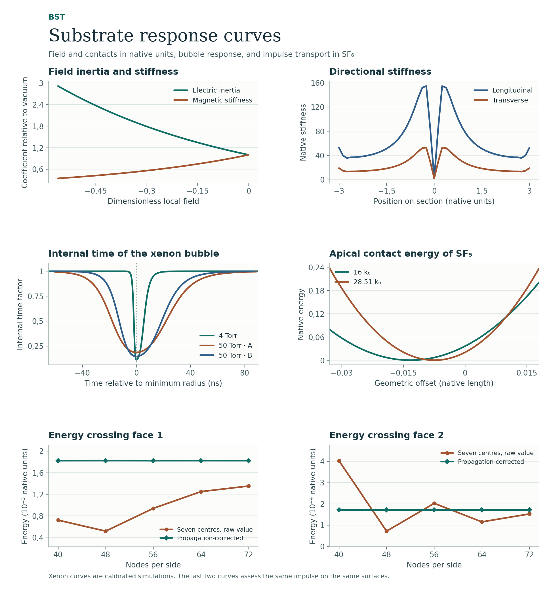

The first panels show electrical inertia and magnetic stiffness as functions of the local field. The next spatial section resolves the longitudinal and transverse responses. Time in the xenon-bubble panel is measured relative to the minimum radius. The last two SF₆ panels follow one pulse on different grids. The source table specifies the axis units, domain and calculation used for each series.

Appendix C contains the terms of the substrate action in its general variational equation. It specifies the restriction which reduces the orientation to a single phase and gives the minimal form of the action of this phase in natural units. The pattern linking the substrate, persistence and agent accompanies the lexicon.

## Which predictions survive a change of scale?

In Wilson's renormalization, eliminating short-scale degrees of freedom transforms actual interactions. This transformation is followed so as to preserve large-scale predictions. To test a match with BST, it would be necessary to specify the transformation between two of its laws and an observable that retains its value. Reducing the resolution of a camera only affects the reading of the same movement. [Wilson, renormalization group](https://doi.org/10.1103/RevModPhys.55.583)

# 4. Physics and information across the eleven benchmark domains {#domain-tests}

The benchmark covers eleven domains in physics and information. It records an outcome for each of 68 requirements, with explicit conditions on 44 of them. Of 576 combinations of models and parameters, 192 satisfy all 67 checks included in the joint comparison. Entry J00.1 records that result for the stated benchmark. Entry J00.2 records the decision, predictions and files needed to reproduce the work.

Calibration has a specific role. Measured lifetimes set an amplitude interval for each nuclear transition, and viscosity measurements constrain a common range of gain for krypton and xenon. The calculation gives the admissible interval. Predictions for a new measurement retain the parameters determined in that way.

Each domain has results for specified observables. The register also asks a broader physical question for each domain. In D09, for example, the xenon spectrum gives a mean energy per period and the time trace resolves eight flashes. Several distributions of energy among those flashes fit these readings. An absolute, synchronized measurement would be needed to determine the energy of each flash. Six of the 28 original sets of requirements are fully met. For each of the eleven domain-wide sets, at least one physical requirement or dependency remains open. Appendix A lists the 68 outcomes, including the 29 that directly concern a single domain. Together with their dependencies, the eleven domains account for 64 requirements. G07.1, G07.2, J00.1 and J00.2 concern provenance, reproduction and the joint decision.

| Domain | Operation in BST | Result and conditions |
|:-----------------|:--------------------------------|:---------------------------------------|
| [D01 · Atoms and molecules](#domain-01) | Compute all six S–F distances in one SF₆ geometry. | All six fall within the diffraction interval of 1.559 to 1.563 Å. |
| [D11 · Isotopes and transitions](#domain-11) | Compute the beta decay rates of ⁶He and ¹⁴C with an amplitude for each transition. | Both half-lives constrain amplitude ranges within the same region of substrate parameters. |
| [D02 · Current and polarization](#domain-02) | Project a current onto the detector plane for four viewing directions. | Across 864 amplitudes, the normalized longitudinal residual is below 6 × 10⁻¹⁶. This tests the projection. |
| [D03 · Molecular spectra](#domain-03) | Read motion in all six SF₆ bonds with the same response operator. | Maximum discrepancy of 5.70% over eight band-area readings. Both pressures enter the weak-band profile fit. |
| [D04 · Mechanics and flux](#domain-04) | Track the energy crossing two faces after a pulse, with an empty-domain control. | From 64 to 72 sites per axis, the corrected flux changes by 0.00888% and 0.02119% on the two faces. |
| [D05 · Thermodynamics](#domain-05) | Obtain the constant-volume heat capacity from the same free-energy correction. | Maximum residual heat-capacity deviations of 4.70% and 4.28% in the two fitted branches. |
| [D06 · Transport and viscosity](#domain-06) | Apply two viscosity estimators to Kr and Xe trajectories. | In branch 0 both gases and both estimators admit a common gain between 1.04246 and 1.15190. |
| [D09 · Sonoluminescence](#domain-09) | Pair bubble radius and phase with xenon flashes. | Eight flashes have a time and a relative amplitude. The spectrum supplies a mean energy within the measured band. |
| [D07 · Clocks and gravitation](#domain-07) | Propagate the local line on two specified backgrounds for Sirius B. | Both calculations give 80.023 km/s. The primary differential measurement is 80.65 ± 0.77 km/s. |
| [D08 · Cosmology](#domain-08) | Compute spectra, distances and growth readouts for twelve families using CAMB transfer. | All twelve meet the stated criteria on the Planck spectra and the distance and growth data blocks. |
| [D10 · Information and memory](#domain-10) | Prepare two memory signs with the same resting readout, then apply the same probe pulse. | Across 72 simulated pairs, the readout yields 0 bits at rest and 1 bit after probing, with no added noise. |

## From quantum states to measured spectral lines

The path begins with the atoms and then their molecular assemblies. The detour through the nuclei specifies what changes when one replaces an isotope. The coupling of the material to the electromagnetic field, already present in the atoms, then makes it possible to excite these states and to read a spectrum. The frequency of strontium in chapter 2 illustrates the three preparation, reading and comparison operations.

### D01. From atomic levels to molecular geometry {#domain-01}

D01 compares three observables between calculation and experiment. In D01.1, a spectral line gives an **energy difference** through $h_{\rm P}\nu=E_b-E_a$. Identifying the two states also requires a preparation and a means of distinguishing them. In D01.2, diffraction probes a mean distance. In D01.3, replacing hydrogen with deuterium shifts a line at fixed nuclear charge. The reduced mass $\mu=mM/(m+M)$ enters the relative motion.

|Line|Calculation that the reader can verify|Scope of the comparison|
|:------------|:-------------------------------------------------|:-------------------------------|
| D01.1 · Spectral lines | Five hydrogen lines are identified. For frequency ratios, the $1S$–$2S$ transition sets the scale and the other four check it. On an absolute scale, the maximum relative deviation across the five lines is $2.88\times10^{-6}$ for each of the Rb and Cs recoil calibrations. With charge set to unity and the specified action normalization it is $3.68$%. | Rb and Cs refer to independent determinations of the fine-structure constant. The broader D01.1 requirement also lists He, C, O and Ne. The five numerical results here refer to hydrogen. |
| D01.2 · Geometry | The six computed S–F distances in SF₆ range from $1.559510$ to $1.560593$ Å. The diffraction interval is $1.559$ to $1.563$ Å for the mean distance $r_g$, with a stated three-standard-deviation uncertainty. | All six arms are compared with the same measured mean. Intensities and the thermal distribution require separate readouts. |
| D01.3 · Isotopes | For the H–D $1S$–$2S$ isotope shift, the point-mass reduction overestimates the measured shift by $20.8844$ and $20.8860$ MHz with the Rb and Cs standards, respectively. Its experimental uncertainty is 15 Hz. | The benchmark uses a wider model tolerance. The reduction omits nuclear-size, relativistic recoil and quantum-electrodynamic contributions needed at experimental precision. |

The six distances describe a single simulated preparation. The two calibrations retain their separate results. The transition from atoms to molecules involves collective movements. For SF₆, D02 specifies the excitation by a field and D03 repeats this movement to test the frequencies and the intensities. The two thermochemical data sets of 1980 and 2015 each define their comparison scenario. [Parthey et al., isotopic displacement H–D](https://doi.org/10.1103/PhysRevLett.104.233001) · [Bartell and Doun, diffraction of SF₆](https://doi.org/10.1016/0022-2860(78)80010-6)

Strontium tests a limit of this identification. Its contact geometry gives 17 positive stiffnesses. At common inertia their spread is too small to reproduce the ratio of the two measured frequencies. A second calculation allows both contact fields to move. Even the best of 561 mode pairs, selected after comparison, then places the clock line 0.943 THz above the reference. [Appendix B](#sr-contact-detail) gives both calculations, the radius-scaling check and the assumptions on electronic states.

### D11. One element, several nuclei and charge states {#domain-11}

The H–D isotope shift illustrates a change of neutron number at fixed atomic number $Z$. Ionization changes the atomic charge $q$ and the number of bound electrons. Excitation can change the energy at fixed $Z$, mass number $A$ and charge $q$. The atlas indexes these operations separately. The 3,557 neutral masses come from AME2020. The 5,842 nuclear states come from NUBASE2020, which identifies extrapolated entries. Fields in the catalogue give the provenance and evaluation status. [Wang et al., masses AME2020](https://amdc.impcas.ac.cn/web/masseval.html) · [Kondev et al., states NUBASE2020](https://amdc.impcas.ac.cn/web/nubase_en.html)

Strontium illustrates how to interpret a catalogue entry. The 44 nuclear inputs of $Z=38$ refer to the same elementary geometry of 315 waves. For $^{87}$ Sr, the ground-state entry is classified as stable and the isomeric line provides a nuclear excitation of $388.5287$ keV and a half-life of 10 098 s. The two lines have the same geometric reference. The clock line of D01 connects two states **electronics** of the atom. In the atlas, the physical count of waves per state is provided on 0 of the 5 842 nuclear lines and 0 of the 7 139 charge lines. The 168 isotope and load change cycles are closed to the accuracy recorded under the assumption of zero ionization isotopic correction. This controls the energy accounting of the atlas. Distinguishing isotopes by their waves would require a preparation sensitive to $A$ or the nuclear state and a reader capable of drawing them up.

**Half-lives and branching ratios.** A beta transition can take several channels. For the channel $i$, the comparator uses $\lambda_i=C\,f_i(Q_i,Z)\,|M_i|^2$. The factor $f_i$ reflects the available energy, $M_i$ the coupling between the parent and daughter states, and $C$ sets the rate convention. The parent's half-life is $\ln 2/\sum_i\lambda_i$. The nuclear-state database contains 19 transition lines with a reference half-life, including several states of charge from the same parent. The following intervals are given in the beta-decay rate calculation.

State-conditioned amplitudes give the half-lives of helium-6 and carbon-14. For the neutral parents, one may take $1.113\leq |M|\leq1.209$ for helium-6 and $0.000964\leq |M|\leq0.001037$ for carbon-14. These endpoints are rounded inwards within the sufficient bands. Every value in its respective band meets the benchmark tolerance of 10% throughout the common parameter region. The amplitudes are calibrated to measured lifetimes.

The same construction fits both the rate ratio and the partial lifetimes of the two main decay branches of oxygen-19. For daughter levels at 197 and 1,554 keV, choose the amplitude of the first branch within its certified band and the ratio of the two amplitudes within $[2.351\,;\,2.449]$, with endpoints rounded inwards. The test value $2.4$ gives a rate ratio between $1.183$ and $1.216$, inside the reference interval. In the joint benchmark register (D11.2), this state-calibrated result holds for 384 of the 576 combinations. The other 192 lie outside the parameter box for which the transfer was established.

In this rate model, predicting lifetimes from the substrate alone would be another claim. The amplitudes $M_i$ should be obtained from the parent and daughter states and their transition current. The calculation of the above half-lives uses the calibrated amplitudes. For the strong interaction, the 12 collective levels calculated on 15 geometries are a distinct result. Their attribution to physical states is Question Q2.2.

### D02. From substrate current to observed polarization {#domain-02}

Charge transport through an oriented surface obeys a balance law. For a fixed region, $\dot Q=-\int_{\partial V}\mathbf j\cdot\mathbf n\,dA$ wherever local charge conservation holds. A detector oriented along $\mathbf n$ measures a transverse projection of the current amplitude $\mathbf J_k$ at wave number $k$. For this readout, $\mathbf J_\perp=(I-\mathbf n\mathbf n^\mathsf T)\mathbf J_k$, with $\|\mathbf n\|=1$. The reduced power is $\mathbf J_\perp^{\,*}\cdot\mathbf J_\perp$. Both detector orientation and the choice of centre enter the received signal.

The calculation covers six preparations, nine sampling times per preparation, four detector directions and four wave numbers. Across 864 complex vector amplitudes, the magnitude of the longitudinal component divided by the larger of unity and the vector norm stays below $6\times10^{-16}$ in model units. The sum of the squared component magnitudes reproduces each archived power. This checks the projection step. Separate tests assess charge conservation, propagation and energy balance. Nine integrations compare substrate coefficients from a common initial preparation. Electrical normalization uses standards based on the fine-structure constant. The spectral comparisons constrain a product of parameters. G02.4 identifies the independent measurement needed to determine the charge separately.

### D03. Reading a molecular spectrum with one instrument {#domain-03}

In SF₆, all six S–F bonds can participate in one collective mode. Its frequency depends on stiffness and inertia. Its line strength also depends on coupling to the field and on the detector response. The common vector readout for all six bonds links D01, D02 and D03. The two action normalizations in the calculation give different band centres. PTB reports the wavenumber $\tilde\nu$ in cm⁻¹, the absorption cross-section $\sigma$ in cm² per molecule and the integrated cross-section $\int\sigma\,d\tilde\nu$ in cm per molecule. Band position and integrated intensity test different parts of the model. [Domanskaya et al., spectra, conditions and uncertainties](https://oar.ptb.de/resources/show/10.7795/720.20231027)

We obtain the band area by integrating the **signed** cross-sections of the weak band from 1,100 to 1,160 cm⁻¹, retaining points that noise places below zero. Each of the two files at $296.05$ K contains 3,485 wavenumbers. At $225.53$ Torr the area is $2.5711\times10^{-20}$ cm per molecule. At $745.66$ Torr it is $2.4597\times10^{-20}$ in the same units. The published integrated area is $(2.5\pm0.8)\times10^{-20}$ cm per molecule. The raw file also gives the expanded uncertainty at each point. Propagating those uncertainties through the integral would require their correlations. [Domanskaya et al., integrated intensities of SF₆](https://www.sciencedirect.com/science/article/pii/S0022407324000293)

At the same reduced damping $0.025$, the two model branches place the response zero at $1\,150.753$ and $1\,148.516$ cm⁻¹. The maximum difference across eight band-area readings is $5.70$%. The weak-band profile uses a single 139-node correction for both pressures and a background of zero integrated area. This profile was jointly calibrated on all 6,970 samples. A held-out spectrum at a different pressure or temperature could test transfer with the zero, gains and correction held fixed. Motion of the same arms leads to the next mechanical question.

## From the motion of matter to the flash from a bubble

### D04. Which flux crosses the boundary of the numerical domain? {#domain-04}

A pulse sets the sulfur, the six fluorines and the field surrounding them in motion. The balance compares the energy that crosses two sides, at the same time reduced from 0 to $0.36$. D04.1 – 3 control the work of forces, covariance of rotations, pitch and return. For rotations of SF₄ and SF₆, the coefficient defect of the forces is less than $10^{-11}$ in units of the calculation. D04.4 deals with the reading of the stream. D04.5 connects the energy of the system to the deformation and release of a fluorine with the declared thermochemical preparation and cycle.

The raw readout combines motion of the seven centres with numerical propagation error in the field packet. For each face the corrected estimate is $E_7(N)-E_{\rm vide}(N)+E_{\rm vide}(\mathrm{continu})$. The first two calculations share the pulse, probe and boundary conditions. The same subtraction is applied on all five grids. From 64 to 72 sites per axis, relative to the 72-site values, the raw changes at the two faces are $7.618$% and $24.478$%. After correction they are $0.00888$% and $0.02119$%. A separate comparison with a fine-field calculation along a prescribed trajectory gives differences of $0.0084$% and $1.463$% on the 72-site grid. Grid convergence and agreement between realizations measure different errors.

### D05. From free energy to thermal observables {#domain-05}

For a phase at equilibrium, the Helmholtz free energy $F(T,V,n)$ determines $p=-(\partial F/\partial V)_{T,n}$, $U=F-T(\partial F/\partial T)_{V,n}$ and $C_V=-T(\partial^2 F/\partial T^2)_{V,n}$. Coexisting phases of a pure substance share temperature, pressure and chemical potential. Under those conditions the latent heat of vaporization is the enthalpy difference between phases. The capacities $C_p$ and $C_V$ correspond to different experimental constraints. D05.1–3 uses these relations to test the proposed common size law for gases.

The thermodynamic model adds $F_{\rm corr}/(nR_gT)=\rho_{\rm mol}\,\delta B_2(T,r)$, where $R_g$ is the gas constant and density and the virial coefficient use consistent volume units. The correction to molar internal energy is $-R_g\rho_{\rm mol}T^2\partial_T\delta B_2$. At the argon radius both branches use $\delta B_2=a(400\,{\rm K}/T-1)^2$. At $400$ K this correction and its first temperature derivative vanish. Its second derivative still gives a correction to $C_{V,m}$ of $-2R_g\rho_{\rm mol}a$. At $\rho_{\rm mol}=10^{-3}$ mol/cm³, analytic evaluation and finite differences give $0.01173$ and $0.00820$ J/(mol K) for branches 0 and 1, respectively. This checks the derivative. The fit used 36 HEOS states and 24 virial values. In those data the maximum deviations for residual $C_V$ are $4.70$% and $4.28$%, respectively. HEOS supplies equation-of-state values. An independent experimental comparison needs the temperature, density, heat-capacity definition and measurement uncertainty. [Bell et al., state equations used by CoolProp](https://doi.org/10.1021/ie4033999)

### D06. From mechanical stress to viscosity {#domain-06}

At equilibrium, the Green–Kubo reader incorporates the autocorrelation of the shear stress. If $\sigma_{xy}$ denotes an intensive stress of zero mean, the prefactor is $V/(k_{\rm B}T)$. The Helfand reader tracks the growth of the variance of the integrated current. The two readings depend on the length of the trajectory, the time window and the size of the box. Interactions and trajectories are shared between readers.

The 0 branch has 24 trajectories of Kr and Xe, on six seeds and two sizes. The four long windows supply the controls of the two gases by the two estimators. Taking the maximum of the four lower bounds and the minimum of the four upper reaches of gain, we find the common interval $[1.04246\,;\,1.15190]$. This interval fixes the multiplicative gain compatible with the two gases and the two estimators. The gain unit is excluded. The file retains the individual results, seed dispersion and the effects of duration and size. For branch 1, the available control is short. The viscosity of the mixtures and its general evolution with the temperature remain to be determined. The switch to the bubble also requires a mobile interface and a transfer of energy to the light.

### D09. From bubble radius to flash energy {#domain-09}

BST follows a transfer from radial motion to detected light. The benchmark compares band-integrated energy for five gases. For xenon it also pairs each flash with bubble phase and radius. The two readouts cover different timescales. One accumulates light across many cycles. The other dates one event.

Hopkins and colleagues used acoustic forcing to sustain a xenon bubble in sulfuric acid. Their Figure 3 gives the bubble radius at the times of the flashes. The drive frequency was $37.8$ kHz. Regimes A and B each contribute four cycles. Mie-scattering and fitted-curve readings therefore give 16 radius estimates for **eight distinct events**. Assumed reading variations of 1 and 2 µm test the sensitivity of the viscous loss estimate. Phases are referenced within each panel. [Hopkins et al., figure 3 and measurement method](https://doi.org/10.1103/PhysRevLett.95.254301)

The synchronized measurement provides the time and relative amplitude of each of the eight flashes. Spectrum integration provides the mean energy per period in the measured band. A mean over eight flashes constrains their total energy. Seven independent differences would remain free, even if this average was exactly known for the eight events. The relative voltage and mean spectrum therefore do not determine the absolute optical energy of each flash or its individual spectrum. This is the range of D09.2 for this xenon preparation.

## From local clocks to observations of the sky

### D07. From the local spectral line to the gravitational redshift of Sirius B {#domain-07}

Chapter 2 gives the conditions for a common cone in the clock models. To extend the comparison to a star, a local frequency in hertz is transported using the static clock-rate factor $N$. For an observer at infinity, $\nu_\infty=N\nu_{\rm locale}$ and $1+z=1/N$. Joyce and colleagues used Sirius A as a reference and compared observed line centroids. Laboratory and stellar line conventions must therefore be stated explicitly. [Joyce et al., differential observations of Sirius A and B](https://arxiv.org/abs/1809.01240)

For the two selected backgrounds A and B, $c(1/N-1)$ equals $80.023$ km/s in spectroscopic velocity units. The primary measurement is $80.65\pm0.77$ km/s, with a central residual of $-0.627$ km/s. The predictions for the two backgrounds differ by less than $2\times10^{-9}$ km/s. Intervals computed from the four combinations of mass and radius endpoints overlap the primary detector reading and are disjoint from the secondary reading. The two readings share instrumental systematics. D07.1–2 test propagation on prescribed Schwarzschild and Kerr backgrounds. The Kerr calculation concerns the stability of a scalar mode. Deriving the strong-field background from its matter source remains open in D07.3. [Dolan, scalar field modes on Kerr](https://doi.org/10.1103/PhysRevD.76.084001)

### D08. From individual distances to sky statistics {#domain-08}

At cosmological distances the available measurements probe different quantities. Baryon acoustic oscillations constrain transverse or radial distances relative to the acoustic ruler. The temperature and polarization of the cosmic microwave background give the TT, TE and EE spectra. One measure of growth is $f\sigma_8$. Each channel has its own information, reference scales and correlations. Chapter 5 examines projection onto the past light cone and the limits of what can be observed at last scattering.

The twelve families use CAMB transfer functions, an effective closure for cosmological perturbations and a common mass prescription. Setting the light-state mass to zero, the adopted squared-mass splitting of $0.002466$ eV² in units $c=1$ gives an effective mass of $0.04966$ eV. These are two expressions of the same input. Each family meets the separate limits on the diagonal scores for three Planck spectra, the scores for two DESI blocks, and the joint score for twelve eBOSS components. Chapter 5 gives the scores, background choices and covariances. The supplied inputs reproduce the spectra and 36 Planck scores. A diagonal band score has a different statistical interpretation from a full likelihood with covariances and nuisance parameters. An alternative propagation law in BST would require its own joint predictions for distances, durations and spectra. [Collaboration Planck, spectra and likelihood 2018](https://doi.org/10.1051/0004-6361/201936386)

## D10. From observation to information {#domain-10}

**When does a readout contain a bit?** Consider the two-state memory model whose dynamics are described in Chapter 6. The prepared content $C$ takes two equally likely signs. At rest, both signs give the same reading. After a known pulse a probe measures the curvature of the displacement of a visible variable at reduced time $0.1$. A threshold fixed analytically by the preparation parameters decodes the sign. The same rule applies to both members of a pair. For the discrete readout $Y$ the mutual information is
$$I(C;Y)=\sum_{c,y:\,p(c,y)>0}p(c,y)\log_2\frac{p(c,y)}{p(c)p(y)}.$$
The probabilities used here are the frequencies of the balanced preparations of the benchmark. This quantity is expressed in bits. It provides information on the content prepared and on the probe specified. [Shannon, information measurement and channel](https://doi.org/10.1002/j.1538-7305.1948.tb01338.x)

The 144 trajectories form 72 pairs. The constant reader provides 0 bits. The decoded sign after the probe provides exactly 1 bit in this sample without added noise. The sensitivity of the decoding is calculated by limiting an additive error on the decision statistic. A pair keeps its two decodings for any amplitude error at most $\varepsilon$ if the smallest of its two distances at the threshold is strictly greater than $\varepsilon$. In the reduced units of the statistic, the minimum margin is equal to $2.12079$. For $\varepsilon=2$, the 72 pairs remain guaranteed, for $\varepsilon=3$, 48, and for $\varepsilon=10$, none. Losing the guarantee means that an eligible error could cross the threshold. The proportion of errors actually made would depend on a noise distribution, which this control does not imply.

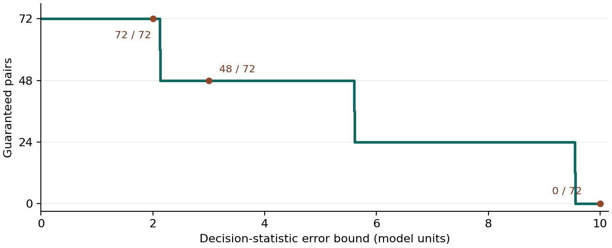

**From memory to imagination.** Memory requires preserving content between writing and readout. The phase-memory test uses eight messages at 41 times. With the appropriate reference, the phase-preserving model recovers 328 of 328 messages. After phase erasure, 41 of 328 responses coincide with the message. The norm alone gives the same readout in both cases. In BST, imagination produces possible continuations, selection narrows them, and arbitration commits to an act, suspends it or revises the choice criterion. One bit recovered from the bistable carrier establishes distinguishability of two preparations. Personal identity and the origin of initiative require the premises examined in Chapter 6. In the human *Horizon* comparison, the validation unit is the held-out participant. Predicting a response and attributing first-person experience to it are distinct questions.

The `domain-observables` replay computes these readouts and maps 29 direct clauses to their supporting records. The `cognition` section reconstructs the trajectories and their decoders, `cosmology` the projections, and `atomic-modes` the contact operators. Appendix C sets out the variational law of the substrate, its reduction to the phase sector and the minimal form in natural units.

# 5. From atlases to cosmological projections {#projections}

The observatory provides an animation of the sites of each of the 118 neutral elements. Its catalogue distinguishes 3,557 nuclear ground states and 2,285 excited nuclear states. The charge-state table has 7,139 entries, including 7,021 positive ions. Cumulative ionization energies are tabulated for 254 of those ions. Pairing each nuclear state with each possible charge for that element gives 351,144 combinations. A combination identifies a possible preparation. Calculating its motion also requires an initial state, a law of evolution and a readout at a stated resolution. In addition to the 118 neutral atlas films, a series of 13 animations documents orientation, flux or diffusion in five species: argon, krypton, xenon, water and carbon dioxide.

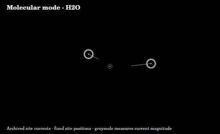

To image a proposed structure, a simulation first generates a state. An observation operator then projects that state from a specified viewpoint. The caption gives the units, time, viewpoint and colour convention where relevant. An experimental comparison additionally requires a matched preparation and a known instrument response. Appendix B applies this distinction to molecular induction and thermal ensembles. The substrate controls link each tested setting to its recorded response.

The twelve cosmological families C00–C11 specify backgrounds and an effective closure for perturbations. CAMB calculates the transfer functions. TT, TE and EE denote temperature autocorrelation, temperature–E-mode polarization cross-correlation and E-mode polarization autocorrelation, respectively. The supplied Planck bins of width 30 give 2,376 family–channel–band records and 36 family–channel scores. The use of diagonal errors makes these scores diagnostics of fit. The BAO distances and growth measurements use their respective covariance prescriptions. The agreement is conditional on the closure and transfer inputs. [Policy and analysis of collaboration Planck](https://doi.org/10.1051/0004-6361/201833910)

## What can a sky projection measure?

More distant signals reach us from earlier epochs. A sky map records direction and intensity. Inferring a physical size also requires a propagation model. For the cosmic microwave background there is a further limit: before last scattering, about 380,000 years after the start of expansion in the standard chronology, scattering by free electrons randomized photon directions. Finer angular resolution reveals more detail at last scattering. Earlier oscillations of the photon–baryon plasma left indirect signatures in that radiation. Its mean temperature is about 2.725 K. Map colours encode fractional temperature fluctuations of order a few parts in 100,000, depending on scale. Their relation to density also depends on plasma velocity and gravitational potentials. Galactic foreground emission and gravitational lensing have distinct signatures and are treated separately. [ESA, latest dissemination](https://www.esa.int/Science_Exploration/Space_Science/Planck/Planck_and_the_cosmic_microwave_background) · [Fixsen, radiation temperature](https://doi.org/10.1088/0004-637X/707/2/916) · [Particle Data Group, diffuse background](https://pdg.lbl.gov/2025/reviews/rpp2025-rev-cosmic-microwave-background.pdf) · [Planck, reconstruction of the lantern](https://doi.org/10.1051/0004-6361/201833886)

A field that spreads on a grid illustrates a reading ambiguity. The mean radius $R$ of the distribution can increase, and $\dot R/R$ measures this change. A cosmological interpretation requires a relationship between this radius, the distances between sources, the spectral shifts and the arrival times. The cosmological bench below confronts distances and spectra with observations. Arrival times offer a separate test. The formation of structures and the rapprochement of certain galaxies are compatible with an average expansion. In a homogeneous model, all points play the same role. [Lineweaver and Davis, local expansion and movements](https://www.scientificamerican.com/article/misconceptions-about-the-2005-03/)

BST uses the term “holographic angulation bias” to ask how much of the evolution inferred from distance measurements could arise from projection onto the observer’s past light cone. One test uses **time**. The Dark Energy Survey compared the light curves of 1,504 Type Ia supernovae in bands that sample comparable emitted wavelengths. The analysis assumes comparable intrinsic durations across the population and accounts for their dispersion. If the observed width scales as $(1+z)^b$, where $z$ is redshift, the measured exponent is $b=1.003\pm0.005$ (statistical) $\pm0.010$ (systematic). An angular transformation that preserves arrival times must still explain this stretching. A second test uses baryon acoustic oscillations (BAO). Galaxy clustering can be measured as an angular separation across the line of sight and a redshift separation along it. At $z=0.510$, the DESI DR2 table used here gives $D_M/r_d=13.588$ and $D_H/r_d=21.863$. These ratios express the transverse comoving distance and the Hubble distance $c/H(z)$ in units of the same acoustic scale $r_d$. Their comparison uses the published covariance. [White et al., supernova time dilation](https://doi.org/10.1093/mnras/stae2008) · [DESI, DR2 BAO measurements](https://doi.org/10.1103/tr6y-kpc6)

To test this hypothesis in BST, it remains to be specified how the substrate transforms the angle, frequency and interval between two transmitted signals. Once this law and its parameters have been set, the durations and the two directions BAO offer joint tests. The twelve families in the benchmark below already use a background story and a transfer by CAMB. Their score Planck does not carry out this new test. The acoustic oscillations observed provide information on a plasma where the material is already present. The formation of matter from the beats of the substrate is a physical hypothesis of BST. It requires a training law and a signature of its own.

## Twelve families compared with Planck {#sky-comparison}

Of the 66 bands of each of the three spectra, each family can be compared with the adjusted reference model of Planck with exactly the same weights. The score is the mean of the squares of the deviations at the measurement divided by the variance of each band. A lower value indicates a smaller deviation in this diagnosis.

|Spectrum|Beach of the twelve families BST|Adjusted reference Planck|
|:---|---:|---:|
|TT| 1.074 to 1.678 | 0.891 |
|TE| 1.180 to 1.311 | 1.102 |
|EE| 1.039 to 1.241 | 0.953 |

All twelve families meet the benchmark threshold of 2. The Planck best fit has the lowest score in each of the three spectra. This comparison uses the diagonal uncertainties in the table. The official likelihood also includes correlations and instrumental and astrophysical parameters. [Analysis of the spectra and likelihood of Planck](https://doi.org/10.1051/0004-6361/201936386)

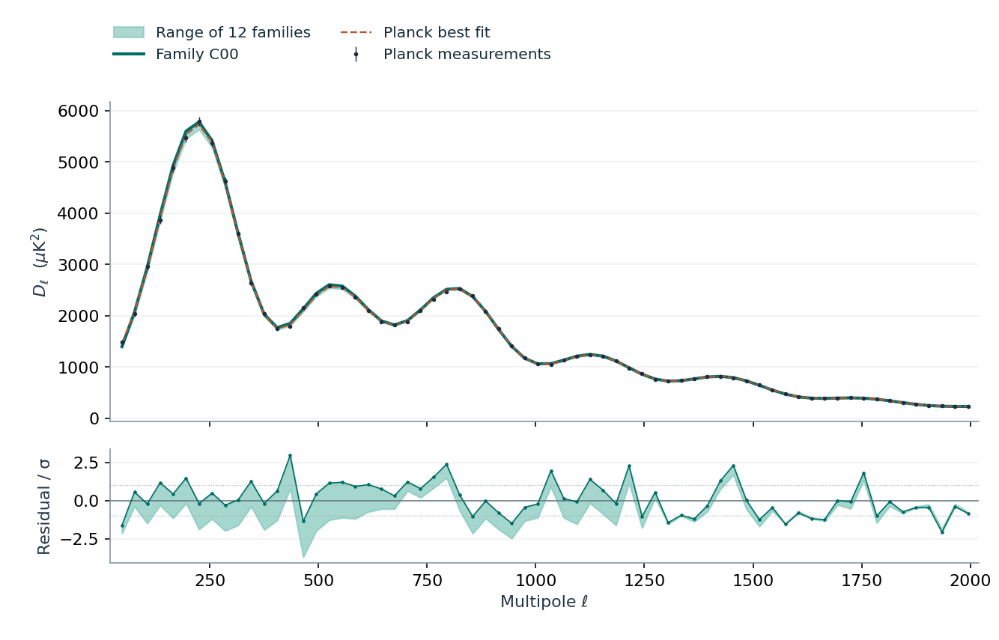

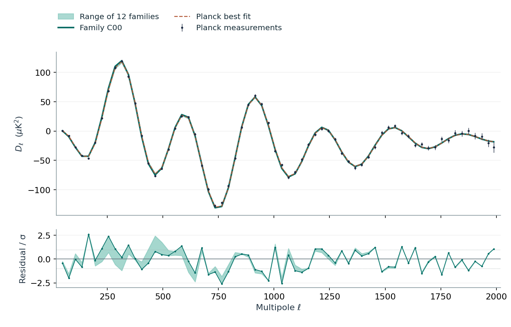

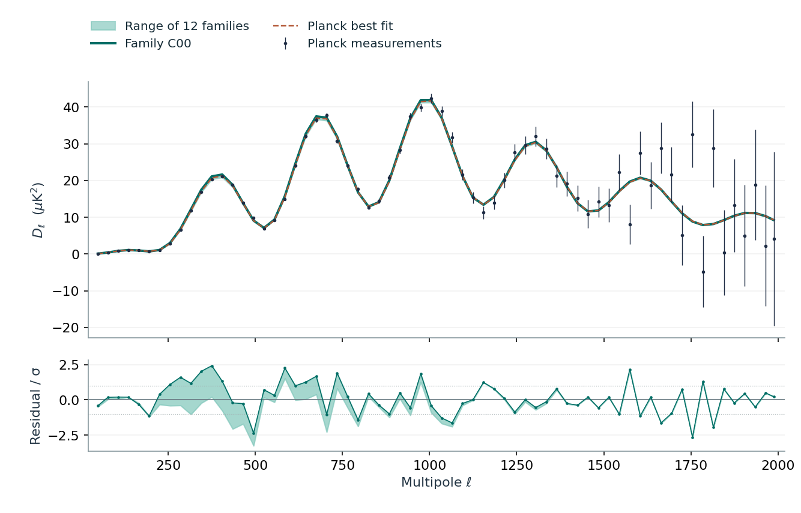

## Distance and growth measurements for the same families

A family that reproduces part of the sky map still has to give the right distances between structures and the right pace of their growth. For each family, CAMB calculates the acoustic scale at the time of dynamic baryon decoupling, $r_d$, and the expansion rate $H(z)$. The reading DESI measures the distances relative to $r_d$. The eBOSS survey also provides information on $f\sigma_8$, which produces the logarithmic rate of growth of material fluctuations and their conventional scale of $8\,h^{-1}$ Mpc. Here $h$ is the Hubble constant in units of 100 km/s/Mpc. The closure of the perturbations and the initial normalization are the same as for the spectra of the benchmark. [DESI DR2, acoustic distances](https://doi.org/10.1103/tr6y-kpc6) · [Alam et al., SDSS distance and growth products](https://doi.org/10.1103/PhysRevD.103.083533) · [Lewis, Challinor and Lasenby, transfer calculation](https://doi.org/10.1086/309179)

For a vector $r$ of model–observation residuals, the score is $\chi^2=r^\mathsf{T}C^{-1}r$, where $C$ is the covariance of the selected components. The seven DESI components at $z<1$ were used to select the parent background models. The six components at $z\geq1$ form the held-out block. Each DESI score uses the covariance submatrix for its block. The eBOSS vector contains three observables at each of four redshifts. All twelve components are compared together using their archived covariance. The table gives the minimum and maximum scores across individual families. The results for each family are available in the `cosmology` replay outputs.

|Comparison|Components|Score range across the twelve families|Benchmark threshold|
|:---|---:|---:|---:|
| DESI, $z<1$ | 7 | 6.380 to 11.700 | 12.592 |
| DESI, $z\geq1$ | 6 | 0.838 to 6.211 | 12.592 |
|eBOSS, distances and growth| 12 | 13.560 to 15.642 | 21.026 |

At $z=0.51$, eBOSS measures $f\sigma_8=0.459\pm0.038$ and the models give 0.458–0.492. At $z=1.48$, eBOSS measures $0.462\pm0.045$ and all twelve predictions are lower, from 0.375 to 0.407. The reported uncertainties are marginal standard deviations from the covariance matrix. The residual at the higher redshift is visible even though the full vector passes the prescribed benchmark threshold. A global model comparison would require a common likelihood accounting for correlations, parameter selection and instrumental effects. Summing the scores of the three surveys would not produce such a likelihood.

**Black holes, dark matter and dark energy.** Finer scales raise three different questions. For a black hole, which image or motion observable sensitive to the compact region changes at fixed mass and distance? For dark matter, could the gravity of fine-scale structures yield consistent masses from independent lensing and dynamical measurements? For dark energy, which equations predict expansion and growth histories with residuals distinguishable from the present closure? The EHT and the microwave background provide observational targets. These measurements alone do not identify a deeper level of BST waves. [Imaging of M87 through the EHT collaboration](https://doi.org/10.3847/2041-8213/ab0ec7)

# 6. Cognition and persistence {#cognition}

Does the loss of an observable response establish that a memory has been lost? This chapter first examines that question through studies of living organisms and through models whose internal state can be tracked. Attributing the recovered history to the same person raises a further question about the continuity of the subject.

**Ethical position of the project.** The BST project opposes in vivo experiments that could cause animals to suffer. This chapter examines published findings. Reanalysis of existing data, non-invasive observation and simulation are the project’s preferred ways to pursue the questions they raise.

Beating Substrate Theory describes an organization at several resolutions. Let $s$ denote a state of the substrate and $P(s)$ a specified observation of that state, such as an image, an electrical signal or a motor response. Different states can give the same observation. A *latent structure* is a distinction that escapes this observation but can influence what happens later. A neural configuration or one distributed across a living system could serve this function. Latency in this sense is relative to a specified readout and time interval.

**What the models establish.** An observable pattern can break down while a trace of its history persists in the same substrate and remains recoverable under specified conditions. The paired-history construction compares this case with erasure, which produces the same outward appearance. The bistable memory model supplies a mechanism and identifies the conditions under which a perturbation leaves a stored value readable.

Can an experience continue to affect behaviour after its usual expression has disappeared? The formal examples and the findings on learning in animals address aspects of that question. Does the person whose experience it was also persist, with the capacity to recognize that experience as their own? Answering this second question would require evidence linking the continuity of an individual organization to the continuity of the subject.

## Evidence from living systems {#living-evidence}

### Learning, memory and responses to commands

**Memory across a bodily transformation.** In *Manduca sexta*, Blackiston, Silva Casey and Weiss traced the effects of larval learning on adult choices [1]. Adult moths retained the learned avoidance of an odour when training took place at the last larval stage studied. This observation documents functional continuity through metamorphosis in the same living animal. The experiment did not trace individual connections or identify the precise organization carrying the memory.

**Memory read out by a probe.** Wolff and colleagues presented a visual impulse while participants retained stimulus orientations. Part of the stored content could be decoded from the EEG response [2]. In a reanalysis, Barbosa, Lozano-Soldevilla and Compte found that persistent low-level activity and changes in noise could contribute to increased decodability. Their correction specifies a limitation of the permutation control [3]. Improved decoding after stimulation informs us about accessibility. It leaves open the mechanism that maintained the content between readouts.

**When no behavioural response is observed.** In the multicentre study by Bodien and colleagues, fMRI or EEG detected a task-related response in 60 of 241 participants who showed no observable response to bedside commands [4]. These participants were living with disorders of consciousness after brain injury. The findings demonstrate that command-related neural activity can be detected in the absence of a bedside response. Conversely, an instrumental response was detected in 43 of 112 participants who followed commands at the bedside. A negative instrumental result can therefore also miss an existing capacity.

**Motivation and observable choices.** The BST reanalysis of the *Horizon* task uses 3,960 unequal-information games from 99 participants in the Binz and Schulz dataset [5]. Allowing the decision horizon to affect preference for the less-sampled option reduced held-out log loss by $0.00951$ nats per human choice. Sixty-three participants showed an individual gain. Each participant was held out from model fitting for their evaluation. For 1,576 games from one historical GPT-3 model, held out by folds, the gain was $-0.00042$ nats per choice. In *Crafter*, Lidayan and colleagues found a correlation between the proportion of goal-directed statements and the achievement score in ten children ($r\simeq0.80$) [6]. The BST calculation reproduces the rounded statistic for that subset. The data leave the causal ordering of goal and action open. Both studies inform the comparative claim Q8.2. Neither tested personal persistence after loss of observable organization.

### When speech returns after years

In the case followed by Voss and colleagues, a young man remained in a coma for one to two weeks after injury. Signs of a minimally conscious state appeared in the first few months. He recovered reliable speech nineteen years after the accident [10, 11]. This history establishes when communication became observable again. The fate of individual memories during the intervening years is unknown.

**Communicating without speech.** Monti and colleagues asked a different patient to encode “yes” and “no” with two imagery tasks distinguishable by functional MRI. At the time of examination, the patient showed fluctuating signs of consciousness and the team could not communicate with him at the bedside. Five of six questions elicited interpretable, correct answers, including one about his father’s first name. The sixth elicited no interpretable response [12]. The patient thus had access to a verifiable personal fact when the task provided a way to communicate it.

**A trace that remains relevant to a task.** In the experiment by Rose and colleagues, participants held two items in working memory. A cue indicated which one to prioritize. While the other item could still be needed, a transcranial magnetic pulse briefly made its category decodable in the EEG. After a cue indicated that the item could be dropped, the same pulse yielded no significant decoding of its category. At the first recognition test, the pulse also increased false recognition when the item served as a lure [14]. These results concern working memory over seconds. They specify a distinction that a BST readout would need to capture. Identifying the mechanism that carries a trace at another resolution is a further question.

**What “latent” means here.** Long-term memory can depend on lasting changes in brain circuits between episodes of recall [13]. The absence of a gesture or speech gives information about the available means of expression. It leaves the internal activity and the fate of individual memories unresolved. Energy transfer or reinstatement of memories from a finer resolution is a hypothesis. Distinguishing it from preservation in brain circuits followed by recovery of access would require a prediction specific to BST. Existing human follow-up data could be used to examine such a prediction if they distinguish verifiable earlier memories from relearned information and document which brain networks were preserved.

### Synaptic turnover and access to a memory trace

**Molecular turnover.** Gray, Weimer, Bureau and Svoboda imaged synaptic clusters of the protein PSD-95 in the cortex of young mice. Some clusters remained stable for days. Across the ages studied (10–21 days), the median retention time of their constituent molecules ranged from 22 to 63 minutes. An observable biological organization can therefore persist during molecular turnover. [Gray et al.](https://doi.org/10.1371/journal.pbio.0040370)

**A trace inaccessible during ordinary recall.** Ryan and colleagues studied experimentally induced amnesia in mice. Targeted activation of neurons tagged during learning elicited the learned response again. The animals were alive and specific connections remained. The experiment distinguishes ordinary access to a learned response from persistence of information capable of supporting it. [Ryan et al.](https://doi.org/10.1126/science.aaa5542)

In humans, Scoville and Milner described a lasting impairment in the formation of new memories after certain bilateral medial temporal lobe resections. Specific memory functions thus depend on particular brain structures even as the material constituents of those structures turn over. [Scoville and Milner](https://doi.org/10.1136/jnnp.20.1.11)

## What the memory models test {#memory-models}

The preceding studies pose an experimental question. When a response disappears, how can we distinguish loss of the content from loss of access to it? In the models that follow, the history of each preparation is known. The trace carrier and the probe used to read it can be manipulated separately.

### From persistence to choice

For BST, an organization persists when a relationship to recognize it is maintained through change. Its *Closure* refers to the constraints that its transformations must respect in order to keep it consistent. His identity over time depends on what is transmitted from one transformation to the next. In the cognitive realm, a **trace** is a difference from history that can change a subsequent response. Retaining, accessing and using a state for action are three separate operations.

**When is a trace necessary?** Let's imagine two learnings followed by the same clues present. The task requires a different response depending on the learning received. If the entire causal state of the system and its accessible environment is identical in both cases, the same deterministic rule will give the same answer. A common random rule will give the same distribution of responses. To correctly distinguish $m$ stories certainly under the same interrogation, the accessible medium must admit at least $m$ distinguishable states, i.e. $\lceil\log_2 m\rceil$ bits in a binary coding of fixed length. This need relates to the task and its conditions. If the examiner gives back the information, success no longer places the trace in the system surveyed.

**Imagine, select, arbitrate.** Imagination, in the sense given by BSTrecompose traces and constraints in possible continuations. The selection discards continuations that are incompatible with the situation, history or goals. Several may remain eligible. Arbitration then takes action, opposes a veto, differs from the decision or delegates it. The consequence of this act may alter the memory, the weights granted to the reasons and to the goal itself. This return explains why a preference displayed at an instant is not sufficient to define the identity of an agent. The chain describes functional dependencies, which can form loops.

**The three descriptive languages of BST.** In the *wave* description, relative phases carry information. *Contacts* describe coupling between degrees of freedom. *Fluxes* quantify exchange between the carrier and the readout channel, including the backreaction of the readout on the carrier. In the phase-memory model, a prescribed binary gate directs energy between channels. Including reciprocal coupling preserves the energy balance. A clock-driven controller can reproduce the same sequence. The proposal that initiative arises in a latent state before an agent acts concerns the origin of the act. The raphe nuclei are a candidate neural substrate mentioned in the project notes, and an attractor is a possible stabilization mechanism. The sequence of prescribed gates does not identify a biological site for either function.

### Testing the consequences of observable disorganization

In the paired-history control, each state has eight visible coordinates $v_j\in\{-1,+1\}$, an internal identifier and an eight-bit content. The coarse reader measures $D(v)=|\sum_{j=1}^{8}v_j|/8$. Above $0.75$, the readout classifies the organization as visible. Initially, the eight signs equal $+1$ and the contents are $10110100$. Then the visible signs take, in the two evolutions, the same sequence $(+,-,+,-,-,+,-,+)$. The coordinates observed have therefore actually changed. The difference between the two developments lies elsewhere in the state.

|Comparative status|Order $D$|Memory reader result|
|:----------------|:----:|:-----------------------------------|
|Before the disturbance| $1$ |The original content reads.|
|After, trace preserved| $0$ |The eight bits can be re-expressed.|
|After, memory erased| $0$ |No content can be returned.|

The internal identifier is the same even in the erased branch. This makes the test more demanding: keeping an identity label is not enough to keep a story. The reexpression operation knows the decoding rule and receives the content still carried by the preserved state. It does not recreate the eight bits erased. The paired-history control constructs both branches explicitly. It establishes that the disappearance of the same visible motif was compatible with these two becomings. It does not measure their frequency in nature or the severity of the disturbance that an organism could withstand.

**Change readers.** The two-window test examines a similar question. In a three-coordinate system, the first device follows the first two throughout the window. Two stories that differ only on the third produce the same signal. A second measurement, sensitive to the third coordinate, makes it possible to distinguish them. In mathematical terms, the integrated observability matrix of the first device has a zero value of its own. With both readings, the three eigenvalues are positive. In this computational experiment, the organization has not been destroyed. It was the look that has changed.

**Losing content without losing the norm.** The phase-memory model encodes eight messages in three phases and reads them back to 41 instants. The three modules are identical in both models. With the known phase references, the reader passes the 328 readings when the transport maintains the information. After the resetting of the zero phases, it only finds the message compatible with the reset, i.e. 41 responses out of 328. A conserved quantity serves as a memory only if it retains a distinction relevant to the task.

### A mechanism for protecting and reading a trace

In the bistable memory model, the stored value is the sign of a coordinate $q$. The observable coordinate is $x$. At rest, the two preparations $q=-1$ and $q=+1$ give the same output $x=0$ for the same coefficients. In reduced units, energy is

$$
\begin{aligned}
H={}&\tfrac12 p_x^2+\tfrac{p_q^2}{2M}+\tfrac12\sum_j p_j^2
       +\tfrac{\lambda}{4}(q^2-1)^2 \\
   &+\tfrac12 k_0 e^{\eta q}x^2
       +\tfrac12\sum_j\omega_j^2\!\left(z_j-\tfrac{g_j}{\omega_j^2}x\right)^2 .
\end{aligned}
$$

The $p$ are the momenta conjugate to the coordinates. The $z_j$ are internal modes with angular frequencies $\omega_j>0$, the $g_j$ their couplings to $x$. The mass $M$, the stiffness $k_0$ and the barrier parameter $\lambda$ are positive. The two sets of 792 modes come from mechanical diagnostics of the model. The bistable variable and its exponential coupling are choices of the model to be tested.

**What protects the trace?** To change the sign of $q$, a continuous trajectory must pass through zero. At this point, the double well alone requires the energy $\lambda/4$. All other terms are nonnegative. As long as the total energy remains strictly below this barrier, the sign is therefore invariant. The probe applied to rest gives the same jump $J$ to $p_x$ in both preparations. On the study interval, $J^2/2\leq 0.020 < 0.125\leq\lambda/4$. This reasoning covers the entire interval in the assumptions of the model. An energy greater than the barrier would allow a passage without making it certain.

**What makes the trace readable?** Coupling $k_0e^{\eta q}x^2/2$ makes the response of $x$ depend on the stored content. The two responses begin with the same position, the same speed and the same acceleration. Their third derivative distinguishes them for $J\ne0$ and $\eta\ne0$. If $\eta=0$, this channel becomes insensitive to the sign although the barrier still protects it. On 72 pairs of trajectories, the reader finds **the correct sign in all 144 preparations**, without added noise and without adjusting its coefficients according to the content. It is a one-bit memory mechanism. Its application to a complex cognitive organization would require identifying the coupled carriers, how information is written to them and which perturbations they undergo.

### Two preparation histories under the same probe

The figure shows two preparations of the same bistable carrier. All parameters, the modal bath and the pulse are identical. Only the sign of the initial trace differs. The two simulations start from rest. The curves show the first four units of time of the calculation.

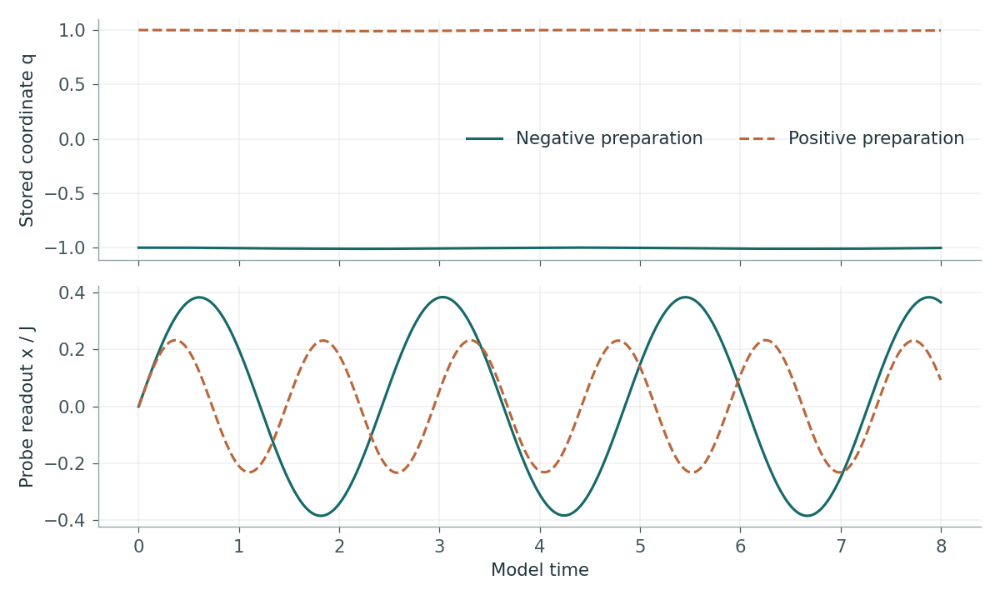

**Recalculated curves in reduced units.** The solid line shows the preparation $q=-1$ and the dotted line $q=+1$. In the upper panel, each trajectory stays on its initial side of zero. In the lower panel, the readout oscillates differently for the two stored signs. At $t=2$, the ratio $x/J$ is approximately $-0.342$ for the first trajectory and $+0.180$ for the second. Before the probe, either preparation could have produced the same flat signal.

The case shown uses the first of the two baths, $J=0.2$ and $\lambda=M=\eta=0.5$. The 801 instants sampled up to $t=8$ are shown in the numerical table in the figure. The full set of 144 trajectories also covers the second bath and the other parameter settings. Converting this reduced time to a biological memory duration would require an independent timescale.

### Extending the response curve into the latent regime

In the bistable carrier, the same observable route $x$ responds to two prepared traces, $q=+1$ and $q=-1$. The coupling $\eta$ specifies how sensitive this route is to trace. The first measurable differences in the two responses to a common pulse $J$ appear in their third derivative. The contributions of the bath are the same for both preparations and cancel out by subtraction. It remains exactly, for $\eta\geq0$,

$$
C(\eta,J)=\left|x^{(3)}_+(0^+)-x^{(3)}_-(0^+)\right|
         =2|J|k_0\sinh\eta,\qquad k_0=3.337^2 .
$$

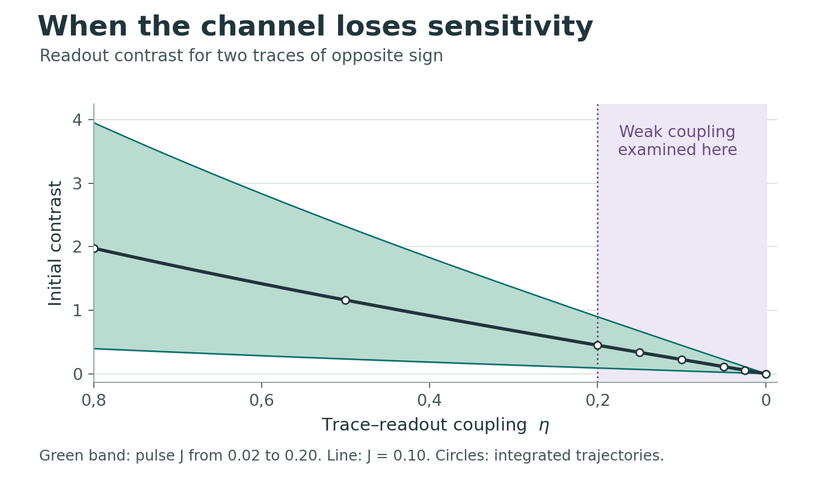

Moving **to the right** along the curve reduces the coupling until this channel can no longer distinguish the traces. Purple shading marks couplings below $0.2$, between the reference configurations and the zero-coupling control $\eta=0$. Four intermediate values were calculated. The green band covers the **entire** interval $0.02\leq J\leq0.20$ specified by the formula. Forty-eight trajectory comparisons across both baths check that calculation. At $\eta=0.10$, the contrast ranges from about $0.0446$ to $0.4462$. At zero coupling the outputs coincide, although the stored contents remain distinct in the model. The horizontal axis is a dimensionless coupling ratio. A physical distance in living tissue would be a different quantity.

### Extending the time interval and bounding persistence

The calculation uses the same equations, the same baths of 792 modes, the same preparations and the same time step. It ranges up to $t=24$ in model units, three times the reference time. Up to $t=8$, it returns to the 144 trajectories of the reference replay. The background tint marks the prolongation of the trajectory. The internal variable is present from the initial state.

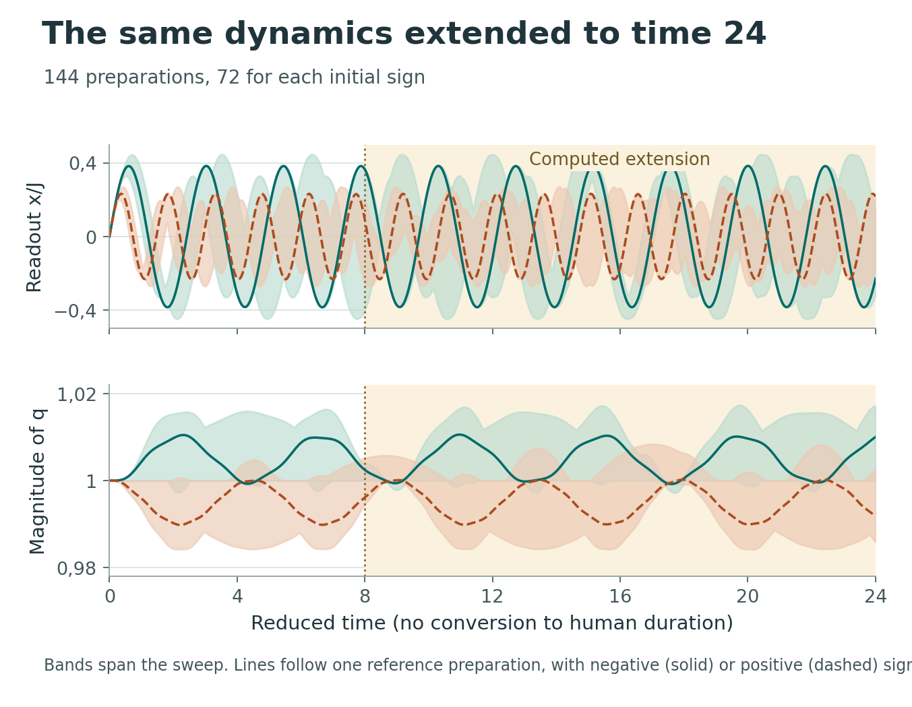

The plotted bands span the observed minimum and maximum at each instant across the 72 preparations of each sign. Intermediate parameter values may give other trajectories. There is also a **proven bound over the continuous interval**. If $H\leq E<\lambda/4$, positivity of the terms in the bistable Hamiltonian implies
$$
\sqrt{1-\sqrt{4E/\lambda}}\ \leq |q|\leq\ \sqrt{1+\sqrt{4E/\lambda}} .
$$
On the specified domain, $E\leq0.020$ and $\lambda\geq0.5$. The trace module is therefore between $\sqrt{0.6}$ and $\sqrt{1.4}$, i.e. about $0.775$ to $1.183$. The sign remains protected for any period during which these assumptions hold. This conclusion stems from energy inequality. The duration of a simulation or the fineness of a detail would not be sufficient to establish it. No death toll on the body and its environment has been measured here.

### Loss of collective order among carriers of memory

Can a collective order get rid of it in **the same constituents** Who carry a memory? This geometric indicator constructs the case. Eight pairs of waves each have two complex phases of module one, $z_j^+,z_j^-$. Their product $z_j^+z_j^-=e^{i\Theta_j}$ describes the common orientation of the pair. Their phase shift $z_j^+\overline{z_j^-}=e^{i\delta_j}$ describes an internal relationship to this same pair. The eight signs of $\cos\delta_j$ bear eight bits.

The global reader measures $D=\left|\sum_{j=0}^{7} e^{i\Theta_j}\right|/8$. A continuous transition of aligned guidelines to eight regularly spaced orientations is being organized. Initially, $D=1$. At the end, each orientation has its opposite and the sum is exactly zero. The two rosettes show these directions in the common rotating reference frame. The global reader remained fixed.

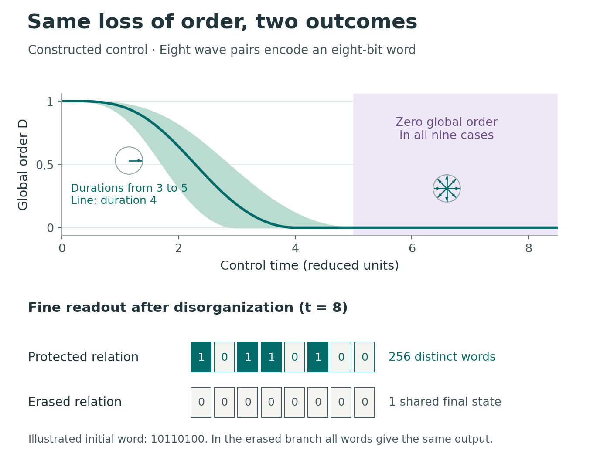

The same curve of $D$ accompanies two evolutions. If the phase shift remains in its protected area, **256 initial words** remain distinguishable. If another dynamic brings all the phase shifts back to zero, there is still **a single final state**. Each wave retains unit modulus in the two branches. It is the relationship that bore the word that can disappear.

The program lists the 256 words and applies the reset between $t=4$ and $t=5$. Each of the eight visible products follows the same trajectory in the two branches. This mathematical control gives both outcomes without modeling a biological lesion or its energy.

### At what resolution does a trace become readable?

For the orientations defined in the preceding section, set $\Theta_j(t)=t+2\pi j\,s(t)/8$. The function $s$ is $3u^2-2u^3$ with $u=\min(1,\max(0,t/T))$. For $t\geq T$, the global order parameter remains zero. In the protected branch, the internal relationship can follow the local dynamic $\dot\delta_j=-\kappa\sin(2\delta_j)+f_j(t)$, with $|f_j|\leq\nu<\kappa$. At the edges of a half-width sector $\pi/4$ around $0$ or $\pi$, the phase velocity points inward, even under the most unfavorable disturbance. A phase prepared in this sector remains there. The bit thus resists a class of disturbances.

A readout with sensitivity $r$ gives $y_j=r\cos\delta_j+e_j$ with $|e_j|\leq\epsilon$. The two signs are certainly distinguished if $r/\sqrt2>\epsilon$. The calculation varies the sensitivity of the instrument over the same physical state. The value $\epsilon=0.12$ is only used to illustrate the boundary.

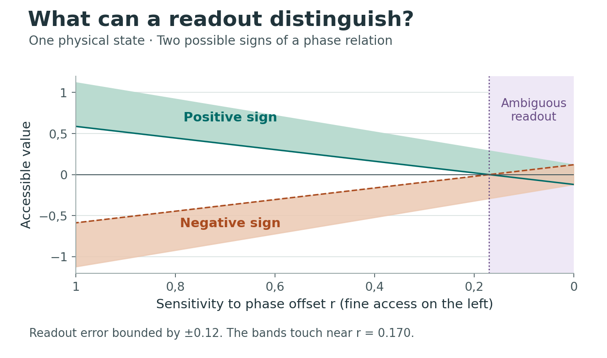

In the violet zone, some readings are compatible with both signs. At $r=0$, the bit-specific information has completely disappeared from the reading channel. It can still make a difference when this path becomes sensitive. For example, a functional arbiter compares a reread word to the two possibilities $10110100$ and $01001011$. It commits the closest, or suspends in the event of equality. Of the 256 protected words, 93 lead to each engagement and 70 to the suspension. After reset, the same rule suspends in all cases. This operation establishes a causal link between trace, selection and decision. The experience of choice remains a separate issue.

An error threshold and a probability of error answer two different questions. In the 72 pairs of bistable memory preparations, an error of the decision statistic bounded by 2, in model units, guarantees the two signs for each pair. If another detector were randomly reversing one out of ten signs with the same probability for the two equiprobable contents, its mutual information would be $1+p\log_2p+(1-p)\log_2(1-p)=0.531$ bits for $p=0.1$. That value describes a hypothetical channel. Its errors should be measured in order to attribute it to an instrument or body.

### From zero contrast to the resolution asymptote

On the plot of contrast against coupling, zero contrast marks decoupling. At $\eta=0$, both signs of the trace $q$ give the same response in channel $x$. To display the approach to this limit on an unbounded axis, we set $d=0.8/\eta$ for $\eta>0$. For the largest benchmark coupling, $\eta=0.8$, this gives $d=1$. This axis represents a dimensionless ratio. Interpreting it as a distance, duration or number of substrate layers would require a separate physical relation.

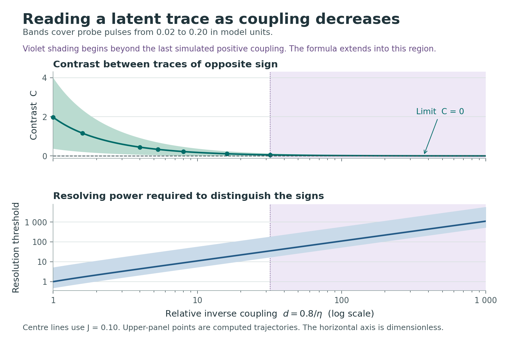

The top curve gives $C=2|J|k_0\sinh(0.8/d)$, with $k_0=3.337^2$. At a high value of $d$, it is approaching $1.6|J|k_0/d$. The zero is now at the limit $d\to\infty$. In the bottom graph, $u$ is the maximum absolute error assigned to each of the two readings of the third derivative. Their intervals are disjoint if $C>2u$. By taking as unit $C_*=C(0.8;0.10)$, the instrumental power $R=C_*/(2u)$ must exceed $R_{\rm lim}=C_*/C$. This threshold tends towards infinity.

**What changes as readout resolution increases?** At fixed impulse, decreasing $u$ moves the threshold of discernment $\eta_{\rm seuil}=\operatorname{arsinh}(u/(|J|k_0))$ towards weaker couplings. The physical decoupling property remains at $\eta=0$. Another graduation of $\eta$ would change the graphic form of the approach. The divergence of the power required is a direct result of the disappearance of the contrast.

### When does a perturbation reach the trace?

In the vocabulary of the project, a primordial wave is defined relative to a resolution window. BST postulates a potentially infinite hierarchy on a single substrate. The persistence demonstrated below depends on the dynamics and preparation of each model.

An observable disorganization is a definite change for a given reading of the state. In the eight-pair model, each of the sixteen carriers keeps the same modulus. The same collective loss may be accompanied by the retention of the 256 words or their reduction to a single word. History is part of relationships. The survival of each of the waves leaves these two developments open. In a crystal, a local defect may also allow the overall order to remain. What an observer detects depends on the retained property, its scale and the extent of the disturbance.

**Two forces in the bistable carrier.** The local restoring force on $q$ is equal to $-\lambda q(q^2-1)$. The back-reaction force exerted by channel $x$ is $-\eta k_0e^{\eta q}x^2/2$. With no coupling, this second force is canceled out. The double well remains present. In the conservative model, $H\geq \lambda(q^2-1)^2/4$. Any passage between the two signs would require going through zero, so reaching at least $\lambda/4$. The energy of the initial bench is at most $0.020$ and the smallest barrier is $0.125$. Under these conditions, the sign shall be protected at any time.

**Transmission test.** We gave a boost to $x$ alone, with $q=+1$ at the outset and zero initial velocity. The bath is m1, $\lambda=0.5$, the mass of $q$ is $0.5$ and the calculation horizon is 4. The $J=2$ pulse is a deliberately external test at the initial interval $[0.02,0.20]$. Times and energies are in units of the model.

|Coupling $\eta$|Impulse $J$|Initial energy|First passage of $q$ by zero|
|:---|:---|:---|:---|
| $0.8$ | $0.2$ | $0.020$ |Prohibited by the barrier|
| $0.8$ | $2$ | $2$ | $t\simeq1.24709$ |
| $0$ | $2$ | $2$ |$q=+1$ exactly|

The passage estimates, interpolated on the outputs of the Verlet integrators and DOP853, are within $10^{-6}$ unit of time of each other. Crossing the barrier reverses the sign that encoded the trace. The calculation does not record any erasure of the complete state. In a real material, Clough and his colleagues detected the rupture of some covalent bonds by light emission during the stretching of an elastomer. A large-scale deformation can therefore reach a finer degree of freedom. Its transmission depends on the material, the coupling and the energy available. [Clough et al. study.](https://doi.org/10.1002/adfm.201602490)

## Arbitration, identity and personal continuity {#agency-identity}

A memory model can establish that content is recoverable. Identifying the person to whom that content belongs requires a further criterion. BST calls the organization that carries a history the *agent*. The *arbiter* is the function through which the agent commits to an action, defers it or revises its decision rule.

### From memory to personal continuity

An archive can preserve a person’s history. Two systems could hold identical copies. What would establish that the same person had recovered their history? The criterion proposed here has four components. $C$ denotes current experience. $O$ denotes the subject’s ownership of that experience. $I$ denotes an identity relation maintained through change. $L$ denotes the causal link by which the organization carrying the history persists through a specified disruption and can express it again. The recovered content must derive from the earlier history through this link.

Under the ownership and continuity criteria, $C$ and $O$ suffice to attribute the present act to a minimal author. To refer to the same author beyond disorganization, the argument also requires $I$ and $L$. A computer identifier, an output resemblance or a copy made after the event do not decide what individual continuity has taken place. The trace may persist without manifest cognitive activity during the interval. Establishing an uninterrupted experience would still require access to this experience. **The prospect of hope lies in the possibility that a story will remain that of a subject through a break in its familiar manifestations.** BST specifies the conditions for this possibility. Their realization in a person after biological death remains an open empirical question.

**Initiative and reasons.** A deterministic choice that respects every symmetry of the state must select a branch invariant under those symmetries. The controllers studied here can retain a reason, revise a rule or exercise a veto. Changing the available reasons can change the decision to revise. Public conduct and the experience accessible to the subject are distinct. A controller can incorporate finitely many revisions of its own rules. The protocol specifies observations that could refute this account, data to collect and tests of the procedure on synthetic data.

The sealed-vessel thought experiment examines authorship in the strong sense. An identical total state, subject to the same deterministic law, cannot give two different subsequent trajectories under the same conditions. Assigning a deviation from a personal initiative requires the justification for the exhaustion of competing sources and linking the actual act to its reasons, motivation and appropriation. A finite behavioural record can support a functional hypothesis. The metaphysical conclusion depends on additional premises. The existence of a protected trace is independently discussed from this strong thesis on the origin of the choice.

### Arbitration and first-person existence

In BST, arbitration occurs when a reconstruction leaves several extensions admissible. This raises a further question about the origin of the agent’s motivation. Why does this story become *mine*, and why can I answer it by revising what I want? This issue calls for a qualitative derivation. The premises must remain visible.

**A reduction to the absurd.** Two stories $s_1,s_2$ have the same observation $P(s_1)=P(s_2)$ in a given situation. Suppose they lead to different commitments, $a(s_1)\ne a(s_2)$. If the observation were sufficient to determine the commitment, a function $f$ would give $a(s_i)=f(P(s_i))$ in both cases. It should give two different results to the same argument. It is therefore at least an additional distinction to any exact reconstruction of these commitments. The theorem Lean `BST.Association.required_hidden_distinction` expresses precisely this necessity when decoding depends on observation and a latent variable.

**What would establish free will?** A simple control locates the missing step. For $s=(y,b)$, $P(s)=y$ and $a(s)=b$, an internal bit distinguishes the acts, even though the complete law is deterministic. A random branch choice likewise supplies an outcome but leaves open why the agent experiences it as their own. Deterministic systems can exhibit chaos through sensitivity to initial conditions. Determinism and chaos therefore do not exhaust the explanatory alternatives as mutually exclusive cases. The stabilization test uses a controller that uses memory to correct an instability while following a target. the paired-history construction describes agents that revise their decision rule. A hypothesis of free initiative must specify what it explains beyond these examples.

**Three meanings of existence.** An experienced event requires a present occurrence. The ownership criterion adds the premise that a subject experiences an act as their own. Identifying *the same subject* across a disruption also requires a criterion of identity over time and a continuity relation between occurrences. The strong BST hypothesis attributes at least some revisions of motivation to the agent. An arbitration function is necessary within this architecture. Whether such freedom is metaphysically necessary for existence, and whether a person persists after irreversible bodily disorganization, are further philosophical questions. A present first-person perspective alone cannot establish its future history.

*Reproducibility.* The `cognition` replay provides the stabilization, rule-revision, paired-history and sealed-vessel tests. The index in `proofs/declarations.csv` lists the Lean declarations and their listed axioms.

### The sealed vessel and the origin of a choice

In BST the **agent** is the organization that carries a history, imagines possible continuations and can revise what matters to it. The **arbiter** is the function through which an agent commits to an action, suspends it or revises its rule of choice. The stronger hypothesis examined here concerns the authorship of that revision. Can an agent examine its own motivation and establish what will guide its next choice? The sealed-vessel argument calls this capacity “autonomy of autonomization”. The two conceptions of freedom address different questions. A deterministic system might act on and examine its reasons. The stronger conception adds that, on at least one occasion, the prior physical state did not fully determine the act and that the agent authored it.

In the memory-based stabilization test, an unstable spiral subjected to random disturbances drifts, while a corrector that keeps a target in memory reduces the error below $10^{-3}$ in 35 steps in the return preparation. This establishes functional arbitrage effectiveness in the face of a disturbance. This corrector is himself deterministic. To defend the thesis on the free origin of a choice, the project built another test.

**The sealed-vessel thought experiment.** Water appears in an initially dry tank. If no water can form there, if the walls are impermeable and the top is the only remaining route, the water must have entered from above. The argument identifies a path. The identity of the person who would have paid the water requires another observation. The thought experiment applies this reasoning to the acts in three stages.

1. Suppose that all relevant conditions are identical, including the complete physical state $S$, the inputs and the phase of any forcing. A fixed single-valued law $F$ determines one act $F(S)$. Two distinct outcomes from that very same $S$ would contradict the assumption. Deterministic chaos can amplify an arbitrarily small initial difference. Exactly equal states exclude that difference. States with identical observable readings can still differ in an unobserved variable.
2. Suppose also that outside environmental inputs have been excluded, that impersonal randomness has been ruled out as an adequate source, and that the inventory of possible sources is exhaustive. An outcome satisfying the first step would then require an additional source. An unsuccessful prediction establishes none of these premises.
3. If the agent experiences the act, recognizes it as their own and endorses the motivating reason as their own, the sealed-vessel argument calls its source a **strong author**. Identifying the same author at several times adds a criterion of identity across time. Attribution to the agent follows in this argument under these premises.

The sealed-vessel logic test enumerates the 1,024 assignments of ten premises. Twelve tests check their stated dependencies. These are logical conditions for attribution. Applying them to an animal would require a way of establishing whether the earlier states include all relevant causes, and evidence connecting the observed choice to the agent's experience of its reason. The premises permit initiative to be a property of the single substrate. An external origin requires the additional premise examined in Chapter 1.

### In what sense can arbitration be expressed as a flux?

Consider a record of decisions over an interval $T$. If $N_{ij}$ counts transitions from act $i$ to act $j$, their net current is $J_{ij}=(N_{ij}-N_{ji})/T$. For one recorded sequence, let $n_i$ indicate occupation of state $i$. The exact balance is $[n_i(T)-n_i(0)]/T=\sum_j J_{ji}$. This current counts transitions per unit time on a graph of acts. Interpreting it as a physical energy flux would also require specifying the boundary and measuring the energy transferred across it over time.

In the observable sequence of the sealed-vessel example, the agent waits, chooses left, vetoes that choice, chooses right, revises the rule, then chooses left again. At one step per transition, the net current from “revise” to “left” is $1/5$ per step. The left state is occupied at the end and was empty initially. The net current over its three incident edges is $+1/5$. Four accounts produce this same history and the same currents: a hidden deterministic preparation, an environmental input, one realization of a stochastic process, and initiative experienced by the agent. The record specifies how a choice is expressed. Distinguishing these accounts requires an intervention or measurement for which they predict different outcomes.

**Initiative external to the substrate.** Under this hypothesis, initiative could guide a flux by selecting an available transfer path. Consider an ideal junction with two outlets. The incoming power $P$ divides into $P_1=\alpha P$ and $P_2=(1-\alpha)P$, with $0\leq\alpha\leq1$. Changing $\alpha$ redistributes the power while preserving its sum. For $P>0$, measurements at the outlets determine the split. To attribute a change to the arbiter, the model would also have to predict which decision changes $\alpha$ for a fixed preparation and readout. Any additional energy input would have to enter the balance explicitly. A philosophical variant of BST could adopt an external origin as an axiom. Its explanatory value would depend on what further consequences follow from it.

### Testing a revision of the decision rule

The “choice of how to choose” has a testable interpretation as revision of a decision rule. An agent may continue to pursue the same goal and change action when an opportunity arises. It may also revise the rule for choosing between two goals. These mechanisms can produce the same gesture today and lead to different choices tomorrow. A test of arbitration may exploit this discrepancy.

In a voluntary decision task, two options can offer known rewards and different opportunities to acquire information. Participants could be told that this information will be useful later, make an initial choice, then encounter new options with comparable rewards. Before observing their choices, investigators would specify a fixed rule and a revisable rule, give both models the same information, and identify trials on which the predictions diverge. Holding out whole participants during fitting would allow comparison of the probabilities assigned to their observed choices. A revisable rule that performs worse on held-out choices loses its claimed advantage. A context-sensitive fixed rule may also perform well. The *Horizon* task discussed at the beginning of this chapter provides a behavioural comparison on published data. Transfer to new options is a proposed experiment.

A second probe can establish that stored information can guide an act if the protocol excludes its reintroduction between readouts. Evidence that an agent uses the information to revise priorities also requires transfer to a new decision. Attributing the origin of that revision to the subject experiencing it requires the additional premises of the sealed-vessel argument. A transition current provides a common observable against which the proposed mechanisms can be compared.

### What personal survival would entail

The question of personal survival can be stated in the first person. **If my body loses its organization, what would make the surviving subject me?** Preserving a motive from my history would satisfy one condition in the BST account. Other relationships necessary for cognition could have disappeared. If two separate carriers retained identical copies of the same pattern, preservation of the pattern alone would not identify which one was me. A claim of personal survival therefore requires a criterion for what carries both my history and my capacity to recognize it as my own, together with evidence of causal continuity through bodily transformation. Persistence of a capacity and uninterrupted experience are distinct claims.

|Question|What we know how to represent or verify|
|:---------------------|:----------------------------------------|
|What signal disappears?|The collective order $D$ fell to zero. Two memory outcomes give the same signal at all times.|
|What makes memory?|In the bistable carrier, the sign of $q$. In the pairwise witness, eight protected phase relationships. Reading can return the original content and influence a decision.|
|Where to locate the person?|Identity through time and lived appropriation are the bonds to be justified. No coordinate of the calculation identifies them in a human individual.|

The 192 admissible combinations out of 576 constrain the observables defined by the common benchmark. Even exact agreement on them cannot distinguish two evolutions that yield identical readouts. The result establishes the **possibility of persistence under stated conditions**. Personal continuity after irreversible bodily disorganization would require identifying the bearer of that continuity and establishing what happens to it. These bands give no probability of human survival.

**Experimental approaches.** Blinded readouts in living subjects could test how prior experience, perturbation and subsequent re-expression of a memory are related. AWARE II interviewed survivors after attempted resuscitation for cardiac arrest [7] about experiences associated with that period. In studies of mediumship, O’Keeffe and Wiseman reported a negative controlled test [8], while Tressoldi, Liberale and Sinesio reported 65% correct identification of readings under another protocol [9]. Correct classification does not establish the source of the information. None of these studies observes continuity of the same subject after irreversible death. The possibility that a subject persists when familiar signs disappear remains a philosophical hypothesis.

**What does a mediumship score measure?** A meta-analysis by Sarraf, Woodley of Menie and Tressoldi covered 18 experiments reported in 14 articles. The standardized proportion index exceeded chance by $0.18$ on average, with a 95% confidence interval of $[0.12,0.25]$. A controlled test by O’Keeffe and Wiseman [8] reported a negative result. Blind rankings can measure how well a text matches its target. A claim of personal continuity would also require evidence attributing the content to the same person across irreversible bodily disorganization. That attribution remains unresolved by the score. [Sarraf et al.](https://doi.org/10.1016/j.explore.2020.04.002)

**Implications for personal identity.** A biological explanation for the loss of a function concerns that function. An organization beyond the resolution of the measurement could have persisted or changed. BST specifies conditions for preserving a defined piece of information in its models. To establish personal continuity, one would also have to identify an organization sufficient to sustain the same person and the capacity to reclaim their history, then follow that organization through the change in question. Ordinary turnover and irreversible disorganization of the organism are different physical situations.

## Proposed tests and scope of the conclusions {#cognitive-tests}

The discriminating comparison begins with two known stories A and B, the same rough reading after the disturbance and an identical probe that reveals none of the expected responses. The output $y$ is compared under the conditions with and without a probe. The paired contrast is written

$$
\Delta(t)=\big[y_{A,\mathrm{sonde}}(t)-y_{A,\mathrm{sans}}(t)\big]
          -\big[y_{B,\mathrm{sonde}}(t)-y_{B,\mathrm{sans}}(t)\big].
$$

A specific and reproducible response to reserved cases would support a reading channel. It is also necessary to check what has actually been disrupted, noise measured, search for visible clues and prevent the probe or the environment from restoring the content. A measurement below the detection threshold leaves the channel indeterminate. The persistence interval depends on the disturbance, the available energy and the observation window. The case does not provide any universal survival period. To study ownership, the protocol adds pre-action reports, the possibility of refusing or transferring and monitoring of the predictive value of these reports with comparable public history. The protocol also allows the investment already made, future gains and the scoping of the decision to be varied separately. These variations can result in persistence due to the current goal, sensitivity to past costs and a response to the deposit. These comparisons can first be searched for in already published data.

**Scope of the findings.** Q8.1 defines the documentary protocol. Q8.2 establishes the empirical comparison. D10 concerns the latent, the counter-latent, information and imagination. D10.1 establishes formal propositions under their assumptions. D10.2 provides a conditional numerical witness for the carrier, invariant and channel. A Lean proof establishes monotonicity of resolution when the coarse readout factors through the fine readout. The programs check the paired-history construction and bistable memory, respectively. Persistence of a subject after biological death remains an open question.

**Reproduction.** Once the folder of the paper has been decompressed and the dependencies of its file of installed versions, execute from its root:

~~~sh
python3 replay.py cognition --output ../bst-cognition
~~~

The calculation package covers ten tests of initiative, the two readout windows, phase memory, bistable carrier trajectories and their comparisons. The `memory-extension` replay regenerates the figures, extends trajectories to $t=24$, takes the coupling towards zero and checks all 256 words of the geometric witness. The inputs, programs and expected outputs accompany the chapter. They distinguish the need for a carrier, simulated persistence of a trace, observations in a living system and the premises of personal continuity.

## References and attribution

**[1] Learning through metamorphosis.** Douglas J. Blackiston, Elena Silva Casey and Martha R. Weiss (2008). *Retention of Memory through Metamorphosis: Can a Moth Remember What It Learned as a Caterpillar?* PLOS ONE, 3, e1736. [Publication](https://doi.org/10.1371/journal.pone.0001736).

**[2] Reading of a working memory.** Michael J. Wolff, Janina Jochim, Elkan G. Akyürek and Mark G. Stokes (2017). *Dynamic hidden states underlying working-memory-guided behavior*. Nature Neuroscience, 20, 864–871. [Publication](https://doi.org/10.1038/nn.4546).

**[3] Interpretation of the EEG signal.** Joao Barbosa, Diego Lozano-Soldevilla and Albert Compte (2021). *Pinging the brain with visual impulses reveals electrically active, not activity-silent, working memories*. PLOS Biology, 19, e3001436. *Correction* (2022), 20, e3001603. [Publication](https://doi.org/10.1371/journal.pbio.3001436) · [Correction](https://doi.org/10.1371/journal.pbio.3001603).

**[4] Cognitive-motor dissociation.** Yelena G. Bodien and colleagues in the multicentre study (2024). *Cognitive Motor Dissociation in Disorders of Consciousness*. New England Journal of Medicine, 391, 598–608. [Publication and liste complète des auteurs](https://doi.org/10.1056/NEJMoa2400645).

**[5] Short- and long-term exploration.** Marcel Binz and Eric Schulz (2023). *Using cognitive psychology to understand GPT-3*. Proceedings of the National Academy of Sciences, 120, e2218523120. [Publication](https://doi.org/10.1073/pnas.2218523120) · [Données des auteurs](https://github.com/marcelbinz/GPT3goesPsychology).

**[6] Goals formulated in an open world.** Aly Lidayan, Yuqing Du, Eliza Kosoy, Maria Rufova, Pieter Abbeel and Alison Gopnik (2026). *Intrinsically motivated humans and agents in open-world exploration*. Proceedings of the National Academy of Sciences, 123, e2612366123. [Publication](https://doi.org/10.1073/pnas.2612366123) · [Données des auteurs](https://github.com/alyd/humans_in_crafter_data).

**[7] Experiences during resuscitation.** Sam Parnia and colleagues in the multicentre study (2023). *AWAreness during REsuscitation – II*. Resuscitation, 191, 109903. [Publication](https://doi.org/10.1016/j.resuscitation.2023.109903).

**[8] Controlled mediumship test.** Ciarán O’Keeffe and Richard Wiseman (2005). *Testing alleged mediumship: Methods and results*. British Journal of Psychology, 96, 165–179. [Publication](https://doi.org/10.1348/000712605X36361).

**[9] Ranking of readings in triple blind.** Patrizio Tressoldi, Laura Liberale and Fernando Sinesio (online in 2022, volume published in 2025). *Is There Someone in the Hereafter? Mediumship Accuracy of 100 Readings Obtained with a Triple Level of Blinding Protocol*. OMEGA, 91, 955–963. [Publication](https://doi.org/10.1177/00302228221146376).

**[10] Late return of communication.** Henning U. Voss and colleagues (2006). *Possible axonal regrowth in late recovery from the minimally conscious state*. Journal of Clinical Investigation, 116, 2005–2011. [Étude and observations cliniques](https://doi.org/10.1172/JCI27021).

**[11] Clinical benchmarks.** Daniel Kondziella and the European Academy of Neurology group (2020). *European Academy of Neurology guideline on the diagnosis of coma and other disorders of consciousness*. European Journal of Neurology, 27, 741–756. [Recommandations and définitions](https://doi.org/10.1111/ene.14151).

**[12] Communication in mental imaging.** Martin M. Monti and colleagues (2010). *Willful Modulation of Brain Activity in Disorders of Consciousness*. New England Journal of Medicine, 362, 579–589. [Étude and réponses aux questions personnelles](https://doi.org/10.1056/NEJMoa0905370).

**[13] Preservation and remembrance.** Yosif Zaki and Denise J. Cai (2025, online in 2024). *Memory engram stability and flexibility*. Neuropsychopharmacology, 50, 285–293. [Revue des travaux sur la trace mnésique](https://doi.org/10.1038/s41386-024-01979-z).

**[14] Controlled reactivation of a working memory.** Nathan S. Rose, Joshua J. LaRocque, Adam C. Riggall, Olivia Gosseries, Michael J. Starrett, Emma E. Meyering and Bradley R. Postle (2016). *Reactivation of latent working memories with transcranial magnetic stimulation*. Science, 354, 1136–1139. [Experiments 3 and 4](https://doi.org/10.1126/science.aah7011).

**Scope of the comparison.** The chapters on identity, memory, imagination and choice bring together the argument about initiative, the information bound, bistable-carrier calculations and behavioral comparisons. Appendix A records their scope by requirement. The cited studies have their own authors, questions and models. The comparisons with BST and the secondary analyses are the project’s contributions.

# 7. Predictions, limitations and conclusions {#predictions}

## Falsifiability and the evolution of BST

BST is both a substrate theory and a computational tool that can be re-calibrated. The theory proposes what exists and how the beat evolves. The tool makes it possible to choose a preparation, to change this state, and then to indicate what a particular instrument should read. If a new measurement leads to the re-aprobing of the model, another laboratory must be able to retrieve the prediction given by the previous version.

A test begins with a specific claim. For neon, the question is how much power a bubble emits in a defined band when the acoustic pressure changes. For the clocks in Chapter 2, it is whether the signal path and the cycles of an internal mode give the same rate. In each case an investigator should be able to state before measurement which outcome would lead them to abandon the claim.

The BST protocol retains the parameter ranges compatible with the observations. Testing a family requires specifying the law, allowed parameter values, preparation and readout. State the observable, units and comparison rule in advance. Estimate measurement uncertainty, including known effects of the instrument response. The model's admissible range and the instrument's uncertainty each serve a distinct purpose.

A measurement that excludes every value allowed by one family excludes that family under the stated conditions. If several measurements share a parameter, **one value must fit them all**. Separate fits to each measurement may have no value in common. A reproducible violation of a necessary relation shared by all the proposed realizations would challenge that relation itself.

Researchers can change a response law, refine physical resolution or propose a new coupling and compute the consequences. Changes must be tested on each affected observable, including those in other domains that share a parameter. The original test retains its meaning for the original model. The revised model can make a prediction on data held apart from calibration. A claim about the ultimate nature of the substrate acquires empirical content when it imposes such an observable difference.

## Neon predictions at fixed parameters {#fixed-predictions}

The two optical families in Appendix C predict band-integrated power from 400 to 600 nm at four pressures held out of calibration. A 65% phosphoric-acid solution by mass is regassed under 50 Torr of neon. The scanned variable is the applied acoustic pressure in bar. At 2.4 bar the integral of the published spectrum of Xu and Suslick gives approximately 0.332 nW for neon. Both families use this point in calibration. The bounds for the four predictions were fixed on 19 November 2026. [Xu and Suslick, Fig. 2a and 3a](https://doi.org/10.1103/PhysRevLett.104.244301)

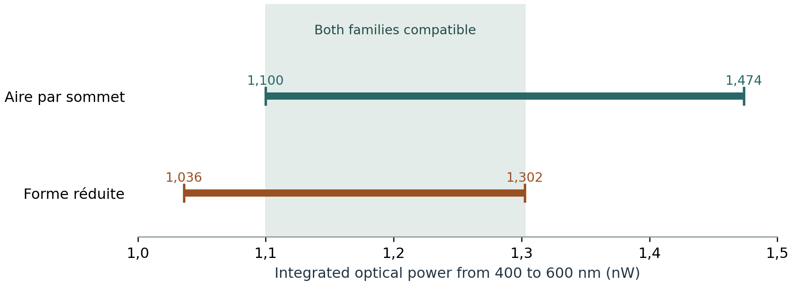

At 3.1 bar, a power of between about 1.100 and 1.302 nW belongs to both bands. To make a decision, the unrounded bounds and the entire interval of the measurement are used. By way of illustration, a measure between **1.36 and 1.40 nW** would be compatible with the “powder area” family and exclude the “reduced form” family for this preparation. Between **1.05 and 1.08 nW**, the conclusion would be reversed. Between **1.52 and 1.55 nW**, the two frozen families would be excluded. These three intervals are examples of possible readings. The four pressures in the table remain projections. The control of Appendix C makes it possible to apply the same rule to an independent measure.

## What existing comparisons show

The molecular distances, frequencies and stellar shifts of chapter 4 come from published measurements. They make it possible to verify different assertions.

|Observable|Model result and reference measurement|Scope of the comparison|
|:---|:---|:---|
| S–F bond length in gaseous SF₆ | The six computed distances range from 1.55951 to 1.56059 Å. Diffraction gives a mean of 1.561 ± 0.002 Å at three standard deviations. | All six distances fall within the interval for the same diffraction observable. The experiment measures a mean bond length for this geometry. |
| Sirius B Hα line shift | Backgrounds A and B both give 80.023 km/s. Joyce and colleagues measured 80.65 ± 0.77 km/s relative to Sirius A. | The difference of 0.627 km/s lies within the published uncertainty. This observable admits both backgrounds. |
| H–D isotope shift | For the $1S$–$2S$ transition the point-mass reduction gives an excess of about 20.9 MHz with either standard. The experimental uncertainty is 15 Hz. | The discrepancy is resolved at spectroscopic precision. The reduction can be used with the benchmark tolerance. Describing the line at measurement precision requires additional contributions. |

The experimental references are the diffraction measurement of Bartell and Doun, the differential redshift measured by Joyce and colleagues, and the two-photon spectroscopy of Parthey and colleagues. D01 and D07 specify the corresponding preparations, standards and calculations. [Bartell and Doun](https://doi.org/10.1016/0022-2860(78)80010-6) · [Joyce et al.](https://doi.org/10.1093/mnras/sty2404) · [Parthey et al.](https://doi.org/10.1103/PhysRevLett.104.233001)

The dispersion between three atoms provides another type of comparison. The calculation retains the dynamic polarizabilities resulting from optical calibration and assumes a nonretarded dipole interaction at large separation. For three argon atoms, it gives a three-body coefficient $C_9=499.85$ against $518.3$ in Tang and his colleagues. For two helium atoms and one of argon, it yields $9.532$ against $10.25$. The four values are in atomic units $E_{\rm h}a_0^9$, where $E_{\rm h}$ is the hartree and $a_0$ is the Bohr radius. With the geometrical convention of these authors, $C_9$ corresponds to their $Z_{111}$. The respective deviations of $-3.56$ % and $-7.00$ % compare two calculations. The precision of numerical integration and the physical accuracy of closure are two separate issues. [Tang et al., three-body dispersion coefficients](https://doi.org/10.1063/1.3691891)

In cosmology the official Planck best fit gives a better score for each of the three spectra under the criterion in Chapter 5. The same BST families can also be compared with DESI distances and eBOSS structure growth. Their parameters must fit these observations together. Reproducing an observation already explained tests consistency. A discriminating prediction also requires a preparation for which the competing models give different outcomes.

## Perspectives on the origin of initiative

Arbitration has an observable consequence when information changes what an agent does while the available actions remain fixed. Chapter 6 describes tests of retaining, vetoing or revising a rule and subsequent comparisons using participants held out of the fit. Under the theorem in Appendix B, different acts with the same readout require a causal distinction. A distinction distributed across substrate degrees of freedom can play that role. Tracing a chain of causes at increasingly fine resolutions can therefore leave its origin undetermined.

A philosophical variant of BST posits that initiative originating outside the substrate directs fluxes within it. If the substrate is the entire physical universe, external origin is a **possible philosophical axiom**. A distinctive consequence would require specifying when and how this direction changes the division of flow between two paths and what an explicitly defined internal mechanism predicts under identical conditions. Measuring both fluxes tests the division. Any energy input must also enter the balance. Equal predicted fluxes and acts leave the two proposed origins observationally indistinguishable. Personal continuity poses a related question: how can the same agent reclaim a preserved trace as their own?

## Three propositions about the substrate, cognition and the arbiter

BST's physical hypothesis identifies the substrate with the universe itself. A single movement can appear as a wave, a persistent contact or a flux, depending on the observable. Once the dynamics of the signal and beat fields are fixed, their two measurements of elapsed time must agree in the sector where a common cone is claimed. Chapter 2 derives these conditions and gives examples in which the readouts separate. Establishing the formation of matter from beats would require an explicit initial state and a law predicting a measurable property of the resulting structure.

The cognitive proposal concerns information that becomes invisible to one readout yet can still guide an action. The paired-history model gives a causal test. Removing the readout coupling at a fixed preparation and pulse erases the contrast between the responses while the barrier retains the trace. A biological test would have to identify the carrier, manipulate the readout channel and control for possible reintroduction of the information. Transfer to a new task could then test whether the agent uses that information to revise a choice rule.

A discriminating test of the arbiter would concern a branch point. Two candidate mechanisms would have to specify in advance the probability of following each path after a defined intervention. Repeated trials could distinguish the mechanisms by their flux distributions. A further argument would be needed to show why an internal law could not reproduce that distribution. This last step remains open in the external-origin variant.

## Reproducibility

The repository for this edition is available on GitHub at [bst-reproducibility](https://github.com/NicolasGilbertAlbertRoux/bst-reproducibility). The manuscript, inputs, readout implementations and expected results refer to the same scientific register. Appendix A links results to requirements. Appendix B gives replay commands and environments. Appendix C specifies how to compare a new measurement with the frozen predictions. Appendix D identifies primary observations, software and contributions.

Three checks answer different questions. SHA-256 checksums identify the supplied files. Re-running the programs tests whether they reproduce the archived values. A new observation with an independent instrument tests physical correspondence, including preparation and readout uncertainty. For neon the table, program and command are supplied here. The powers at the four held-out pressures must come from measurement.

## Limitations

Each of the 68 requirements concerns a defined claim. Agreement within its tolerance can coexist with a discrepancy at higher precision, as the H–D isotope shift illustrates. Parameter combinations that agree on the measured quantities can also assign different values to an unobserved quantity. Three qualifications apply to the joint result: identifying charge independently of the spectrum, assigning the collective levels to strong-interaction states and determining the absolute energy of an individual xenon flash.

The cosmological calculations use a perturbation closure, initial conditions and a radiative-transfer calculation. In cognition, the trace-preservation result holds for a specified Hamiltonian. The behavioural data describe observed choices. Attributing those choices to initiative outside the substrate or establishing a subject's continuity of experience requires additional premises. The nature of the substrate and what might act upon it are BST's most far-reaching proposals. The precision of each comparison determines how far observations constrain them.

## Conclusion

BST begins with motion and specifies an instrument that converts it into a duration, a distance, a spectral line or evidence about a choice. A reproducible claim therefore specifies its preparation, law of evolution, readout and agreement criterion. In the benchmark, 192 of 576 combinations simultaneously satisfy the 67 common checks. The final entry records the decision and supporting materials. The four held-out pressures of the neon experiment give a laboratory a way of distinguishing between realizations whose ranges are already fixed. The published intervals can be tested with the stated preparation and readout rule.

For cognition, two readouts of the same carrier give a specific conclusion. A trace can influence a later response even when the resting readout cannot distinguish it. Establishing this in a person also requires linking the response to an earlier experience and controlling what the probe itself might have reintroduced. This requirement clarifies the reach of the ontological postulate. Several origins of agency may be consistent with the same observable history. Distinguishing them would require a measurable consequence specific to each.

# Appendix A. Register of the sixty-eight requirements {#register}

The following register gives the identifier, scope and finding for each of the 68 requirements. Conditions appear with the relevant findings. The machine-readable register is `evidence/requirements.csv`. The Measurements and settings tab in the console gives the counts for each parameter combination. Several combinations satisfy the joint criterion. The three remaining qualifications concern independent identification of charge, interpretation of collective levels as strong-interaction states, and the absolute energy of a single flash in the xenon experiment.

## Cross-domain requirements

**G00.1 · Claims, premises and supporting evidence.** Documentary evidence. Each claim is linked to the evidence that supports it and to the domain in which it applies.

**G00.2 · Scope of the final generalizations.** Documentary evidence. Conditions on a general conclusion are recorded separately for each level of evidence.

**G01.1 · Conjugacy of forcing and readout, dimensions and masses.** Native-model result. Forcing and its conjugate readout use the normalization of the core operators. Units are specified for the reduced fluoride models.

**G01.2 · Conservation, passivity and limiting cases.** Native-model result. The reduction preserves positivity of the Schur complement. The residual of the equations of motion is checked with all seven centres free to move.

**G02.1 · Gauss law, direct and adjoint readouts, and gauge in the static core with halo.** Numerical benchmark result. Gauss's law and the direct and adjoint readouts are checked on the same static core and halo.

**G02.2 · Three-dimensional time-dependent current and spatial convergence.** Conditional numerical benchmark result. Convergence of the three-dimensional current is tested for the specified operator and spatial windows.

**G02.3 · Threshold of the charged sector.** Conditional native-model result. The threshold for the charged solution is given for the specified vacuum mass and sector conditions.

**G02.4 · Normalization and independent electrical identity.** Conditional numerical benchmark result. One charge normalization carries over to atomic lines, radii and bonds. The standards constrain a combination of parameters.

Associated condition. Charge identity independent of the fine-structure calibration retains the evidential status given in the register. Two standards for the same constant cannot establish that identification on their own.

**G03.1 · Transport of degrees, geometry and responses.** Native-model result. The same observation geometry and parameters apply to all twelve preparations.

**G03.2 · Balance laws and convergence of transported operators.** Native-model result. The weights and poles of the projected operators are checked for each preparation.

**G04.1 · Weights, moments, positivity and causality.** Native-model result. The reservoir reduction preserves the weights, moments and causality of this realization.

**G04.2 · Matching to a physical reservoir and current.** Conditional numerical benchmark result. The core defines a reservoir current. Flux through the faces of the volume is evaluated on five grids.

**G05.1 · CO₂ band centre near 728 at fixed parameters.** Benchmark agreement with competing interpretations unresolved. The prediction for the centre of the CO₂ band at 728 cm⁻¹ uses the specified preparation and frozen parameters.

**G05.2 · Gases, rotations and spectra at the reference conditions.** Conditional numerical benchmark result. The gas, rotation and spectroscopy measurements are identified together with their reference conditions.

**G05.3 · Held-out predictions, covariances, uncertainty budgets and controls.** Benchmark agreement with competing interpretations unresolved. The held-out predictions and comparison conventions are documented. Appendix C gives the neon example.

**G06.1 · Electrostatic source, reciprocal readout and negative controls.** Numerical result shared across cases. The electrostatic calculation uses one operator for the reciprocity tests and their controls.

**G06.2 · Lossy propagation, phase and clock.** Conditional numerical benchmark result. The cosmological propagation comparisons share a background, matter fraction, perturbation closure and effective mass.

**G06.3 · Detector, calibration and feedback.** Conditional numerical benchmark result. One vector readout couples the six arms of SF₆ to the detector. The intensities are compared with the measurement windows and the 6,970 samples of the weak band.

**G07.1 · Provenance and access to evidence files.** Documentary evidence. Each supporting file is identified by its path and checksum.

**G07.2 · Reproducing restoration.** Documentary evidence. The distribution supplies the replay commands and the corresponding reference outputs.

## Scientific questions

**Q1.1 · Composition, measurement and entanglement.** Conditional numerical benchmark result. Probabilities and spacings of the collective harmonic system are computed for fifteen preparations using the action scale of the fluoride family.

**Q1.2 · Spin and exchange statistics.** Conditional numerical benchmark result. The sign associated with rotation and exchange is checked along the specified closed paths.

**Q2.1 · Gauge structure and Gauss law.** Conditional numerical benchmark result. For both fluoride families and fifteen geometries, the same construction of induced links satisfies the Gauss, covariance and positivity checks. Its physical identification is a hypothesis.

**Q2.2 · Matter, strong interactions and spectrum.** Conditional numerical benchmark result. Four excitations of the collective realization yield twelve levels on the fifteen geometries with the action scales of the fluoride families.

Associated condition. The fifteen outputs leave open the assignment of this spectrum to physical strong-interaction states. The effective gauge model is admissible, subject to that qualification.

**Q3.1 · Weak current, chirality and symmetry violations.** Conditional numerical benchmark result. The angular correlations of the weak current and the reduced-mass distribution use the same shared parameters as the atomic and nuclear comparisons.

**Q3.2 · Neutrinos and a held-out test.** Conditional numerical benchmark result. The same mass-squared splitting enters the reactor oscillation calculation and the cosmological closure with one massive mode.

**Q4.1 · Transport in dilute and finite-density gases.** Conditional numerical benchmark result. With the virial forces and the same size law, the 54 windows per branch for the two gases admit a common correction to diffusion and its relaxation time.

**Q4.2 · Condensed matter, electronic transport and plasma.** Conditional numerical benchmark result. The condensed-matter, electronic-transport and plasma observations are assessed under the conditions of their respective experiments.

**Q5.1 · Exact Schwarzschild and Kerr backgrounds.** Benchmark agreement with competing interpretations unresolved. The Schwarzschild and Kerr vacuum solutions provide the backgrounds and units for the calculation.

**Q5.2 · Sign of the growth rate of a Kerr scalar mode.** Numerical benchmark result. The sign of the growth rate of a scalar mode is checked on the Kerr background under specified boundary conditions.

**Q5.3 · Source, feedback and strong-field readout.** Conditional numerical benchmark result. The Sirius B signal is propagated using the atomic frequency and metric of the same parameter combination. The strong-field background is an input to this calculation.

**Q6.1 · Early universe and background.** Conditional numerical benchmark result. The cosmological comparisons share a background with a specified matter fraction and effective mass.

**Q6.2 · Perturbation growth and transfer.** Conditional numerical benchmark result. The same perturbation closure applies to the microwave background, distances and growth through the transfer calculation in Chapter 5.

**Q7.1 · Stability and reactive chemistry.** Conditional numerical benchmark result. The preparations retain the free fragment and the condition on the separation block. The fluoride threshold is documented for each branch.

**Q7.2 · Excited states, channels and dissociation thresholds.** Conditional numerical benchmark result. The energy, action scale and stiffness of the fluoride family relate its frequencies, the release of one fluorine atom and the formation cycle.

**Q8.1 · Protocol, controls and analysis.** Documentary evidence. The behavioural protocol specifies the observations, controls and unit of analysis.

**Q8.2 · Cognition test using observations of humans.** Comparative empirical result. Human observations support the behavioural comparison under the stated protocol. Chapter 6 examines its interpretation in terms of subjective experience.

## Domain-specific requirements

**D01.1 · Atomic levels and intervals in H, hydrogen-like systems, He, C, O and Ne.** Conditional numerical benchmark result. Five hydrogen lines are computed using one charge and fine-structure normalization. Chapter 4 reports frequency ratios separately from the absolute scale.

**D01.2 · Geometry and stability of the molecular panel.** Conditional numerical benchmark result. All six S–F distances of the spectroscopic preparation fall within the diffraction interval for the mean molecular distance. Other geometries are assessed within their own preparation.

**D01.3 · Isotopes and other cases outside calibration.** Benchmark agreement with competing interpretations unresolved. The H–D isotope shift probes the change in reduced mass at fixed nuclear charge. D01 reports the discrepancy from the published value and the experimental uncertainty.

**D02.1 · Charge, current, constraints and gauge.** Conditional numerical benchmark result. The nine integrations of the common preparation use stiffness 2 and inertia 8 in core units.

**D02.2 · Polarization, propagation and the matter–field balance.** Conditional numerical benchmark result. Current, polarization, propagation and the matter–field balance are checked with the operators of the specified preparation.

**D03.1 · Frequencies, ratios and isotopes.** Conditional numerical benchmark result. The fluoride frequencies and ratios use the same stiffness and action scale as the calculation of dissociation.

**D03.2 · Selection rules, intensities, phases and amplitudes.** Conditional numerical benchmark result. One vector readout for all six arms yields integrated intensities and the combination-band profile.

**D03.3 · Held-out species and measurement setups.** Conditional numerical benchmark result. The weak SF₆ band profile is calibrated on 6,970 samples at two pressures. Transfer to a new preparation would supply an independent test.

**D04.1 · Force and work residuals.** Reproduced native-model result. The work done by the SF₄ and SF₆ forces and the residual of the mechanical equations for the seven centres are checked.

**D04.2 · Invariances.** Reproduced native-model result. The forces for SF₄ and SF₆ transform under rotation with a covariance error below 10⁻¹¹ in calculation units.

**D04.3 · Integration steps and reversibility.** Native-model result with extension. Step size, return and duration are checked at fixed parameters. The time-step test also uses the same pulse on the 40³ grid.

**D04.4 · Boundary flux.** Conditional numerical benchmark result. All seven centres move freely. Both boundary fluxes use the same impedance and subtract the propagation bias of the packet.

**D04.5 · Observable comparison in the claimed regime.** Conditional numerical benchmark result. Frequencies, the energy required to release one fluorine atom and the formation cycle are compared within the specified branch and thermochemical scenario.

**D05.1 · Energy, density and the equation of state.** Conditional numerical benchmark result. The same cluster radii enter the virials and thermal readouts. Krypton and xenon states are computed with a shared free-energy correction.

**D05.2 · Heat capacities, compressibility and sound speed.** Conditional numerical benchmark result. Heat capacities and derivatives of the equation of state are evaluated for the preparations and reference states specified in D05.

**D05.3 · Vapour pressure, latent heat and coexistence.** Conditional numerical benchmark result. A shared free energy and size law relate the two phases, latent heat and calorimetry in both branches. Reduced argon supplies the dense reference.

**D06.1 · Viscosity, temperature and composition.** Conditional numerical benchmark result. For pure Kr and Xe the four long readouts in branch 0 admit the common gain interval reported in D06. Branch 1 has a short control for each gas.

**D06.2 · Correlations, relaxation, system size and duration.** Conditional numerical benchmark result. Size and duration tests use six seeds and two sizes. Both estimators are compared over the four specified windows.

**D07.1 · Propagation on a prescribed Schwarzschild background.** Benchmark agreement with competing interpretations unresolved. Signal propagation is computed on the fixed Schwarzschild background in all 576 combinations.

**D07.2 · Scalar-mode propagation on a prescribed Kerr background.** Numerical result shared across cases. The scalar mode propagates on the same fixed Kerr background in all 576 combinations.

**D07.3 · Dispersion, kinematics, invariants and matter–geometry coupling.** Conditional numerical benchmark result. The differential redshift of Sirius B is evaluated for both specified backgrounds. Generating the strong-field metric from matter remains a separate question.

**D08.1 · Distances and expansion including covariance.** Conditional numerical benchmark result. Distances and growth are compared using the covariance conventions of the observations and the common background of each family.

**D08.2 · BAO and CMB projections.** Conditional numerical benchmark result. BAO distances and microwave-background bands use the same transfer calculation. The TT, TE and EE band scores use diagonal variances.

**D09.1 · Radius, phase and forcing during collapse.** Conditional numerical benchmark result. Radii and phase are read from eight xenon cycles at the specified forcing. The electrical signal of each cycle gives a relative amplitude.

**D09.2 · Energy, duration, spectrum and gas dependence.** Conditional numerical benchmark result. The benchmark provides band-integrated spectral comparisons for five gases. Radius and voltage are paired over eight cycles of the xenon preparation.

Associated condition. In the synchronized Hopkins experiment, voltage gives timing and relative amplitude. The spectral band energy is averaged over multiple periods. The available measurements do not determine total absolute energy and a cycle-resolved spectrum for the same flashes.

**D10.1 · Definitions and conditional theorems.** Conditional formal result. The formal results on observations and latent distinctions hold under the assumptions stated in Chapter 6 and Appendix B.

**D10.2 · Bearer, invariant, readout channel and empirical tests.** Conditional numerical result. The simulations relate an internal distinction to a probe that makes it readable. Human observations are assessed under the behavioural protocol in Q8.2.

**D11.1 · Masses, mass differences and stability.** Conditional numerical benchmark result. Nuclear binding and radius calculations use parameters shared with the atomic family. The atlas distinguishes evaluated masses from model results.

**D11.2 · Rates, transitions and lifetimes.** Conditional numerical benchmark result. State-specific amplitudes calibrated on half-lives and branching data are compatible within the recorded parameter region. The certificate transfers to 384 of 576 combinations.

## Joint decision

**J00.1 · Joint compatibility of one parameter combination.** Conditional agreement on the calibrated benchmark. Of 576 combinations, 192 satisfy the other 67 checks jointly within their stated scope. The introduction to this appendix gives the three qualifications on that joint result.

**J00.2 · Decision, frozen predictions, manuscript and repository.** Documentary evidence. The archived decision, frozen predictions, manuscript and reproduction package constitute the documentary result.

# Appendix B. Computations and formal verification {#replay}

## Replaying the benchmark

From the root of the [BST reproducibility repository](https://github.com/NicolasGilbertAlbertRoux/bst-reproducibility), run the following command to verify the files against their SHA-256 checksums.

~~~sh
python3 replay.py integrity
~~~

On a POSIX system, install the Python environment shown below. The full standard replay also requires C/C++ compilers and Lean 4.30.0 on the executable path. Section-specific commands are listed by `python3 replay.py list`.

~~~sh
python3 -m venv .venv
. .venv/bin/activate
python -m pip install -r requirements.txt
python replay.py all --output ../bst-replay
~~~

The standard replay checks the scientific inputs, the 14 outputs of the physics summary, the eleven domains, the atomic operators, the clocks, the early models, the animations, cognition, CAMB and the archived declarations rebuilt with Lean. The field and transport integrations that produced the archived trajectories have a separate command, `python3 replay.py long --output ../bst-long`. The pair simulation stores one sample every 25 integration steps, including the instantaneous power transferred to the separation coordinate. Its initial state fixes the trajectory. Stochastic tests retain their own seeds.

The README describes the prerequisites, including those of the long integrations. The commands create a working copy of the original numerical file layout. Examples that cite a historical data filename refer to this copy, obtainable with `python3 replay.py extract --output ../bst-inputs`. The package contains the SQLite atlas, Planck band values and the cell-by-cell combination register. Dimensionless model units acquire a physical interpretation only through the calibration specified for that comparison.

The offline observatory opens from `observatory/index.html`. Its pair view integrates the mantle and separation variables when contact stiffness or inertia is changed. The SF₆ view uses the six archived equilibrium directions and displays a chosen mode of the 66-dimensional operator. The atomic catalogue explicitly identifies missing nucleus- or ion-specific mode counts. The thermodynamics view also provides external reference curves for water and carbon dioxide using the NIST Chemistry WebBook. [Water](https://webbook.nist.gov/cgi/cbook.cgi?ID=C7732185&Mask=4) · [Carbon dioxide](https://webbook.nist.gov/cgi/cbook.cgi?ID=C124389&Mask=4)

The BAO example in Chapter 5 uses `DESI_DR2_mean.txt` and `DESI_DR2_cov.txt` in the extracted cosmology inputs. At redshift 0.51 the two observations are labelled `DM_over_rs` and `DH_over_rs`. The covariance matrix follows the row order of the measurement file. The supernova time-dilation exponent reported by White and colleagues supplies an external observational target.

The command below reconstructs 36 Planck scores using diagonal band variances, extracts the two DESI scores for each run and recalculates the twelve eBOSS scores from the predicted vectors and covariance matrix. The output also gives the observations, their marginal uncertainties and the range of predictions for each eBOSS observable. The cosmology replay includes propagation from the initial conditions.

~~~sh
python3 replay.py cosmology --output ../bst-cosmology
~~~

The opening replay includes the dispersion check in Chapter 1. Its numerical implementation uses the Python standard library. The command below produces the table for four grids, including the two phase speeds normalized to $c_*$ and their difference. An archived reference table is included in the extracted inputs.

~~~sh
python3 replay.py pair --output ../bst-pair
~~~

**Reproducing the substrate and clock calculations.** From the repository root, the following command produces the moving-clock table, the local response and the cone figure. It also recomputes the static-background clocks from the radial profiles and the C and Python programs. This step uses GCC with OpenMP on Linux or Clang on macOS. The output paths are listed in `evidence/reader-files.csv`. The extracted working tree contains the program for running the moving-clock test independently.

~~~sh
python3 replay.py substrate --output ../bst-substrate
~~~

The units are reduced. The first calculation integrates the wave without a reminder on a ring of length 64. A Gaussian amplitude 1 and width $1.25$, centered in 16, has a zero initial velocity. The sensors in 24 and 32 read the maximum of the orientation or transverse electrical component. In the second case, the same Gaussian initializes the potential $A_y$ and the centered time difference gives $E_y$. The time of the maximum is estimated by parabolic interpolation at three points before the periodic return. The second calculation uses two Fourier modes at $k\pm\epsilon$ on an infinite uniform network. The possible values of $k$ y are continuous. The periodic range of length 64 is used for the measurement of flight times. On the network, the two neighbors of a mode contribute the factor of $2\cos(kh)$. Section two-order integration starts at amplitude 1 and zero speed. The angular frequencies are deduced from zero crossings on 100 units of time. Their difference divided by $2\epsilon$ gives the speed of the ridge. Quadrature solutions reconstruct the progressive wave from which the cycles are directly counted on this trajectory. The program also compares the rate played with that given by the carrier phase. No dilation factor enters the evolution of the two fields.

The table contains four grid spacings $h=1/4,1/8,1/16,1/32$, with $\Delta t=h/4$ and wavenumber half-width $\epsilon=h/4$ in reduced units. On the finest grid, two controls halve either the time step or the half-width. Three stiffness choices (common, rescaled, or modified gauge stiffness) and two directions of motion yield 36 readouts. For the local test in Chapter 3 the JSON records the inertias, the two preparations and the derivative of the action computed by a centred difference in $s$ with step $10^{-5}$.

To reproduce the radial modes and the transverse signal on a static background, run the following command.

~~~sh
python3 replay.py substrate --output ../bst-radial-clocks
~~~

For each preparation the program compares two radial modes for two topological degrees, using first 128 and then 256 elements, three background offsets and two inertia laws. It also integrates transverse links on a lattice of 11 sites per axis with the resolution field free to evolve, using first 100 and then 200 time steps over two periods. The index in `evidence/reader-files.csv` locates the frequencies, speeds and time series recalculated from the radial profiles.

**Reproducing the atomic derivation.** Run the following command from the repository root.

~~~sh
python3 replay.py atomic-modes --output ../bst-atomic-modes
~~~

The program reads the atomic geometries, coefficients fixed on the elements from H to Ne, and contact matrices. It reconstructs the Laplacian from dot products of the frozen directions, recomputes the 82 contact responses and diagonalizes the two strontium test systems. It reproduces the angular control, retrieves the results for H, H–D and SF₆ from the register, and writes the figure alongside the numerical result. The two dynamical witnesses and the angular control are retrospective checks. The output paths appear in `evidence/reader-files.csv`.

**Reproducing beat persistence, the two currents and the strontium transition.** Run the following command from the repository root.

~~~sh
python3 replay.py clocks-and-flux --output ../bst-clocks-and-flux
~~~

The program integrates three preparations for ten periods with DOP853 at relative tolerance $10^{-11}$ and absolute tolerance $10^{-13}$. It checks the work–loss balance at 2,001 instants. It evaluates energy flux at 256 phases, then derives action currents and the population balance from the six events in the sealed-vessel trace. `Entrees_strontium.json` gives the two primary intervals for the same isotope, the comparison targets and their sources. `Battement_flux_strontium.json` records the results and their units. The cognition replay includes the twelve sealed-vessel tests among the 97 historical tests.

The inspection of the two coupled-pair preparations follows the integrator of the figure of Chapter 2. From the root of the extracted folder, execute the following command in the Python environment used above.

~~~sh
python3 replay.py reduced-dynamics --output ../bst-reduced-dynamics
~~~

For each step and preparation, the paired-mantle comparison gives the distances, their difference and the maximum energy drift. Its path appears in `evidence/reader-files.csv`.

## Does the strontium contact operator contain the clock line? {#sr-contact-detail}

The strontium contact geometry provides a second route to the clock-frequency question. The Sr preparation ($Z=38$) in the reference atlas has 315 model waves and 18 surface directions. In the contact test it accepts two contacts and rejects a third. These counts specify geometry at the element level. Further information is needed to identify the isotope and its excited electronic states.

Minimizing the energy of a feedback field gives the response to a change in contact load $p$. Denote the feedback field by $r$. The calculation uses 82 fixed atomic geometries, from $Z=37$ to 118. For $N$ directions, the projector $P=I-\mathbf1\mathbf1^\mathsf{T}/N$ removes the uniform load. Let $L$ denote the surface-graph Laplacian and $c_0,\ell_0,g_0$ the coupling, local restoring and transport coefficients. The equilibrium and stiffness are

$$A=(c_0+\ell_0)I+g_0 L,\qquad r_*=A^{-1}c_0p,\qquad
K=\frac{1}{N}P\big(c_0 I-c_0^2A^{-1}\big)P.$$

Reconstruction of all 82 matrices uses the directions and radii of each geometry. The maximum absolute difference from the reference coefficients is below $2\times10^{-17}$ in reduced units. For Sr, the uniform direction has a zero eigenvalue to numerical precision. Its 17 positive stiffnesses range from $0.01771294$ to $0.01798572$, giving a maximum-to-minimum ratio of $1.0154003$. **Converting a stiffness into a frequency also requires the inertia of the mode.**

The first test assigns each line from the ground state to a positive mode, using a common scalar inertia and a common conversion to hertz. Then $\omega_i\propto\sqrt{\lambda_i(K)}$, so the frequency ratio cannot exceed $1.007671$. For $^{87}$Sr and the $F=9/2$ components, the measured transition to $^3P_1$ and the clock reference to $^3P_0$ give a ratio of $1.013050$. If the first line sets the conversion, the second must be at least $431.519$ THz. The clock frequency is $429.228$ THz. No pair of modes gives the observed ratio in this test. [Courtillot et al., table I](https://doi.org/10.1140/epjd/e2005-00058-0) · [BIPM, strontium clock transition 87](https://www.bipm.org/documents/20126/288515313/87Sr_429THz_2025/bbd827f7-3e1e-5fbe-6bd8-0eadd9b5b674)

The radius supplies a scaling check. At fixed directions, wave count and reference coefficients, the three coefficients scale as $R^{-2}$. It follows that $K(aR)=K(R)/a^2$, and that $\omega_i(aR)=\omega_i(R)/a$ at constant inertia. Rescaling the radius by $0.8$ and $1.3$ verifies the matrix identity to within $3\times10^{-17}$. A uniform change of size changes the absolute rate and preserves the line ratio. This internal-radius derivative alone does not determine the response to the gravitational field $s$ in Chapter 2.

The second test retains the two fields $p,r$ as dynamical degrees of freedom and assumes a kinetic energy $(\|\dot p\|^2+\|\dot r\|^2)/(2N)$. For each nonuniform Laplacian mode of eigenvalue $u$, the squared angular frequencies are the eigenvalues of a matrix with diagonal entries $(c_0,c_0+\ell_0+g_0u)$ and off-diagonal entries $-c_0$. Its 34 modes form 561 distinct pairs. After calibration on the transition to $^3P_1$, even the pair selected to minimize the discrepancy puts the clock at $430.171$ THz, an excess of $0.943$ THz. Both tests concern direct assignments of ground-state transitions to contact modes.

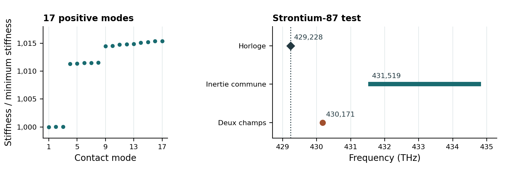

### What two electronic levels determine in neutral strontium

The angular structure supplies an independent check of the functional form. In spectroscopic notation, the electronic term $5s5p\,{}^3P$ has $L=S=1$. The eigenvalues of $X=\mathbf L\cdot\mathbf S/\hbar^2$ are $x_J=[J(J+1)-4]/2$, giving $-2,-1,+1$ for $J=0,1,2$ with multiplicities $1,3,5$. The linear model $E_J/(h_{\rm P}c)=a+b x_J$, fitted to the two levels $J=1,2$ in the compilation of Sansonetti and Nave, predicts $14\,307.2285$ cm⁻¹ for $J=0$. The tabulated value is $14\,317.507$ cm⁻¹, a difference of $-10.2785$ cm⁻¹. The compilation optimized all three levels jointly. This check concerns the published electronic term. The preceding isotope-specific comparison used frequencies for $^{87}$Sr. [Sansonetti and Nave, table 3 and method of optimization](https://doi.org/10.1063/1.3449176)

Why are two levels insufficient to determine the third? Adding $d(X^2-I)$ to the operator in cm⁻¹ leaves $J=1,2$ unchanged and shifts $J=0$ by $3d$. Choosing $d=3.4262$ cm⁻¹ would fit the target retrospectively. A BST prediction would require fixing this term or an alternative coupling from independent data. The many-electron calculations of Safronova and colleagues provide a comparison for this specific problem. [Safronova et al., table I](https://doi.org/10.1103/PhysRevA.87.012509)

The spinor construction and its Dirac dynamics characterize a spin and its sources in the preparations studied. The identification of these states with those of neutral strontium remains open. Under the reading in modes of the first test, a positive inertia $M$ on the non-uniform subspace must already satisfy $\kappa(M)\ge(\nu_1/\nu_0)^2/\kappa(K)$, i.e. approximately $1.01070$. This necessary condition comes from the Rayleigh quotient of $Ku=\omega^2Mu$. It leaves several possible matrices. A predictive derivation must determine the inertia and both states before consulting the clock line, and then check the coupling of their phases at the same proper time. To also predict the intensity of the line of $^{87}$ Sr, it is necessary to describe the hyperfine mixing that makes the transition between the two states $J=0$ accessible. [Porsev and Derevianko, hyperfine coupling calculation](https://doi.org/10.1103/PhysRevA.69.042506)

## Does a phase loop identify an effective string?

The *effective string* provides a concrete comparison for the idea of a persistent wave imprint. Athenodorou and colleagues computed excitation levels of closed flux tubes on a lattice for $SU(N)$ gauge theories with $N=3,5,6$. A low-energy description of a long string accounts for the structure seen in these spectra. The observable is energy as a function of tube length. A physical comparison would require a spectrum and its uncertainties derived from BST dynamics. The exploratory flux-tube calculation on a $U(1)$ lattice computes Wilson loops, which track phase transport around closed contours. [Athenodorou, Dubovsky, Luo and Teper, flux-tube spectrum](https://arxiv.org/abs/2411.03435)

**Checking the flux-tube calculation.** The lattice program calculates Creutz ratios from small Wilson loops. Within a sweep, the program separately accepts rotations of parallel links using the old field, even when the links share a plaquette. This can be checked on a periodic $6^4$ lattice at coupling $\beta=1$, starting with zero field. If opposite links of a plaquette each rotate through $0.4$ radians in the same direction, their contributions to its oriented angle cancel. Over the full lattice, the joint change in action is $0.789390$. Adding the two changes evaluated separately gives $0.947268$. For links separated by two lattice spacings, both calculations give $0.947268$. The archived source contains `controler_plaquette.py`. The `foundations` replay runs it alongside the Wilson-loop calculation. String tension depends on the sampled distribution. The small-loop ratios here check the lattice calculation. A BST flux-tube excitation spectrum remains to be computed.

## Reading the projections across scales

The Simulations tab opens with the same four reference films that the Python replay regenerates. The elementary wave and atomic views use white to show motion. BST proposes an ultraviolet counterpart for elementary motion. A kinetic image alone supplies no wavelength. In the atomic krypton plate, a grey filter separately represents a measured line of excited neutral krypton at 123.58 nm. The two visible filters are centred at 557.03 and 587.09 nm. [NIST, neutral krypton](https://physics.nist.gov/PhysRefData/Handbook/Tables/kryptontable3.htm)

Each neutral element has an atlas film. In the coherent preparation, every site diameter oscillates between 72% and 128% of its mean. A faint outline marks the position at the turning points. A separate view shows the native displacement mode. For H through Kr, coordinates come from the relaxed geometries. Hydrogen has six surface positions and a central site assumed in the candidate count of seven. For Rb through Og, the calculation retains the outer directions and their contact mode. It places the preceding period closure inside that surface according to the documented scaling rule. The resulting core coordinates are a reconstruction. The separate eight-mode krypton film uses 309 mesh sites, whereas the neutral atlas count is 297. The catalogue contains 5,842 nuclear states and 7,139 charge states including neutral references. The selected state card gives proton and electron numbers and, when a nucleus is specified, its neutron number. The console exports this card. The animated neutral model has its own entry. The model data supply neither a state-specific wave total nor its coordinates.

In the Kr₂ and C₂ preparations, a blurred density field constructed from the instantaneous sites defines each mantle. The display weights that field by the local rate of strain. Internal sites fade as the viewing resolution becomes coarser. The Kr₂ radial preparation carries 4.21 meV above its minimum. Grey encodes the dimer’s mechanical strain rate. For excited C₂, the filters correspond to measured Swan band heads at 473.7, 516.5 and 563.5 nm. The concentration of brightness on the moving mantles is a proposed spatial model. The internal modes and the molecular vibration have independent clocks synchronized for display. [Dicarbon constants](https://webbook.nist.gov/cgi/cbook.cgi?ID=C12070154&Mask=1807&Units=SI) · [Yadav and colleagues, Swan bands](https://doi.org/10.1016/j.sab.2009.07.009)

For H₂O and CO₂, the equilibrium geometry and frequency are reference inputs. SF₆ uses the six directions and a mode of the contact operator. For all three molecules, centre separations and atomic radii share one scale in ångströms. The adopted covalent radii are 31, 76, 66, 57 and 105 pm for H, C, O, F and S, respectively. These reference values provide a convention for comparing diffuse atomic boundaries. Rigid molecular shapes retain the same proportions in the thermal ensembles. The liquid, gas and ordered comparator views use 108 interacting Lennard–Jones centres and report their mean-square displacement in reduced units. [Covalent radii, Cordero et al.](https://doi.org/10.1039/B801115J) · [Water data](https://cccbdb.nist.gov/exp2x.asp?casno=7732185) · [Carbon dioxide data](https://cccbdb.nist.gov/exp2x.asp?casno=124389)

In the solid view, each oxygen site in ice Ih has four tetrahedrally arranged neighbours. CO₂ centres occupy a face-centred cubic lattice with four molecular orientations. The centres in the plastic phase of SF₆ occupy a body-centred cubic lattice with disordered molecular orientations. Solid krypton provides the monatomic example of a face-centred cubic lattice. Each animation starts from the indicated crystallographic structure and shows small harmonic vibrations in reduced time. Formation of a crystal from a liquid would require a separate calculation. Varying azimuth and elevation reveals rows that overlap in projection. Geometry and motion are drawn in grey. A separate optical panel displays the measured quantity for the specified phase. In pure water at 22 °C or clear ice Ih, the calculated colour is that of daylight transmitted through a selected thickness. Infrared absorption bands of gaseous molecules are marked by wavelength. An infrared band does not determine a visible hue. The method, source spectra and calculation conditions are given in `projections/README.md`. [Ice Ih](https://www.tms.org/pubs/journals/JOM/9902/Schulson-9902.html) · [Dry ice](https://doi.org/10.1016/j.icarus.2017.03.012) · [Solid SF₆](https://doi.org/10.6028/jres.123.013) · [Solid krypton](https://doi.org/10.1103/PhysRevB.9.1797)

The electromagnetic panel presents two calculations. For SF₆, the change in effective electric dipole along a molecular mode fitted to infrared band areas provides the source for a relative exterior magnetic induction map in the near-field dipole approximation. The substrate-current calculation supplies six separate preparations at nine time samples each, with transverse power projected along four lines of sight at four wave numbers. The molecular map is a model estimate of the field. A local magnetic-field measurement would test a different observable.

The sky panel displays C00, the selected CAMB family and their signed temperature difference in microkelvins, using the same harmonic phases and beam. The slider selects one of seven angular resolutions. A separate experiment follows two or three uniform spherical aggregates under Newtonian gravity. Their chosen isotopic composition, radius and number density determine total mass by summing neutral atomic masses and neglecting molecular binding energy. The calculation ends at first surface contact or after 96 hours. This macroscopic limit admits checks of an orbit and its energy balance. Deriving gravitation from individual waves and predicting a cosmological sky remain distinct physical questions. [Gravitational and mass constants, CODATA](https://physics.nist.gov/cuu/Constants/)

## Reproducing the domain checks and the reduction of the action

From the peer folder, run the following command.

~~~sh
python3 replay.py domain-observables --output ../bst-domains
~~~

The cross-reference table maps three D01 clauses and 26 other direct clauses to 56 distinct records. The numerical report gives the numerators, denominators, deviations, bounds and units. The 144 trajectory rows reproduce the readout-margin figure. Paths appear in `evidence/reader-files.csv`. The `domain-observables` replay reads the trajectories. The `cognition` replay reintegrates them and compares signs and margins. The `cosmology` replay reruns the transfer calculation. The `physics` replay rebuilds 14 outputs from the archived integrations. The `all` command includes these checks. Use `long` for the long integration and `proofs` for Lean compilation.

## What Lean verifies

The formal reference contains eighteen audited source files. In this edition Lean 4.30.0 compiled the projects again and audited the dependencies of 84 distinct declarations. For 78, the compiler lists no axioms. The six other declarations and their exact dependencies appear in `proofs/declarations.csv`. The replay checks for unfinished proofs. The statements range over the types, functions and premises written in the sources. The numerical comparisons and the experimental interpretations have separate evidence.

The proposition `BST.Association.required_hidden_distinction` applies directly to Chapter 6. Suppose a decoder reproduces a task for every state from an observation and a latent distinction. If two states have the same observation and different task outputs, their latent distinctions must differ. Otherwise the decoder would have equal inputs and unequal outputs. The theorem applies to arbitrary functions and types. Choosing a task that captures a subject's experience of ownership needs an additional correspondence. The sources and build command are in `proofs/` and `replay.py proofs`.

# Appendix C. Observables, predictions and terminology {#equations}

## The neon example

Xu and Suslick report spectra for five gases at 2.4 bar and for argon at several pressures. Two BST families infer band-integrated power from cluster geometry and contact stiffness. One uses convex-hull area per vertex. The other uses the total hull area normalized by the squared reduced radius. Both take argon as the reference.

Why measure neon at another pressure? Both families assume that the change in power with the pressure is transported from one gas to another. To see what this hypothesis implies, let $r_g$ denote the reduced radius of a gas, with $r_{\rm Ar}=1$, and $p_0=2.4$ bar. Multiplying power by $\exp[\gamma(r_g-1)(p/p_0-1)]$, with $\gamma$ without dimension, leaves it exactly unchanged for argon at any pressure and for the five gases at $p_0$. For neon at another pressure, this factor changes the power as soon as $\gamma$ differs from zero. The two projections in the table retain the separable law, i.e. $\gamma=0$ in this example. An independent measure would thus test a property that the adjustment data, even exactly reproduced, leave free.

The intervals below are projections of all settings admitted by the benchmark tolerance for the preparation and spectral band in Chapter 7. They are parameter envelopes. Assigning a probability of coverage in a future experiment would require a statistical model. The role column identifies the calibration point and the pressures reserved for testing neon.

| Pressure (bar) |Role| Area per vertex (nW) | Reduced shape (nW) |
|:---|:---|:---|:---|
| 1.9 |Frozen projection| 0.0435 to 0.0586 | 0.0409 to 0.0543 |
| 2.1 |Frozen projection| 0.1008 to 0.1236 | 0.0960 to 0.1178 |
| 2.4 |Calibration| 0.3022 to 0.3490 | 0.2987 to 0.3390 |
| 2.7 |Frozen projection| 0.5522 to 0.6590 | 0.5303 to 0.6107 |
| 3.1 |Frozen projection| 1.0999 to 1.4738 | 1.0360 to 1.3023 |

**Comparing a measurement.** Enter acoustic pressure in bar and the lower and upper bounds on integrated power in nW, incorporating measurement uncertainty. Record the detector response and background subtraction. The program compares the new interval with the unrounded frozen predictions. From the repository root, the following command illustrates the test with a hypothetical measurement interval of 1.36 to 1.40 nW.

~~~sh
python3 replay.py neon --pressure 3.1 --interval 1.36 1.40 --output ../bst-neon

~~~

At 2.4 bar the command identifies a check at the calibration pressure. At each of the four other pressures a family is compatible with that readout if the intervals intersect, including when they share only an endpoint. Comparing several pressures jointly requires evaluating the same coefficients at all of them. Marginal intervals alone do not identify a common parameter set.

## Determining the scope of a prediction

A computed normal-mode frequency for water or carbon dioxide depends on the masses and stiffnesses in the model. Identifying it with a laboratory spectral line requires a frequency conversion, an allowed transition, a specified preparation and the spectrometer response. The optical power of a gas mixture likewise depends on its composition and acoustic driving conditions. A comparison with an existing measurement documents agreement or disagreement for that case. The four held-out neon pressures provide a prospective test because the predicted intervals were fixed in advance.

A prediction for a new version should record the code version, preparation, shared coefficients, instrument, observable, unit, expected signature, the result that would exclude each family and the date the prediction was fixed. When one measurement bears on several hypotheses, its implications for each should be stated separately. For example, a measured division of flux between two paths might distinguish laws of flux allocation while leaving the origin of the initiative unresolved.

## The general BST equation and its minimal form

BST proposes common dynamics for the substrate. The variational equation of its physical core governs orientation, resolution and transport. To compare a solution with a measurement, each domain also specifies the preparation, boundary conditions, readout and readout parameters. Chapter 4 identifies the quantities determined by calibration and those calculated at fixed parameters.

### The physical core equation

In the notation of Chapter 3, the state is $X=(q,s,A)$, where $q$ designates the orientation of the substrate, $s$ its local resolution and $A$ the transport on the links. The subscript “sub” stands for substrate. Its action and Lagrangian are

$$\begin{aligned}
\delta S_{\rm sub}[X]&=0,\qquad S_{\rm sub}[X]=\int L_{\rm sub}\,dt,\\
L_{\rm sub}&=T_q-V_q+L_s+\tfrac12 m_A\|\dot A\|^2-\tfrac12 k_A\|dA\|^2.
\end{aligned}$$

The first two terms describe changes in the orientations over time and across space.  $L_s$ describes the dynamics of local resolution. The last two terms describe the inertia and circulation of the transport field. The variation preserves $|q|=1$ and the boundary conditions, in temporal gauge with initial data satisfying the Gauss constraint. The compact form $\delta S_{\rm sub}=0$ encodes these dynamics for the stated action and constraints. The beta-decay lifetimes in D11.2 illustrate how readout and data enter the calculation. Each transition rate uses the amplitude calibrated for that state.

### The minimal phase form in natural units

Two steps lead to the minimal form below. First, restrict the substrate model to a sector in which a single phase describes the orientations, the resolution field is constant and transport is neutral. This selects a family of motions. Then choose natural units. This change of units preserves all solutions in that sector and their boundary conditions.

The subscript θ identifies the action reduced to a single phase. The angular field is $\theta\equiv\theta+2\pi$, the spatial resolution is $r$, the inertia per unit volume is $\chi>0$ and the stiffness is $K>0$. For a homogeneous, isotropic medium with constant couplings and zero potential, the action to quadratic order in first derivatives is

$$S_\theta[\theta;r]=\frac12\int dt\,d^3x
  \left[\chi(\partial_t\theta)^2-K|\nabla\theta|^2\right].$$

Each realization must specify the domain and how it implements the cutoff $r$, for example, a lattice that resolves the allowed variations or an excluded core radius. In the smooth sector, one may use a periodic spatial box or impose vanishing variations on its boundary, with fixed temporal endpoints. Integration by parts in $\delta S_\theta$ then gives $\chi\,\partial_t^2\theta-K\Delta\theta=0$. The initial data are $\theta$ and $\partial_t\theta$ subject to the boundary conditions. The energy density is $(\chi\dot\theta^2+K|\nabla\theta|^2)/2$ and the energy current is $-K\dot\theta\,\nabla\theta$. The speed of the small signal is $c_\theta=\sqrt{K/\chi}$. Identifying that speed experimentally with $c$ requires the clock and transport conditions discussed in chapter 2.

The phase being dimensionless, $[\chi]={\rm J\,s^2/m^3}$ and $[K]={\rm J/m}$. Choose a length $L_*$, and set $\xi^0=c_\theta t/L_*$, $\boldsymbol\xi=\mathbf x/L_*$ and $S_*=\sqrt{\chi K}\,L_*^2$. The change of variables gives **without changing the angle or its period**

$$\frac{S_\theta}{S_*}
=\frac12\int d^4\xi\,
(\partial_\mu\theta)(\partial^\mu\theta),
\qquad \eta_{\mu\nu}=\mathrm{diag}(1,-1,-1,-1),
\qquad r_{\rm réduit}=r/L_*.$$

Both forms describe the same classical phase-field dynamics on the same domain, with the same data expressed in reduced units and in the same phase sector. An overall factor leaves the classical field equations of the isolated system invariant. When coupling sectors or evaluating a quantum weight $\exp(iS/\hbar)$, one must retain their relative normalization, in particular $S_*/\hbar$.

### Restricting the action to the neutral great circle

Consider the orientation, resolution and transport terms in the action of Chapter 3. On the neutral great circle in the orientation space $S^3$, set $q=(0,0,\sin\theta,\cos\theta)$, $A=0$ and $s=s_0$ constant, with $U'_s(s_0)=0$. Take initial configurations on the circle, velocities tangent to it, compatible boundary conditions and the same logarithm branch on every link, with $|\Delta\theta|<\pi$. Then $\dot q=\dot\theta\,e_\theta$ and $v_i=(\Delta_i\theta/h)e_\theta$, where $e_\theta=(0,0,\cos\theta,-\sin\theta)$. All area terms $W$ vanish. The gauge rotation of the first two components fixes the circle, and the feedback from the area terms also vanishes. The remaining orientation terms are quadratic in the time derivative $\dot\theta$ and in spatial differences of the phase. Their coefficients are both $\alpha$ in the units of Chapter 3. A constant background-potential contribution may be subtracted from the action.

The `domain-observables` replay checks this restriction on $12^3=1\,728$ sites with periodic boundaries in all three directions, nonzero spatial gradients and an internal velocity. It computes phase increments on the circle from dot products of neighboring orientations. The maximum difference between the two calculated densities is below $10^{-15}$ in reduced units. A separate check sets $\chi=3.2$, $K=7.5$ and $L_*=2.3$ in consistent units and verifies the change of units for the action on the same time slice. Other parts of the benchmark also use variations in resolution, gauge currents and transverse orientations. The restricted model holds those degrees of freedom fixed.

**Why does symmetry allow more than one action?** A global shift $\theta\mapsto\theta+\theta_0$ also preserves a quartic term built from derivatives of $\theta$. Obtaining the phase action above therefore requires truncation at quadratic order. In three spatial dimensions, rescaling a smooth, localized configuration as $\theta_\lambda(\mathbf x)=\theta(\mathbf x/\lambda)$ gives a gradient energy $E_2(\lambda)=\lambda E_2(1)$ over all space. This energy alone selects no finite stationary size for a nonconstant configuration in that family. For a line defect with radial cutoffs $r$ and $L$, a phase with integer winding number $m$ gives an exterior energy per unit length of $\pi K m^2\ln(L/r)$. Assigning a total energy to an object also requires its core, geometry and boundary conditions. [Derrick, scaling of the static energy](https://doi.org/10.1063/1.1704233)

A quartic area term changes the scaling argument. For $E(\lambda)=\lambda E_2+E_4/\lambda$ with $E_2,E_4>0$, the family of dilations has a stationary size $\lambda_*=\sqrt{E_4/E_2}$. Stability under arbitrary deformations would also require control of variations outside this family. The core action in Chapter 3 explicitly includes the area term.

### Dependencies between closure, persistence, identity and agency

The next channel gives the conditions for reconstruction, from the existence postulated to the agent. It can be isolated from closure to identity.

$$E\ \Rightarrow\ S\ \Rightarrow\ B_r\ \Rightarrow\ \kappa_r\ \Rightarrow\
P\ \Rightarrow\ R\ \Rightarrow\ \mathcal I_d\ \Rightarrow\ \mathfrak A,$$

$$\kappa_r\ \Rightarrow\ P\ \Rightarrow\ R\ \Rightarrow\ \mathcal I_d.$$

$E$ denotes postulated existence, $S$ the substrate, $B_r$ the beat described at resolution $r$, $\kappa_r$ closure or coherence, $P$ persistence, $R$ reconstruction, $\mathcal I_d$ reconstructed identity and $\mathfrak A$ the agent. These symbols identify operations, conditions or roles. An arrow states what a reconstruction requires at its preceding step under the conditions of the case. Persistence requires checking closure through time. Recovering an identity requires an invariant and readouts that discriminate between its possible values. The signs in the D10 paired-history model illustrate the dependence on readout.

The shorter chain starts with closure at a fixed resolution and ends with reconstructed identity. The last arrow condenses several conditions. A memory maintains a distinction. Imagination produces continuations, selection dismisses some of them, and arbitration $\mathcal A$ takes action or revises the rule. The agent $\mathfrak A$ carries that history. The existence of a reconstructed identity in a physical calculation is not sufficient to deduce all these faculties. The origin of the initiative falls within the proposal of Chapter 7.

### Symbols and observables used in comparisons

|Symbol or use|Meaning and unit in the designated calculation|
|:--------------------------|:----------------------------------------------------------------|
|$E,S,P,R$ in the chain|Existence, substrate, persistence, reconstruction. These structural symbols are dimensionless. In a dynamic equation, $E$ can denote an energy in joules, $S$ an action in joule seconds.|
| $r,h,s$ |$r$ is the declared spatial resolution or cutoff, $h$ the calculation step.  $s=\ln(\ell/\ell_*)$ is a dimensionless field. Modifying the cut-off and refining the fixed physical resolution mesh are two separate operations.|
| $\kappa_r,K,K_{\rm contact}$ |The first symbol denotes a closure condition. The gradient stiffness $K$ is an energy per length. The contact matrix of the strontium connects variations in contact loading patterns to the conjugate responses in the units of the contact operator.|
| $\theta,q,A$ |Phase angle, orientation in the internal space and angle of transport in the variational substrate model. In the isotopic atlas, $q$ is the charge of the ion in elementary units and $A$ is the mass number.|
| $f,\nu,\omega,\tilde\nu$ |$f$ or $\nu$ in hertz, $\omega=2\pi\nu$ in rad/s, spectroscopic wave number $\tilde\nu=\nu/c$ in cm-1 if $c$ is in cm/s. The model angular frequencies require a unit of time before conversion.|
|$Q,\lambda,T_{1/2}$ in D11|Available energy per channel, transition rate in s-1 and half-life in seconds. A tabulated half-life can be used as a target for recovery.|
|$C,Y,\varepsilon,I(C;Y)$ in D10|Prepared content, reader output, bound on readout error, and mutual information in bits for base-two logarithms. The behavioural study reports a separate quantity, log loss in nats per choice.|

## Glossary of measurement and readout

|Term or symbol|Definition and unity in its use|
|:---|:---|
| Substrate | The physical universe as the common support of the dynamics. $X$ denotes the complete state. In the core model $s$ denotes only its resolution variable. The laws and their domains of application characterize the substrate. |
| Primordial wave | An elementary process relative to a specified reconstruction window. In an isotropic window a ball with a moving mantle provides a radial model. |
| $d$, $b$, $R_0$, $O$ in the paired-beat model | Separation, change in mantle radius, reference radius and overlap, in reduced length units. In the cognition graph $d$ denotes a dimensionless ratio of couplings. |
| $m,\mu,G,k,\kappa$ in the paired-beat model | Inertias, attraction strength, contact stiffness and internal restoring stiffness. In dimensional units $G$ has units of energy times length. Each stiffness has units of energy per length squared. |
| $c_q$, $c_s$, $c_A$ | Characteristic speeds of the orientation, resolution and gauge branches (length per time). The echo and beat rates are dimensionless frequency ratios. |
| $s$, $\ell_*$ and $\Omega_0$ | Logarithm of relative scale, reference length and rest angular frequency of the resolution field (radians per unit time). |
| $c_*$ and $c$ | Speed of the linearized branch and speed of light in vacuum. Both have units of length per time. Relating them requires probes and clocks. |
| $h$, $\ell$, $P$ | Numerical grid spacing, physical resolution and readout projection. In a spatial calculation the first two can have units of length. $P$ carries the units of its output. |
| Flux and power | Quantity crossing a boundary per unit time. The contact power has units of energy per time. Energy integrated over a frequency band and time interval is a separate observable. |
| Latent state and control with erasure | A distinction that a specified readout cannot resolve. Comparison with dynamics that erase it tests which features the data can attribute to its carrier. |
| Agent | An organization that carries a history, imagines and initiates continuations, and can revise its motives. |
| Current between acts $J_{ij}$ | Net number of transitions from $i$ to $j$ per unit time. The model specifies no energy per act. |
| Arbiter | The function that commits to, suspends or revises an action relative to a history in the model. First-person authorship requires a separate hypothesis. |
| Family and interval | Set of parameters compatible with the stated criteria. Projection onto one parameter axis gives the values that remain possible along it. |
| Calibration and frozen prediction | Calibration uses observations to set a range. For a frozen prediction the parameters and protocol are fixed before the test result is known. |

Related terms in the literature depend on the operation. A BST *readout* may be a *measurement operator* or a *forward model* predicting the received signal. A spatial observation window may involve a *point-spread function*. Eliminating degrees of freedom is addressed by *model reduction* or *coarse-graining*. Finding a closed law for the retained variables is the *closure problem*.

# Appendix D. Origins, contributions and data {#sources}

**Conception and drafting.** Nicolas Gilbert Albert Roux initiated and directed the project. He introduced the ocean analogy, formulated the questions, proposed mechanisms including contacting mantles and an internal beat, and reconsidered interpretations as the tests progressed. ChatGPT (OpenAI) drafted the manuscript from those exchanges and the project records, and contributed to literature searches, programming, calculations, figures and checks. A Lean verification was also run on the project computer. Experimental measurements are credited to the teams that made them.

**Other contributions and submission.** Claude (Anthropic) contributed to analysis and drafting at earlier stages. The project account describes how proposals were reviewed in succession with both assistants. Gemini (Google) was consulted on limits of cosmological observation and work relevant to resolution. The publications are cited for the scientific claims. Local machine translation assisted preparation of the English text. A submission signature has yet to be decided. arXiv requires signing authors to take responsibility for the content and significant use of generative AI to be disclosed in the text. [arXiv policy on author use of generative AI](https://info.arxiv.org/help/moderation/index.html#policy-for-authors-use-of-generative-ai-language-tools)

## Sources of the definitions and computations

The definitions of the substrate, the beat, the resolution windows and the three readings are given in chapters 1 to 3. The quartic gradient term in the action has a precedent in the Skyrme model. BST couples it to the local resolution and internal transport of the substrate. [Skyrme, non-linear field model](https://doi.org/10.1098/rspa.1961.0018)

The table connects each question to its supporting calculations. The index in `evidence/reader-files.csv` lists paths to the outputs cited in Appendix B. Definitions appear in the text and glossary.

|Subject matter|Definition, proof or measure|
|:---|:---|
| Movement of mantles |The radius varies as a degree of internal freedom. The energy balance in Chapter 2 gives the power exchanged with the motion of separation.|
| Signals and clocks |Radial modes and transverse signals test clock rates on a static background. The beat and moving echo test the common cone on a uniform background. Profiles, equations and controls are set out in Chapters 2 – 3 and in Appendix B.|
| Strontium |The coordinates give the contact stiffness. Courtillot et al. and BIPM give the atomic frequencies. Bothwell et al. measure a frequency gradient. The text distinguishes between these three observables.|
| Isotopes, gas and fluorides |The ion and isotope database documents the reference masses, states and charges. Nuclear calculations give the permissible bands per state. The data of the PTB and the shear files make it possible to reproduce the comparisons of chapter 4.|
| Information, identity and initiative |Chapter 6 distinguishes evidence under hypotheses, simulation of a bistable trace and observations in living systems. The argument on the external initiative and its premises are set out in Chapters 1 and 7.|
| Compatibility and predictions |Appendix A gives the results by clause. Appendix C contains the frozen neon values and the conditions of observation corresponding to them.|

## References for reproducing the comparisons

**Laboratory measurements.** Bartell and Doun measured the mean SF₆ bond length by diffraction. The PTB dataset supplies the infrared cross-sections integrated in Chapter 4. Parthey and colleagues give the experimental precision of the H–D isotope shift. The figures published by Xu and Suslick identify the gas, spectral band and pressure used to calibrate the neon projections. Tang and colleagues provide theoretical references for three-body interactions. [Bartell and Doun, 1978](https://doi.org/10.1016/0022-2860(78)80010-6) · [Data PTB, 2023](https://doi.org/10.7795/720.20231027) · [Parthey et al., 2010](https://doi.org/10.1103/PhysRevLett.104.233001) · [Xu and Suslick, 2010](https://doi.org/10.1103/PhysRevLett.104.244301) · [Tang et al., 2012](https://doi.org/10.1063/1.3691891)

**From proper time to the sky.** Courtillot and colleagues measured spectroscopic intervals that allow reconstruction of the strontium transition frequency. Bothwell and colleagues measured a frequency gradient in Earth's gravitational field. Joyce and colleagues reported the differential redshift of Sirius B. These observations constrain different aspects of the relation between signals and clocks. [Courtillot et al., 2005](https://doi.org/10.1140/epjd/e2005-00058-0) · [Bothwell et al., 2022](https://doi.org/10.1038/s41586-021-04349-7) · [Joyce et al., 2018](https://doi.org/10.1093/mnras/sty2404)

**Cosmological projections.** The spectra and likelihood of the cosmic microwave background are described in *Planck 2018 results V*. Acoustic distances come from *DESI DR2 results II*. The final SDSS analysis by Alam and colleagues gives combined measurements of distance and growth. CAMB computes the transfer for the twelve families. White and colleagues’ measurements of supernova time dilation provide a separate observational target. [Planck, 2020](https://doi.org/10.1051/0004-6361/201936386) · [DESI, 2025](https://doi.org/10.1103/tr6y-kpc6) · [Alam et al., 2021](https://doi.org/10.1103/PhysRevD.103.083533) · [Lewis, Challinor and Lasenby, 2000](https://doi.org/10.1086/309179) · [White et al., 2024](https://doi.org/10.1093/mnras/stae2008)

**Information and cognition.** Chapter 6 draws on research into behaviour, memory and consciousness. The *Horizon* task distinguishes directed information seeking from variability in choice. The dataset published by Binz and Schulz identifies the observations and their sources. For tests of memory reactivation, Wolff and colleagues’ visual-impulse experiment should be read alongside the reanalysis by Barbosa and colleagues and its correction. [Wilson et al.](https://doi.org/10.1037/a0038199) · [Binz and Schulz](https://doi.org/10.1073/pnas.2218523120) · [Wolff et al.](https://doi.org/10.1038/nn.4546) · [Barbosa et al.](https://doi.org/10.1371/journal.pbio.3001436) · [Correction](https://doi.org/10.1371/journal.pbio.3001603)

The bibliography in `evidence/bibliography.csv` indexes the external sources by the chapters or appendices that cite them. The archived inputs preserve the order of numerical tables used by the readout operators. The following credits identify the roles of individuals, teams and tools.

## Contributions and credits

\setlength{\parskip}{.2em plus.05em minus.03em}

**Albert Einstein.** The equations of the gravitational field of 1915 provide the historical reference for the relationship between geometry and gravitation. [Contribution reference](https://assets.press.princeton.edu/books/einstein11/e_biblio.pdf)

**James Clerk Maxwell.** The equations of electromagnetism and the text of 1865 serve as an explicit reference for flow and propagation descriptions in the earlier OMM formulation. [Contribution reference](https://doi.org/10.1098/rstl.1865.0008)

**Erwin Schrödinger.** Equation of the eigenvalues of 1926, reference for undulatory regimes. [Contribution reference](https://doi.org/10.1002/andp.19263840404)

**Paul A. M. Dirac.** Relativistic equation of the electron, reference for a Dirac-type realization. [Contribution reference](https://doi.org/10.1098/rspa.1928.0023)

**Kenneth G. Wilson and Michael Creutz.** The lattice gauge calculation uses Wilson loops and a Creutz ratio. The reference BST simulation uses U(1). [Contribution reference](https://doi.org/10.1103/PhysRevD.10.2445)

**Michael Creutz.** Historical reference for the numerical estimation of string tension on a lattice. The cited paper studies SU(2). [Contribution reference](https://doi.org/10.1103/PhysRevD.21.2308)

**W. J. Huang, M. Wang, F. G. Kondev, G. Audi, S. Naimi and the AME/NUBASE teams.** The atlas employs mass, fundamental state and excitation assessments. Its tables distinguish measured, evaluated or extrapolated values. [Contribution reference](https://nds3.westeurope.cloudapp.azure.com/amdc/)

**A. Kramida, Yu. Ralchenko, J. Reader and the NIST ASD team.** The ASD database provides reference ionisation data and bibliographical cross-references of the series. [Contribution reference](https://physics.nist.gov/cgi-bin/ASD/ie.pl?spectra=C)

**Hangxun Xu and Kenneth S. Suslick.** Spectra of five gases at 2.4 bar and of argon at five pressures. Figures 2a and 3a supply the measurements used to calibrate the neon projections. [Contribution reference](https://doi.org/10.1103/PhysRevLett.104.244301)

**Stephen D. Hopkins, Seth J. Putterman, Brian A. Kappus, Kenneth S. Suslick and Carlos G. Camara.** Figures 1 and 3 of their xenon-bubble study permit a comparison of the mean spectrum, bubble radius and synchronized flash signal. [Contribution reference](https://doi.org/10.1103/PhysRevLett.95.254301)

**Kiang and Zare (1980), Akhgarnusch, Höckendorf and Beyer (2015).** The fluoride assessment retains the distinct protocols, reference temperatures and evidential status of the 1980 bound and the 2015 determination. [Contribution reference](https://doi.org/10.1021/acs.jpca.5b06975)

**Domanskaya and colleagues, PTB.** Infrared band areas and datasets for SF₆. The 33% value concerns one specific combination band. [Contribution reference](https://doi.org/10.7795/720.20231027)

**Antony Lewis and Anthony Challinor, with the contributors to CAMB.** CAMB 2.0.5 computes the transfer functions for the effective cosmological closure of each of the twelve families. [Contribution reference](https://camb.info/)

**Planck Collaboration.** Published 2018 band powers, best-fit reference spectra and likelihood information used for the cosmological comparisons. [Contribution reference](https://doi.org/10.1051/0004-6361/201936386)

**DESI Collaboration.** DESI DR2 provides acoustic distances and their covariance. A separate reference below identifies the eBOSS tables. [Contribution reference](https://doi.org/10.1103/tr6y-kpc6)

**Robert C. Wilson and colleagues.** The Horizon task gives an operational definition of information seeking. The experimental protocol and the observations used here are credited separately. [Contribution reference](https://doi.org/10.1037/a0038199)

**Marcel Binz and Eric Schulz.** Shared data and scripts for the human–GPT-3 comparison. The reanalysis of the Horizon data records the source commit and credits Zaller and colleagues for the human observations. [Contribution reference](https://doi.org/10.1073/pnas.2218523120)

**ChatGPT (OpenAI).** Drafting of this text, desk research, programmes, calculations, figures and verification with oversight from the project lead.

**Claude (Anthropic).** Participation in analysis and drafting at previous stages. The project account describes successive reviews by the two assistants.

**Gemini (Google).** Consultation on the limits of cosmological observation and possible comparisons with work on scale and resolution. Two excerpts were provided on 20 November 2026.

**Douglas J. Blackiston, Elena Silva Casey and Martha R. Weiss.** Larval learning and behaviour in adult butterfly. [Contribution reference](https://doi.org/10.1371/journal.pone.0001736)

**Michael J. Wolff, Janina Jochim, Elkan G. Akyürek and Mark G. Stokes.** Response to a visual pulse during maintenance of memory orientation. [Contribution reference](https://doi.org/10.1038/nn.4546)

**Joao Barbosa, Diego Lozano-Soldevilla and Albert Compte.** Interpretation of decodability, electrical activity and noise variability. [Contribution reference](https://doi.org/10.1371/journal.pbio.3001436)

**Joao Barbosa, Diego Lozano-Soldevilla and Albert Compte.** Limit of a permutation check of the figure 3. [Contribution reference](https://doi.org/10.1371/journal.pbio.3001603)

**Yelena G. Bodien and the multicentre study team listed in the publication.** Comparison of behavioural response to instructions and MRI or EEG assessments. [Contribution reference](https://doi.org/10.1056/NEJMoa2400645)

**Henning U. Voss and colleagues.** Clinical follow-up and imaging of a patient who has returned to speech 19 years after a trauma. [Contribution reference](https://doi.org/10.1172/JCI27021)

**Daniel Kondziella and the European Academy of Neurology group.** Clinical definitions of coma, unanswered awakening and minimum state of consciousness. [Contribution reference](https://doi.org/10.1111/ene.14151)

**Martin M. Monti and colleagues.** Responses to personal questions decoded by functional MRI in a patient. [Contribution reference](https://doi.org/10.1056/NEJMoa0905370)

**Yosif Zaki and Denise J. Cai.** Role of neural sets and their plasticity in preservation and recall. [Contribution reference](https://doi.org/10.1038/s41386-024-01979-z)

**Aly Lidayan, Yuqing Du, Eliza Kosoy, Maria Rufova, Pieter Abbeel and Alison Gopnik.** Aims expressed and accomplished in an open game. The under-analysis of ten children is taken up in aggregated form. [Contribution reference](https://doi.org/10.1073/pnas.2612366123)

**Sam Parnia and the AWARE II authors listed in the publication.** Multicentre study of reported experiences and activity during resuscitation. [Contribution reference](https://doi.org/10.1016/j.resuscitation.2023.109903)

**Ciarán O’Keeffe and Richard Wiseman.** Negative test of the communication hypothesis tested. [Contribution reference](https://doi.org/10.1348/000712605X36361)

**Patrizio Tressoldi, Laura Liberale and Fernando Sinesio.** Result of the selection of readings, to be distinguished from the attribution of their source. [Contribution reference](https://doi.org/10.1177/00302228221146376)

**Jess M. Clough, Costantino Creton, Stephen L. Craig and Rint P. Sijbesma.** Visualization of breakages of connections during deformation of a filled elastomer. [Contribution reference](https://doi.org/10.1002/adfm.201602490)

**Noah W. Gray, Robby M. Weimer, Ingrid Bureau and Karel Svoboda.** Monitoring of synaptic clusters maintained during the renewal of their PSD- molecules95. [Contribution reference](https://doi.org/10.1371/journal.pbio.0040370)

**Tomás J. Ryan, Dheeraj S. Roy, Michele Pignatelli, Autumn Arons and Susumu Tonegawa.** Reexpression of a response learned after activation of marked cells in mice. [Contribution reference](https://doi.org/10.1126/science.aaa5542)

**William Beecher Scoville and Brenda Milner.** Study of the bilateral median temporal resection effects on the formation of new memories. [Contribution reference](https://doi.org/10.1136/jnnp.20.1.11)

**Matthew Sarraf, Michael A. Woodley of Menie and Patrizio Tressoldi.** Meta-analysis of reading classifications. Entriance to a personal source remains open. [Contribution reference](https://doi.org/10.1016/j.explore.2020.04.002)

**Nathan S. Rose and colleagues.** The future relevance of the stored element, stimulation and response to the decoy provide conditions for comparison for the rereading of a trace. [Contribution reference](https://doi.org/10.1126/science.aah7011)

**Tony Hilton Royle Skyrme.** The variational substrate model relates its quartic gradient term to the soliton field model of 1961. The variable scale and internal transport are set out in implementation BST. [Contribution reference](https://doi.org/10.1098/rspa.1961.0018)

**Markus Pössel.** The light clock and its transverse mirrors give the reference construction for the echo of the chapter 2. [Contribution reference](https://www.einstein-online.info/en/spotlight/light-clocks-time-dilation/)

**Jürgen Ehlers, Felix A. E. Pirani and Alfred Schild.** The chapter 2 is based on the distinction between the determination of the cone by the signals and the determination of the duration scale. Text of 1972 republished in 2012. [Contribution reference](https://doi.org/10.1007/s10714-012-1353-4)

**C. W. Chou, D. B. Hume, T. Rosenband and D. J. Wineland.** Experimental comparison of the rates at relative velocities and controlled height differences. [Contribution reference](https://doi.org/10.1126/science.1192720)

**Tobias Bothwell and colleagues de JILA.** The slope measured with strontium is compared with the static-background clock-rate factor after identification of the field with Newtonian potential. [Contribution reference](https://doi.org/10.1038/s41586-021-04349-7)

**Irène Courtillot, Audrey Quessada-Vial, Anders Brusch, Dmitri Kolker, Giovanni D. Rovera and Pierre Lemonde.** Table I and the fine structure gap between two components of the same F in section V make it possible to reconstruct the clock frequency of the strontium 87. [Contribution reference](https://doi.org/10.1140/epjd/e2005-00058-0)

**BIPM and the CCL–CCTF Working Group on Frequency Standards.** The recommendation of 2025, entry into force in March 2026, is the rest control target for the strontium transition 87. [Contribution reference](https://www.bipm.org/documents/20126/288515313/87Sr_429THz_2025/bbd827f7-3e1e-5fbe-6bd8-0eadd9b5b674)

**Masato Nakajima and colleagues.** Reconstitution of the KaiC phosphorylation cycle outside the cell provides a reference for the conditions under which a biological oscillator persists. [Contribution reference](https://doi.org/10.1126/science.1108451)

**Jean E. Sansonetti and Gillian Nave.** The table 3 provides the levels of neutral strontium compared with the linear angular law. The hyperfine frequencies of the strontium-87 clock are tested separately. [Contribution reference](https://doi.org/10.1063/1.3449176)

**M. S. Safronova, S. G. Porsev, U. I. Safronova, M. G. Kozlov and C. W. Clark.** Table I provides an example of multi-electron determination of levels that are still missing from the calculation BST. [Contribution reference](https://doi.org/10.1103/PhysRevA.87.012509)

**Sergey G. Porsev and Andrei Derevianko.** Calculation of the width of the strontium transition 87 specifies the coupling required to predict its intensity. [Contribution reference](https://doi.org/10.1103/PhysRevA.69.042506)

**Christian G. Parthey and colleagues.** The measurement of isotopic displacement H–D and its uncertainty of 15 Hz serves as a reference for the comparison D01.3. [Contribution reference](https://doi.org/10.1103/PhysRevLett.104.233001)

**Lawrence S. Bartell and S. K. Doun.** D01.2 distinguishes the six simulated distances and the diffraction quantity measured on the gas. [Contribution reference](https://doi.org/10.1016/0022-2860(78)80010-6)

**Ian H. Bell, Jorrit Wronski, Sylvain Quoilin and Vincent Lemort.** The HEOS reference states in D05 are state equation values calculated with CoolProp. [Contribution reference](https://doi.org/10.1021/ie4033999)

**Simon R. G. Joyce and colleagues.** Differential Hα measurements of Sirius A and B. The primary and detector-centre positions give two correlated readings. [Contribution reference](https://arxiv.org/abs/1809.01240)

**Sam R. Dolan.** Calculation of a massive scalar field on a Kerr background, used in the frequency comparison. [Contribution reference](https://doi.org/10.1103/PhysRevD.76.084001)

**Claude E. Shannon.** The mutual information in bits here measures the link between the prepared sign and the output of the bistable carrier’s decoder. [Contribution reference](https://doi.org/10.1002/j.1538-7305.1948.tb01338.x)

**G. H. Derrick.** The variation in the static energy under expansion explains the absence of preferred size of the only three-dimensional quadratic term. [Contribution reference](https://doi.org/10.1063/1.1704233)

**Shadab Alam and the SDSS/BOSS/eBOSS teams.** Products DR16 provide the distance and growth vector and its covariance to four redshifts. [Contribution reference](https://doi.org/10.1103/PhysRevD.103.083533)

**Antony Lewis, Anthony Challinor and Anthony Lasenby.** This paper describes the calculation underlying CAMB. The archived inputs specify the implementation used for this edition. [Contribution reference](https://doi.org/10.1086/309179)

**Li-Yan Tang and colleagues.** The theoretical coefficients for Ar-Ar-Ar and He-He-Ar are compared with the long-range dipolar calculation. [Contribution reference](https://doi.org/10.1063/1.3691891)
