# Résumé {#abstract}

La théorie du substrat battant (BST) propose que l’Univers physique soit un substrat dont les mouvements peuvent se lire comme des ondes, des contacts ou des flux, selon la résolution et la grandeur mesurée. Nous examinons cette proposition en spécifiant, pour chaque épreuve, l’état préparé, sa loi d’évolution et la manière d’en tirer une mesure. Sur un fond uniforme, une horloge à écho et une horloge fondée sur une oscillation interne donnent la même dilatation du temps lorsque le signal et le mode oscillant ont la même vitesse caractéristique. Dans un modèle de mémoire, deux préparations donnent la même lecture au repos. Une impulsion permet de retrouver le bit qui les distingue dans chacune des 72 paires simulées sans bruit ajouté. Le banc de onze domaines consigne 68 résultats, dont 44 sous conditions explicites. Sur 576 combinaisons de modèles et de paramètres, 192 satisfont simultanément les 67 contrôles de la comparaison commune. Les observations publiées sur la mémoire et la réponse aux consignes permettent de discuter ce que ces calculs pourraient expliquer chez le vivant. L’origine de l’initiative et la continuité d’une personne restent des questions ouvertes.

# Introduction {#introduction}

Une horloge compte des cycles. On peut aussi mesurer une durée par l’aller-retour d’un signal. À quelles conditions les deux mesures s’accordent-elles si l’horloge se déplace ? La mémoire pose une question apparentée. Deux préparations indiscernables au repos peuvent répondre différemment à la même sollicitation. Dans les deux cas, il faut préciser comment l’état observé produit le signal mesuré.

BST propose que la matière, ses interactions et les instruments d’observation appartiennent au même substrat, l’Univers physique. Elle nomme *battement* un mouvement qui se renouvelle. La *résolution* détermine quelles différences une mesure peut distinguer. La méthode consiste à préparer un état, à calculer son évolution et à préciser ce que l’instrument enregistre.

Un même assemblage de six liaisons, celui de SF₆, permet de poser trois questions à BST. Où se placent les atomes à l’équilibre ? Quels mouvements un champ peut-il exciter ? Quelle part de ce mouvement un spectromètre enregistre-t-il ? La géométrie se compare à des distances de diffraction et la réponse collective à des aires de bandes d’absorption. Une distance bien reproduite laisse ouverte la question de l’intensité d’une raie. Le chapitre 4 suit ainsi onze domaines en donnant, pour chacun, la préparation, la lecture obtenue et ce qui a servi à l’étalonner. L’annexe A rattache ces résultats aux exigences du banc.

## Parcours de lecture {#reading-paths}

**Physique.** Le chapitre 2 compare [signal et horloges](#common-cone). Le [modèle mathématique du substrat](#substrate-model) donne ensuite les lois utilisées dans [les onze domaines](#domain-tests). On peut poursuivre directement vers les [comparaisons cosmologiques](#sky-comparison) et les [prédictions à paramètres fixés](#fixed-predictions).

**Neurosciences et cognition.** Le chapitre 6 est autonome. Les [observations chez le vivant](#living-evidence) précisent ce que mesurent les études de mémoire et de réponse aux consignes. Les [modèles de mémoire](#memory-models) isolent les conditions de conservation et de relecture d’une trace. Les [épreuves proposées](#cognitive-tests) indiquent ce qu’il faudrait observer pour relier ces résultats à une personne.

**Philosophie.** L’[ontologie](#ontology) expose les postulats sur le substrat, le battement et la résolution. Le chapitre s’achève sur [l’origine et le « choix du choix »](#origin-choice). La discussion de [l’arbitre et de l’identité personnelle](#agency-identity) en développe les prémisses et les implications.

\clearpage

# 1. Ontologie du substrat battant {#ontology}

Une vague garde une forme reconnaissable alors que l’eau qui la traverse se déplace. BST emprunte à l’océan cette image de la persistance. Si une chose physique peut être reconnue à deux instants, qu’est-ce qui, dans son mouvement même, a persisté ? BST propose que la matière, ses interactions et les moyens de les observer appartiennent à un même substrat. Dans cette hypothèse, le substrat est l’Univers physique lui-même. Les mots *tissu* et *océan* aident à penser ce qui se transforme. Les équations doivent ensuite préciser ce qui se déforme, ce qui se transmet et comment un observateur pourrait le mesurer.

## Le substrat et l’espace-temps mesuré

Qu’est-ce qui rend la géométrie de ce substrat accessible ? Les distances mesurées, les durées enregistrées par des horloges et les trajets de signaux permettent de la reconstruire. Pour attribuer une métrique à un état du substrat, il faut préciser quelles horloges et quelles règles mesurent ces relations. Le repère donne des coordonnées aux événements. Son choix laisse libre le mouvement de l’observateur.

La comparaison avec les matériaux simulés en trois dimensions a un usage précis. Une **raideur** lie une déformation à une réponse de rappel. Une **inertie** intervient dans la réponse à une force. Un **cisaillement** déforme suivant des directions tangentielles. Une **latence** se mesure par le retard de la réponse à une excitation. Une **mémoire** se manifeste lorsque deux préparations ayant la même lecture présente répondent différemment à une même sollicitation en raison de leur histoire. La résistance du substrat au mouvement et la réaction qui s’ensuit peuvent ainsi recevoir une traduction en forces, en couplages et en temps caractéristiques. Le chapitre 2 donne un rappel et une réaction mutuelle calculables. La présence d’une mémoire ou d’une anisotropie, sa loi et son ordre de grandeur s’établissent séparément pour chaque réalisation.

## Ce qui bat et ce qui persiste

Le *battement* désigne une activité locale ou collective qui se renouvelle. Sa réalisation géométrique la plus simple proposée dans BST est l’alternance d’une contraction et d’une dilatation. Dans le repère où le centre du motif est au repos, supposons qu’une seule limite du motif soit résolue et que toutes les directions soient équivalentes. Cette limite se trouve alors au même rayon dans toutes les directions. On obtient une sphère de rayon variable. La **boule** est la région qu’elle délimite, et le **manteau** désigne la zone déformable par laquelle un motif peut interagir avec un autre. Le rayon seul suffit pour un mode radial idéal. Une forme lisse peut aussi être allongée. C’est l’hypothèse d’isotropie autour du centre qui justifie ici le choix sphérique. Une oscillation locale se propage comme une onde si le couplage transmet la perturbation de proche en proche. La vitesse radiale du manteau et la vitesse de propagation se calculent alors par des lois distinctes.

*Primordiale* situe l’onde par rapport aux données accessibles. Elle est le mouvement que la fenêtre choisie prend pour élémentaire. Plusieurs battements fins peuvent apparaître comme un cycle à une résolution plus grossière. Le projet pose ainsi un substrat commun sans lui imposer une horloge unique. Dans BST, le battement fournit l’activité, la *fermeture transverse* exprime les contraintes qui permettent de reconnaître une organisation à travers des lectures de résolutions différentes, et la résolution détermine quelles différences deviennent accessibles.

« Rien n’est figé, tout bouge » exprime ici une intuition sur l’identité. Un motif peut rester le même au sens d’un critère annoncé alors que ses constituants et ses valeurs instantanées changent. La *tolérance* acquiert un sens physique en précisant quelle perturbation le motif peut subir, quelle relation doit subsister et pendant combien de temps. Un seuil de 10 % choisi pour comparer un calcul à une mesure répond à une autre question. Pour un organisme, l’hypothèse est que cette continuité s’entretient par une activité. Un cristal qui oscille peut lui aussi conserver sa structure. L’entretien d’une oscillation, à lui seul, ne caractérise donc pas la vie. Le chapitre 6 examine la condition plus exigeante de l’identité d’un agent.

## Du tout aux fenêtres de résolution

Prenons d’abord l’Univers physique comme un tout, sans distinguer de parties. BST associe la valeur **1** à cette description globale. Par hypothèse, le pouvoir de distinguer des parties croît sans borne lorsque la taille des détails considérés tend vers zéro. Réciproquement, la description tend vers l’unité lorsqu’elle embrasse le tout. Le 1 compte ici une totalité. Il n’attribue à l’Univers ni diamètre mesuré ni unité de longueur. Le plus petit détail résolu par un appareil se définit relativement à sa bande, à sa sensibilité et à la préparation.

Un exemple fixe exactement le sens de ces limites. Divisons en deux chaque intervalle d’une ligne de longueur finie $L$. Après $n$ divisions successives de toutes les cellules, il y a $2^n$ cellules de largeur $L/2^n$. À $n=0$, la ligne forme une seule cellule. Une adresse à $n$ bits désigne ensuite une cellule, et effacer le dernier bit redonne exactement la cellule mère. Plus généralement, pour des descriptions $X_i,X_j,X_k$ de finesse croissante, les projections compatibles vérifient $P_{i\leftarrow k}=P_{i\leftarrow j}\circ P_{j\leftarrow k}$. L’exemple donne une hiérarchie mathématique sans dernier étage. Après un nombre fini d’observations, une hiérarchie qui se prolongerait seulement de quelques étages donnerait encore les mêmes préfixes. La division binaire illustre l’argument. BST n’en fait pas une loi de subdivision physique de l’Univers.

Dans les calculs, trois opérations peuvent être variées indépendamment. Le pas $h$ fixe la finesse du **maillage numérique**. Dans le modèle de champ du substrat, la longueur locale $\ell_x=\ell_*e^{s_x}$ intervient dans la **dynamique**. Le nombre $s_x$ est sans dimension et $\ell_*$ fixe son unité de longueur. Enfin, la **fenêtre de l’appareil** fixe quelles structures, fréquences ou durées la mesure distingue. Une simulation plus fine peut améliorer l’approximation à $\ell_x$ et appareil identiques. Un appareil plus sensible peut révéler un contraste déjà présent dans le même état. Aucun de ces changements n’impose à lui seul une nouvelle propriété physique au substrat.

### Une longueur reconstruite varie-t-elle avec l’échelle ?

La relativité d’échelle de Laurent Nottale formule un précédent pour cette question. Elle postule un espace-temps continu dont la géométrie fractale est non différentiable. Dans BST, on pourrait fixer une trajectoire et comparer la longueur qu’en reconstruisent plusieurs fenêtres. Revendiquer une loi fractale demanderait de prédire cette variation sur une plage annoncée et de distinguer le résultat de l’effet du détecteur ou du maillage. La simple existence de plusieurs lectures ne fixe aucun exposant. [Nottale, relativité d’échelle](https://doi.org/10.1007/s10699-010-9170-2)

## En quel sens BST est-elle relativiste ?

L’ambition est relativiste au sens physique suivant. Des observateurs en mouvement relatif devraient pouvoir relier leurs lectures d’un même processus, et le modèle devrait dire quelles horloges et quels signaux réalisent cette comparaison. La branche scalaire du modèle de champ donne un premier résultat précis. Au voisinage d’un état uniforme, pour une petite perturbation $u$, une longueur locale constante et une vitesse de référence $c_*$, l’équation devient $\partial_t^2 u=c_*^2\Delta_h u$. Sur une maille cubique, une onde plane de vecteur d’onde $\mathbf k$ et de pulsation $\omega$ vérifie

$$\omega^2=\frac{4c_*^2}{h^2}\sum_{i=1}^3\sin^2(k_i h/2).$$

Pour $h|\mathbf k|\ll1$, le premier terme est $c_*^2|\mathbf k|^2$. Il définit un cône isotrope pour cette branche dans la limite continue. À pas fini, les trois directions du maillage laissent une empreinte dans les termes suivants. On peut le vérifier en gardant la même longueur d’onde dans une boîte périodique de côté $2\pi$ en unités réduites. Les deux vecteurs $(3,0,0)$ et $(2,2,1)$ ont la même norme 3. Seule leur direction diffère. Le tableau donne la vitesse de **phase** $v_\varphi=\omega/|\mathbf k|$ divisée par $c_*$. Le nombre de sites $N$ par côté fixe $h=2\pi/N$.

\Needspace{8\baselineskip}

| Sites par côté | Axe $(3,0,0)$ | Oblique $(2,2,1)$ | Écart en % de $c_*$ |
|---:|---:|---:|---:|
| 16 | 0,943165 | 0,976635 | 3,3470 |
| 32 | 0,985605 | 0,994122 | 0,8517 |
| 64 | 0,996390 | 0,998528 | 0,2139 |
| 128 | 0,999097 | 0,999632 | 0,0535 |

Le programme applique le laplacien aux six voisins d’un maximum du cosinus et compare la pulsation à la formule ci-dessus. L’écart entre directions diminue environ d’un facteur quatre à chaque division du pas par deux. Cela isole un effet numérique pour une loi connue. Le chapitre 2 construit un écho et un battement transporté, puis donne la condition qui leur fait mesurer le même temps. Il montre également comment le calcul sur fond statique relie la cadence au repos et la vitesse de la lumière au même champ de résolution. L’identification de $c_*$ à la vitesse de la lumière mesurée requiert en plus le couplage au champ électromagnétique et aux horloges physiques. La dynamique de la métrique et sa rétroaction avec la matière constituent encore une autre exigence. Le chapitre 4 donne la portée des essais gravitationnels. [Will, épreuves de la relativité et de l’invariance de Lorentz locale](https://doi.org/10.12942/lrr-2014-4)

### La longueur de Planck fixe-t-elle la dernière fenêtre ?

Le raccord aux unités physiques utilise la vitesse de la lumière $c$, la constante de Planck réduite $\hbar$ et la constante gravitationnelle $G$. Dans le Système international, la définition du mètre fixe exactement $c=299\,792\,458\ \mathrm{m\,s^{-1}}$. La combinaison $\ell_{\rm P}=\sqrt{\hbar G/c^3}$ donne environ $1{,}616\times10^{-35}$ m. Son calcul à partir de ces constantes ne mesure ni un rayon de battement ni une longueur minimale. Dériver une échelle propre à BST demanderait une relation indépendante, par exemple la prédiction d’un rapport sans dimension entre deux échelles mesurables. Une autre comparaison disponible porte sur les aires. En gravitation quantique à boucles, Ashtekar et Lewandowski obtiennent un spectre discret pour un opérateur d’aire défini sur leurs états cinématiques. Un appareil de résolution finie peut, lui aussi, ne distinguer qu’un nombre fini de lectures. L’égalité de ces deux constructions demanderait de définir l’opérateur correspondant et d’en comparer le spectre. [BIPM, définition du mètre](https://www.bipm.org/fr/si-base-units/metre) · [Particle Data Group, constantes](https://pdg.lbl.gov/2025/reviews/rpp2024-rev-astrophysical-constants.pdf) · [Hossenfelder, scénarios de longueur minimale](https://doi.org/10.12942/lrr-2013-2) · [Ashtekar et Lewandowski, opérateur d’aire](https://arxiv.org/abs/gr-qc/9602046)

## Ondes, contacts et flux vus par un observateur

Les trois langages décrivent un même état sous des questions différentes. Le **langage des ondes** suit le mouvement du substrat, son amplitude, sa phase et sa propagation lorsqu’elle existe. Le **langage des contacts** repère où deux organisations interagissent et quelles tensions ou forces en résultent. Une interaction peut être fugace. L’hypothèse de BST est qu’un réseau de contacts assez stable puisse recevoir, à une autre résolution, une description en matière ou en particules. Pour identifier une particule particulière, il faut en retrouver les signatures mesurables, par exemple sa charge et sa réponse à une sonde. Une extraction des filaments d’un champ donne aussi un graphe. Le lien tracé sur un tel graphe dépend de l’extraction, ce qui rend cette vérification indispensable.

Le **langage des flux** suit ce qui passe d’une région à une autre ou d’un degré de liberté à un autre. Une déformation du manteau peut transporter de l’énergie. Pour mesurer ce transport à travers une surface orientée $\Sigma$, on précise la densité locale de courant d’énergie $\mathbf j_E$ et on calcule $\Phi_E=\int_\Sigma\mathbf j_E\cdot\mathbf n\,dA$. Si $\mathbf j_E$ s’exprime en watts par mètre carré, $\Phi_E$ s’exprime en watts. Inverser la normale inverse le signe. Dans la paire du chapitre 2, on dispose d’un autre bilan précis. Le battement est lu sur le rayon, le contact sur le recouvrement $O$ et l’énergie échangée par unité de temps sur la puissance $kO\dot d$ reçue par le mouvement de séparation. À un instant de vitesse $\dot d$ nulle, un contact peut exercer une force sans transmettre de puissance à ce mouvement. Associer le flux à une courbure de l’espace-temps exigerait une métrique et une loi reliant cette courbure à la grandeur transportée.

Le *lecteur* est la règle qui associe un état à un signal. L’atlas d’observation distingue son repère de coordonnées, son orientation, son canal, sa résolution, sa détection et sa reconstruction. Un observateur interne au système, un appareil extérieur et une vue centrée sur l’amas n’ont pas nécessairement accès aux mêmes composantes. Une caméra centrée sur le milieu de deux foyers peut lire $d$ sur un axe aligné et $d/2$ à 60 degrés. Un détecteur qui ne retient que le carré d’une amplitude perd son signe. Pour départager les états rendus identiques par un lecteur, on cherche un deuxième canal sensible à la différence. Le chapitre 2 le montre pour deux battements et le chapitre 6 pour deux traces de préparation. Une limite d’observation devient ainsi une question à tester sur le lecteur spécifié.

## L’origine et le « choix du choix » {#origin-choice}

Dans BST, l’idée d’une hiérarchie inépuisable conduit à une question sur l’origine. Même si chaque étage observé a un prolongement, une enquête finie en laisse d’autres ouverts. Dans cette perspective, BST laisse ouverte la question d’une origine ultime. La portée logique de l’argument mérite une précision. Une loi finie peut décrire une infinité de cas. Par exemple, un état binaire qui alterne selon $a_{n+1}=1-a_n$ pour tout entier relatif $n$ admet deux histoires complètes, selon la valeur de $a_0$. Chacune obéit à la loi à tout instant et aucune n’a de premier instant. Le modèle fournit donc un exemple où l’absence de premier terme s’accorde avec une loi universelle sur son domaine, sans intervention extérieure dans la règle. Il ne décrit pas l’origine de notre Univers.

Le « choix du choix » porte cette interrogation sur l’agent. Choisir une action et pouvoir réviser la règle qui la fait préférer sont deux actes distincts. Un agent peut, par exemple, renoncer à ce qui lui donne un gain immédiat, puis décider qu’à l’avenir le gain lui-même comptera moins dans ses choix. Si une règle supérieure sélectionne la première, d’où tient-elle son autorité ? Une suite de règles reporte la question de l’origine de la préférence.

**Une chaîne sans dernier maillon et la position de l’arbitre.** Cherchons ce qui commande un corps en suivant les mécanismes qui se répondent à des échelles successivement plus fines. Si chaque maillon en révèle un autre, cette recherche ne désigne jamais un dernier maillon auquel attribuer l’initiative. L’argument sur l’origine de l’initiative ajoute deux prémisses. Si la cognition des animaux requiert un arbitre doté d’un libre arbitre, et si une organisation interne du substrat à quelque échelle que ce soit, y compris une organisation distribuée, est incapable d’exercer ce rôle, alors cet arbitre doit, dans l’alternative interne ou externe ainsi posée, être hors du substrat. L’inférence est valide sous ces deux prémisses, appliquées au même sens du mot *arbitre*.

La difficulté porte notamment sur le passage entre « aucun dernier maillon identifiable » et « aucune commande interne possible ». Soient des contributions internes $b_n$ valant 0 ou 1 à chaque résolution $n\geq1$. Considérons une commande distribuée $u=\sum_{n\geq1}2^{-n}b_n$. L’observation des $N$ premiers niveaux laisse une incertitude d’au plus $2^{-N}$ sur $u$. Pour tout $N$, deux prolongements de ces mêmes valeurs peuvent donner des commandes différentes. Pourtant la règle et toutes ses contributions sont internes. Si l’acte est déclenché pour $u>1/3$, il existe même, à toute profondeur finie, un préfixe compatible avec les deux décisions. Il suffit de prendre celui du développement binaire de $1/3$, qui ne se termine pas. Ce contre-exemple logique montre ce qu’une recherche de position peut manquer. Il ne prête à cette somme ni expérience vécue ni liberté, et n’exige pas de supposer qu’un organisme effectue une infinité d’opérations en un temps fini.

Le chapitre 6 prouve qu’il faut une distinction supplémentaire pour reconstruire deux actes différents ayant la même lecture. Dans le contrôleur de mouvement, une mémoire interne permet de corriger un mouvement. Dans le contrôleur adaptatif, une règle interne révise la règle de décision. L’apprentissage observé chez les animaux établit une capacité fonctionnelle. La première prémisse demanderait de montrer que cette cognition exige aussi une initiative libre au sens fort. La seconde demanderait d’exclure toute réalisation interne, y compris distribuée. Une variante philosophique de BST envisage qu’une telle source oriente les évolutions physiques possibles et rende possible la vie. Puisque le substrat désigne l’Univers physique entier, « hors » exprime ici une extériorité ontologique. Cette variante situe dans le substrat les flux par lesquels le choix s’exprime. Elle laisse ouverte l’origine de leur orientation. Le chapitre 6 reprend la démonstration conditionnelle de la cuve scellée et calcule ce que ces flux permettent d’identifier.

\clearpage

# 2. Le battement, du contact à l’horloge {#beat}

## Deux battements et trois lectures

Plaçons deux centres à une distance $d$ sur un axe. Dans le modèle de la paire à battement interne, une seule variable $b$ décrit le battement commun de leurs manteaux. Chaque rayon vaut $R_0+b$. Le recouvrement vaut $O=\max(0,2(R_0+b)-d)$. Les centres s’attirent, et le recouvrement produit une répulsion. Le degré de liberté interne réagit au contact. Dans la zone parcourue, $d>0{,}06$, le modèle réduit possède l’énergie

$$ H=\frac{p_d^2}{2m}+\frac{p_b^2}{2\mu}-\frac{G}{d}
      +\frac{\kappa b^2}{2}+\frac{kO^2}{2}. $$

Les équations du script sont $\dot d=p_d/m$, $\dot b=p_b/\mu$, $\dot p_d=-G/d^2+kO$ et $\dot p_b=-\kappa b-2kO$. Le facteur deux dans la dernière équation vient des deux rayons qui entrent dans le recouvrement. Le script régularise le dénominateur de l’attraction pour $d<0{,}05$ et arrête une trajectoire qui atteint $d\leq0{,}06$. Il s’agit d’un modèle à une dimension en unités réduites. Le coefficient $G$ du potentiel est exprimé dans ces unités réduites.

**Une période du manteau.** Sur un intervalle où $O=0$, la seconde équation de force donne $\mu\ddot b+\kappa b=0$. Le rayon $R_0+b$ se contracte quand $\dot b<0$ et se dilate quand $\dot b>0$. Son déplacement est $b(t)=B\cos(\Omega_b t+\phi)$, avec $\Omega_b=\sqrt{\kappa/\mu}$, une amplitude $B$ et une phase $\phi$ fixées par la préparation. Pour $\mu=0{,}3$ et $\kappa=2$, la période libre $2\pi/\Omega_b$ vaut $2{,}43347$ en unités de temps du modèle. Quand les manteaux se touchent, le terme $-2kO$ modifie le cycle. Pour se servir d’un battement comme horloge, il faut donc spécifier sa préparation, son couplage, ce qui compte comme un cycle et la trajectoire du lecteur.

**Une trajectoire reproductible.** Posons $d(0)=2$, $b(0)=p_d(0)=0$, $G=0{,}4$, $k=3$, $R_0=0{,}8$, $\kappa=2$, $m=1$, $\mu=0{,}3$. Donnons au battement une énergie cinétique de $0{,}30$, donc $p_b(0)=\sqrt{2\mu\,0{,}30}$. L’énergie totale initiale vaut $0{,}10$. Un intégrateur de Verlet la suit pendant 40 000 pas de $0{,}004$. Les échantillons espacés de $0{,}1$ donnent des distances entre $1{,}8893$ et $2{,}5889$. L’écart absolu maximal d’énergie sur tous les pas vaut $1{,}92\times10^{-4}$ après arrondi supérieur. Le tableau des préparations à battement interne compte sept effondrements sur sept préparations avec énergie interne initiale nulle et quinze trajectoires classées liées à l’horizon de calcul sur vingt-huit préparations avec énergie interne positive. La loi à forçage prescrit, qui imposait le battement de l’extérieur, avait produit des résultats différents.

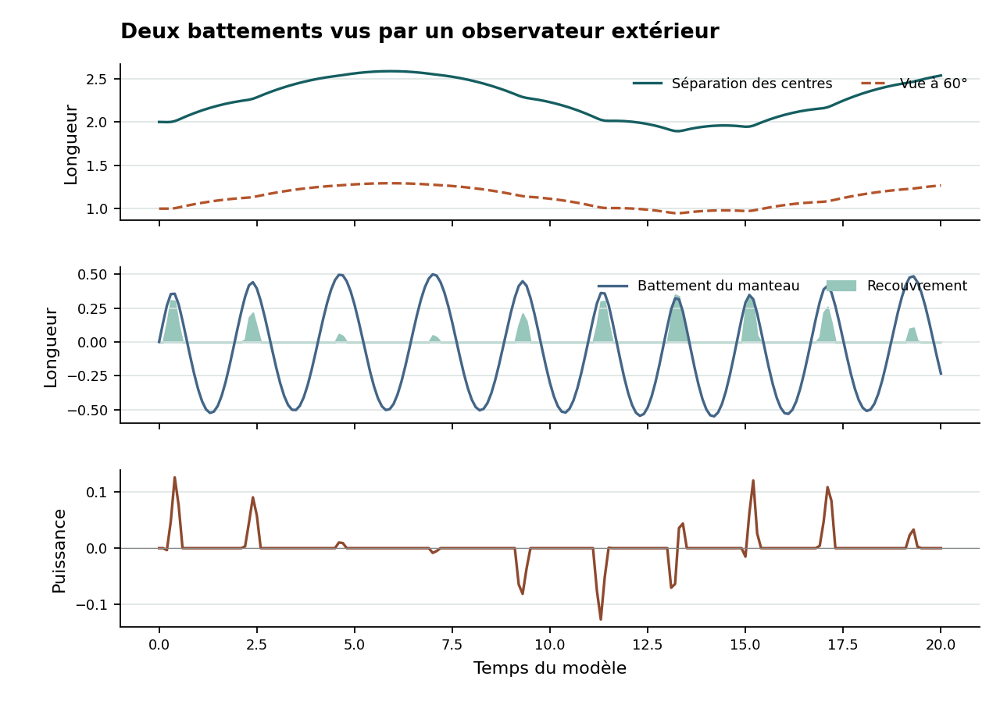

L’onde se lit ici dans $b(t)$, le contact dans $O(t)$, et le transfert d’énergie vers le mouvement de séparation dans la puissance $kO\dot d$. Elle peut changer de signe. La variation de l’énergie de contact vaut $kO(2\dot b-\dot d)$ et compense les deux puissances de contact exercées sur les degrés libres. Une caméra extérieure, centrée sur le milieu de la paire et voyant l’axe sous un angle de 60 degrés relativement à son axe de mesure, lit la composante $d\cos 60^\circ=d/2$. Une caméra alignée lit $d$. Ces deux longueurs décrivent le même mouvement. Ce lecteur géométrique illustratif ne convertit pas l’unité du calcul en mètres. Les tableaux, paramètres et code sont réunis en annexe B.

## Une distance suffit-elle à prévoir la suivante ?

Préparons deux fois la paire à $d=2$, avec une vitesse de séparation nulle, un déplacement de manteau $b=0$ et la même énergie totale $H=0{,}10$. Seul le signe du mouvement interne change. Dans la première préparation, $p_b=+\sqrt{0{,}18}$ et les manteaux commencent par s’élargir. Dans la seconde, $p_b=-\sqrt{0{,}18}$ et ils commencent par se contracter. Un appareil qui lit la distance des centres et leur vitesse de séparation attribue le même état initial aux deux paires. Il conserve la même orientation dans tout l’essai.

\Needspace{7\baselineskip}

| Préparation | Distance à $t=1$ | Distance à $t=2$ |
|:---|---:|---:|
| Manteaux initialement sortants, contact actif | 2,118257 | 2,235958 |
| Manteaux initialement entrants, contact actif | 1,949576 | 1,930571 |
| Contact désactivé, dans les deux préparations | 1,949576 | 1,792792 |

Les distances et les temps sont en unités réduites. Le tableau provient du pas de Verlet $0{,}0005$. Les pas $0{,}004$, $0{,}002$ et $0{,}001$ donnent aussi un écart de séparation voisin de $0{,}169$ à $t=1$ avec le contact actif. L’écart disparaît à chaque instant calculé quand sa raideur est annulée. Dans le modèle avec contact, une loi déterministe autonome qui donnerait une évolution unique à partir de la seule séparation et de sa vitesse initiales échoue donc sur cette paire de préparations. Conserver le degré de liberté interne suffit ici à départager les trajectoires. L’essai documente la conséquence d’une réduction de variables dans le modèle de la paire. La géométrie réelle de l’espace-temps reste une question expérimentale distincte.

Chorin, Hald et Kupferman étudient ce problème de fermeture avec la dynamique projetée de Mori et Zwanzig. L’élimination de variables peut y faire apparaître une dépendance à l’histoire. Le calcul de la paire établit la perte de prédictibilité de la paire de variables retenues pour ces deux préparations. Pour en déduire un terme de mémoire particulier, il faudrait encore calculer sa forme. [Chorin, Hald et Kupferman, dynamique projetée](https://doi.org/10.1073/pnas.97.7.2968)

## Qu’est-ce qui entretient un battement ?

Le mot *vital* désigne, dans le vocabulaire de BST, la possibilité qu’une organisation se maintienne par son activité alors même que ses constituants et ses échanges changent. Quel fait observable distinguerait cette idée de la simple répétition d’un mouvement ? Le modèle du manteau oscillant permet d’isoler une première question. Une préparation peut-elle conserver le même rythme alors que de l’énergie la traverse à chaque période ?

Reprenons le battement libre hors contact, d’inertie $\mu$ et de raideur $\kappa$. Dans le système conservatif, l’énergie du mode $E_b=(\mu\dot b^2+\kappa b^2)/2$ demeure constante. Pour ouvrir ce modèle à une source de travail $F(t)$ et à une perte visqueuse $\gamma\dot b$, posons $\mu\ddot b+\gamma\dot b+\kappa b=F(t)$. En multipliant par $\dot b$, on obtient le bilan $dE_b/dt=F\dot b-\gamma\dot b^2$. Ces deux termes ont les dimensions d’une puissance. Avec $\Omega=\sqrt{\kappa/\mu}$ et $F=\gamma B\Omega\cos(\Omega t)$, la trajectoire $b=B\sin(\Omega t)$ est une solution exacte. La puissance moyenne reçue et celle dissipée valent toutes deux $\gamma B^2\Omega^2/2$.

Le contrôle garde la préparation $b(0)=0$, $\dot b(0)=B\Omega$, avec $\mu=0{,}3$, $\kappa=2$, $B=0{,}1$. Après dix périodes libres, le témoin conservatif a gardé sa propre énergie initiale de $0{,}0100$ en unités réduites. Avec $\gamma=0{,}06$ et l’apport périodique, le battement suit la même trajectoire. Il a cependant reçu et dissipé $0{,}04867$ unité d’énergie, soit près de cinq fois son énergie initiale. En coupant cet apport tout en gardant la perte, l’énergie restante tombe à $0{,}773$ % de sa valeur initiale. Observer seulement le rayon pendant le régime entretenu ne permettrait pas de choisir entre les deux premières préparations. Une mesure du travail ou une coupure de l’apport les départage.

Chez le vivant, une question supplémentaire est de savoir comment l’organisation règle et renouvelle elle-même son activité. Ici la force est prescrite de l’extérieur. Un rapprochement expérimental précise la portée du mot « battement ». Nakajima et ses collègues ont observé hors de la cellule un cycle circadien de phosphorylation de KaiC dans un système biochimique reconstitué. Une oscillation propre à un mécanisme du vivant peut ainsi être étudiée séparément de l’organisme. Dans BST, passer du maintien d’un mode à celui d’un organisme demanderait d’identifier la frontière, le renouvellement, la régulation et la récupération après perturbation. [Nakajima et coll., oscillation circadienne reconstituée](https://doi.org/10.1126/science.1108451)

## Quand un battement et un signal mesurent-ils le même temps ? {#common-cone}

Imaginez un éclair au milieu d’un train. À chaque seconde, sa lumière atteint des points un peu plus éloignés. Si l’on dessine une direction de l’espace à l’horizontale et le temps à la verticale, les trajets de la lumière vers la gauche et vers la droite dessinent un V. C’est une coupe du *cône de lumière*. Son bord indique jusqu’où le signal a pu arriver. Une horloge embarquée suit un trajet à l’intérieur du cône.

Plaçons un miroir au sol du wagon et un autre au plafond. Un aller-retour de lumière fait un tic. Dans le train, la lumière monte et descend. Depuis le quai, elle suit deux diagonales, car les miroirs avancent. La lumière ayant la même vitesse pour les deux observateurs, le quai mesure un intervalle plus long entre deux tics. BST pose alors une question précise. Si l’on remplace les miroirs par un battement du substrat, réglé au même rythme au repos, les deux horloges restent-elles d’accord dans le train en mouvement ? Le calcul donne ci-dessous la condition de cet accord. Régler les horloges au repos suffit à choisir l’unité de temps. Les comparer en mouvement permet de tester la géométrie que chacune mesure.

**Deux équations issues du substrat.** Reprenons le modèle de champ du substrat sur un fond uniforme, à l’équilibre, en négligeant les termes au-delà du premier ordre dans les équations du mouvement. On choisit un mode d’orientation neutre $u$ sans terme de rappel local, et une petite variation $\sigma=s-s_0$ du champ de résolution. Au premier ordre, $\sigma$ est la variation relative de longueur $\delta\ell/\ell(s_0)$. Dans ce régime continu et isotrope, les équations du chapitre 3 donnent

$$\begin{aligned}
\partial_t^2u-c_q^2\Delta u&=0,\\
\partial_t^2\sigma-c_s^2\Delta\sigma+\Omega_0^2\sigma&=0,
\qquad c_s^2=k_s/m_s,\quad\Omega_0^2=U_s''(s_0)/m_s.
\end{aligned}$$

La vitesse $c_q$ provient du rapport entre raideur de gradient et inertie du mode d’orientation. Les unités du noyau lui donnent la valeur 1. Pour le battement, $m_s>0$, $k_s>0$ et $U_s''(s_0)>0$ donnent respectivement une inertie, une vitesse réelle et une fréquence au repos. Les dérivées de plus haut ordre déterminent les directions caractéristiques, c’est-à-dire les directions possibles des fronts. Le rappel local crée la pulsation $\Omega_0$ et laisse ces directions intactes. **Ces deux branches ont un cône commun exactement lorsque $k_s/m_s=c_q^2$** sous les hypothèses indiquées. L’action autorise aussi des valeurs différentes de ce rapport.

Le modèle possède aussi un signal de jauge. Sur ce même fond neutre, la force de courant s’annule au premier ordre pour une perturbation libre des liens. En jauge temporelle, prenons une polarisation $A_y(x,t)$ perpendiculaire à la propagation. La contrainte de Gauss est satisfaite pour ce mode transverse et l’équation des liens se réduit à $m_A\partial_t^2 A_y-k_A\partial_x^2A_y=0$. Sa vitesse caractéristique est $c_A=\sqrt{k_A/m_A}$. Le lecteur électrique du modèle suit $E_y=-\partial_t A_y$. Le critère pour l’orientation, le battement et ce signal de jauge est donc $c_q^2=k_s/m_s=k_A/m_A$ dans les mêmes unités. Ce secteur de jauge est un candidat pour un raccord à l’électromagnétisme détecté en laboratoire.

**Première horloge, l’écho.** Deux miroirs idéaux, séparés transversalement d’une distance $a$, se déplacent ensemble à vitesse $v$ suivant $x$. Supposons leur séparation transverse stable, leur réflexion instantanée et le signal isotrope de vitesse $c_{\rm sig}$, égale à $c_A$ pour le signal de jauge et à $c_q$ pour le mode d’orientation. Dans le repère où ils avancent, le signal parcourt $c_{\rm sig} t_1$ pour atteindre le second miroir. Celui-ci s’est déplacé de $v t_1$ pendant la traversée. Le triangle donne $(c_{\rm sig}t_1)^2=a^2+(vt_1)^2$. Au retour, la géométrie est la même. Si $T_0=2a/c_{\rm sig}$ est la période au repos, la période observée en mouvement vaut $T(v)=2t_1=T_0/\sqrt{1-v^2/c_{\rm sig}^2}$. Le rapport des nombres de cycles par unité de temps est donc $r_{\rm e}=T_0/T(v)=\sqrt{1-v^2/c_{\rm sig}^2}$. Cette horloge construit sa durée à partir du signal choisi. [Pössel, construction de l’horloge à lumière](https://www.einstein-online.info/en/spotlight/light-clocks-time-dilation/)

**Deuxième horloge, un cycle interne.** La pulsation d’une petite perturbation de résolution vérifie $\omega^2=\Omega_0^2+c_s^2 k^2$. Préparons une superposition de modes voisins de nombre d’onde $k$ et suivons son enveloppe, de vitesse $v=d\omega/dk=c_s^2 k/\omega$ en limite de bande étroite. Un lecteur sensible au champ réel $\sigma$ compte ses oscillations sur le trajet $x=vt$. Il lit la phase $\omega t-kx$ à un signe global près. La pulsation qu’il compte par unité de temps du laboratoire vaut

$$\omega-kv=\frac{\Omega_0^2}{\omega}
  =\Omega_0\sqrt{1-v^2/c_s^2}.$$

Le rythme relatif du battement est donc $r_s=\sqrt{1-v^2/c_s^2}$. On obtient $r_s=r_{\rm e}$ pour tout mouvement inertiel admis par les deux branches si leurs rapports de raideur à inertie fixent la même vitesse. Réciproquement, dans cette famille isotrope, les deux rythmes à une même vitesse non nulle ne peuvent être égaux que si $c_s=c_{\rm sig}$. Dans le cas commun, les deux constructions donnent $d\tau=dt\sqrt{1-v^2/c_{\rm sig}^2}$ après normalisation de leurs cycles au repos. Les deux ondes employées ici sont étendues. Leurs crêtes permettent de suivre une phase et d’en compter les cycles. Pour construire une horloge attachée à un objet localisé, il faudrait établir qu’un paquet d’ondes ou un mode lié reste lisible le long du trajet pendant la durée de la mesure. La période propre du manteau oscillant, calculée plus haut avec son temps d’intégration, ne suffit pas à prouver que cet autre modèle se transforme de la même façon.

### Comment reconnaître deux cônes distincts dans les lectures ?

Un premier calcul envoie une impulsion sur un anneau et mesure la date du maximum à deux capteurs. On effectue la mesure sur l’orientation, puis sur la composante électrique transverse du modèle de jauge. Leur écart de position divisé par le retard donne une vitesse du signal. Ce maximum estime la vitesse de propagation dans la limite continue de la branche sans dispersion. Un deuxième calcul intègre les oscillations de deux modes voisins, mesure leurs pulsations et suit une crête de leur enveloppe. On compte les passages par zéro dans le même sens du champ oscillant sur cette trajectoire. Le rythme du battement vient de ces cycles. Le rythme de l’écho du tableau se calcule à partir du temps de vol du signal de jauge et de la vitesse de la crête, avec la géométrie des miroirs idéaux. Ce contrôle simule les champs. La dynamique du matériau des miroirs reste une hypothèse du montage.

En unités réduites, $c_q=m_s=m_A=\Omega_0=1$. Dans la première préparation, $k_A=k_s=1$ et le nombre d’onde central vaut $3/4$. Le témoin « Échelle » change la raideur $k_s$ en $9/16$. Son nombre d’onde central est $16/9$ pour garder la même vitesse d’enveloppe $0{,}6$ en limite continue. Le témoin « Jauge » conserve le battement initial et change uniquement la raideur $k_A$ en $9/16$. Les deux dernières colonnes sont les rythmes rapportés au repos.

\Needspace{9\baselineskip}

| Préparation | Pas spatial | Vitesse de la crête | Rythme de l’écho | Rythme du battement |
|:---|---:|---:|---:|---:|
| Commun | 1/4 | 0,596770 | 0,800051 | 0,802932 |
| Échelle | 1/4 | 0,584192 | 0,809378 | 0,620199 |
| Jauge | 1/4 | 0,596770 | 0,599884 | 0,802932 |
| Commun | 1/32 | 0,599950 | 0,800005 | 0,800046 |
| Échelle | 1/32 | 0,599752 | 0,800153 | 0,600317 |
| Jauge | 1/32 | 0,599950 | 0,600009 | 0,800046 |

À $v=0{,}6$, la limite du rythme est $0{,}8$ pour les deux horloges du premier cas. Dans le témoin « Échelle », seul le battement tend vers $0{,}6$. Dans le témoin « Jauge », seul l’écho de jauge tend vers $0{,}6$. L’écho calculé avec l’orientation tend vers $0{,}8$ dans les trois cas. Ces écarts persistent au raffinement. Les deux sens de déplacement, le changement de pas temporel et le resserrement de la bande figurent en annexe B et dans les données.

### Comment le même champ règle-t-il la lumière et une horloge au repos ?

Le modèle d’horloge sur fond statique pose une autre question. Si l’on change localement la longueur de résolution, une onde transverse et une horloge de matière reconstruisent-elles des durées compatibles ? Prenons d’abord un fond statique isotrope. Dans les unités où la vitesse de référence vaut 1, écrivons l’intervalle sous la forme $d\mathcal S^2=-T(s)\,dt^2+H(s)\,d\mathbf x^2$. Dans l’action de matière à couplage métrique minimal, le coefficient spatial du terme quadratique est $\sqrt{TH}$ et celui du terme quartique est $\sqrt{T/H}$. Cela vient du volume $\sqrt{TH^3}$ et d’un facteur $H^{-1}$ par paire de dérivées spatiales contractées. Ce modèle identifie ces deux poids à ceux de son énergie, $1$ et $e^{2s}$. Les deux équations donnent $T=e^{2s}$ et $H=e^{-2s}$. Cette identification fixe une métrique candidate dans la famille choisie.

Les coefficients des liens sont alors $m_A=g^{-2}e^{-2s}$ et $k_A=g^{-2}e^{2s}$, où $g$ est le couplage. Le signal transverse a pour vitesse de coordonnée $c_A=\sqrt{k_A/m_A}=e^{2s}$. Une horloge immobile doit accumuler $d\tau=e^s dt$, et une longueur propre locale vaut $dL=e^{-s}|d\mathbf x|$. En combinant ces trois résultats sur un rayon lumineux, on trouve $dL/d\tau=1$. Une mesure locale de la lumière avec des règles et des horloges qui suivent ces lois donne ainsi la même vitesse pour toute valeur uniforme de $s$. Pour un trajet de vitesse de coordonnée $v$, la métrique candidate donnerait $d\tau=e^s\sqrt{1-v^2/e^{4s}}\,dt$. Les fréquences radiales ci-dessous éprouvent le facteur au repos. Une règle de longueur transportable reste à construire dans le modèle.

**Que compte l’horloge de matière ?** Le modèle d’horloge de matière compte des oscillations radiales couplées de l’orientation $q$ et de la résolution $s$, autour de configurations localisées de deux degrés topologiques. Deux préparations sont homologues lorsque leurs profils et leurs bords se correspondent sous $s\mapsto s+\delta$, $x\mapsto e^\delta x$ et $t\mapsto e^{-\delta}t$. À phase égale, une période de coordonnée est donc divisée par $e^\delta$. Pour $\delta=0{,}12$, les pulsations calculées augmentent d’un facteur $1{,}127497$, en accord avec $e^{0{,}12}$. Un témoin à liens figés et aux inerties du modèle témoin donne $0{,}886920$, soit le sens opposé. Le signal transverse fournit une lecture indépendante. À $s=0{,}12$, sur 200 pas en deux périodes, sa vitesse de coordonnée calculée vaut $1{,}27124898$, pour $e^{0{,}24}=1{,}27124915$. Le dossier permet de refaire les 24 préparations radiales et les douze trajectoires transverses, témoins compris, à partir des profils et des programmes d’origine.

**Un mode peut rester à l’intérieur du cône de la lumière.** Dans cette version à longue portée, le champ $s$ a un gradient quartique et aucun rappel linéaire dans le vide. Sa perturbation longitudinale sur fond statique a pour vitesse $c_{s,\parallel}/c_A=\sqrt{(2+3X)/(8+4X)}$, avec $X=\eta e^{2s}|\nabla s|^2\geq0$ et $\eta=1000$ dans le banc. Sur fond uniforme, le rapport vaut $1/2$. Le mode radial collectif utilisé comme horloge au repos et cette perturbation libre sont deux préparations différentes. L’horloge en mouvement utilise un mode oscillant du champ de résolution avec rappel $U_s''>0$. Les résultats répondent ensemble à la question du cône sans attribuer une unique vitesse de front à toutes les excitations. La même prudence vaut pour la gravitation. Sur le fond statique, les intervalles radiaux du rapport entre source du champ et inertie de translation sont disjoints pour les deux degrés testés. Une variante du modèle de champ examine une autre inertie, $m_s=c_A^{-2}(a+bX)$. La condition pour que le front longitudinal reste dans le cône est $a+bX\geq2+3X$. Pour que les deux fronts coïncident sur tout fond statique de cette famille, il faut $a=2$ et $b=3$. Même à cette valeur, les intervalles de source sur inertie restent disjoints pour les deux profils radiaux testés. La chute universelle impose ainsi un contrôle supplémentaire.

**Une mesure au laboratoire.** Si l’on identifie en champ faible $s=\Phi/c^2$, où $\Phi$ est le potentiel newtonien, la cadence $e^s$ redonne au premier ordre $\Delta f/f=\Delta\Phi/c^2$. Bothwell et ses collègues ont mesuré le gradient de fréquence d’une horloge au strontium sur une étendue millimétrique. Dans leur axe, ils trouvent $(-9{,}8\pm2{,}3)\times10^{-20}$ par millimètre, pour une valeur attendue de $-10{,}9\times10^{-20}$ par millimètre. La relativité générale donne cette même prédiction. La comparaison contraint ici le modèle sous l’identification de $s$ au potentiel. La sous-section suivante reconstruit cette transition à partir de mesures indépendantes de la raie d’horloge et examine le couplage que BST doit encore dériver. [Bothwell et coll., gradient gravitationnel d’une horloge atomique](https://doi.org/10.1038/s41586-021-04349-7)

**Passage aux horloges physiques.** Un cône local fixe une géométrie à un facteur conforme près. Ainsi $g$ et $F(x)^2g$, avec $F>0$, ont les mêmes directions nulles, tandis que leurs durées propres le long d’un trajet sont dans le rapport $F(x)$ à chaque événement. Le calcul sur fond statique propose une façon de fixer ce facteur pour deux familles de modes. Il reste à suivre des horloges de matière de compositions distinctes en mouvement et en champ variable, et à dériver le couplage de la jauge au signal électromagnétique réellement détecté. Dans le registre des comparaisons physiques, la ligne D07.3 compare déjà le transport d’une fréquence atomique de Sirius B dans une métrique spécifiée. Une autre épreuve accessible est la comparaison d’horloges optiques de Chou et coll., sensibles à un mouvement relatif inférieur à 10 m/s et à une différence de hauteur inférieure au mètre. Une prédiction propre à BST exigerait de fixer les coefficients sur d’autres observations, puis de calculer les deux décalages avec les mêmes couplages. [Ehlers, Pirani et Schild, structure des cônes locaux](https://doi.org/10.1007/s10714-012-1353-4) · [Chou et coll., horloges optiques et relativité](https://doi.org/10.1126/science.1192720)

### D’où vient la fréquence d’une véritable horloge au strontium ?

Dans le strontium neutre 87, l’horloge utilise la différence d’énergie entre le fondamental $g=5s^2\,{}^1S_0$ et l’état excité $e=5s5p\,{}^3P_0$. La phase relative des deux niveaux s’accumule à la pulsation $(E_e-E_g)/\hbar$ par unité de temps propre. On la compare à la phase d’un oscillateur optique. Un cycle correspond à $2\pi$ et la fréquence propre vaut donc $\nu_0=(E_e-E_g)/h_{\rm P}$, où $h_{\rm P}$ est la constante de Planck.

**Reconstruire l’écart sans prendre la raie d’horloge en entrée.** Courtillot et ses collègues ont mesuré, pour le même isotope et les composantes de moment angulaire total $F=9/2$, l’intervalle du fondamental vers $p=5s5p\,{}^3P_1$, puis celui entre $e$ et $p$. Le premier vaut $434\,829\,343\,010$ kHz. Le second, mesuré par piégeage cohérent de population, vaut $5\,601\,338\,670$ kHz. Chaque intervalle a une incertitude publiée de 50 kHz. Comme $E_e-E_g=(E_p-E_g)-(E_p-E_e)$, leur différence redonne $429\,228\,004\,340$ kHz, avec l’incertitude de 70 kHz publiée pour cette détermination indirecte. L’écart à la fréquence recommandée du BIPM, $429\,228\,004\,229\,872{,}992$ Hz, vaut $+110{,}127$ kHz. Les deux fréquences sont en accord à environ $1{,}6$ fois l’incertitude de l’estimation de Courtillot et coll. Cette reconstruction utilise deux mesures reliant trois niveaux du même atome. Cette valeur fournit un étalon externe aux calculs de BST. [Courtillot et coll., tableau I et section V](https://doi.org/10.1140/epjd/e2005-00058-0) · [BIPM, fiche du strontium 87, ajustement 2025](https://www.bipm.org/documents/20126/288515313/87Sr_429THz_2025/bbd827f7-3e1e-5fbe-6bd8-0eadd9b5b674)

**Transporter sa phase dans le champ de résolution.** Si les deux niveaux évoluent selon le même temps propre et que leurs énergies propres sont indépendantes de $s$, la différence de phase au repos satisfait $d\varphi=2\pi\nu_0\,d\tau=2\pi\nu_0 e^s dt$ dans la métrique statique définie ci-dessus. La cadence de coordonnée est alors $\nu_0 e^s$. Avec $s=\Phi/c^2$ au premier ordre, le gradient de référence dans l’axe vertical de Bothwell vaut $-1{,}09\times10^{-19}$ par millimètre. Multiplié par la fréquence reconstruite ci-dessus, il donne $-46{,}8$ microhertz par millimètre. La pente mesurée sur le nuage atomique se traduit dans la même unité par $-42{,}1\pm9{,}9$ microhertz par millimètre. Ces dernières valeurs proviennent d’une mesure de fréquence relative. La fréquence recommandée du BIPM sert uniquement à contrôler la reconstruction au repos.

Si le champ modifie aussi l’intervalle propre, posons $K=\partial_s\ln(E_e-E_g)$ dans le voisinage mesuré. La pente fractionnaire de la fréquence de coordonnée devient $(1+K)\partial_z s$. Sous le raccord au potentiel terrestre et à la lecture optique de l’expérience, les pentes publiées donnent $K_{\rm eff}=-0{,}10\pm0{,}21$, en propageant l’incertitude de mesure et en tenant la pente gravitationnelle de référence fixe. Cette lecture relative est compatible avec le couplage commun $K=0$. Pour qu’elle départage deux réalisations de BST, celles-ci doivent donner des valeurs de $K$ avant le recours à cette mesure. [Bothwell et coll., gradient de fréquence à travers un échantillon millimétrique](https://doi.org/10.1038/s41586-021-04349-7)

**Ce que les données atomiques du modèle déterminent.** Dans l’atlas atomique de cette édition, la ligne du strontium neutre donne 38 électrons et un seuil de première ionisation de $5{,}69486745$ eV. Le seuil relie le fondamental au continuum de l’ion. La transition d’horloge relie deux niveaux neutres espacés d’environ $1{,}77514$ eV. L’insuffisance du seul seuil se montre directement. Dans un Hamiltonien effectif, ajouter $\lambda|e\rangle\langle e|$ déplace l’état excité de $\lambda$ en conservant le fondamental et le seuil, pour une petite variation gardant le même ordre des niveaux. La fréquence d’horloge change de $\lambda/h_{\rm P}$. Cet exemple établit ce que le seuil permet d’identifier. Une dérivation microscopique propre à BST réclame donc un opérateur sur les états neutres, l’identification des deux états et le calcul de leur différence d’énergie à paramètres fixés par d’autres données. La fréquence de référence utilisée ici est fournie par la spectroscopie.

BST associe au strontium une géométrie et un opérateur de réponse aux contacts. Le chapitre 4 donne le résultat de la confrontation à la raie d’horloge. L’[annexe B](#sr-contact-detail) dérive l’opérateur et teste deux choix de dynamique, en distinguant taille, inertie et degrés de liberté angulaires.

# 3. Propriétés et dynamique du substrat {#substrate-model}

L’identification du substrat à l’Univers physique est un postulat de BST. Pour lui donner un contenu mathématique, il faut spécifier ce qui peut varier en chaque lieu, les états qui coûtent de l’énergie, les mouvements que cette énergie autorise et la réponse d’un appareil. Ce chapitre explicite le modèle variationnel du substrat. Les grandeurs qu’il emploie peuvent être évaluées sur une préparation. L’identification de ses champs à la réalité physique dépend ensuite de prédictions confrontées à des mesures.

## État local, directions et temps caractéristiques

Sur un réseau de pas $h$, le site $x$ porte une orientation interne $q_x\in S^3$ (un vecteur à quatre composantes de norme 1) et le scalaire sans dimension $s_x=\log(\ell_x/\ell_*)$. La valeur $\ell_*>0$ fixe l’unité de longueur de résolution. Un lien orienté de $x$ vers $y$ porte un angle de transport $A_{xy}$. Avec leurs vitesses ou leurs moments, ces variables constituent l’état. Le $S^3$ des orientations est un espace d’états interne. La surface du manteau radial dans l’espace physique du chapitre 1 a deux dimensions.

Comparer deux voisins demande de transporter $q_y$ dans le repère interne de $x$. Notons $R(A_{xy})$ la rotation dans le plan des deux premières composantes. La variation suivant une direction de maille $i$ est $v_i=h^{-1}\log_{q_x}\big(R(A_{xy})q_y\big)$. Le logarithme sur la sphère désigne le vecteur tangent dirigé vers le point comparé, de longueur égale à leur écart angulaire. Cette définition utilise le plus court arc, unique en dehors de l’antipode. Une orientation fixée au bord, ou une condition périodique, doit être annoncée avec le calcul. Le test de propagation choisit un fond uniforme et un domaine périodique pour l’impulsion.

Posons $W(u,w)=|u|^2|w|^2-(u\cdot w)^2$. C’est l’aire au carré du parallélogramme formé par deux variations internes. Elle s’annule lorsque leurs directions sont colinéaires. En unités du noyau et par unité de volume, une réalisation des énergies cinétique et de déformation est

$$\begin{aligned}
\mathcal T_q &= \tfrac12\Big[\alpha|\dot q|^2+\beta(s)\sum_i W(\dot q,v_i)\Big],\\
\mathcal V_q &= \tfrac12\Big[\alpha\sum_i|v_i|^2+\beta(s)\sum_{i<j}W(v_i,v_j)\Big],
\qquad \beta(s)=\beta_* e^{2s}.
\end{aligned}$$

Ici $\alpha>0$ et $\beta_*\geq0$. La matrice d’inertie agissant sur le plan tangent se lit directement dans $\mathcal T_q=\dot q^T M_q\dot q/2$,

$$M_q=\alpha I+\beta(s)\sum_i\big(|v_i|^2 I-v_i v_i^T\big).$$

Pour toute vitesse tangente $w$, $w^TM_q w\geq\alpha |w|^2$. L’inertie est donc positive et peut dépendre de la direction et de la déformation déjà présente. Autour d’une préparation stationnaire, la **raideur** est la matrice $K$ des dérivées secondes de l’énergie potentielle sur les variations admissibles. Les petites oscillations libres satisfont $M\ddot z+Kz=0$. Pour un mode de forme $e$, on a $Ke=\omega^2 M e$. Il faut préciser de quel mode longitudinal, transverse ou interne on parle pour attribuer une raideur, une fréquence ou une vitesse au substrat. Une valeur propre négative de $K$ sur une direction physique indique une instabilité linéaire dans cette direction.

## Résolution dynamique et rétroaction

La résolution propre du modèle est un degré de liberté. Autour de $s_0$, avec coefficients locaux constants et en absorbant le poids de volume dans les produits scalaires, son lagrangien est

$$L_s=\tfrac12 m_s\|\dot s\|^2-\tfrac12 k_s\|\nabla_h s\|^2-\sum_x U_s(s_x).$$

Si $L_q$ est la somme de $\mathcal T_q-\mathcal V_q$ avec les mêmes poids, la variation en $s$ donne

$$m_s\ddot s+k_s\nabla_h^*\nabla_h s+U_s'(s)=\partial_s L_q.$$

La dérivée à droite est prise site par site, à déformation et vitesse données. L’opérateur $\nabla_h^*\nabla_h$ est positif et tend vers $-\Delta$ dans la convention employée. Les rapports $k_s/m_s$ et $U_s''/m_s$ ont respectivement les dimensions d’une vitesse au carré et d’une pulsation au carré. Si le transport est dynamique, le lagrangien comprend le terme cinétique $m_A\|\dot A\|^2/2$ et l’énergie de circulation $k_A\|dA\|^2/2$. Ici $dA$ est la somme orientée des angles autour d’une plaquette. Les conditions initiales doivent aussi satisfaire la contrainte de Gauss pour ce secteur de jauge. Le test des horloges en mouvement utilise un fond $q=(0,0,0,1)$, $A=0$, $s=s_0$ avec $U_s'(s_0)=0$. Une petite variation neutre de $q$ suivant la troisième composante et la variation $\sigma$ de $s$ s’y découplent au premier ordre. Les aires $W$ y commencent à l’ordre quatre dans les perturbations. On retrouve ainsi les deux équations du chapitre 2. La dépendance des cônes sur un fond déjà déformé est une question différente.

**Un calcul local de la rétroaction.** En base tangente, choisissons $v_1=(1,0,0)$, $v_2=(0,1/2,0)$, $v_3=0$ et $\alpha=\beta_*=m_s=1$, $s=0$. Les trois inerties principales valent $1{,}25$, $2$ et $2{,}25$. Gardons ces déformations. Au repos de l’orientation, $\partial_s(\mathcal T_q-\mathcal V_q)=-0{,}25$. Donnons-lui maintenant une vitesse $\dot q=(0,0,1)$. L’énergie cinétique vaut $1{,}125$, l’énergie de déformation reste $0{,}75$ et la même dérivée vaut $+1$. Avec $U_s'(0)=0$ et un champ $s$ initialement uniforme, la résolution subit donc deux accélérations de signes opposés au même point. Ce résultat porte sur la réponse instantanée du modèle. Il illustre comment le mouvement agit en retour sur l’échelle qui règle la réponse du substrat.

## Du mouvement à un flux d’énergie puis à une déformation mesurée

Le flux se déduit d’une quantité dont on peut faire le bilan. Pour le champ de résolution dans la limite continue, prenons $m_s\ddot s-k_s\Delta s+U_s'(s)=f$, avec $m_s,k_s$ constants et $f$ la force par unité de volume exercée par les autres degrés de liberté. Multiplier par $\dot s$ donne exactement

$$\mathcal E_s=\tfrac12m_s\dot s^2+\tfrac12 k_s|\nabla s|^2+U_s(s),\qquad
\mathbf j_s=-k_s\dot s\,\nabla s,\qquad
\partial_t\mathcal E_s+\nabla\!\cdot\!\mathbf j_s=f\dot s.$$

La variation d’énergie d’un volume égale le travail reçu à l’intérieur moins le flux sortant. Un battement local uniforme peut osciller tout en ayant $\mathbf j_s=0$. Pour une onde libre de la forme $s_0+B\cos(kx-\omega t)$ autour d’un minimum harmonique, le flux moyen suivant $x$ vaut $k_s B^2\omega k/2$. Dans les unités $m_s=k_s=U_s''=1$, avec $B=0{,}1$ et $k=\pm0{,}75$, le calcul sur une période donne $\pm0{,}0046875$. Les deux ondes ont la même amplitude, la même pulsation et des sens de transport opposés.

Pour relier une modification de $s$ à des horloges et des règles, revenons au fond statique du modèle d’horloge. Les poids $T=e^{2s}$ et $H=e^{-2s}$ donnent $\delta T/T=2\,\delta s$ et $\delta H/H=-2\,\delta s$ au premier ordre. Un décalage uniforme et constant conserve une géométrie plate dans cette métrique. Une variation spatiale peut produire un effet de marée. En champ faible, avec $\Phi=c^2s$, deux sondes lentes séparées de $\xi^j$ ont une accélération relative $\delta a_i\simeq-c^2\sum_j(\partial_i\partial_j s)\xi^j$ sous l’hypothèse du mouvement géodésique. Ce sont les dérivées spatiales du fond reconstruit qui entrent dans cette lecture. Passer d’un flux donné à une courbure demande donc une équation de source, ses conditions aux limites et un test du couplage à la matière. Le chapitre sur la cognition définit, de son côté, le courant entre actes que l’on peut attribuer à un arbitre observé.

## Mémoire, latence et résolution de l’appareil

Un exemple de réduction explique ce que peut signifier un retard de réponse. Soit $w$ un mode interne de pulsation $\omega_L>0$, couplé à un déplacement observable $z$ par $\ddot w+\omega_L^2w=gz$. À conditions initiales données, sa réponse contient le terme

$$g\int_0^t\frac{\sin[\omega_L(t-t')]}{\omega_L}\,z(t')\,dt'.$$

Lorsque $w$ agit à son tour sur $z$, l’équation réduite de $z$ dépend ainsi des mouvements passés et de la préparation de $w$. Le temps de réponse dépend de la fréquence et des couplages. Un déphasage peut donc exister dans un système conservatif. Attribuer un temps mort avant toute réponse ou une dissipation irréversible demande un contrôle propre, par exemple un bilan de l’énergie restituée. Dans une réalisation avec pertes, une matrice $\Gamma$ positive ou nulle donne dans l’équation linéarisée une force $-\Gamma\dot z$ et une puissance dissipée $\dot z^T\Gamma\dot z$. Cette définition permet de tester la passivité sur des coordonnées et des unités spécifiées.

La résolution de l’appareil possède sa propre loi. Par exemple, lisons un champ $\cos(kx-\omega t)$ par une moyenne spatiale gaussienne normalisée, d’écart type $\delta$, sans filtrage temporel. La lecture vaut $e^{-(k\delta)^2/2}\cos(kx-\omega t)$. Doubler la largeur de lecture atténue le contraste de façon calculable sans déplacer la fréquence de ce mode isolé. Changer $s$ peut, en revanche, modifier le coefficient $\beta$ de la dynamique. Changer $h$ à état physique et appareil fixés sert au contrôle de convergence. Ces trois opérations donnent des protocoles distincts pour expliquer pourquoi un motif change d’aspect ou devient invisible.

## Du calcul à la mesure

Notons $X$ l’état préparé. Les équations ci-dessus découlent du principe variationnel $\delta S=0$. Pour des coordonnées $q_a$, sur une trajectoire à extrémités fixées, une réalisation de ce principe satisfait $\frac{d}{dt}(\partial L/\partial\dot q_a)-\partial L/\partial q_a=0$. La paire à battement interne en donne un exemple avec $L=T-V$. Le choix de l’action, des champs, de leurs coefficients et de leurs conditions aux limites apporte le contenu physique. Chaque réalisation précise ces données. Une même écriture variationnelle ne prouve pas que tous ces coefficients ont été déduits d’une unique loi microscopique.

Pour un lecteur linéaire des perturbations du substrat, on écrit une sortie sous la forme
$$y_a(t)=\int_{-\infty}^t\!\int W_a(x,t-t';\ell,\eta_a)\,{\cal O}_a[X(t')](x)\,dx\,dt' + \epsilon_a(t).$$
La grandeur $\mathcal O_a$ précise la quantité couplée au détecteur et $W_a$ sa fenêtre spatiale et temporelle, normalisée en fonction des unités de la sortie. Le terme $\epsilon_a$ représente l’erreur de lecture. La position, le temps d’intégration et la sensibilité de l’appareil changent la mesure possible. Un lecteur non linéaire, par exemple une puissance proportionnelle au carré d’une amplitude dans son domaine de validité, demande sa propre fonction d’observation.

L’atlas d’observation distingue le repère de coordonnées, l’orientation de la vue, le canal, la résolution physique, la détection et la reconstruction. Tourner ensemble le système et son appareil conserve la lecture attendue. Tourner le seul appareil peut masquer une composante. Ainsi, une intensité issue du carré d’une amplitude efface son signe, et une moyenne sur les orientations peut masquer une anisotropie. Pour comparer deux calculs, on précise le centre d’observation, la surface ou l’axe du détecteur, la grandeur qu’il intègre et l’information perdue. Ces six choix forment le protocole de lecture employé dans cet article.

Le **Protocole BST de compatibilité progressive** conserve les intervalles compatibles quand plusieurs valeurs répondent aux mesures. Pour une préparation $i$, une famille $f$ et des paramètres communs $\theta$, appelons $A_{i,f}$ l’ensemble qui satisfait le test annoncé pour cette ligne. L’intersection $\bigcap_i A_{i,f}$ impose les lignes simultanément. Dans un banc fini, les candidats retenus peuvent être disjoints. Les minima et maxima projetés sur un curseur ne garantissent pas toutes leurs combinaisons croisées. La console garde donc l’identité des candidats. Les paramètres propres à une préparation et les paramètres communs doivent être déclarés avant de pouvoir interpréter cette intersection.

Le registre distingue les grandeurs étalonnées, les résultats calculés à paramètres conservés, les rapprochements documentaires et les projections gelées avant comparaison. La tolérance de travail de 10 % intervient là où le protocole la spécifie. Une incertitude publiée se rapporte à une grandeur, une expérience et, si disponible, un niveau de couverture. Deux expériences contradictoires exigent de garder leurs hypothèses et références distinctes. L’annexe A reproduit les décisions par ligne dans leur portée. L’annexe C donne un exemple de prédiction gelée.

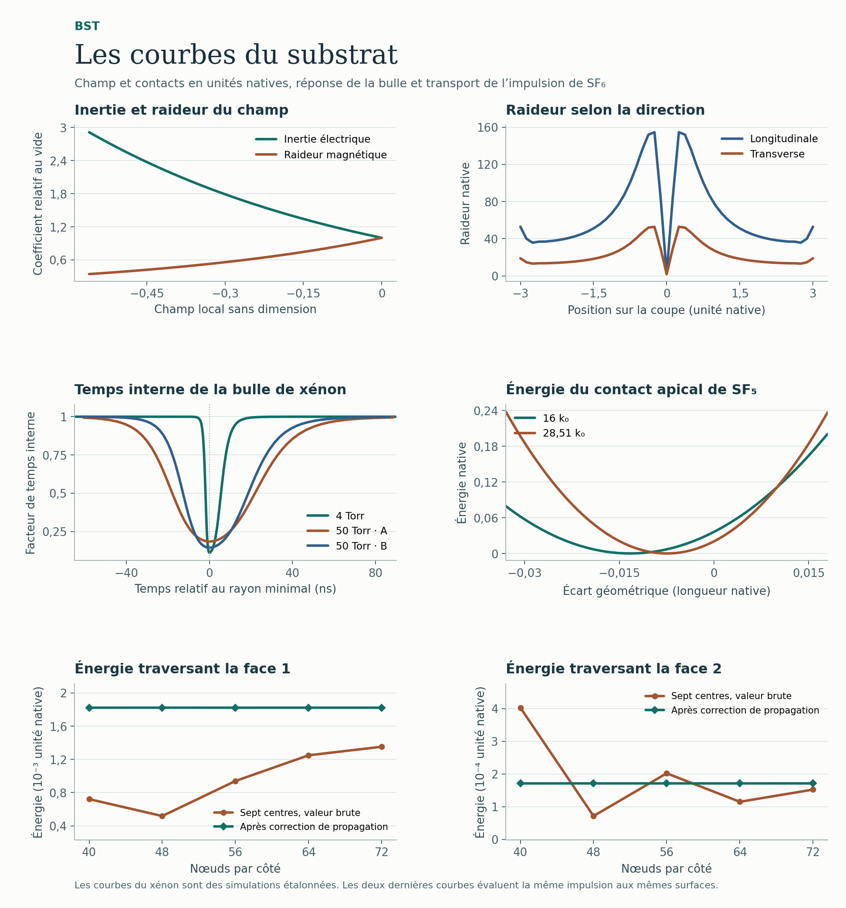

La figure suivante rend visibles les courbes effectivement utilisées. Les premières décrivent une inertie électrique et une raideur magnétique en fonction du champ local. La coupe suivante sépare les réponses longitudinale et transverse. Le temps interne de la bulle de xénon est centré sur le rayon minimal. Les deux dernières lectures de SF₆ suivent la même impulsion sur des maillages différents. Le tableau source conserve pour chaque série les deux unités, le domaine et la version du calcul.

L’annexe C réunit les termes du noyau physique du substrat dans son équation variationnelle générale. Elle précise la restriction qui ramène l’orientation à une seule phase et donne la forme minimale de l’action de cette phase en unités naturelles. Le schéma reliant le substrat, la persistance et l’agent accompagne le lexique.

## Quelles prédictions conserver en changeant d’échelle ?

Dans la renormalisation de Wilson, éliminer des degrés de liberté de courte échelle transforme les interactions effectives. On suit cette transformation de manière à conserver des prédictions à grande échelle. Pour tester une correspondance avec BST, il faudrait spécifier la transformation entre deux de ses lois et une observable qui conserve sa valeur. Réduire la résolution d’une caméra agit seulement sur la lecture du même mouvement. [Wilson, groupe de renormalisation](https://doi.org/10.1103/RevModPhys.55.583)

# 4. Physique et information dans les onze domaines du banc {#domain-tests}

Le banc étalonné réunit onze domaines de physique et d’information. Chacune des 68 exigences possède un résultat dans sa portée. Pour 44 d’entre elles, le registre précise une condition. Parmi les 576 combinaisons de modèles et de paramètres, 192 satisfont ensemble les 67 contrôles pris en compte dans la comparaison commune. C’est le résultat de J00.1 dans les conditions du banc. J00.2 porte sur la décision, les prédictions consignées et les fichiers de reproduction.

Les étalonnages font partie de la méthode. Par exemple, les mesures de durée fixent une bande d’amplitude pour chaque transition nucléaire, et les mesures de viscosité fixent un intervalle de gain commun au krypton et au xénon. L’intervalle admissible est le résultat du calcul. Une prédiction sur une autre mesure conserve les paramètres ainsi déterminés.

Les onze domaines ont chacun des résultats sur les observables prévues au banc. Le registre examine aussi une question plus large pour chaque domaine. Par exemple, en D09, le spectre au xénon donne une énergie moyenne par période et la trace temporelle distingue huit éclairs. Ces lectures laissent plusieurs répartitions possibles de l’énergie entre les éclairs. Identifier l’énergie absolue de chacun demanderait une lecture absolue synchronisée. Sur les vingt-huit contrats d’origine, six sont entièrement satisfaits. Aucun des onze contrats de domaine ne remplit encore toutes ses exigences physiques avec leurs dépendances. Les résultats du banc peuvent dès à présent être soumis à l’examen des pairs et à des épreuves indépendantes. L’annexe A donne les 68 décisions, dont 29 concernent directement un domaine. Avec leurs dépendances, les onze domaines couvrent 64 exigences. G07.1, G07.2, J00.1 et J00.2 portent sur la provenance, la reproduction et la décision commune.

| Domaine | Opération effectuée dans BST | Résultat et conditions |
|:-----------------|:--------------------------------|:---------------------------------------|
| [D01 · Atomes et molécules](#domain-01) | Calcul des six distances S–F d’une même géométrie de SF₆. | Les six distances sont dans l’intervalle de diffraction de 1,559 à 1,563 Å. |
| [D11 · Isotopes et transitions](#domain-11) | Calcul des taux bêta de ⁶He et ¹⁴C avec une amplitude par transition. | Les deux demi-vies contraignent deux intervalles d’amplitude dans une même région de paramètres. |
| [D02 · Courant et polarisation](#domain-02) | Projection d’un même courant sur le plan du détecteur pour quatre directions. | Sur 864 amplitudes, le résidu longitudinal normalisé est inférieur à 6 × 10⁻¹⁶. Ce contrôle porte sur la projection. |
| [D03 · Spectres moléculaires](#domain-03) | Lecture du mouvement des six liaisons de SF₆ avec un même opérateur de réponse. | Écart maximal de 5,70 % sur huit lectures d’aire. Le profil de la bande faible est ajusté aux deux pressions. |
| [D04 · Mécanique et flux](#domain-04) | Suivi de l’énergie qui sort par deux faces après une impulsion, avec un témoin vide. | De 64 à 72 sites par axe, le flux corrigé varie de 0,00888 % et 0,02119 % selon la face. |
| [D05 · Thermodynamique](#domain-05) | Calcul de la capacité thermique à volume constant à partir de la même correction d’énergie libre. | Écarts maximaux sur la capacité résiduelle de 4,70 % et 4,28 % dans les deux branches ajustées. |
| [D06 · Transport et viscosité](#domain-06) | Application de deux estimateurs aux trajectoires de Kr et de Xe. | Dans la branche 0, les deux gaz et les deux estimateurs admettent un gain commun entre 1,04246 et 1,15190. |
| [D09 · Sonoluminescence](#domain-09) | Mise en correspondance du rayon de la bulle, de la phase et des éclairs au xénon. | Huit éclairs ont un instant et une amplitude relative. Le spectre donne une énergie moyenne dans la bande mesurée. |
| [D07 · Horloges et gravitation](#domain-07) | Transport de la raie locale sur deux géométries spécifiées pour Sirius B. | Les deux calculs donnent 80,023 km/s. La mesure différentielle principale vaut 80,65 ± 0,77 km/s. |
| [D08 · Cosmologie](#domain-08) | Calcul des spectres, distances et lectures de croissance pour douze familles utilisant le transfert CAMB. | Les douze passent les critères annoncés sur les spectres de Planck et les blocs de distances et de croissance. |
| [D10 · Information et mémoire](#domain-10) | Préparation de deux signes de mémoire indiscernables au repos, puis interrogation par une impulsion commune. | Dans 72 paires simulées, le lecteur donne 0 bit au repos et 1 bit après la sonde, sans bruit ajouté. |

## Des états quantiques aux raies mesurées

Le parcours commence avec les atomes, puis leurs assemblages moléculaires. Le détour par les noyaux précise ce qui change quand on remplace un isotope. Le couplage de la matière au champ électromagnétique, déjà présent dans les atomes, permet ensuite d’exciter ces états et de lire un spectre. La fréquence du strontium au chapitre 2 illustre les trois opérations de préparation, de lecture et de comparaison.

### D01. Des niveaux atomiques à la géométrie moléculaire {#domain-01}

Comment savoir si deux nombres désignent la même chose en calcul et au laboratoire ? Le registre D01 pose la question à trois observables. Dans D01.1, la lumière mesure une **différence entre deux énergies** par $h_{\rm P}\nu=E_b-E_a$. Une raie donne un écart. Identifier ses deux états réclame aussi une préparation et un moyen de les distinguer. Dans D01.2, la diffraction renseigne sur une distance moyennée par la mesure. Dans D01.3, remplacer l’hydrogène par le deutérium déplace une raie sans changer la charge nucléaire. La masse réduite $\mu=mM/(m+M)$ intervient alors dans la dynamique relative.

| Ligne | Calcul que le lecteur peut vérifier | Portée de la comparaison |
|:------------|:-------------------------------------------------|:-------------------------------|
| D01.1 · Raies | Le dossier identifie cinq raies de H. Pour les rapports de fréquences, $1S$–$2S$ sert d’étalon et quatre autres raies contrôlent cette échelle. Dans le calcul à l’échelle absolue, le maximum des écarts relatifs sur les cinq raies vaut $2{,}88\times10^{-6}$ avec chacun des deux étalonnages par recul Rb et Cs, contre $3{,}68$ % avec la charge fixée à l’unité et la normalisation d’action spécifiée. | Rb et Cs désignent ici deux déterminations de la constante de structure fine. Le libellé de D01.1 couvre également He, C, O et Ne. Les chiffres des cinq raies concernent H. |
| D01.2 · Géométrie | Pour SF₆, les six longueurs S–F du calcul de géométrie moléculaire s’étendent de $1{,}559510$ à $1{,}560593$ Å. Elles se trouvent dans l’intervalle de diffraction allant de $1{,}559$ à $1{,}563$ Å publié pour $r_g$. | L’expérience donne une longueur de liaison avec une incertitude annoncée à trois écarts-types. Les six bras du calcul sont confrontés à cette même grandeur. Les intensités et la distribution thermique demandent d’autres lectures. |
| D01.3 · Isotopes | Pour le déplacement $1S$–$2S$ entre H et D, la réduction à masse ponctuelle avec les étalons Rb et Cs donne respectivement un excès de $20{,}8844$ et $20{,}8860$ MHz. L’incertitude expérimentale sur le déplacement est de 15 Hz. | Le banc admet une tolérance de modèle plus large. L’écart dépasse la précision de cette mesure. Les contributions de taille nucléaire, de recul relativiste et d’électrodynamique quantique manquent à la réduction utilisée. |

Les six distances viennent du même échantillon simulé et les deux étalonnages gardent leurs résultats propres. Le passage des atomes aux molécules fait intervenir des mouvements collectifs. Pour SF₆, D02 précise l’excitation par un champ et D03 reprend ce mouvement pour tester les fréquences et les intensités. Les deux jeux de données thermochimiques de 1980 et de 2015 définissent chacun leur scénario de comparaison. [Parthey et coll., déplacement isotopique H–D](https://doi.org/10.1103/PhysRevLett.104.233001) · [Bartell et Doun, diffraction de SF₆](https://doi.org/10.1016/0022-2860(78)80010-6)

Le cas du strontium teste une limite de cette identification. La géométrie de contact donne 17 raideurs positives. À inertie commune, leur dispersion est trop faible pour reproduire le rapport des deux fréquences mesurées. Un second calcul met en mouvement les deux champs de contact. Même la meilleure des 561 paires, sélectionnée après comparaison, place alors la raie d’horloge 0,943 THz au-dessus de sa valeur de référence. L’[annexe B](#sr-contact-detail) donne les deux calculs, le contrôle de changement de rayon et les hypothèses sur les états électroniques.

### D11. Un élément, plusieurs noyaux et plusieurs états {#domain-11}

Le déplacement H–D de D01 introduit une opération précise. Changer le nombre de neutrons change le noyau tout en gardant son numéro atomique $Z$. Ioniser l’atome change sa charge $q$ et le nombre d’électrons liés. Exciter un état peut encore changer l’énergie à $Z$, nombre de masse $A$ et $q$ fixés. L’atlas des isotopes et des ions croise ces opérations. Ses 3 557 masses neutres proviennent de l’évaluation AME2020. Les 5 842 états nucléaires proviennent de NUBASE2020, qui distingue résultats évalués et estimations. Une colonne indique la provenance et le statut des grandeurs. [Wang et coll., masses AME2020](https://amdc.impcas.ac.cn/web/masseval.html) · [Kondev et coll., états NUBASE2020](https://amdc.impcas.ac.cn/web/nubase_en.html)

Le strontium permet de lire la base sans ambiguïté. Les 44 entrées nucléaires de $Z=38$ renvoient à la même géométrie élémentaire de 315 ondes. Pour $^{87}$Sr, la ligne fondamentale est classée stable et la ligne isomérique fournit une excitation nucléaire de $388{,}5287$ keV et une demi-vie de 10 098 s. Les deux lignes ont la même référence géométrique. La raie d’horloge de D01 relie deux états **électroniques** de l’atome. Dans l’atlas, le décompte physique d’ondes par état est renseigné sur 0 des 5 842 lignes nucléaires et 0 des 7 139 lignes de charge. Les 168 cycles de changement d’isotope et de charge se referment à la précision enregistrée sous l’hypothèse de correction isotopique d’ionisation nulle. Cela contrôle la comptabilité énergétique de l’atlas. Distinguer les isotopes par leurs ondes exigerait une préparation sensible à $A$ ou à l’état nucléaire et un lecteur capable de les départager.

**Le raccord des demi-vies et des branches.** Une transition bêta peut emprunter plusieurs canaux. Pour le canal $i$, le comparateur emploie $\lambda_i=C\,f_i(Q_i,Z)\,|M_i|^2$. Le facteur $f_i$ traduit l’énergie disponible, $M_i$ le couplage entre l’état parent et l’état fils, et $C$ fixe la convention de taux. La demi-vie du parent vaut $\ln 2/\sum_i\lambda_i$. La base des états nucléaires contient 19 lignes de transitions avec une demi-vie de référence, dont plusieurs états de charge d’un même parent. Les intervalles ci-dessous figurent dans le calcul des taux bêta.

**Les demi-vies sont compatibles avec une amplitude propre à chaque état.** Pour une même région de paramètres du substrat, le calcul des taux bêta donne des intervalles d’amplitude qui satisfont simultanément les demi-vies de l’hélium 6 et du carbone 14. Pour les parents neutres, on peut prendre $1{,}113\leq |M|\leq1{,}209$ pour l’hélium 6 et $0{,}000964\leq |M|\leq0{,}001037$ pour le carbone 14. Ces bornes sont arrondies vers l’intérieur des bandes suffisantes. Toute valeur de chaque bande respecte la tolérance de 10 % du banc dans tout cet intervalle multidimensionnel. Ces bandes sont étalonnées sur les durées mesurées.

La même construction satisfait à la fois le rapport et la durée partielle des deux principales branches de l’oxygène 19. Pour les niveaux fils de 197 et 1 554 keV, on choisit l’amplitude de la première branche dans la bande certifiée et le rapport des deux amplitudes dans $[2{,}351\,;\,2{,}449]$ (arrondi intérieur). Le rapport témoin de $2{,}4$ donne un rapport de taux de $1{,}183$ à $1{,}216$, inclus dans l’intervalle de référence. Dans le registre du banc commun (D11.2), cet accord étalonné par état est établi pour 384 des 576 assemblages. Les 192 autres se situent hors de la boîte pour laquelle le transfert a été établi.

Dans ce modèle de taux, prédire les durées à partir du seul substrat serait une autre revendication. Il faudrait obtenir les amplitudes $M_i$ à partir des états parent et fils et de leur courant de transition. Le calcul des demi-vies ci-dessus emploie les amplitudes étalonnées. Pour l’interaction forte, les 12 niveaux collectifs calculés sur 15 géométries constituent un résultat distinct. Leur attribution à des états physiques est la question Q2.2.

### D02. Du courant dans le substrat à la polarisation lue {#domain-02}

Le mouvement d’une charge à travers une fenêtre orientée se lit d’abord par une loi de bilan. Pour une région fixe, $\dot Q=-\int_{\partial V}\mathbf j\cdot\mathbf n\,dA$ lorsque la continuité locale s’applique. Un détecteur dirigé vers $\mathbf n$ peut ensuite recevoir la projection transverse de l’amplitude de courant $\mathbf J_k$ au nombre d’onde $k$. Dans le lecteur de courant transverse, $\mathbf J_\perp=(I-\mathbf n\mathbf n^\mathsf T)\mathbf J_k$ avec $\|\mathbf n\|=1$. La lecture de puissance réduite est $\mathbf J_\perp^{\,*}\cdot\mathbf J_\perp$. La direction du détecteur et le choix du centre modifient ainsi le signal reçu.

Le recalcul parcourt six cas, neuf lectures par cas, quatre directions extérieures et quatre nombres d’onde. Pour les 864 amplitudes complexes, la composante longitudinale divisée par le maximum de 1 et de la norme reste inférieure à $6\times10^{-16}$ en unités du calcul. La somme des carrés retrouve chaque puissance publiée dans le dossier. C’est une vérification de l’opération de lecture. La dynamique du champ est éprouvée séparément par la conservation de charge, la propagation et le bilan d’énergie. Neuf intégrations de la réponse du substrat à préparation initiale commune comparent des coefficients du substrat. La normalisation électrique utilise les étalons fondés sur la constante de structure fine. Les comparaisons spectrales contraignent un produit de paramètres. Déterminer séparément la charge par une mesure indépendante est la question identifiée en G02.4.

### D03. Lire un spectre moléculaire avec le même appareil {#domain-03}

Dans SF₆, les six liaisons S–F peuvent participer à un même mouvement collectif. La fréquence de ce mouvement dépend de la raideur et de l’inertie. La force de la raie dépend aussi du couplage au champ et du détecteur. Le lecteur vectoriel commun aux six bras relie ainsi D01, D02 et D03. Dans le calcul, deux étalons d’action donnent des centres de bande distincts. Dans les mesures de la PTB, le nombre d’onde $\tilde\nu$ est donné en cm⁻¹, la section efficace $\sigma$ en cm² par molécule, l’aire $\int\sigma\,d\tilde\nu$ en cm par molécule. Une mesure de position et une mesure d’aire éprouvent deux parties différentes du modèle. [Domanskaya et coll., spectres, conditions et incertitudes](https://oar.ptb.de/resources/show/10.7795/720.20231027)

L’aire de bande se calcule en intégrant les sections efficaces **signées** de la bande faible de 1 100 à 1 160 cm⁻¹, en gardant les points dont le bruit place la valeur sous zéro. Les deux fichiers à $296{,}05$ K contiennent chacun 3 485 abscisses. À $225{,}53$ Torr l’aire vaut $2{,}5711\times10^{-20}$ cm par molécule, et à $745{,}66$ Torr $2{,}4597\times10^{-20}$ dans la même unité. L’aire intégrée publiée vaut $(2{,}5\pm0{,}8)\times10^{-20}$ cm par molécule. Le fichier brut donne aussi l’incertitude élargie de chaque point. Propager ces incertitudes sur l’aire demanderait leurs corrélations. [Domanskaya et coll., intensités intégrées de SF₆](https://www.sciencedirect.com/science/article/pii/S0022407324000293)

Pour le même amortissement réduit $0{,}025$, les deux branches du modèle placent le zéro de réponse à $1\,150{,}753$ et $1\,148{,}516$ cm⁻¹. La comparaison des huit lectures d’aire donne un écart maximal de $5{,}70$ %. Le profil de bande faible utilise une correction à 139 nœuds commune aux deux pressions et un fond d’aire nulle. Le profil est étalonné en commun sur les 6 970 relevés des deux pressions. Un spectre à une pression ou température réservée, avec le zéro, les gains et la correction gelés, éprouverait son transport. Le mouvement des mêmes bras conduit à la question mécanique suivante.

## Du mouvement de la matière à l’éclair d’une bulle

### D04. Quel flux traverse réellement la frontière du calcul ? {#domain-04}

Une impulsion met en mouvement le soufre, les six fluors et le champ qui les entoure. Le bilan compare l’énergie qui franchit deux faces, sur le même temps réduit de 0 à $0{,}36$. D04.1–3 contrôlent le travail des forces, la covariance des rotations, le pas et le retour. Pour les rotations de SF₄ et SF₆, le défaut de covariance des forces est inférieur à $10^{-11}$ en unités du calcul. D04.4 traite la lecture du flux. D04.5 relie l’énergie du système à la déformation et à la libération d’un fluor, avec la préparation et le cycle thermochimique déclarés.

Le lecteur brut mélange le mouvement des sept centres avec l’erreur de propagation numérique du paquet. Pour chaque face, l’estimation corrigée est $E_7(N)-E_{\rm vide}(N)+E_{\rm vide}(\mathrm{continu})$. Les deux premiers calculs ont la même impulsion, la même sonde et le même bord. La même soustraction s’applique aux cinq maillages. Entre 64 et 72 sites par axe, avec la valeur à 72 au dénominateur, les variations brutes des deux faces sont $7{,}618$ % et $24{,}478$ %. Les variations corrigées sont $0{,}00888$ % et $0{,}02119$ %. Ce sont des variations entre maillages. La confrontation distincte à un calcul de champ fin sur trajectoire imposée laisse des écarts de $0{,}0084$ % et $1{,}463$ % à la maille 72. Une convergence entre deux mailles et une comparaison entre deux réalisations ont donc ici des valeurs différentes.

### D05. De l’énergie libre aux grandeurs thermiques {#domain-05}

Pour une phase à l’équilibre, la même énergie libre de Helmholtz $F(T,V,n)$ donne $p=-(\partial F/\partial V)_{T,n}$, $U=F-T(\partial F/\partial T)_{V,n}$ et $C_V=-T(\partial^2 F/\partial T^2)_{V,n}$. À coexistence, les phases comparées d’un corps pur partagent température, pression et potentiel chimique. Une chaleur latente de vaporisation est une différence d’enthalpies dans ces conditions. $C_p$ et $C_V$ supposent deux préparations différentes. Ces relations précisent ce que D05.1–3 demandent à la loi de taille commune aux gaz.

Le modèle thermodynamique introduit une correction $F_{\rm corr}/(nR_gT)=\rho_{\rm mol}\,\delta B_2(T,r)$, où $R_g$ est la constante des gaz et où la densité et le viriel utilisent le même volume. La correction à l’énergie molaire vaut $-R_g\rho_{\rm mol}T^2\partial_T\delta B_2$. Au rayon de l’argon, la solution retenue dans chaque branche a $\delta B_2=a(400\,{\rm K}/T-1)^2$. À $400$ K la correction s’annule, avec sa première dérivée. Sa seconde dérivée laisse pourtant une correction de $C_{V,m}$ égale à $-2R_g\rho_{\rm mol}a$. À $\rho_{\rm mol}=10^{-3}$ mol/cm³, le recalcul analytique et la différence finie donnent $0{,}01173$ et $0{,}00820$ J/(mol K) pour les branches 0 et 1 respectivement. Ce point vérifie la dérivée. Les 36 états de référence HEOS et les 24 valeurs viriales ont servi à l’ajustement. Sur le jeu utilisé, le maximum d’écart de $C_V$ résiduel est respectivement $4{,}70$ % et $4{,}28$ %. Les états de référence sont des valeurs d’équation d’état. Pour une confrontation expérimentale indépendante, température, densité, définition de la capacité et incertitude de la source doivent accompagner la mesure. [Bell et coll., équations d’état utilisées par CoolProp](https://doi.org/10.1021/ie4033999)

### D06. Des contraintes mécaniques à la viscosité {#domain-06}

À l’équilibre, le lecteur de Green–Kubo intègre l’autocorrélation de la contrainte de cisaillement. Si $\sigma_{xy}$ désigne une contrainte intensive de moyenne nulle, le préfacteur est $V/(k_{\rm B}T)$. Le lecteur de Helfand suit la croissance de la variance du courant intégré. Les deux lectures dépendent de la longueur de la trajectoire, de la fenêtre temporelle et de la taille de la boîte. Les interactions et les trajectoires sont partagées entre lecteurs.

La branche 0 dispose de 24 trajectoires de Kr et Xe, sur six graines et deux tailles. Les quatre fenêtres longues alimentent les contrôles des deux gaz par les deux estimateurs. En prenant le maximum des quatre bornes inférieures et le minimum des quatre bornes supérieures de gain, on retrouve l’intervalle commun $[1{,}04246\,;\,1{,}15190]$. Cet intervalle fixe le gain multiplicatif compatible avec les deux gaz et les deux estimateurs. Le gain unité en est exclu. Le dossier conserve les résultats individuels, la dispersion par graine et les effets de durée et de taille. Pour la branche 1, le contrôle disponible est court. La viscosité des mélanges et son évolution générale avec la température restent à déterminer. Le passage à la bulle requiert en plus une interface mobile et un transfert d’énergie vers la lumière.

### D09. Du rayon de la bulle à l’énergie de l’éclair {#domain-09}

BST suit ici un transfert entre le mouvement radial et la lumière détectée. Le banc compare l’énergie intégrée sur une bande pour cinq gaz. Pour le xénon, il peut aussi apparier chaque éclair à la phase et au rayon de la bulle. La première lecture cumule la lumière de nombreux cycles. La seconde date un événement.

Chez Hopkins et ses collègues, un entraînement acoustique entretient une bulle de xénon dans l’acide sulfurique. La figure 3 permet de comparer le rayon de la bulle aux instants des éclairs. La fréquence d’entraînement est de $37{,}8$ kHz. Les deux régimes A et B fournissent quatre cycles chacun. La lecture par diffusion de Mie et celle de la courbe ajustée produisent 16 enregistrements de rayon sur **huit événements distincts**. Des variations supposées de lecture de 1 et 2 µm servent au calcul de sensibilité des pertes visqueuses. La phase est celle de chaque panneau. [Hopkins et coll., figure 3 et méthode de mesure](https://doi.org/10.1103/PhysRevLett.95.254301)

La mesure synchronisée fournit le temps et l’amplitude relative de chacun des huit éclairs. L’intégration du spectre fournit l’énergie moyenne par période dans la bande mesurée. Une moyenne sur huit éclairs fixe une somme d’énergies. Sept différences indépendantes resteraient libres, même si cette moyenne était connue exactement pour les huit événements. La tension relative et le spectre moyen ne déterminent donc pas l’énergie lumineuse absolue de chaque éclair ni son spectre individuel. C’est la portée de D09.2 pour cette préparation au xénon.

## Des horloges locales aux observations du ciel

### D07. De la raie locale au décalage gravitationnel de Sirius B {#domain-07}

Le chapitre 2 établit les conditions d’un cône commun dans les réalisations d’horloges du modèle. Pour étendre la comparaison à une étoile, le calcul de décalage spectral transporte une composante locale d’Hα avec le facteur de cadence statique $N$. Pour un observateur à l’infini, $\nu_\infty=N\nu_{\rm locale}$ et $1+z=1/N$. La mesure astronomique de Joyce et coll. prend Sirius A comme référence et compare les centroïdes observés. Le laboratoire et l’étoile demandent ainsi des conventions de raie explicites. [Joyce et coll., observations différentielles de Sirius A et B](https://arxiv.org/abs/1809.01240)

Pour les deux fonds A et B retenus, $c(1/N-1)$ vaut $80{,}023$ km/s, en unités de vitesse spectroscopique. La mesure principale est de $80{,}65\pm0{,}77$ km/s et l’écart central de $-0{,}627$ km/s. Les deux fonds s’écartent ici de moins de $2\times10^{-9}$ km/s entre eux. Les intervalles obtenus aux quatre coins de masse et de rayon recoupent la lecture principale du détecteur et restent disjoints de sa lecture secondaire. Les deux lectures du même instrument ont des systématiques communes. Sur Schwarzschild et sur Kerr, D07.1–2 éprouvent la propagation sur fond spécifié. Le calcul de Kerr concerne la stabilité d’un mode scalaire. D07.3 laisse ouverte la dérivation du fond de champ fort par la matière qui le produit. [Dolan, modes d’un champ scalaire sur Kerr](https://doi.org/10.1103/PhysRevD.76.084001)

### D08. Des distances individuelles aux statistiques du ciel {#domain-08}

À distance cosmologique, on compare des observables différentes. Une distance transverse ou radiale rapportée à la règle acoustique concerne les oscillations acoustiques baryoniques. La température et la polarisation du fond diffus donnent les spectres TT, TE et EE. La croissance est sondée notamment par $f\sigma_8$. Chaque canal transporte sa propre information, ses étalons et ses corrélations. Le chapitre 5 décrit la projection sur le cône passé et les limites de la dernière diffusion.

Les douze familles du banc utilisent le transfert CAMB, une fermeture cosmologique effective et une hypothèse commune sur les masses. Avec la masse de l’état léger fixée à zéro dans cette fermeture, l’écart de masses au carré choisi, $0{,}002466$ eV² en unités $c=1$, correspond à $0{,}04966$ eV pour la masse effective retenue. Les deux nombres expriment ici une même entrée. Pour chaque famille, le banc borne séparément le score diagonal de chacun des trois spectres Planck, le score de chacun des deux blocs DESI et le score conjoint des douze composantes eBOSS. Les douze familles satisfont ces critères. Le chapitre 5 donne les valeurs, la sélection des fonds et les covariances employées. Les spectres et les 36 scores sont reproductibles depuis les entrées fournies. Un score de bande employant des erreurs diagonales et une vraisemblance expérimentale complète, incluant covariances et nuisances, ont des interprétations statistiques différentes. Une autre loi de propagation proposée dans BST devra fournir ses propres prédictions conjointes de distances, de durées et de spectres. [Collaboration Planck, spectres et vraisemblances 2018](https://doi.org/10.1051/0004-6361/201936386)

## D10. De l’observation à l’information {#domain-10}

**Quand une lecture contient-elle un bit ?** Considérons la mémoire à deux états dont le chapitre 6 décrit la dynamique. Le contenu préparé $C$ prend deux signes équiprobables. Le lecteur de repos renvoie la même valeur aux deux signes. Après une impulsion connue, on lit la courbure du déplacement d’une variable visible à l’instant réduit $0{,}1$. Un seuil analytique, fixé par les paramètres de préparation, décode le signe. La même règle s’applique aux deux signes d’une paire. Pour le résultat discret $Y$ du lecteur, l’information mutuelle est
$$I(C;Y)=\sum_{c,y:\,p(c,y)>0}p(c,y)\log_2\frac{p(c,y)}{p(c)p(y)}.$$
Les probabilités employées ici sont les fréquences des préparations équilibrées du banc. Cette quantité s’exprime en bits. Elle renseigne sur le contenu préparé et sur la sonde spécifiée. [Shannon, mesure de l’information et canal](https://doi.org/10.1002/j.1538-7305.1948.tb01338.x)

Les 144 trajectoires forment 72 paires. Le lecteur constant fournit 0 bit. Le signe décodé après la sonde fournit exactement 1 bit dans cet échantillon sans bruit ajouté. La sensibilité du décodage se calcule en bornant une erreur additive sur la statistique de décision. Une paire garde ses deux décodages pour toute erreur d’amplitude au plus $\varepsilon$ si la plus petite de ses deux distances au seuil est strictement supérieure à $\varepsilon$. Dans les unités réduites de la statistique, la marge minimale vaut $2{,}12079$. Pour $\varepsilon=2$, les 72 paires restent garanties, pour $\varepsilon=3$, 48, et pour $\varepsilon=10$, aucune. Perdre la garantie signifie qu’une erreur admissible pourrait faire franchir le seuil. La proportion d’erreurs réellement commises dépendrait d’une distribution de bruit, que ce contrôle ne suppose pas.

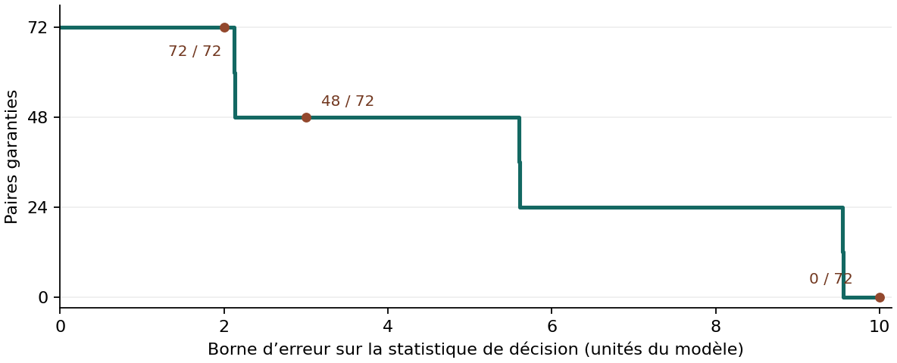

**De la mémoire à l’imagination.** La mémoire demande que le contenu se maintienne entre écriture et relecture. Le test de mémoire de phase compare huit messages à 41 instants. Le modèle conservant la phase récupère 328 messages sur 328 avec la référence appropriée. Dans le témoin qui efface la phase, 41 réponses sur 328 coïncident avec le message, alors que la norme seule garde la même lecture. L’imagination désigne dans BST la production de continuations possibles. La sélection resserre ces possibilités et l’arbitrage engage, suspend ou révise le critère du choix. Un bit récupéré dans le porteur bistable teste la distinction entre deux préparations. Inférer l’identité d’un sujet ou l’origine de son initiative demande les prémisses discutées au chapitre 6. La comparaison humaine de la tâche *Horizon* y garde comme unité de validation la personne tenue à l’écart du réglage. Un calcul sur ces réponses et une attribution de vécu portent sur des questions distinctes.

Le parcours de reproduction `domain-observables` fournit les lectures ci-dessus et la carte des 29 clauses directes vers leurs pièces justificatives. Le parcours `cognition` reconstruit les trajectoires et leurs décodeurs, `cosmology` les projections et `atomic-modes` les opérateurs atomiques. L’annexe C rassemble la loi variationnelle du substrat, sa réduction au secteur de phase et la forme minimale de cette dernière en unités naturelles.

# 5. Des atlas aux projections cosmologiques {#projections}

L’atlas de la console permet de sélectionner chacun des 118 éléments neutres et d’en animer les sites. Le catalogue distingue 3 557 états nucléaires fondamentaux et 2 285 états excités. Sa table des charges compte 7 139 entrées, dont 7 021 ions positifs. Une énergie cumulée d’ionisation est renseignée pour 254 de ces ions. En croisant les états nucléaires et les charges possibles de chaque élément, on obtient 351 144 combinaisons. Un croisement donne l’adresse d’une préparation possible. Calculer son mouvement exigerait aussi un état initial, une loi d’évolution et une mesure à une résolution spécifiée. Outre les 118 films de l’atlas neutre, une série de 13 animations documente l’orientation, le flux ou la diffusion dans cinq espèces : argon, krypton, xénon, eau et dioxyde de carbone.

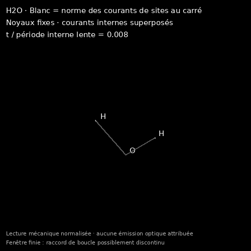

Une image d’une structure préobservable demande deux opérations documentées. La simulation produit d’abord un état. Un opérateur donne ensuite la projection qu’obtiendrait un observateur placé à un endroit déterminé. L’unité, le point de vue, le temps et, le cas échéant, la couleur codée doivent figurer dans la légende. Pour la comparaison expérimentale, il faut encore apparier cette sortie à une mesure dont la préparation et la réponse instrumentale sont connues. L’annexe B applique cette distinction à l’induction moléculaire et aux ensembles thermiques. La console de réglage du substrat relie les valeurs des réglages aux réponses du banc qu’elle représente.

À l’échelle cosmologique, les douze familles C00 à C11 partagent des choix déclarés pour le fond et utilisent une fermeture effective des perturbations. Le transfert est calculé par CAMB. Les spectres TT, TE et EE décrivent respectivement les corrélations de température, de température et polarisation E, et de polarisation E. Les bandes Planck de largeur 30 du dossier fournissent 2 376 lignes famille–canal–bande et 36 scores famille–canal. Les erreurs diagonales utilisées pour ces scores en font des diagnostics. Le tableau des distances BAO et celui de la croissance emploient leurs conventions de covariance propres. L’accord dépend de la fermeture et des entrées déclarées du transfert. [Mesures et analyse de la collaboration Planck](https://doi.org/10.1051/0004-6361/201833910)

## Ce qu’une projection du ciel permet de mesurer

En regardant plus loin, nous recevons des signaux émis plus tôt. Une carte donne des directions sur le ciel et des intensités reçues. Pour en tirer une taille physique, il faut un modèle de propagation. Au fond diffus cosmologique intervient une limite physique supplémentaire. Avant la dernière diffusion, environ 380 000 ans après le début de l’expansion dans la chronologie usuelle, les électrons libres diffusaient les photons et brouillaient leur direction. Améliorer la résolution angulaire affine la carte de cette époque. Les oscillations antérieures du plasma de photons et de baryons y ont laissé une empreinte indirecte. La température moyenne, proche de 2,725 kelvins, caractérise le rayonnement reçu. Les couleurs représentent ses écarts relatifs de température, de l’ordre de quelques cent-millièmes selon l’échelle. Leur relation avec la densité dépend de l’échelle, du mouvement du plasma et des potentiels gravitationnels. Les émissions de la Voie lactée et la déviation gravitationnelle des rayons ont des signatures distinctes et se traitent séparément. [ESA, dernière diffusion](https://www.esa.int/Science_Exploration/Space_Science/Planck/Planck_and_the_cosmic_microwave_background) · [Fixsen, température du rayonnement](https://doi.org/10.1088/0004-637X/707/2/916) · [Particle Data Group, fond diffus](https://pdg.lbl.gov/2025/reviews/rpp2025-rev-cosmic-microwave-background.pdf) · [Planck, reconstruction du lentillage](https://doi.org/10.1051/0004-6361/201833886)

Un champ qui s’étale sur une grille illustre une ambiguïté de lecture. Le rayon moyen $R$ de la distribution peut croître, et $\dot R/R$ mesure ce changement. Une interprétation cosmologique exige une relation entre ce rayon, les distances entre sources, les décalages spectraux et les temps d’arrivée. Le banc cosmologique ci-dessous confronte les distances et les spectres aux observations. Les temps d’arrivée offrent une épreuve distincte. La formation de structures et le rapprochement de certaines galaxies sont compatibles avec une expansion moyenne. Dans un modèle homogène, tous les points jouent le même rôle. [Lineweaver et Davis, expansion et mouvements locaux](https://www.scientificamerican.com/article/misconceptions-about-the-2005-03/)

L’expression « biais d’angulation holographique » désigne ici une hypothèse de BST sur l’effet de la projection sur le cône de lumière passé. Quelle part de l’évolution attribuée aux distances pourrait provenir de la projection du ciel sur notre cône de lumière passé ? Un premier test porte sur le **temps**. Le Dark Energy Survey a comparé les courbes de lumière de 1 504 supernovæ de type Ia en appariant les bandes qui sondent des longueurs d’onde comparables à l’émission. L’analyse suppose que les durées intrinsèques de cette population sont comparables et tient compte de leur dispersion. Si leur largeur observée varie comme $(1+z)^b$, où $z$ est le décalage spectral, l’équipe mesure $b=1{,}003\pm0{,}005$ (statistique) $\pm0{,}010$ (systématique). Une transformation des angles qui conserve les temps d’arrivée laisse cet étirement à expliquer. Un second test utilise les oscillations acoustiques des baryons (BAO). Le motif de regroupement des galaxies peut être mesuré en angle entre deux directions et en écart de décalage spectral le long de la visée. Ainsi, à $z=0{,}510$, le tableau DESI DR2 employé dans le dossier donne $D_M/r_d=13{,}588$ et $D_H/r_d=21{,}863$. Ces rapports comparent la distance comobile transverse et la distance de Hubble $c/H(z)$ à la même échelle acoustique $r_d$. Leur comparaison utilise la covariance publiée. [White et coll., durées des supernovæ](https://doi.org/10.1093/mnras/stae2008) · [DESI, mesures BAO DR2](https://doi.org/10.1103/tr6y-kpc6)

Pour tester cette hypothèse dans BST, il reste à spécifier comment le substrat transforme l’angle, la fréquence et l’intervalle entre deux signaux émis. Une fois cette loi et ses paramètres fixés, les durées et les deux directions BAO offrent des épreuves conjointes. Les douze familles du banc ci-dessous utilisent déjà une histoire du fond et un transfert par CAMB. Leur score Planck ne réalise pas ce nouveau test. Les oscillations acoustiques observées renseignent sur un plasma où de la matière est déjà présente. La formation de la matière à partir des battements du substrat est une hypothèse physique de BST. Elle demande une loi de formation et une signature qui lui soit propre.

## Les douze familles confrontées à Planck {#sky-comparison}

Sur les 66 bandes de chacun des trois spectres, on peut comparer chaque famille au modèle de référence ajusté de Planck avec exactement les mêmes poids. Le score est la moyenne des carrés des écarts à la mesure divisés par la variance de chaque bande. Une valeur plus basse indique un écart plus faible sur ce diagnostic.

| Spectre | Plage des douze familles BST | Référence Planck ajustée |
|:---|---:|---:|
| TT | 1,074 à 1,678 | 0,891 |
| TE | 1,180 à 1,311 | 1,102 |
| EE | 1,039 à 1,241 | 0,953 |

Les douze familles passent le seuil de 2 retenu pour ce banc. La référence ajustée de Planck obtient le score le plus bas sur chacun des trois spectres. La comparaison emploie les incertitudes diagonales du tableau. La vraisemblance officielle tient aussi compte des corrélations et des paramètres instrumentaux et astrophysiques. [Analyse des spectres et des vraisemblances de Planck](https://doi.org/10.1051/0004-6361/201936386)

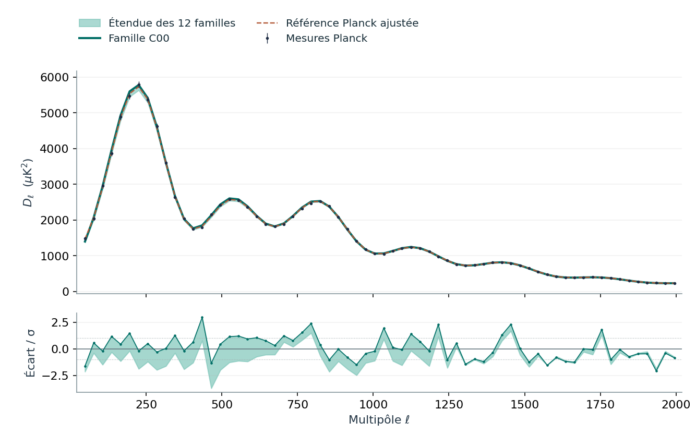

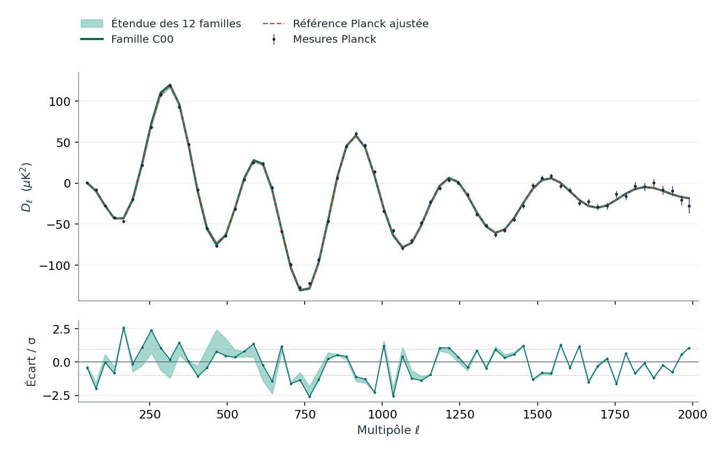

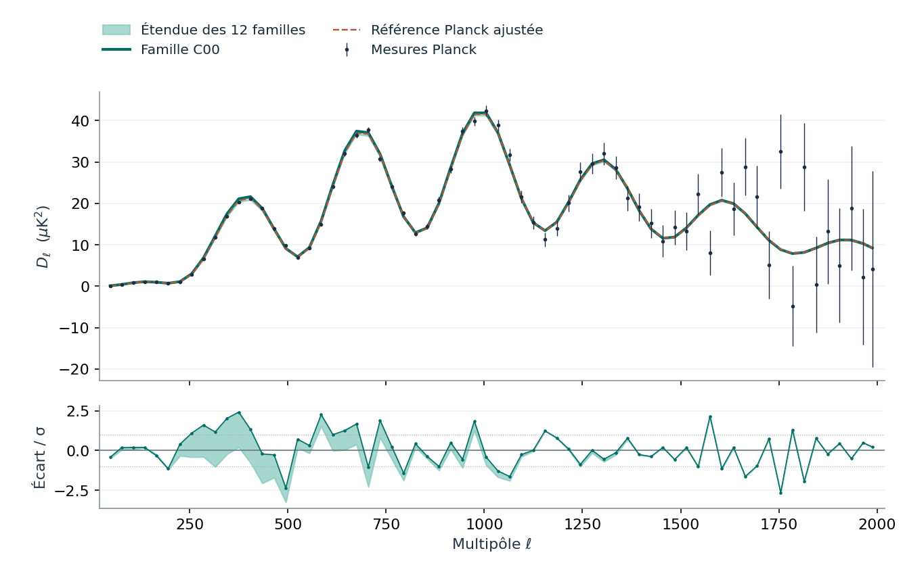

## Les mêmes familles face aux distances et à la croissance

Une famille qui reproduit une partie de la carte du ciel doit encore donner les bonnes distances entre structures et le bon rythme de leur croissance. Pour chaque famille, CAMB calcule l’échelle acoustique à l’époque du découplage dynamique des baryons, $r_d$, et le taux d’expansion $H(z)$. Le relevé DESI mesure des distances rapportées à $r_d$. Le relevé eBOSS renseigne aussi sur $f\sigma_8$, produit du taux logarithmique de croissance des fluctuations de matière et de leur amplitude à l’échelle conventionnelle de $8\,h^{-1}$ Mpc. Ici $h$ est la constante de Hubble en unités de 100 km/s/Mpc. La fermeture des perturbations et la normalisation initiale sont les mêmes que pour les spectres du banc. [DESI DR2, distances acoustiques](https://doi.org/10.1103/tr6y-kpc6) · [Alam et coll., produits de distances et de croissance de SDSS](https://doi.org/10.1103/PhysRevD.103.083533) · [Lewis, Challinor et Lasenby, calcul de transfert](https://doi.org/10.1086/309179)

Pour un vecteur d’écarts $r$ entre calcul et observations, le score est $\chi^2=r^\mathsf{T}C^{-1}r$, où $C$ est la covariance des composantes retenues. Les sept composantes DESI à $z<1$ ont servi au choix des fonds parents. Les six composantes à $z\geq1$ forment le bloc réservé de ce banc. Chaque score DESI emploie la sous-matrice du bloc correspondant. Le vecteur eBOSS associe quatre décalages spectraux à trois observables chacun. Ses douze valeurs sont jugées ensemble avec leur covariance archivée. Le tableau donne les extrêmes de familles précises. Un lecteur peut retrouver chaque famille dans les sorties du parcours `cosmology`.

| Comparaison | Composantes | Étendue du score des douze familles | Seuil du banc |
|:---|---:|---:|---:|
| DESI, $z<1$ | 7 | 6,380 à 11,700 | 12,592 |
| DESI, $z\geq1$ | 6 | 0,838 à 6,211 | 12,592 |
| eBOSS, distances et croissance | 12 | 13,560 à 15,642 | 21,026 |

À $z=0{,}51$, eBOSS donne $f\sigma_8=0{,}459\pm0{,}038$ et les calculs vont de 0,458 à 0,492. À $z=1{,}48$, eBOSS donne $0{,}462\pm0{,}045$ et les douze calculs se situent tous plus bas, de 0,375 à 0,407. Les incertitudes citées sont les écarts-types marginaux de la covariance. Le désaccord sur la valeur centrale au décalage le plus élevé reste visible même quand le vecteur complet satisfait le seuil du banc. Les seuils sont ceux du protocole. Une comparaison globale de modèles demanderait une vraisemblance commune qui traite les corrélations, la sélection des paramètres et les effets instrumentaux. Additionner les scores de ces trois relevés ne donnerait pas cette vraisemblance.

**Trous noirs, matière noire et énergie noire.** L’hypothèse de résolutions plus fines ouvre ici trois questions de travail distinctes. Pour un trou noir, quelle observable d’image ou de mouvement sensible à la région compacte changerait à masse et distance fixées ? Pour la matière noire, quels effets gravitationnels d’une organisation fine donneraient la même masse inférée par des lecteurs indépendants, par exemple lentillage et dynamique ? Pour l’énergie noire, quelles équations produiraient une histoire d’expansion et de croissance dont les résidus différeraient de ceux de la fermeture actuelle ? Les mesures de l’EHT et du fond diffus permettent de formuler des cibles. Aucune de ces observations n’identifie un étage profond d’ondes propre à BST. [Imagerie de M87 par la collaboration EHT](https://doi.org/10.3847/2041-8213/ab0ec7)

# 6. Cognition et persistance {#cognition}

La disparition d’une réponse observable suffit-elle à conclure qu’un souvenir a été perdu ? Le chapitre examine d’abord cette question à partir d’études sur le vivant et de modèles dont on peut suivre l’état interne. Attribuer l’histoire ainsi retrouvée à la même personne soulève une seconde question, celle de la continuité du sujet.

**Position éthique du projet.** Le projet BST ne soutient aucune expérimentation in vivo susceptible de faire souffrir des animaux. Nous citons les observations déjà publiées pour que leur portée puisse être examinée. Pour poursuivre cette recherche, nous privilégions la réanalyse de données existantes, les observations non invasives et les simulations.

La Théorie du substrat battant (BST) propose de décrire une organisation à plusieurs résolutions. Appelons $s$ l’état du substrat et $P(s)$ ce qu’en livre une observation définie : une image, un signal électrique, une réponse motrice ou un autre relevé. Deux états différents peuvent avoir la même image. Une *structure latente* désigne ici une distinction qui échappe à cette lecture et qui peut encore faire une différence dans la suite de l’histoire. Une configuration neuronale ou distribuée dans le système vivant peut remplir cette fonction. Le mot *latent* indique toujours par rapport à quel lecteur et sur quel intervalle une distinction échappe.

**La possibilité établie par BST est la suivante.** Une organisation visible peut effectivement se désorganiser, tandis qu’une trace de l’histoire subsiste dans le même substrat et peut, dans des conditions définies, s’exprimer de nouveau. Le témoin à histoires appariées construit cette situation et la compare à un effacement donnant exactement le même aspect extérieur. Le modèle de mémoire bistable explique ensuite, pour un mécanisme précis, quand un contenu peut résister à une perturbation et comment le relire.

Deux questions donnent leur portée à ces résultats. Quelque chose de ce qui a été vécu peut-il demeurer causalement efficace après la perte de sa manifestation habituelle ? Nous disposons de témoins formels et d’exemples d’apprentissage chez le vivant. La personne à qui appartenait cette histoire traverse-t-elle, elle aussi, la transformation et peut-elle se la réapproprier ? Cette seconde question exige de suivre une organisation individuelle et sa relation à un sujet. La possibilité mérite une place dans la théorie précisément parce que ces deux questions peuvent désormais être formulées séparément.

## Observations chez le vivant {#living-evidence}

### Apprentissage, mémoire et réponse aux consignes

**Une mémoire après une transformation corporelle.** Chez *Manduca sexta*, Blackiston, Silva Casey et Weiss suivent l’effet d’un apprentissage larvaire jusqu’au choix de l’adulte [1]. Le papillon adulte évitait encore l’odeur lorsque l’apprentissage avait eu lieu au dernier stade larvaire étudié. Cette observation documente une continuité fonctionnelle à travers un remaniement majeur chez le même animal vivant. Le protocole ne suit pas chaque connexion et ne détermine pas quelle organisation précise a porté la trace.

**Une mémoire rendue lisible par une sonde.** Wolff et ses collègues présentent une impulsion visuelle pendant la rétention d’orientations. La réponse EEG permet de décoder une partie du contenu mémorisé [2]. Barbosa, Lozano-Soldevilla et Compte ont réexaminé ces données. Une activité faible persistante et une variation du bruit peuvent contribuer à la hausse de décodabilité. Leur correction précise une limite du contrôle par permutation [3]. Une meilleure lecture après stimulation informe sur l’accessibilité du contenu. Elle ne permet pas, à elle seule, de conclure sur la nature du support entre les lectures.

**Quand le geste attendu manque.** Dans l’étude multicentrique de Bodien et de ses collègues, 60 des 241 participants chez qui aucune réponse aux consignes n’était observée au chevet ont répondu à une tâche détectée en IRMf ou en EEG [4]. Il s’agit de personnes vivantes présentant des troubles de la conscience après une lésion cérébrale. Le résultat documente la dissociation possible entre la réponse comportementale et une activité liée à la consigne. Dans la même étude, une réponse instrumentale a été détectée chez 43 des 112 participants qui répondaient aux consignes au chevet. Des capacités présentes peuvent donc échapper aussi à l’épreuve instrumentale.

**Motivation et choix observables.** La réanalyse BST de la tâche *Horizon* de Binz et Schulz retient 3 960 parties à information inégale de 99 personnes [5]. Ajouter au modèle de choix l’effet de l’horizon sur la préférence pour l’option moins observée améliore la perte logarithmique de $0{,}00951$ nat par choix chez les humains, avec un gain individuel chez 63 personnes. Chaque personne est tenue à l’écart de son ajustement. Sur 1 576 parties d’un seul GPT‑3 historique, écartées par plis, le gain est de $-0{,}00042$ nat. Dans *Crafter*, Lidayan et ses collègues relient chez dix enfants la part des énoncés exprimant un but au score d’accomplissements ($r\simeq0{,}80$) [6]. Le calcul BST reprend pour cette sous-analyse la statistique publiée arrondie. La succession causale entre but et action reste indéterminée. Les deux études renseignent Q8.2 dans sa portée comparative. Aucune des deux n’interroge la persistance d’une personne après la perte d’une organisation visible.

### Quand la parole revient après des années

Dans le suivi de Voss et de ses collègues, le coma initial d’un jeune homme a duré une à deux semaines. Des signes de conscience minimale sont apparus dans les premiers mois. Il a retrouvé une parole fiable dix-neuf ans après l’accident [10, 11]. Cette chronologie indique quand la communication est redevenue observable. Elle laisse inconnue l’histoire de chaque souvenir pendant cet intervalle.

**Interroger un souvenir avant le retour de la parole.** Martin Monti et ses collègues ont proposé à un autre patient de coder « oui » et « non » par deux tâches d’imagination que l’IRM fonctionnelle permettait de distinguer. Au moment de l’examen, il présentait des signes fluctuants de conscience, et l’équipe n’arrivait pas à échanger avec lui au chevet. Cinq des six questions ont reçu une réponse interprétable et correcte, y compris sur le prénom de son père. La sixième est restée sans réponse interprétable [12]. Un fait personnel était donc accessible au patient au moment où ce canal lui permettait de le communiquer.

**Une trace encore utile à la tâche.** Dans l’expérience de Rose et de ses collègues, les participants gardent deux éléments en mémoire. Un indice leur signale lequel examiner en priorité. Quand l’autre élément peut encore servir, une impulsion magnétique transcrânienne fait brièvement réapparaître dans l’EEG une information sur sa catégorie. Après l’indice qui permet de l’abandonner, la même stimulation ne produit plus de décodage significatif de cette catégorie. Dans une épreuve de reconnaissance, l’impulsion accroît aussi, à la première interrogation, les fausses reconnaissances quand cet élément sert de leurre [14]. Pour BST, la comparaison précise ce qu’un lecteur devrait distinguer après une perturbation. Elle porte sur une mémoire de travail à l’échelle de quelques secondes. Le mécanisme physique qui conserverait une trace à une autre résolution reste à départager.

**Ce que « latent » veut dire ici.** Un souvenir à long terme peut dépendre de modifications durables de circuits cérébraux sans que la personne ait à le rappeler continuellement [13]. L’absence de geste ou de parole renseigne sur les moyens d’expression disponibles. Elle laisse ouvertes la question de l’activité interne et celle des souvenirs qui ont pu se perdre. Ces observations éclairent la distinction que fait BST entre une trace et sa lecture. L’existence d’un transfert d’énergie ou d’une réinscription des souvenirs depuis une résolution plus fine reste une hypothèse. Pour la départager d’une conservation cérébrale suivie d’une récupération de l’accès, il faudrait une prédiction propre à BST. On pourrait la confronter à des suivis humains déjà recueillis, en distinguant les souvenirs antérieurs vérifiables des informations réapprises depuis et en tenant compte des réseaux cérébraux préservés.

### Renouvellement synaptique et accès à une trace

**Le renouvellement de la matière.** Dans le cortex de jeunes souris, Noah Gray, Robby Weimer, Ingrid Bureau et Karel Svoboda ont suivi par imagerie des amas synaptiques de la protéine PSD-95. Certains étaient stables pendant des jours. La durée médiane de rétention des molécules qui les composaient variait de 22 à 63 minutes entre les âges étudiés de 10 à 21 jours. Ce résultat donne une place physique précise à l’intuition de continuité. Une organisation biologique observable peut se maintenir tout en échangeant ses constituants. Le renouvellement corporel est donc compatible avec un support biologique de l’histoire personnelle. [Étude de Gray et coll.](https://doi.org/10.1371/journal.pbio.0040370)

**Une trace que le rappel ordinaire n’exprime plus.** Tomás Ryan et ses collègues ont étudié une amnésie provoquée chez la souris. L’activation ciblée de neurones marqués lors de l’apprentissage a fait réapparaître une réponse apprise. Un changement de voie de lecture permet ici de retrouver une distinction que le rappel habituel n’exprimait plus. Les animaux étaient vivants et des connexions spécifiques subsistaient. Cette expérience étaye la dissociation entre accès et persistance d’un apprentissage. [Étude de Ryan et coll.](https://doi.org/10.1126/science.aaa5542)

Chez l’humain, William Beecher Scoville et Brenda Milner ont décrit une perte durable de la capacité à former de nouveaux souvenirs chez des patients ayant subi certaines résections bilatérales du lobe temporal médian. La conservation d’une histoire à travers le renouvellement de la matière est donc compatible avec la dépendance de certaines fonctions de mémoire à une organisation cérébrale précise. [Étude de Scoville et Milner](https://doi.org/10.1136/jnnp.20.1.11)

## Ce que testent les modèles de mémoire {#memory-models}

Les études précédentes posent un problème expérimental. Quand une réponse disparaît, comment départager la perte du contenu et celle de son accès ? Dans les modèles qui suivent, on connaît l’histoire de chaque préparation et l’on peut agir séparément sur le porteur de la trace et sur la sonde qui permet de la relire.

### De la persistance au choix

Pour BST, une organisation persiste lorsqu’une relation permettant de la reconnaître se maintient à travers des changements. Sa *fermeture* désigne les contraintes que ses transformations doivent respecter pour qu’elle reste cohérente. Son identité dans le temps dépend de ce qui se transmet d’une transformation à la suivante. Dans le domaine cognitif, une **trace** est une différence due à l’histoire qui peut modifier une réponse ultérieure. Retenir un état, y avoir accès et s’en servir pour agir sont trois opérations distinctes.

**Pourquoi une trace est parfois nécessaire.** Imaginons deux apprentissages suivis des mêmes indices présents. La tâche exige une réponse différente selon l’apprentissage reçu. Si tout l’état causal du système et de son environnement accessible est identique dans les deux cas, une même règle déterministe donnera la même réponse. Une règle aléatoire commune donnera la même distribution de réponses. Pour distinguer correctement $m$ histoires à coup sûr sous une même interrogation, le support accessible doit admettre au moins $m$ états distinguables, soit $\lceil\log_2 m\rceil$ bits dans un codage binaire de longueur fixe. Cette nécessité porte sur la tâche et ses conditions. Si l’examinateur redonne l’information, la réussite ne situe plus la trace dans le système interrogé.

**Imaginer, sélectionner, arbitrer.** L’imagination, au sens donné par BST, recompose des traces et des contraintes en continuations possibles. La sélection écarte les continuations incompatibles avec la situation, l’histoire ou les buts. Plusieurs peuvent rester admissibles. L’arbitrage engage alors une action, oppose un veto, diffère la décision ou la délègue. La conséquence de cet acte peut modifier la mémoire, les poids accordés aux raisons et jusqu’au but lui-même. Ce retour explique pourquoi une préférence affichée à un instant ne suffit pas à définir l’identité d’un agent. La chaîne décrit des dépendances fonctionnelles, qui peuvent former des boucles.

**Les trois langages de BST.** Les *ondes* permettent de décrire un contenu porté par des phases relatives. Les *contacts* décrivent comment deux degrés de liberté se couplent. Les *flux* suivent l’échange entre le porteur et la voie de lecture, y compris le retour de la lecture sur ce porteur. Dans le modèle de mémoire de phase, une porte binaire prescrite oriente une énergie entre voies et respecte le bilan lorsque les couplages réciproques sont conservés. Un contrôleur à horloge reproduit aussi cette séquence. L’idée qu’une initiative provienne d’un état latent avant de se traduire en acte et de produire des effets est une hypothèse sur son origine. Les notes du projet proposent le raphé comme raccord possible à un réseau nerveux et un attracteur comme mécanisme possible de stabilisation. La suite de portes prescrites ne localise biologiquement aucune de ces fonctions.

### L’épreuve décisive de la désorganisation visible

Dans le témoin à histoires appariées, chaque état possède huit coordonnées visibles $v_j\in\{-1,+1\}$, un identifiant interne et un contenu de huit bits. Le lecteur grossier mesure $D(v)=|\sum_{j=1}^{8}v_j|/8$. Au-dessus de $0{,}75$, il déclare l’organisation visible. Au départ, les huit signes valent $+1$ et le contenu vaut $10110100$. Puis les signes visibles prennent, dans les deux évolutions, la même suite $(+,-,+,-,-,+,-,+)$. Les coordonnées observées ont donc réellement changé. La différence entre les deux évolutions se trouve ailleurs dans l’état.

| État comparé | Ordre $D$ | Résultat du lecteur de mémoire |
|:----------------|:----:|:-----------------------------------|
| Avant la perturbation | $1$ | Le contenu initial se lit. |
| Après, trace préservée | $0$ | Les huit bits peuvent être réexprimés. |
| Après, mémoire effacée | $0$ | Aucun contenu ne peut être restitué. |

L’identifiant interne est le même jusque dans la branche effacée. Cela rend le test plus exigeant : conserver une étiquette d’identité ne suffit pas à conserver une histoire. L’opération de réexpression connaît la règle de décodage et reçoit le contenu encore porté par l’état préservé. Elle ne recrée pas les huit bits effacés. Le témoin à histoires appariées construit les deux branches explicitement. Il établit que la disparition d’un même motif visible est compatible avec ces deux devenirs. Il ne mesure ni leur fréquence dans la nature ni la gravité de la perturbation qu’un organisme pourrait supporter.

**Changer de lecteur.** Le test à deux fenêtres étudie une question voisine. Dans un système à trois coordonnées, le premier dispositif suit les deux premières pendant toute la fenêtre. Deux histoires qui ne diffèrent que sur la troisième produisent rigoureusement le même signal. Une deuxième mesure, sensible à la troisième coordonnée, permet de les distinguer. En termes mathématiques, la matrice d’observabilité intégrée du premier dispositif a une valeur propre nulle. Avec les deux lectures, les trois valeurs propres sont positives. Dans cette expérience de calcul, l’organisation n’a subi aucune destruction. C’est le regard qui a changé.

**Perdre le contenu sans perdre la norme.** Le modèle de mémoire de phase code huit messages sur trois phases et les relit à 41 instants. Les trois modules sont identiques dans les deux modèles. Avec les références de phase connues, le lecteur réussit les 328 lectures lorsque le transport maintient l’information. Après la remise des phases à zéro, il retrouve uniquement le message compatible avec la remise à zéro, soit 41 réponses sur 328. Une grandeur conservée ne sert de mémoire que si elle conserve une distinction pertinente pour la tâche.

### Un mécanisme de protection et de relecture

Dans le modèle de mémoire bistable, le contenu est le signe d’une coordonnée $q$. La voie observable est $x$. Au repos, les deux préparations $q=-1$ et $q=+1$ donnent la même sortie $x=0$ pour les mêmes coefficients. En unités réduites, l’énergie est

$$
\begin{aligned}
H={}&\tfrac12 p_x^2+\tfrac{p_q^2}{2M}+\tfrac12\sum_j p_j^2
       +\tfrac{\lambda}{4}(q^2-1)^2 \\
   &+\tfrac12 k_0 e^{\eta q}x^2
       +\tfrac12\sum_j\omega_j^2\!\left(z_j-\tfrac{g_j}{\omega_j^2}x\right)^2 .
\end{aligned}
$$

Les $p$ sont les moments associés aux coordonnées. Les $z_j$ sont des modes internes de pulsations $\omega_j>0$, les $g_j$ leurs couplages à $x$. La masse $M$, la raideur $k_0$ et le paramètre de barrière $\lambda$ sont positifs. Les deux jeux de 792 modes proviennent de diagnostics mécaniques du modèle. La variable bistable et son couplage exponentiel sont des choix du modèle à éprouver.

**Ce qui protège.** Pour aller d’un signe de $q$ à l’autre, une trajectoire continue doit passer par zéro. En ce point, le double puits exige à lui seul l’énergie $\lambda/4$. Tous les autres termes sont positifs ou nuls. Tant que l’énergie totale reste strictement inférieure à cette barrière, le signe est donc invariant. La sonde appliquée au repos donne le même saut $J$ à $p_x$ dans les deux préparations. Sur l’intervalle étudié, $J^2/2\leq 0{,}020 < 0{,}125\leq\lambda/4$. Ce raisonnement couvre l’intervalle entier dans les hypothèses du modèle. Une énergie supérieure à la barrière autoriserait un passage sans pour autant le rendre certain.

**Ce qui rend lisible.** Le couplage $k_0e^{\eta q}x^2/2$ fait dépendre la réponse de $x$ du contenu porté. Les deux réponses commencent avec la même position, la même vitesse et la même accélération. Leur dérivée troisième les distingue pour $J\ne0$ et $\eta\ne0$. Si $\eta=0$, ce canal devient insensible au signe bien que la barrière le protège toujours. Sur 72 paires de trajectoires, le lecteur retrouve **le bon signe dans les 144 préparations**, sans bruit ajouté et sans ajuster ses coefficients selon le contenu. Il s’agit d’un mécanisme de mémoire à un bit. Son application à une organisation cognitive complexe demanderait d’identifier les porteurs couplés, leur écriture et les perturbations qu’ils subissent réellement.

### Deux histoires sous la même impulsion

La figure représente deux préparations du même porteur bistable. Tous les paramètres, le bain de modes et l’impulsion sont identiques. Seul le signe de la trace initiale diffère. Les deux simulations partent du repos. Les courbes montrent les quatre premières unités de temps du calcul.

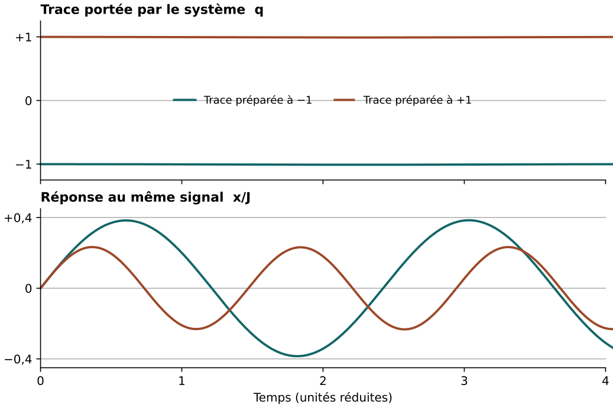

**Courbes recalculées, unités réduites.** Le trait plein correspond à la préparation $q=-1$, le pointillé à $q=+1$. En haut, les deux trajectoires restent de leur côté de zéro. En bas, la voie de lecture oscille différemment selon le signe conservé. À $t=2$, le rapport $x/J$ vaut environ $-0{,}342$ pour la première trace et $+0{,}180$ pour la seconde. Cette différence est un effet mesurable du contenu dans le modèle. À elle seule, une courbe plate avant la sonde aurait été compatible avec les deux préparations.

Le cas représenté utilise le premier des deux bains, $J=0{,}2$ et $\lambda=M=\eta=0{,}5$. Les 801 instants échantillonnés jusqu’à $t=8$ figurent dans le tableau numérique de la figure. Le bilan des 144 trajectoires couvre en outre le deuxième bain et les autres réglages du balayage. Aucune durée de mémoire biologique ne peut être déduite de l’axe du temps en unités réduites.

### Prolonger la courbe vers le latent

Dans le porteur bistable, la même voie observable $x$ répond à deux traces préparées, $q=+1$ et $q=-1$. Le couplage $\eta$ spécifie combien cette voie est sensible à la trace. Les premières différences mesurables dans les deux réponses à une impulsion commune $J$ apparaissent dans leur dérivée troisième. Les contributions du bain sont les mêmes pour les deux préparations et s’annulent par soustraction. Il reste exactement, pour $\eta\geq0$,

$$
C(\eta,J)=\left|x^{(3)}_+(0^+)-x^{(3)}_-(0^+)\right|
         =2|J|k_0\sinh\eta,\qquad k_0=3{,}337^2 .
$$

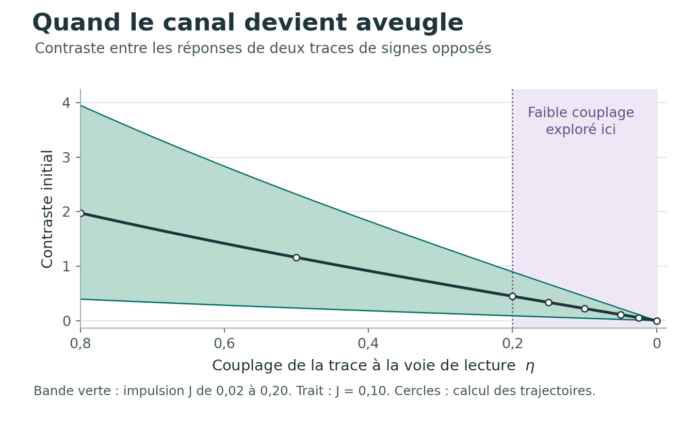

En suivant la courbe **vers la droite**, on réduit le couplage jusqu’à rendre la trace illisible par cette voie. Le fond violet repère le couplage inférieur à $0{,}2$, entre les configurations de référence et le témoin de couplage nul $\eta=0$. Quatre valeurs intermédiaires ont été calculées. La bande verte couvre **tout** l’intervalle $0{,}02\leq J\leq0{,}20$ par la formule. Les 48 comparaisons de trajectoires, dans les deux bains, en contrôlent le calcul. À $\eta=0{,}10$, le contraste va d’environ $0{,}0446$ à $0{,}4462$. À zéro, les sorties sont identiques et les deux contenus restent distincts dans le modèle. L’axe représente un rapport de couplages sans dimension. Une distance dans un tissu vivant serait une autre grandeur.

### Prolonger dans le temps et borner ce qui résiste

Le calcul reprend les mêmes équations, les mêmes bains de 792 modes, les mêmes préparations et le même pas de temps. Il va jusqu’à $t=24$ en unités du modèle, trois fois la durée de référence. Jusqu’à $t=8$, il retrouve les 144 trajectoires du rejeu de référence. La teinte de fond repère la prolongation de la trajectoire. La variable interne est présente dès l’état initial.

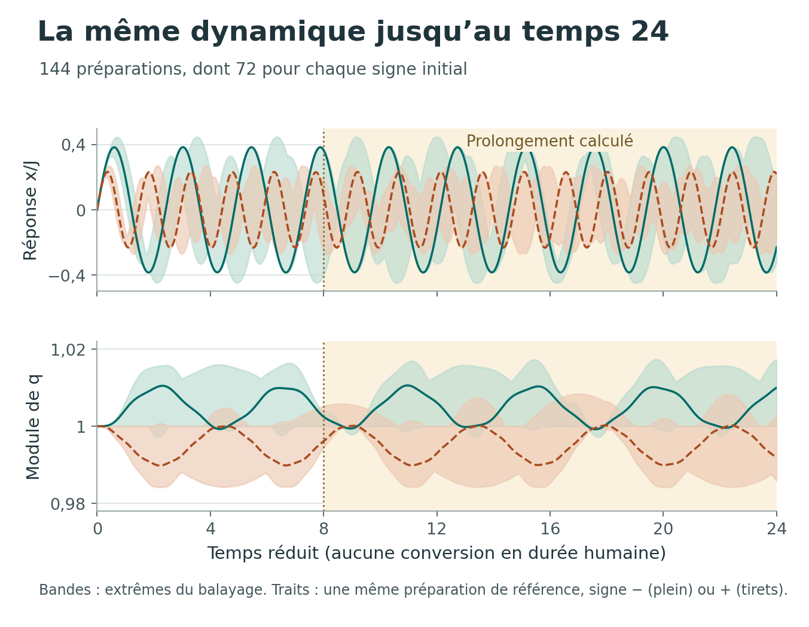

Les bandes du tracé sont les minima et maxima constatés, à chaque instant, parmi les 72 préparations de chaque signe. Les paramètres intermédiaires peuvent produire d’autres trajectoires. On dispose aussi d’une **borne démontrée sur l’intervalle continu**. Si $H\leq E<\lambda/4$, la positivité des termes du hamiltonien bistable impose
$$
\sqrt{1-\sqrt{4E/\lambda}}\ \leq |q|\leq\ \sqrt{1+\sqrt{4E/\lambda}} .
$$
Sur le domaine spécifié, $E\leq0{,}020$ et $\lambda\geq0{,}5$. Le module de la trace est donc compris entre $\sqrt{0{,}6}$ et $\sqrt{1{,}4}$, soit environ $0{,}775$ à $1{,}183$. Le signe reste protégé pour toute durée pendant laquelle ces hypothèses tiennent. Cette conclusion vient de l’inégalité d’énergie. La durée d’une simulation ou la finesse d’un détail ne suffiraient pas à l’établir. Aucun bilan du corps et de son environnement lors d’un décès n’a été mesuré ici.

### Un ordre qui se défait dans les porteurs de la mémoire

Un ordre collectif peut-il se défaire dans **les mêmes constituants** qui portent une mémoire ? Ce témoin géométrique construit le cas. Huit paires d’ondes ont chacune deux phases complexes de module un, $z_j^+,z_j^-$. Leur produit $z_j^+z_j^-=e^{i\Theta_j}$ décrit l’orientation commune de la paire. Leur déphasage $z_j^+\overline{z_j^-}=e^{i\delta_j}$ décrit une relation interne à cette même paire. Les huit signes de $\cos\delta_j$ portent huit bits.

Le lecteur global mesure $D=\left|\sum_{j=0}^{7} e^{i\Theta_j}\right|/8$. On organise un passage continu d’orientations alignées à huit orientations régulièrement espacées. Au départ, $D=1$. À la fin, chaque orientation a son opposée et la somme vaut exactement zéro. Les deux rosaces montrent ces directions dans le repère tournant commun. Le lecteur global est resté fixe.

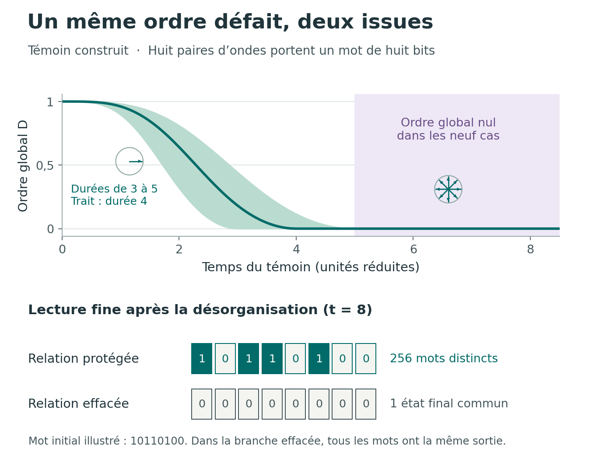

La même courbe de $D$ accompagne deux évolutions. Si le déphasage reste dans son secteur protégé, les **256 mots initiaux** demeurent distinguables. Si une autre dynamique ramène tous les déphasages à zéro, il subsiste **un seul état final**. Chaque onde garde un module égal à un dans les deux branches. C’est la relation qui portait le mot qui peut disparaître.

Le programme énumère les 256 mots et applique la remise à zéro entre $t=4$ et $t=5$. Chacun des huit produits visibles suit la même trajectoire dans les deux branches. Ce témoin mathématique donne les deux issues sans modéliser une lésion biologique ni son énergie.

### À quelle résolution une trace redevient lisible

Pour construire les orientations de la section précédente, on pose $\Theta_j(t)=t+2\pi j\,s(t)/8$. La fonction $s$ vaut $3u^2-2u^3$ avec $u=\min(1,\max(0,t/T))$. Dès $t\geq T$, l’ordre global reste nul. Dans la branche protégée, la relation interne peut suivre la dynamique locale $\dot\delta_j=-\kappa\sin(2\delta_j)+f_j(t)$, avec $|f_j|\leq\nu<\kappa$. Aux bords d’un secteur de demi-largeur $\pi/4$ autour de $0$ ou $\pi$, la vitesse pointe vers l’intérieur, même sous la perturbation la plus défavorable. Une phase préparée dans ce secteur y demeure. Le bit résiste ainsi à une classe de perturbations.

Un lecteur de sensibilité $r$ fournit $y_j=r\cos\delta_j+e_j$ avec $|e_j|\leq\epsilon$. Les deux signes se distinguent à coup sûr si $r/\sqrt2>\epsilon$. Le calcul fait varier la sensibilité de l’instrument sur un même état physique. La valeur $\epsilon=0{,}12$ sert seulement à illustrer la frontière.

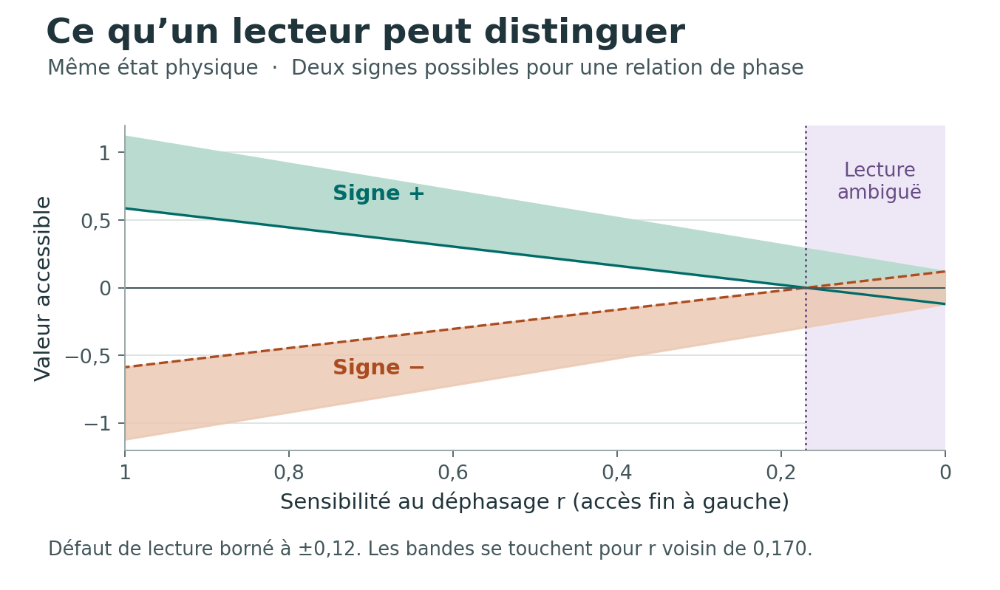

Dans la zone violette, certaines lectures sont compatibles avec les deux signes. À $r=0$, l’information propre au bit a entièrement disparu de la voie de lecture. Elle peut encore faire une différence lorsque cette voie devient sensible. Par exemple, un arbitre fonctionnel compare un mot relu aux deux possibilités $10110100$ et $01001011$. Il engage la plus proche, ou suspend en cas d’égalité. Sur les 256 mots protégés, 93 conduisent à chaque engagement et 70 à la suspension. Après remise à zéro, la même règle suspend dans tous les cas. Cette opération situe un lien causal entre trace, sélection et décision. Le vécu du choix demeure une question distincte.

Un seuil d’erreur et une probabilité d’erreur répondent à deux questions différentes. Dans les 72 paires de préparations du porteur bistable, une erreur de la statistique de décision bornée par 2, en unités du modèle, garantit les deux signes pour chaque paire. Si un autre détecteur inversait au hasard un signe sur dix avec la même probabilité pour les deux contenus équiprobables, son information mutuelle vaudrait $1+p\log_2p+(1-p)\log_2(1-p)=0{,}531$ bit pour $p=0{,}1$. Ce dernier chiffre décrit un canal hypothétique. Il faudrait mesurer ses erreurs pour l’attribuer à un instrument ou à un organisme.

### Du zéro de contraste à l’asymptote de résolution

Sur la courbe du contraste en fonction du couplage, le zéro correspond au découplage. À $\eta=0$, les deux signes de la trace $q$ donnent exactement la même réponse dans la voie $x$. Pour voir l’approche vers cette limite sur un axe illimité, nous choisissons $d=0{,}8/\eta$ pour $\eta>0$. L’origine de cette convention est le plus grand couplage du banc, $\eta=0{,}8$, auquel correspond $d=1$. L’axe représente un rapport sans dimension. Une distance, une durée ou un nombre de couches du substrat demanderaient un autre raccord.

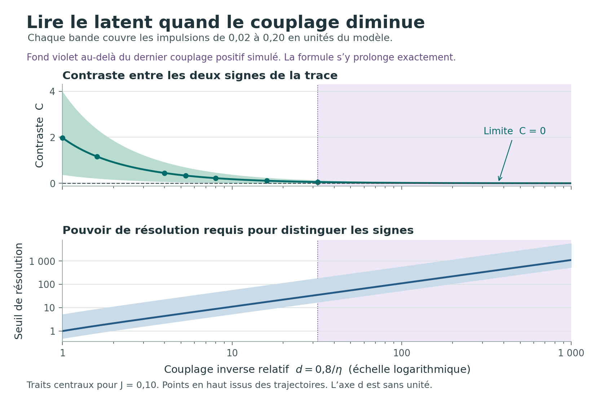

La courbe du haut donne $C=2|J|k_0\sinh(0{,}8/d)$, avec $k_0=3{,}337^2$. À grande valeur de $d$, elle approche $1{,}6|J|k_0/d$. Le zéro se trouve désormais à la limite $d\to\infty$. Dans le graphique du bas, $u$ est l’erreur absolue maximale attribuée à chacune des deux lectures de la dérivée troisième. Leurs intervalles sont disjoints si $C>2u$. En prenant pour unité $C_*=C(0{,}8;0{,}10)$, le pouvoir instrumentel $R=C_*/(2u)$ doit dépasser $R_{\rm lim}=C_*/C$. Ce seuil tend vers l’infini.

**Ce qui se déplace quand on affine le lecteur.** À impulsion fixée, réduire $u$ déplace le seuil de discernement $\eta_{\rm seuil}=\operatorname{arsinh}(u/(|J|k_0))$ vers des couplages plus faibles. La propriété physique de découplage reste située à $\eta=0$. Une autre graduation de $\eta$ modifierait la forme graphique de l’approche. La divergence du pouvoir requis découle directement de la disparition du contraste.

### Quand une perturbation atteint-elle la trace ?

Dans le vocabulaire du projet, une onde primordiale est définie relativement à une fenêtre de résolution. BST envisage une hiérarchie potentiellement infinie sur un seul substrat. La persistance démontrée ci-dessous dépend de la dynamique et de la préparation de chaque modèle.

Une désorganisation observable est un changement défini pour une lecture donnée de l’état. Dans le modèle à huit paires, chacun des seize porteurs garde le même module. La même perte d’ordre collectif peut s’accompagner du maintien des 256 mots ou de leur réduction à un seul mot. L’histoire est inscrite dans des relations. La survie de chacune des ondes laisse ouvertes ces deux évolutions. Dans un cristal, un défaut local peut également laisser subsister l’ordre global. Ce qu’un observateur détecte dépend de la propriété retenue, de son échelle et de l’étendue de la perturbation.

**Deux forces dans le porteur bistable.** La force de rappel locale sur $q$ vaut $-\lambda q(q^2-1)$. La force que la voie $x$ exerce en retour vaut $-\eta k_0e^{\eta q}x^2/2$. À couplage nul, cette seconde force s’annule. Le double puits reste présent. Dans le modèle conservatif, $H\geq \lambda(q^2-1)^2/4$. Tout passage entre les deux signes exigerait de passer par zéro, donc d’atteindre au moins $\lambda/4$. L’énergie du banc initial est au plus $0{,}020$ et la plus petite barrière vaut $0{,}125$. Sous ces conditions, le signe est protégé à toute échéance.

**Test de transmission.** Nous avons donné une impulsion à $x$ seul, avec $q=+1$ au départ et sa vitesse nulle. Le bain est m1, $\lambda=0{,}5$, la masse de $q$ vaut $0{,}5$ et l’horizon de calcul vaut 4. L’impulsion $J=2$ est un essai délibérément extérieur à l’intervalle initial $[0{,}02,0{,}20]$. Les temps et les énergies sont en unités du modèle.

| Couplage $\eta$ | Impulsion $J$ | Énergie initiale | Premier passage de $q$ par zéro |
|:---|:---|:---|:---|
| $0{,}8$ | $0{,}2$ | $0{,}020$ | Interdit par la barrière |
| $0{,}8$ | $2$ | $2$ | $t\simeq1{,}24709$ |
| $0$ | $2$ | $2$ | $q=+1$ exactement |

Les estimations du passage, interpolées sur les sorties des intégrateurs de Verlet et DOP853, se trouvent à moins de $10^{-6}$ unité de temps l’un de l’autre. Le basculement change le signe qui codait la trace. Le calcul ne constate aucun effacement de l’état complet. Dans un matériau réel, Clough et ses collègues ont détecté par émission lumineuse la rupture de certaines liaisons covalentes lors de l’étirement d’un élastomère. Une déformation imposée à grande échelle peut donc atteindre un degré de liberté plus fin. Sa transmission dépend du matériau, du couplage et de l’énergie disponible. [Étude de Clough et coll.](https://doi.org/10.1002/adfm.201602490)

## Arbitrage, identité et continuité personnelle {#agency-identity}

Le modèle de mémoire permet de retrouver un contenu. Reconnaître la personne qui se l’approprie exige un critère supplémentaire. BST appelle *agent* l’organisation qui porte une histoire et *arbitre* la fonction par laquelle cet agent s’engage, diffère un acte ou révise sa règle de choix.

### Du souvenir à la continuité d’une personne

Une archive peut contenir l’histoire de quelqu’un. Deux systèmes peuvent même en porter des copies identiques. Qu’est-ce qui permettrait de dire que c’est *cette personne* qui retrouve *son* histoire ? Le critère d’identité personnelle distingue quatre conditions. $C$ désigne la présence d’une expérience actuelle. $O$ désigne son appropriation par le sujet comme sienne. $I$ désigne une relation d’identité qui se maintient au fil des changements. $L$ désigne le pont causal par lequel l’organisation porteuse traverse la perturbation considérée et peut se réexprimer. Le contenu relu doit provenir de l’histoire antérieure par cette voie.

Avec les critères d’appropriation et de continuité, $C$ et $O$ suffisent à parler d’un auteur minimal de l’acte présent. Pour parler de ce même auteur au-delà d’une désorganisation, l’argument requiert aussi $I$ et $L$. Un identifiant informatique, une ressemblance en sortie ou une copie faite après coup ne décident pas quelle continuité individuelle a eu lieu. La trace peut persister sans activité cognitive manifeste pendant l’intervalle. Établir un vécu ininterrompu demanderait encore d’accéder à ce vécu. **La perspective d’espoir tient à la possibilité qu’une histoire reste celle d’un sujet à travers une rupture de ses manifestations familières.** BST en formule les conditions. Leur réalisation chez une personne après la mort biologique demeure une question sans réponse empirique dans ce dossier.

**L’initiative et ses raisons.** Un choix déterministe qui respecte toutes les symétries de l’état doit désigner une branche invariante sous ces symétries. Les contrôleurs étudiés peuvent conserver une raison, réviser une règle ou opposer un veto. Modifier les raisons disponibles peut modifier la décision de réviser. On distingue la conduite publique de l’expérience vécue accessible au sujet. Un contrôleur peut intégrer un nombre fini de révisions de ses propres règles. Le protocole précise les observations qui mettraient cette explication en défaut, les données à recueillir et les essais du traitement sur données synthétiques.

L’expérience de la cuve scellée examine la version forte de l’auteur. Un état total identique, soumis à une même loi déterministe, ne peut donner deux suites distinctes dans les mêmes conditions. Attribuer un écart à une initiative personnelle exige de justifier que les sources concurrentes ont été épuisées et de relier l’acte effectif à ses raisons, sa motivation et son appropriation. Des comportements publics finis peuvent étayer une hypothèse fonctionnelle. La conclusion métaphysique dépend de prémisses supplémentaires. L’existence d’une trace protégée se discute indépendamment de cette thèse forte sur l’origine du choix.

### L’arbitrage et l’existence à la première personne

Dans BST, l’arbitrage intervient lorsqu’une reconstruction laisse plusieurs prolongements admissibles. Reste la question de l’origine de la motivation de l’agent. Pourquoi cette histoire devient-elle *la mienne*, et pourquoi puis-je y répondre en révisant ce que je veux ? Cette question appelle une dérivation qualitative. Les prémisses doivent en rester visibles.

**Une réduction à l’absurde.** Deux histoires $s_1,s_2$ ont la même observation $P(s_1)=P(s_2)$ dans une situation donnée. Supposons qu’elles conduisent à des engagements différents, $a(s_1)\ne a(s_2)$. Si l’observation suffisait à déterminer l’engagement, une fonction $f$ donnerait $a(s_i)=f(P(s_i))$ dans les deux cas. Elle devrait donner deux résultats différents au même argument. Il faut donc au moins une distinction supplémentaire dans toute reconstruction exacte de ces engagements. Le théorème Lean `BST.Association.required_hidden_distinction` exprime précisément cette nécessité quand un décodage dépend de l’observation et d’une variable latente.

**Ce que devrait ajouter une démonstration du libre arbitre.** Un témoin suffit à localiser l’étape suivante. Avec $s=(y,b)$, $P(s)=y$ et $a(s)=b$, un bit interne distingue les actes et la loi complète est déterministe. De même, tirer une branche au hasard fournit une issue sans expliquer pourquoi l’agent l’éprouve comme sienne. Le chaos décrit une sensibilité de la dynamique aux conditions initiales et peut se rencontrer dans un système déterministe. L’alternative « déterminisme ou chaos » ne constitue donc pas à elle seule une partition des explications possibles. Le test de stabilisation fournit un contrôleur à mémoire qui corrige une instabilité en suivant une cible, et le témoin à histoires appariées donne des histoires où un agent révise sa règle. Ces cas obligent à préciser ce qu’une hypothèse d’initiative libre expliquerait de plus.

**Trois sens du mot « exister ».** Pour qu’un événement éprouvé ait lieu, il faut au moins une occurrence actuelle. Pour parler d’un sujet qui se reconnaît aujourd’hui auteur d’un acte, le critère d’appropriation ajoute la prémisse de son appropriation vécue. Pour parler de *ce même sujet* à travers une désorganisation, il faut aussi un critère d’identité dans le temps et un lien de continuité entre les occurrences. L’hypothèse forte de BST attribue à l’agent l’origine d’au moins certaines révisions de sa motivation. La nécessité d’une fonction d’arbitrage dans cette architecture est dérivable. La nécessité métaphysique de cette liberté pour toute existence, et la persistance de l’identité de la personne après la désorganisation irréversible de son corps, restent des propositions philosophiques à argumenter. L’accès à une première personne présente ne livre pas à lui seul sa trajectoire future.

*Reproductibilité.* Le parcours `cognition` donne accès aux tests de stabilisation, de révision de règle, d’histoires appariées et de la cuve scellée. Le fichier `proofs/declarations.csv` répertorie les déclarations Lean et les axiomes répertoriés pour chacune.

### La cuve scellée et l’origine du choix

Dans le vocabulaire de BST, l’**agent** est l’organisation qui porte une histoire, imagine des continuations et peut réviser ce qui compte pour elle. L’**arbitre** désigne la fonction par laquelle cet agent s’engage, suspend un acte ou change sa règle de choix. La thèse forte examinée ici porte sur l’auteur de cette révision. Peut-il prendre sa propre motivation pour objet et instituer ce qui guidera son prochain choix ? L’expérience de la cuve scellée appelle cette capacité l’« autonomie de l’autonomisation ». Deux conceptions de la liberté répondent ici à des questions distinctes. Une liberté compatible avec le déterminisme peut consister à agir selon ses raisons et à les examiner. L’initiative au sens fort ajoute que l’acte, dans au moins un cas, n’était pas entièrement fixé par l’état physique antérieur et que l’agent en est l’auteur.

Dans le test de stabilisation à mémoire, une spirale instable soumise à des perturbations aléatoires dérive, tandis qu’un correcteur qui garde une cible en mémoire ramène l’erreur sous $10^{-3}$ en 35 pas dans la préparation de retour. Cela établit une efficacité de l’arbitrage fonctionnel face à une perturbation. Ce correcteur est lui-même déterministe. Pour défendre la thèse qui porte sur l’origine libre d’un choix, le projet a construit une autre épreuve.

**L’expérience de la cuve scellée.** De l’eau apparaît dans une cuve initialement sèche. Si aucune eau ne peut s’y former, si les parois sont imperméables et si le dessus est la seule voie qui reste, l’eau a dû entrer par le dessus. L’argument identifie une voie. L’identité de celui qui aurait versé l’eau demande une autre observation. L’argument transpose ce raisonnement aux actes en trois étapes.

1. Supposons que les conditions pertinentes soient identiques jusque dans l’état physique complet $S$, y compris les entrées et la phase d’un éventuel forçage. Une loi fixe et univoque $F$ devrait donner un seul acte $F(S)$. Deux actualisations distinctes depuis ce même $S$ contrediraient cette hypothèse. Le chaos déterministe peut amplifier une différence initiale arbitrairement petite. L’égalité exacte des états exclut précisément cette différence. Une même lecture de deux états laisse ouverte la possibilité d’un écart caché.
2. Supposons aussi les apports environnementaux écartés, le hasard impersonnel exclu comme source adéquate et l’inventaire des sources exhaustif. Une actualisation qui satisfait la première étape exige alors une source supplémentaire. Le seul échec d’une prédiction ne remplit aucune de ces conditions.
3. Si l’acte est éprouvé par l’agent, reconnu comme sien et motivé par une raison qu’il s’approprie, l’argument de la cuve appelle cette source un **auteur fort**. Le reconnaître comme le même auteur entre plusieurs moments ajoute un critère d’identité à travers le temps. C’est sous ces prémisses que l’attribution à l’agent prévaut dans le raisonnement.

Le test logique de la cuve parcourt les 1 024 combinaisons de dix prémisses et ses douze tests vérifient les dépendances annoncées. Ce décompte porte sur la logique d’attribution. Pour l’appliquer à un animal, deux passages restent à établir. Comment reconnaître que les états antérieurs sont complets pour les causes pertinentes ? Qu’est-ce qui relie la décision observée à l’appropriation vécue de son motif ? Les prémisses autorisent une initiative qui serait une propriété du substrat unique. L’hypothèse d’une origine extérieure introduit la prémisse supplémentaire examinée au chapitre d’ontologie.

### En quel sens l’arbitrage peut-il s’exprimer par un flux ?

Considérons les décisions effectivement enregistrées pendant un intervalle $T$. Si $N_{ij}$ compte les passages de l’acte $i$ à l’acte $j$, leur courant net est $J_{ij}=(N_{ij}-N_{ji})/T$. Pour une seule histoire, notons $n_i$ l’indicateur de présence dans l’état $i$. Le bilan exact est $[n_i(T)-n_i(0)]/T=\sum_j J_{ji}$. On mesure ici des transitions par unité de temps sur un graphe d’actes. Pour passer à un courant physique d’énergie, il faudrait aussi mesurer l’énergie échangée, la durée et la frontière traversée.

Dans la trace publique de la cuve scellée, l’agent attend, choisit la gauche, oppose son veto, choisit la droite, révise sa règle et choisit de nouveau la gauche. À un pas par transition, le courant net de « réviser » vers « gauche » vaut $1/5$ par pas. L’état « gauche » est occupé à la fin et ne l’était pas au départ. Le bilan de ses trois liaisons donne bien $+1/5$. Le test de la cuve construit pour cette même trace une préparation déterministe cachée, une entrée de l’environnement, une réalisation aléatoire possible et une interprétation par une initiative vécue. Les quatre lectures donnent les mêmes courants. La trace documente comment l’arbitrage s’exprime. Départager ses origines demanderait une intervention ou une mesure dont les quatre explications prédisent des résultats différents.

**L’hypothèse d’une initiative extérieure au substrat.** Une initiative dont l’origine excéderait le substrat pourrait orienter les flux qui s’y réalisent. « Orienter » peut ici vouloir dire sélectionner une voie de transfert déjà disponible. Une jonction idéale à deux sorties en donne un exemple. Une puissance entrante $P$ se répartit en $P_1=\alpha P$ et $P_2=(1-\alpha)P$, avec $0\leq\alpha\leq1$. Changer $\alpha$ modifie les deux flux en conservant leur somme. Les mesurer détermine le partage pour $P>0$. Pour attribuer le réglage à l’arbitre, il faudrait encore prédire quelle décision changerait $\alpha$, à préparation et à lecteur fixés. Si elle suppose un apport d’énergie, il faut en plus spécifier son entrée dans le bilan physique. On pourrait adopter l’origine extérieure comme axiome d’une variante philosophique de BST. Elle en deviendrait un point de départ explicite. Son pouvoir explicatif se jugerait sur les conséquences supplémentaires qu’elle permettrait de déduire.

### Comment éprouver une révision de règle

Le « choix du choix », entendu comme la révision d’une règle de décision, a une traduction observable. Un agent peut continuer à poursuivre le même but et changer d’action quand une occasion se présente. Il peut aussi réviser la règle qui lui servait à départager deux buts. Ces mécanismes peuvent produire le même geste aujourd’hui et conduire à des choix différents demain. Une épreuve de l’arbitrage peut exploiter ce décalage.

Dans une tâche volontaire, deux options offrent par exemple des gains connus et des possibilités différentes de recueillir de l’information. On peut annoncer une occasion ultérieure d’utiliser cette information, observer le premier choix, puis proposer des options nouvelles aux gains comparables. Avant de connaître les décisions, il faut préciser la règle fixe et la règle révisable que l’on veut comparer, les mêmes informations accessibles aux deux modèles, et les essais sur lesquels ils prédisent des choix différents. En tenant des personnes entières à l’écart du réglage, on peut comparer la probabilité que chaque modèle donnait aux choix effectivement enregistrés. Une règle révisable qui se dégrade sur ces choix perd l’avantage explicatif revendiqué. Une règle fixe sensible au contexte pourrait également réussir. La tâche *Horizon* présentée au début de ce chapitre offre une comparaison comportementale sur données publiées. L’épreuve de transfert à des options nouvelles décrite ici est une proposition.

La conséquence pour la cognition est précise. Retrouver une information avec une autre sonde établit qu’elle peut guider un acte si le protocole exclut sa réintroduction entre les deux lectures. Montrer qu’un agent utilise cette information pour revoir ses priorités demande en plus un transfert à une décision nouvelle. Attribuer l’origine de cette révision au sujet qui la vit engage encore les prémisses de l’argument de la cuve. Un courant entre actes mesure l’expression du choix et permet à des mécanismes d’origines différentes d’être comparés sur le même enregistrement.

### Ce que signifierait la survie d’une personne

La question humaine peut se dire à la première personne. **Quand mon corps perdra son organisation, est-ce moi qui demeurerai ?** Conserver un motif de mon histoire serait une condition importante dans l’architecture de BST. Un élément nécessaire à la cognition peut persister alors que d’autres relations indispensables ont disparu. Une copie parfaite de ce motif dans deux supports distincts montre pourquoi sa seule conservation ne désigne pas encore lequel serait moi. Pour soutenir une survie personnelle, il faut identifier ce qui porte ensemble mon histoire et ma capacité de me l’approprier, puis établir une continuité causale de ce même porteur à travers la transformation de mon corps. La persistance d’une capacité et celle d’un vécu ininterrompu constituent aussi deux propositions distinctes.

| Question | Ce que l’on sait représenter ou vérifier |
|:---------------------|:----------------------------------------|
| Quel signal disparaît ? | L’ordre collectif $D$ tombe à zéro. Deux devenirs de la mémoire donnent le même signal à tout instant. |
| Qu’est-ce qui porte la mémoire ? | Dans le porteur bistable, le signe de $q$. Dans le témoin à paires, huit relations de phase protégées. La lecture peut restituer le contenu initial et influer sur une décision. |
| Où situer la personne ? | L’identité à travers le temps et l’appropriation vécue sont les liens à justifier. Aucune coordonnée du calcul ne les identifie chez un individu humain. |

Les 192 assemblages admissibles sur 576 du banc commun contraignent les observables définies sur ce banc. Même un accord exact sur ces observables ne choisirait pas entre deux évolutions qui y donnent toutes les mêmes lectures. La preuve porte donc sur la **possibilité de persistance et ses conditions**. La continuité de la même personne après la désorganisation irréversible de son corps demande d’identifier ce qui la porte et d’en établir le devenir. Aucune probabilité de survie humaine ne se déduit des bandes de ces figures.

**Des voies d’enquête.** On peut éprouver le lien entre histoire, perturbation et réexpression chez le vivant avec des épreuves de relecture en aveugle. L’étude AWARE II a interrogé des survivants d’arrêts cardiaques ayant fait l’objet d’une réanimation [7]. Elle concerne les expériences associées à cette période. En médiumnité, O’Keeffe et Wiseman rapportent un test contrôlé négatif [8]. Tressoldi, Liberale et Sinesio rapportent 65 % de lectures désignées correctement dans un autre protocole [9]. Le classement d’une lecture n’identifie pas causalement son informateur. Dans ces travaux, aucune observation ne relie un décès irréversible à la continuité du même sujet. L’espoir exprimé ici est que la perte de ce que nous pouvions reconnaître puisse laisser subsister ce à quoi cela appartenait.

**Ce que mesure une lecture de médiumnité.** La méta-analyse de Matthew Sarraf, Michael A. Woodley of Menie et Patrizio Tressoldi rassemble 14 articles, soit 18 expériences. L’indice de proportion standardisé dépasse le niveau de hasard de $0{,}18$ en moyenne, avec un intervalle de confiance à 95 % de $[0{,}12,0{,}25]$. Un autre test contrôlé, celui d’O’Keeffe et Wiseman [8], a donné un résultat négatif. Un classement en aveugle peut renseigner sur la correspondance d’un texte à sa cible. Pour établir la continuité personnelle, il faudrait aussi pouvoir attribuer la production du contenu à cette même personne à travers la désorganisation irréversible de son corps. Le score, même supérieur au hasard, ne réalise pas cette attribution. [Méta-analyse de Sarraf et coll.](https://doi.org/10.1016/j.explore.2020.04.002)

**Portée pour le sujet humain.** Que la perte d’une fonction ait une explication biologique renseigne sur cette fonction. Cette observation est compatible avec la conservation comme avec l’altération d’une organisation plus fine restée inaccessible. BST établit une possibilité de persistance et donne, dans ses modèles, les conditions qui la garantissent pour un contenu défini. Pour passer à « je demeure », il faudrait encore identifier la structure dont la continuité suffirait à soutenir une même personne, avec son histoire et sa capacité à se la réapproprier, puis établir son devenir. Le renouvellement ordinaire et une désorganisation irréversible de l’organisme sont deux situations physiques distinctes.

## Épreuves proposées et portée des conclusions {#cognitive-tests}

La comparaison discriminante commence avec deux histoires connues A et B, la même lecture grossière après la perturbation et une sonde identique qui ne révèle aucune des réponses attendues. On compare la sortie $y$ dans les conditions avec et sans sonde. Le contraste apparié s’écrit

$$
\Delta(t)=\big[y_{A,\mathrm{sonde}}(t)-y_{A,\mathrm{sans}}(t)\big]
          -\big[y_{B,\mathrm{sonde}}(t)-y_{B,\mathrm{sans}}(t)\big].
$$

Une réponse spécifique à l’histoire et reproductible sur des cas réservés étayerait un canal de relecture. Il faut aussi vérifier ce qui a effectivement été désorganisé, mesurer le bruit, chercher les indices restés visibles et empêcher que la sonde ou l’environnement redonne le contenu. Une mesure sous le seuil de détection laisse le canal indéterminé. L’intervalle de persistance dépend de la perturbation, de l’énergie disponible et de la fenêtre d’observation. Le dossier ne fournit aucune durée universelle de survie. Pour étudier l’appropriation, le protocole ajoute des rapports antérieurs à l’action, la possibilité de refuser ou de reporter et un contrôle de la valeur prédictive de ces rapports à histoire publique comparable. Le protocole permet aussi de faire varier séparément l’investissement déjà consenti, les gains futurs et le cadrage de la décision. Ces variations peuvent départager une persistance motivée par le but actuel, une sensibilité aux coûts passés et une réponse à la consigne. Ces comparaisons peuvent d’abord être recherchées dans des données déjà publiées.

**Portée des conclusions.** Q8.1 définit le protocole documentaire. Q8.2 établit le rapprochement empirique comparatif. D10 porte sur le latent, le contre-latent, l’information et l’imagination. D10.1 établit les propositions formelles sous leurs hypothèses. D10.2 donne un témoin numérique conditionnel du porteur, de l’invariant et du canal. Une preuve Lean établit la monotonie de la résolution lorsque la lecture grossière se factorise par la lecture fine. Les programmes vérifient respectivement le témoin à histoires appariées et la mémoire bistable. La persistance d’un sujet après la mort biologique demeure une question ouverte.

**Reproduction.** Une fois le dossier du papier décompressé et les dépendances de son fichier de versions installées, exécuter depuis sa racine :

~~~sh
python3 replay.py cognition --output ../bst-cognition
~~~

Le dossier de calcul couvre les dix tests sur l’initiative, les deux fenêtres de lecture, la mémoire de phase, les trajectoires du porteur bistable et leurs comparaisons. Le parcours `memory-extension` reproduit les figures, prolonge les trajectoires jusqu’à $t=24$, réduit progressivement le couplage vers zéro et vérifie les 256 mots du témoin géométrique. Les entrées, les programmes et les sorties attendues accompagnent le chapitre. Ils permettent de distinguer la nécessité d’un support, la persistance simulée d’une trace, les observations chez le vivant et les prémisses de la continuité personnelle.

## Références et attribution

**[1] Apprentissage à travers la métamorphose.** Douglas J. Blackiston, Elena Silva Casey et Martha R. Weiss (2008). *Retention of Memory through Metamorphosis: Can a Moth Remember What It Learned as a Caterpillar?* PLOS ONE, 3, e1736. [Publication](https://doi.org/10.1371/journal.pone.0001736).

**[2] Lecture d’une mémoire de travail.** Michael J. Wolff, Janina Jochim, Elkan G. Akyürek et Mark G. Stokes (2017). *Dynamic hidden states underlying working-memory-guided behavior*. Nature Neuroscience, 20, 864–871. [Publication](https://doi.org/10.1038/nn.4546).

**[3] Interprétation du signal EEG.** Joao Barbosa, Diego Lozano-Soldevilla et Albert Compte (2021). *Pinging the brain with visual impulses reveals electrically active, not activity-silent, working memories*. PLOS Biology, 19, e3001436. *Correction* (2022), 20, e3001603. [Publication](https://doi.org/10.1371/journal.pbio.3001436) · [Correction](https://doi.org/10.1371/journal.pbio.3001603).

**[4] Dissociation cognitivo-motrice.** Yelena G. Bodien et les coauteurs de l’étude multicentrique (2024). *Cognitive Motor Dissociation in Disorders of Consciousness*. New England Journal of Medicine, 391, 598–608. [Publication et liste complète des auteurs](https://doi.org/10.1056/NEJMoa2400645).

**[5] Exploration à court et long horizon.** Marcel Binz et Eric Schulz (2023). *Using cognitive psychology to understand GPT-3*. Proceedings of the National Academy of Sciences, 120, e2218523120. [Publication](https://doi.org/10.1073/pnas.2218523120) · [Données des auteurs](https://github.com/marcelbinz/GPT3goesPsychology).

**[6] Buts formulés dans un monde ouvert.** Aly Lidayan, Yuqing Du, Eliza Kosoy, Maria Rufova, Pieter Abbeel et Alison Gopnik (2026). *Intrinsically motivated humans and agents in open-world exploration*. Proceedings of the National Academy of Sciences, 123, e2612366123. [Publication](https://doi.org/10.1073/pnas.2612366123) · [Données des auteurs](https://github.com/alyd/humans_in_crafter_data).

**[7] Expériences pendant une réanimation.** Sam Parnia et les coauteurs de l’étude multicentrique (2023). *AWAreness during REsuscitation – II*. Resuscitation, 191, 109903. [Publication](https://doi.org/10.1016/j.resuscitation.2023.109903).

**[8] Épreuve contrôlée de médiumnité.** Ciarán O’Keeffe et Richard Wiseman (2005). *Testing alleged mediumship: Methods and results*. British Journal of Psychology, 96, 165–179. [Publication](https://doi.org/10.1348/000712605X36361).

**[9] Classement de lectures en triple aveugle.** Patrizio Tressoldi, Laura Liberale et Fernando Sinesio (en ligne en 2022, volume de 2025). *Is There Someone in the Hereafter? Mediumship Accuracy of 100 Readings Obtained with a Triple Level of Blinding Protocol*. OMEGA, 91, 955–963. [Publication](https://doi.org/10.1177/00302228221146376).

**[10] Retour tardif de la communication.** Henning U. Voss et ses coauteurs (2006). *Possible axonal regrowth in late recovery from the minimally conscious state*. Journal of Clinical Investigation, 116, 2005–2011. [Étude et observations cliniques](https://doi.org/10.1172/JCI27021).

**[11] Repères cliniques.** Daniel Kondziella et le groupe de l’Académie européenne de neurologie (2020). *European Academy of Neurology guideline on the diagnosis of coma and other disorders of consciousness*. European Journal of Neurology, 27, 741–756. [Recommandations et définitions](https://doi.org/10.1111/ene.14151).

**[12] Communication en imagerie mentale.** Martin M. Monti et ses coauteurs (2010). *Willful Modulation of Brain Activity in Disorders of Consciousness*. New England Journal of Medicine, 362, 579–589. [Étude et réponses aux questions personnelles](https://doi.org/10.1056/NEJMoa0905370).

**[13] Conservation et rappel d’un souvenir.** Yosif Zaki et Denise J. Cai (2025, en ligne en 2024). *Memory engram stability and flexibility*. Neuropsychopharmacology, 50, 285–293. [Revue des travaux sur la trace mnésique](https://doi.org/10.1038/s41386-024-01979-z).

**[14] Réactivation contrôlée d’une mémoire de travail.** Nathan S. Rose, Joshua J. LaRocque, Adam C. Riggall, Olivia Gosseries, Michael J. Starrett, Emma E. Meyering et Bradley R. Postle (2016). *Reactivation of latent working memories with transcranial magnetic stimulation*. Science, 354, 1136–1139. [Expériences 3 et 4](https://doi.org/10.1126/science.aah7011).

**Portée de la comparaison.** Les chapitres sur l’identité, la mémoire, l’imagination et le choix articulent l’argument sur l’initiative, la borne informationnelle, les calculs du porteur bistable et les comparaisons comportementales. L’annexe A en précise la portée par exigence. Les études citées ont leurs propres auteurs, questions et modèles. Le rapprochement avec BST et les analyses secondaires relèvent du projet.

# 7. Prédictions, limites et conclusions {#predictions}

## Falsifiabilité et évolution de BST

BST est à la fois une théorie du substrat et un outil de calcul que l’on peut réétalonner. La théorie propose ce qui existe et comment le battement évolue. L’outil permet de choisir une préparation, de faire évoluer cet état, puis d’indiquer ce qu’un instrument déterminé devrait lire. Si une nouvelle mesure conduit à réétalonner le modèle, un autre laboratoire doit pouvoir retrouver la prédiction que donnait la version antérieure.

Une expérience éprouve une affirmation précise. Pour le néon, la question est de savoir quelle puissance lumineuse une bulle émet dans une bande donnée quand on change la pression. Pour les horloges du chapitre 2, la question est de savoir si le trajet d’un signal et les cycles d’un mode interne donnent la même cadence. Dans chaque cas, le lecteur doit pouvoir dire avant la mesure quel résultat ferait abandonner l’explication proposée.

Le Protocole BST conserve les intervalles de paramètres compatibles avec les observations. Pour mettre l’un d’eux à l’épreuve, on fixe la loi, les valeurs ou intervalles admissibles, la préparation et le lecteur. On annonce la grandeur observée, ses unités et la règle de comparaison. Le laboratoire estime l’incertitude de sa mesure, y compris les effets connus de sa réponse instrumentale. Les bornes admises par le modèle et l’incertitude de l’instrument ont ainsi chacune une origine identifiable.

Quand une mesure exclut toutes les valeurs permises par une famille, le résultat porte sur cette famille dans les conditions annoncées. Quand plusieurs mesures éprouvent un paramètre commun, il faut qu’**une même valeur** convienne à toutes. Un réglage qui convient à la première mesure et un autre qui convient à la seconde peuvent n’avoir aucune valeur en commun. Enfin, si toutes les réalisations considérées partagent une relation nécessaire, un écart reproductible à cette relation, les hypothèses de préparation et de lecture étant contrôlées, met en cause cet élément commun. Le cône des horloges en fournit un exemple. Sur le fond uniforme et dans le secteur spécifié au chapitre 2, l’égalité des trois vitesses caractéristiques impose une relation entre l’écho et l’horloge mobile. Un écart persistant dans la limite de maillage fin mettrait en cause cette réalisation. Son application à une horloge atomique suppose en plus le raccord entre cette dernière et les champs du modèle.

La souplesse de BST tient à ce qu’un chercheur peut remplacer une loi de réponse, affiner la résolution ou proposer un autre couplage, puis en calculer les conséquences. Une telle extension se juge d’abord sur les observables que la modification touche, y compris dans les autres domaines qui utilisent le même paramètre. Le résultat du test initial garde sa valeur pour la version éprouvée. La version modifiée annonce à son tour une conséquence sur des données tenues à l’écart de son réglage. Une hypothèse sur la nature ultime du substrat acquiert une portée expérimentale lorsqu’elle impose ainsi une différence observable.

## Prédictions du néon à paramètres fixés {#fixed-predictions}

Les deux familles optiques de l’annexe C donnent des intervalles de puissance pour quatre pressions hors étalonnage. Le signal est la puissance intégrée de 400 à 600 nm. La solution d’acide phosphorique à 65 % en masse est regazée sous 50 Torr de néon. La pression acoustique appliquée, indiquée en bar, est la variable du balayage. À 2,4 bar, l’intégration du spectre publié de Xu et Suslick donne environ 0,332 nW pour le néon. Ce point participe à l’étalonnage des deux familles. Les bornes des quatre projections ont été fixées le 19 novembre 2026. [Xu et Suslick, fig. 2a et 3a](https://doi.org/10.1103/PhysRevLett.104.244301)

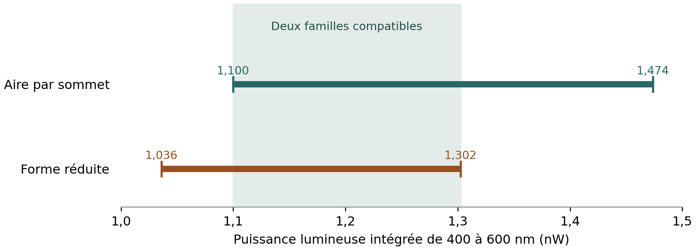

À 3,1 bar, une puissance située entre 1,100 et 1,302 nW environ appartient aux deux bandes. Pour prendre une décision, on utilise les bornes non arrondies et l’intervalle entier de la mesure. À titre d’illustration, une mesure comprise entre **1,36 et 1,40 nW** serait compatible avec la famille « aire par sommet » et exclurait la famille « forme réduite » pour cette préparation. Entre **1,05 et 1,08 nW**, la conclusion s’inverserait. Entre **1,52 et 1,55 nW**, les deux familles gelées seraient exclues. Ces trois intervalles sont des exemples de lectures possibles. Les quatre pressions du tableau restent des projections. La commande de l’annexe C permet d’appliquer la même règle à une mesure indépendante.

## Ce qu’apportent les comparaisons déjà disponibles

Les distances moléculaires, les fréquences et les décalages stellaires du chapitre 4 proviennent de mesures publiées. Ils permettent de vérifier des affirmations différentes.

| Observable | Résultat du banc et mesure de référence | Ce que la comparaison établit |
|:---|:---|:---|
| Longueur S–F dans SF₆ gazeux | Les six bras calculés vont de 1,55951 à 1,56059 Å. La diffraction donne une longueur moyenne de 1,561 ± 0,002 Å à trois écarts-types. | Les six valeurs sont compatibles avec la même grandeur de diffraction. L’expérience fournit une longueur moyenne pour cette géométrie. |
| Décalage de la raie Hα de Sirius B | Les deux fonds A et B donnent 80,023 km/s. Joyce et ses collègues mesurent 80,65 ± 0,77 km/s, relativement à Sirius A. | L’écart de 0,627 km/s entre dans l’incertitude publiée. Cette observable laisse les deux fonds compatibles. |
| Déplacement isotopique de H à D | Pour la transition $1S$–$2S$, la réduction à masses ponctuelles donne un excès d’environ 20,9 MHz avec les deux étalons. L’incertitude expérimentale est de 15 Hz. | L’écart reste visible à la précision de la spectroscopie. Cette réduction sert aux comparaisons dans la tolérance du banc. Pour rendre compte de la raie à la précision de la mesure, d’autres contributions sont nécessaires. |

Les références expérimentales sont la diffraction de Bartell et Doun, la mesure différentielle de Joyce et ses collègues et la spectroscopie à deux photons de Parthey et ses collègues. Les préparations, étalons et calculs correspondants figurent en D01 et D07. [Bartell et Doun](https://doi.org/10.1016/0022-2860(78)80010-6) · [Joyce et coll.](https://doi.org/10.1093/mnras/sty2404) · [Parthey et coll.](https://doi.org/10.1103/PhysRevLett.104.233001)

La dispersion entre trois atomes fournit un autre type de comparaison. Le calcul conserve les polarisabilités dynamiques issues de l’étalonnage optique et suppose une interaction dipolaire non retardée à grande distance. Pour trois atomes d’argon, il donne un coefficient à trois corps $C_9=499{,}85$ contre $518{,}3$ chez Tang et ses collègues. Pour deux atomes d’hélium et un d’argon, il donne $9{,}532$ contre $10{,}25$. Les quatre valeurs sont en unités atomiques $E_{\rm h}a_0^9$, où $E_{\rm h}$ est le hartree et $a_0$ le rayon de Bohr. Avec la convention géométrique de ces auteurs, $C_9$ correspond à leur $Z_{111}$. Les écarts respectifs de $-3{,}56$ % et $-7{,}00$ % comparent deux calculs. La précision de l’intégration numérique et l’exactitude physique de la fermeture sont deux questions distinctes. [Tang et coll., coefficients de dispersion à trois corps](https://doi.org/10.1063/1.3691891)

En cosmologie, le modèle de référence ajusté de Planck rend mieux compte de chacun des trois spectres selon le score du chapitre 5. Les mêmes familles BST peuvent cependant être confrontées aux distances de DESI et à la croissance de structure mesurée par eBOSS. L’intérêt de la comparaison tient à cette contrainte commune. Retrouver une observation déjà expliquée constitue une épreuve de cohérence. Une prédiction discriminante demanderait en plus une préparation pour laquelle les conséquences de BST diffèrent de celles du modèle concurrent.

## Perspectives sur l’origine de l’initiative

L’arbitrage a une conséquence observable lorsqu’une information acquise change ce que l’agent fait à possibilités égales. Le chapitre 6 précise comment éprouver le maintien d’une règle, son veto ou sa révision, puis comparer les choix de personnes tenues à l’écart de l’ajustement. La nécessité d’une distinction causale pour expliquer deux actes différents à observation identique est établie sous les hypothèses du théorème donné en annexe B. Une distinction distribuée entre plusieurs degrés de liberté du substrat peut jouer ce rôle. Remonter une chaîne de causes à des résolutions toujours plus fines peut donc laisser l’origine indéterminée.

Une variante philosophique de BST suppose qu’une initiative extérieure au substrat oriente les flux qui s’y expriment. Si le substrat désigne tout l’Univers physique, une origine effectivement extérieure est un **axiome philosophique possible**. Pour que cette variante acquière une conséquence propre, elle doit préciser dans quelle situation l’orientation modifierait le partage entre deux voies et quelle modification un mécanisme interne défini prévoirait dans la même situation. Mesurer les deux flux contrôle leur partage. Un apport d’énergie devrait également apparaître dans le bilan. Tant que les deux descriptions donnent les mêmes flux et les mêmes actes, l’observation laisse leur origine indécidable. La même exigence vaut pour la continuité d’un sujet. La conservation d’une trace devient pertinente pour l’identité personnelle si l’on établit comment le même agent peut se la réapproprier.

## Trois propositions sur le substrat, la cognition et l’arbitre

Dans l’hypothèse physique de BST, l’Univers lui-même est le substrat. Un même mouvement peut apparaître comme une onde, comme un contact persistant ou comme un flux, selon ce que l’appareil mesure. Cette idée engage davantage que l’emploi d’un vocabulaire commun. Par exemple, une fois fixée la dynamique des champs qui portent un signal et un battement, elle doit rendre compatibles leurs deux façons de mesurer une durée dans le secteur où un cône commun est annoncé. Le chapitre 2 précise ces conditions et donne des exemples où les deux lectures se séparent. Établir que la matière elle-même se forme par de tels battements demanderait une loi de formation reliant un état initial explicite à une propriété mesurable du produit formé.

La proposition cognitive porte d’abord sur une information qui cesse d’être visible et peut encore orienter une action. Le porteur bistable livre un test causal de cette idée. À préparation et impulsion identiques, supprimer le couplage de lecture efface le contraste entre les deux réponses tandis que la barrière conserve la trace. Pour transposer cette distinction au vivant, il faudrait identifier le porteur, agir sur le canal de lecture et contrôler une éventuelle réintroduction de l’information. Le transfert à une tâche nouvelle examinerait ensuite si l’agent peut employer cette information pour réviser sa règle de choix.

Pour l’arbitre, l’épreuve décisive porterait sur l’orientation prise à un embranchement. Deux mécanismes candidats devraient annoncer à l’avance la probabilité d’emprunter chaque voie après une intervention spécifiée. Des répétitions pourraient alors départager ces deux mécanismes sur la distribution des flux. Pour donner à ce résultat une portée sur l’origine de l’initiative, il faudrait en outre montrer pourquoi une loi interne ne peut reproduire cette distribution. Cette dernière étape reste ouverte dans la variante extérieure.

## Reproductibilité

Le dépôt de cette édition porte le nom **bst-reproducibility**. Le manuscrit, les données d’entrée, les lecteurs et les résultats attendus se rapportent au registre des 68 exigences. L’annexe A relie chaque résultat à son exigence. L’annexe B indique les commandes et les environnements. L’annexe C donne les conditions nécessaires pour confronter une mesure nouvelle aux prédictions. L’annexe D renvoie aux observations d’origine, aux logiciels et aux contributions.

Trois opérations répondent à trois questions différentes. Vérifier les empreintes SHA-256 établit que l’on dispose des fichiers attendus. Relancer les programmes permet de comparer les valeurs recalculées aux sorties archivées. Enfin, acquérir un nouvel enregistrement avec un instrument indépendant éprouve la correspondance physique, y compris la préparation et les incertitudes de lecture. Pour le néon, par exemple, le tableau, le code et la commande sont fournis. La puissance aux quatre pressions réservées doit venir d’une mesure.

## Limites

Les 68 lignes du banc portent chacune sur un énoncé défini. Un accord à l’intérieur d’une tolérance laisse ouverte la précision d’une observable plus fine. Le déplacement isotopique H–D l’illustre. Plusieurs combinaisons compatibles avec les mêmes mesures peuvent également attribuer des valeurs différentes à une grandeur cachée. L’identification indépendante de la charge, l’attribution des niveaux collectifs de l’interaction forte et l’énergie absolue d’un éclair individuel au xénon sont les trois réserves explicites de la décision commune.

En cosmologie, les calculs empruntent une fermeture des perturbations, des conditions initiales et un transfert radiatif. Pour la cognition, la preuve de conservation d’une trace porte sur un hamiltonien précis, et les données de comportement renseignent sur les choix observés. Attribuer l’origine de ces choix à une initiative extérieure ou établir la continuité vécue d’un sujet exige des prémisses supplémentaires. La nature du substrat et ce qui pourrait agir sur lui restent les propositions de plus grande portée de BST. La précision de chaque comparaison détermine jusqu’où les observations peuvent les instruire.

## Conclusion

BST propose de partir d’un mouvement et de préciser l’appareil qui permet d’en tirer une durée, une distance, une raie ou une information sur un choix. Pour un lecteur extérieur, le résultat transmissible est l’ensemble formé par la préparation, la loi, la lecture et le critère d’accord. Sur le banc des 68 exigences, 192 combinaisons sur 576 satisfont simultanément les 67 contrôles communs. La dernière ligne consigne la décision et les pièces de reproduction. Les quatre pressions du néon offrent un premier cas où un laboratoire peut départager des réalisations déjà fixées. Les intervalles annoncés pourront être comparés à ces mesures en conservant la préparation et la règle de lecture.

Pour la cognition, les deux lectures d’un même porteur donnent une conclusion précise. Une trace peut influer sur une réponse ultérieure alors même que l’observation au repos ne permet pas de la distinguer. Pour l’établir chez une personne, il faut aussi relier la réponse à une expérience antérieure et contrôler ce que la sonde a pu réintroduire. Cette exigence délimite la portée du postulat ontologique de BST. Une même histoire observable peut admettre plusieurs origines de l’initiative. Les départager demanderait une conséquence mesurable propre à chacune.

# Annexe A. Registre des soixante-huit exigences {#register}

Le registre présente les 68 exigences avec leur identifiant, leur statut et le résultat qui le justifie. Les conditions figurent auprès des résultats concernés. Le fichier `evidence/requirements.csv` donne, pour chaque exigence, la portée, le résultat, ses conditions et la commande de rejeu. L’onglet « Mesures et réglages » de la console présente les décomptes par combinaison. L’accord commun admet plusieurs combinaisons. Ses trois réserves concernent l’identification de la charge indépendamment du spectre, l’attribution des niveaux collectifs aux états de l’interaction forte et la mesure absolue par éclair dans l’expérience au xénon.

## Exigences transversales

**G00.1 · Registre des revendications, prémisses et preuves.** Statut du registre « acquis documentaire ». Le registre associe à chaque revendication son périmètre et les pièces qui l’étayent.

**G00.2 · Portée des généralisations finales.** Statut du registre « acquis documentaire ». Les conditions d’une conclusion générale sont consignées pour chaque niveau de preuve.

**G01.1 · Conjugaison du forçage et de la lecture, dimensions et masses.** Statut du registre « acquis natif ». Le forçage et sa lecture conjuguée utilisent la normalisation des opérateurs du noyau. Les unités des réductions fluorées sont explicites.

**G01.2 · Conservation, passivité et limites.** Statut du registre « acquis natif ». La réduction conserve la positivité du complément de Schur. Le résidu des équations du mouvement est contrôlé avec les sept centres mobiles.

**G02.1 · Gauss, lecture directe/adjointe et jauge du cœur statique avec halo.** Statut du registre « valide numerique ». La loi de Gauss et les lectures directe et adjointe sont vérifiées sur le même cœur statique avec halo.

**G02.2 · Courant tridimensionnel dynamique et convergence spatiale.** Statut du registre « valide numerique conditionnel ». La convergence du courant tridimensionnel est testée pour l’opérateur et les fenêtres spatiales du lecteur de courant.

**G02.3 · Seuil du secteur chargé.** Statut du registre « acquis natif conditionnel ». Le seuil de la solution chargée est donné pour la masse du vide et les conditions du secteur spécifiées.

**G02.4 · Normalisation et identité électrique indépendante.** Statut du registre « valide numerique conditionnel ». Une même normalisation de charge est transportée aux raies atomiques, aux rayons et aux liaisons. Les étalons déterminent une combinaison de paramètres.

Condition associée. L’identité électrique indépendante de la seule calibration de la constante de structure fine garde le statut de la preuve dans le registre. Deux étalons de cette constante ne la démontrent pas à eux seuls.

**G03.1 · Transport des degrés, géométrie et réponses.** Statut du registre « acquis natif ». La géométrie d’observation fixée s’applique aux douze préparations avec les mêmes paramètres.

**G03.2 · Bilans et convergence des opérateurs transportés.** Statut du registre « acquis natif ». Les poids et les pôles des opérateurs projetés sont contrôlés pour chaque préparation.

**G04.1 · Poids, moments, positivité et causalité.** Statut du registre « acquis natif ». La réduction du réservoir respecte les poids, les moments et la causalité de cette réalisation.

**G04.2 · Raccord à un réservoir et un courant physiques.** Statut du registre « valide numerique conditionnel ». Le courant du réservoir est défini dans le noyau. Le flux traversant les faces du volume est évalué sur cinq maillages.

**G05.1 · Centre CO₂ 728 à paramètres gelés.** Statut du registre « valide avec departage reserve ». La prédiction du centre du CO₂ à 728 cm⁻¹ utilise la préparation et les paramètres gelés.

**G05.2 · Gaz, rotations et spectres à conditions de référence.** Statut du registre « valide numerique conditionnel ». Les mesures de gaz, de rotation et de spectroscopie sont identifiées avec leurs conditions de référence.

**G05.3 · Prédictions réservées, covariances, budgets et témoins.** Statut du registre « valide avec departage reserve ». Les prédictions réservées et leurs conventions de comparaison sont documentées. L’annexe C donne l’exemple du néon.

**G06.1 · Source électrostatique, lecture réciproque et contrôles négatifs.** Statut du registre « valide numerique partage ». Le calcul électrostatique emploie le même opérateur pour les tests de réciprocité et les témoins.

**G06.2 · Propagation physique avec pertes, phases et horloge.** Statut du registre « valide numerique conditionnel ». À l’échelle cosmologique, le fond, la fraction de matière, la fermeture des perturbations et la masse effective sont communs aux comparaisons de propagation.

**G06.3 · Détecteur, calibration et rétroaction.** Statut du registre « valide numerique conditionnel ». Un même lecteur vectoriel couple les six bras de SF₆ au détecteur. Les intensités sont confrontées aux fenêtres de mesure et aux 6 970 relevés de la bande faible.

**G07.1 · Provenance et accès aux fichiers de preuve.** Statut du registre « acquis documentaire ». Les fichiers de preuve sont identifiés par leur chemin et leur empreinte.

**G07.2 · Reproduction de la restauration.** Statut du registre « acquis documentaire ». Le dossier fournit le parcours de reproduction et les sorties de référence correspondantes.

## Questions scientifiques

**Q1.1 · Composition, mesure et intrication.** Statut du registre « valide numerique conditionnel ». Les probabilités et les espacements du système harmonique collectif sont calculés sur quinze préparations avec l’échelle d’action de la famille fluorée.

**Q1.2 · Spin et statistiques d’échange.** Statut du registre « valide numerique conditionnel ». Le signe associé à la rotation et à l’échange est contrôlé sur les chemins fermés spécifiés.

**Q2.1 · Structure de jauge et loi de Gauss.** Statut du registre « valide numerique conditionnel ». Pour les deux familles fluorées et quinze géométries, la même construction des liens induits satisfait les contrôles de Gauss, de covariance et de positivité. Son identification physique est une hypothèse.

**Q2.2 · Matière, interactions fortes et spectre.** Statut du registre « valide numerique conditionnel ». Quatre excitations de la réalisation collective donnent douze niveaux sur les quinze géométries avec les échelles d’action des familles fluorées.

Condition associée. L’assignation de ce spectre aux états physiques de l’interaction forte est explicitement laissée ouverte dans les quinze sorties. Le modèle de jauge effectif est autorisé, le niveau d’attribution du spectre doit accompagner le résultat.

**Q3.1 · Courant faible, chiralité et violations.** Statut du registre « valide numerique conditionnel ». Les corrélations angulaires du courant faible et la distribution de masse réduite utilisent les mêmes paramètres communs que les comparaisons atomiques et nucléaires.

**Q3.2 · Neutrinos et épreuve réservée.** Statut du registre « valide numerique conditionnel ». La même différence de masses au carré intervient dans le calcul d’oscillations au réacteur et dans la fermeture cosmologique à un mode massif.

**Q4.1 · Transport des gaz dilués et à densité finie.** Statut du registre « valide numerique conditionnel ». Avec les forces des viriels et la même loi de taille, les 54 fenêtres par branche pour les deux gaz admettent une correction commune de la diffusion et de son temps de relaxation.

**Q4.2 · Condensé, transport électronique et plasma.** Statut du registre « valide numerique conditionnel ». Les observations en milieu condensé, en transport électronique et en plasma sont qualifiées dans les conditions propres à chaque dispositif.

**Q5.1 · Fonds exacts de Schwarzschild et Kerr.** Statut du registre « valide avec departage reserve ». Les solutions de vide de Schwarzschild et de Kerr fournissent les fonds et les unités du calcul.

**Q5.2 · Signe de la croissance d’un mode scalaire de Kerr.** Statut du registre « valide numerique ». Le signe de croissance d’un mode scalaire est contrôlé sur le fond de Kerr et avec les conditions aux limites spécifiées.

**Q5.3 · Source, rétroaction et lecture en champ fort.** Statut du registre « valide numerique conditionnel ». Le signal de Sirius B est transporté avec la fréquence atomique et la métrique de la même combinaison. Le fond de champ fort est une donnée de ce calcul.

**Q6.1 · Univers primordial et fond.** Statut du registre « valide numerique conditionnel ». Les comparaisons cosmologiques emploient un fond commun, une fraction de matière et une masse effective spécifiées.

**Q6.2 · Croissance des perturbations et transfert.** Statut du registre « valide numerique conditionnel ». La même fermeture des perturbations est appliquée au fond diffus, aux distances et à la croissance avec le transfert documenté au chapitre 5.

**Q7.1 · Stabilité et chimie réactive.** Statut du registre « valide numerique conditionnel ». Les préparations conservent le fragment libre et la condition sur le bloc de séparation. Le calcul du seuil fluoré est documenté pour chaque branche.

**Q7.2 · États excités, canaux et seuils de dissociation.** Statut du registre « valide numerique conditionnel ». L’énergie, l’échelle d’action et la raideur de la famille fluorée relient fréquences, libération d’un fluor et cycle de formation.

**Q8.1 · Protocole, contrôles et analyse.** Statut du registre « acquis documentaire ». Le protocole comportemental précise les données, les contrôles et l’unité d’analyse.

**Q8.2 · Épreuve de cognition à observations humaines.** Statut du registre « valide empirique comparatif ». Les observations humaines étayent la comparaison comportementale dans le protocole déclaré. Son interprétation quant au vécu est exposée au chapitre 6.

## Exigences par domaine

**D01.1 · Niveaux et écarts atomiques H/H-like, He, C/O/Ne.** Statut du registre « valide numerique conditionnel ». Le calcul de cinq raies de l’hydrogène utilise la même normalisation de charge et de structure fine. Le chapitre 4 donne séparément rapports de fréquences et échelle absolue.

**D01.2 · Géométrie et stabilité du panel moléculaire.** Statut du registre « valide numerique conditionnel ». Les six distances S–F de la préparation utilisée pour le spectre appartiennent à l’intervalle de diffraction défini pour la distance moléculaire moyenne. Les autres géométries gardent le périmètre de leur propre préparation.

**D01.3 · Isotopes et autres cas hors calibration.** Statut du registre « valide avec departage reserve ». Le déplacement isotopique H–D sonde le changement de masse réduite à charge nucléaire fixée. L’écart à la valeur publiée et l’incertitude expérimentale sont explicités en D01.

**D02.1 · Charge, courant, contraintes et jauge.** Statut du registre « valide numerique conditionnel ». Les neuf intégrations à préparation commune utilisent la raideur 2 et l’inertie 8 dans les unités du noyau.

**D02.2 · Polarisation, propagation et bilan matière-champ.** Statut du registre « valide numerique conditionnel ». Le courant, la polarisation, la propagation et le bilan entre matière et champ sont contrôlés avec les opérateurs de la préparation spécifiée.

**D03.1 · Fréquences, rapports et isotopes.** Statut du registre « valide numerique conditionnel ». Les fréquences et les rapports de la famille fluorée utilisent la raideur et l’échelle d’action communes à son calcul de rupture.

**D03.2 · Règles de sélection, intensités, phases et amplitudes.** Statut du registre « valide numerique conditionnel ». Le lecteur vectoriel commun aux six bras donne les intensités intégrées et le profil de la bande de combinaison.

**D03.3 · Espèces et dispositifs réservés.** Statut du registre « valide numerique conditionnel ». Le profil de la bande faible de SF₆ est étalonné sur les 6 970 relevés des deux pressions. Son transfert à une autre préparation constituerait une épreuve indépendante.

**D04.1 · Défauts de forces/travail.** Statut du registre « acquis natif rejoue ». Le travail des forces de SF₄ et SF₆ et le résidu des équations mécaniques des sept centres sont contrôlés.

**D04.2 · Invariances.** Statut du registre « acquis natif rejoue ». La rotation conserve les forces de SF₄ et de SF₆ avec un défaut de covariance inférieur à 10⁻¹¹ dans les unités du calcul.

**D04.3 · Pas et retours.** Statut du registre « acquis natif et prolonge ». Le pas, le retour et la durée sont contrôlés à paramètres fixés. Le test du pas temporel porte aussi sur la même impulsion à 40³.

**D04.4 · Flux de frontière.** Statut du registre « valide numerique conditionnel ». Les sept centres sont libres. Les deux flux de frontière utilisent la même impédance et la soustraction du biais de propagation du paquet.

**D04.5 · Comparaison d’observables dans le régime revendiqué.** Statut du registre « valide numerique conditionnel ». Les fréquences, l’énergie de libération d’un fluor et le cycle de formation sont comparés dans la branche et le scénario thermochimique spécifiés.

**D05.1 · Énergie, densité et équation d’état.** Statut du registre « valide numerique conditionnel ». Les mêmes rayons d’amas entrent dans les viriels et les lectures thermiques. Les états du krypton et du xénon sont calculés avec la correction commune d’énergie libre.

**D05.2 · Cp/Cv, compressibilité et vitesse du son.** Statut du registre « valide numerique conditionnel ». Les capacités thermiques et les dérivées de l’équation d’état sont évaluées sur les préparations et les états de référence indiqués en D05.

**D05.3 · Pression de vapeur, chaleur latente et coexistence.** Statut du registre « valide numerique conditionnel ». L’énergie libre et la loi de taille communes relient les deux phases, la chaleur latente et la calorimétrie dans les deux branches. L’argon réduit fixe la référence dense.

**D06.1 · Viscosité, température et composition.** Statut du registre « valide numerique conditionnel ». Pour Kr et Xe purs, les quatre lectures longues de la branche 0 admettent l’intervalle de gain commun donné en D06. La branche 1 dispose du contrôle court pour les deux gaz.

**D06.2 · Corrélations, relaxations, taille et durée.** Statut du registre « valide numerique conditionnel ». Les tests de taille et de durée portent sur six graines et deux tailles. Les deux estimateurs sont comparés sur les quatre fenêtres spécifiées.

**D07.1 · Propagation sur fond de Schwarzschild.** Statut du registre « valide avec departage reserve ». La propagation des signaux est calculée sur le fond de Schwarzschild fixé dans les 576 combinaisons.

**D07.2 · Propagation du mode scalaire sur Kerr fixé.** Statut du registre « valide numerique partage ». Le mode scalaire se propage sur le même fond de Kerr fixé dans les 576 combinaisons.

**D07.3 · Dispersion, cinématique, invariants et couplage matière-géométrie.** Statut du registre « valide numerique conditionnel ». Le décalage différentiel de Sirius B est évalué pour les deux fonds indiqués. La production de la métrique par la matière en champ fort demeure une question distincte.

**D08.1 · Distances et expansion avec covariance.** Statut du registre « valide numerique conditionnel ». Les distances et la croissance sont comparées avec les conventions de covariance des observations et le fond commun de chaque famille.

**D08.2 · BAO/CMB et projections.** Statut du registre « valide numerique conditionnel ». Les distances BAO et les bandes du fond diffus utilisent le transfert commun. Le score de bande TT, TE ou EE emploie les variances diagonales.

**D09.1 · Rayon, phase et forçage du collapse.** Statut du registre « valide numerique conditionnel ». Les rayons et la phase de huit cycles au xénon sont lus pour le forçage indiqué. Le signal électrique de chaque cycle donne une amplitude relative.

**D09.2 · Énergie, durée, spectre et dépendance au gaz.** Statut du registre « valide numerique conditionnel ». Le banc donne des comparaisons spectrales intégrées sur les cinq gaz. Dans la préparation au xénon, le rayon et la tension sont associés sur huit cycles.

Condition associée. Pour le protocole synchronisé de Hopkins, la tension fixe le temps et l’amplitude relative. L’énergie de bande déduite du spectre est moyennée sur des périodes. L’énergie absolue totale et le spectre par cycle de ces tirs ne sont pas identifiés ensemble dans les pièces disponibles.

**D10.1 · Définitions et théorèmes conditionnels.** Statut du registre « acquis formel conditionnel ». Les résultats formels sur les observations et les distinctions latentes valent sous les hypothèses indiquées en cognition et dans l’annexe B.

**D10.2 · Porteur, invariant, canal et tests empiriques.** Statut du registre « acquis numerique conditionnel ». Les simulations du porteur bistable relient une distinction interne à une sonde qui permet de la lire. Les observations humaines relèvent de Q8.2 et de son protocole comportemental.

**D11.1 · Masses, écarts et stabilité.** Statut du registre « valide numerique conditionnel ». Le calcul des liaisons et des rayons nucléaires emploie les paramètres communs à la famille atomique. L’atlas distingue les masses évaluées et les résultats du modèle.

**D11.2 · Taux, transitions et durées de vie.** Statut du registre « valide numerique conditionnel ». Les amplitudes par état étalonnées sur les demi-vies et les branches sont compatibles dans la région commune des paramètres du substrat. Le certificat se transfère à 384 assemblages sur 576.

## Décision commune

**J00.1 · Compatibilité d’un jeu commun sur toutes les clauses.** Statut du registre « validée sous conditions sur le banc étalonné ». 192 combinaisons sur 576 satisfont ensemble les 67 autres contrôles dans leur portée. Les trois réserves du résultat commun figurent en ouverture de cette annexe.

**J00.2 · Décision, prédictions gelées, manuscrit et dépôt.** Statut du registre « acquis documentaire ». La décision, les prédictions gelées, le manuscrit et le dépôt reproductible constituent le résultat documentaire.

# Annexe B. Calculs et vérification formelle {#replay}

## Rejouer

Depuis le dépôt extrait, cette commande vérifie les fichiers avec leurs empreintes SHA-256. L’archive est l’exemplaire privé de relecture du dépôt proposé sous le nom `bst-reproducibility`.

~~~sh
python3 replay.py integrity
~~~

Sur un système POSIX, installer l’environnement Python ci-dessous. Le parcours standard complet exige aussi des compilateurs C/C++ et Lean 4.30.0 accessibles par le terminal. La commande `python3 replay.py list` énumère les parcours.

~~~sh
python3 -m venv .venv
. .venv/bin/activate
python -m pip install -r requirements.txt
python replay.py all --output ../bst-replay
~~~

Le parcours standard vérifie les entrées, les 14 sorties de synthèse de la physique, les onze domaines, les opérateurs atomiques, les horloges, les premiers modèles, les animations, la cognition, CAMB et les déclarations recompilées avec Lean. Les intégrations de champ et de transport à l’origine des trajectoires archivées disposent d’une commande distincte, `python3 replay.py long --output ../bst-long`. Le calcul de la paire conserve un état tous les 25 pas, dont la puissance transmise à la coordonnée de séparation. L’état initial détermine sa trajectoire. Les essais stochastiques conservent leurs graines.

Le README détaille les prérequis, y compris ceux des intégrations longues. Les commandes recréent une copie de travail avec les noms de données du calcul de référence. On peut la matérialiser avec `python3 replay.py extract --output ../bst-inputs`. Le dossier contient la base SQLite, les bandes Planck et le registre des combinaisons cellule par cellule. Les unités natives sans dimension prennent leur sens physique par l’étalonnage indiqué dans chaque comparaison.

L’observatoire hors ligne s’ouvre depuis `observatory/index.html`. La vue de la paire intègre à nouveau le mouvement du manteau et la séparation lorsqu’on modifie la raideur de contact ou l’inertie. La vue SF₆ utilise les six directions d’équilibre archivées et un mode choisi de l’opérateur à 66 dimensions. Le catalogue atomique indique les décomptes d’ondes absents à l’échelle d’un isotope ou d’un ion. La thermodynamique présente aussi des courbes de référence externes pour l’eau et le dioxyde de carbone, d’après le Chemistry WebBook du NIST. [Eau](https://webbook.nist.gov/cgi/cbook.cgi?ID=C7732185&Mask=4) · [Dioxyde de carbone](https://webbook.nist.gov/cgi/cbook.cgi?ID=C124389&Mask=4)

Pour retrouver l’exemple BAO du chapitre 5, ouvrir les entrées `DESI_DR2_mean.txt` et `DESI_DR2_cov.txt` dans les entrées cosmologiques extraites. Les deux lignes à décalage 0,51 portent respectivement les étiquettes `DM_over_rs` et `DH_over_rs`. La matrice de covariance suit l’ordre des lignes du fichier de mesures. La valeur de l’exposant de dilatation temporelle des supernovæ est celle publiée par White et ses collègues. Elle fournit une cible extérieure pour le lecteur BST.

La commande suivante reconstitue les 36 scores diagonaux de Planck, extrait les deux scores DESI de chaque calcul du banc commun et recalcule les douze scores eBOSS à partir des douze vecteurs prédits et de la covariance. Le fichier contient aussi les mesures, leurs erreurs marginales et l’étendue des prédictions pour chaque observable eBOSS. Le transfert depuis les conditions initiales peut être relancé séparément selon le parcours cosmologique de cette annexe.

~~~sh
python3 replay.py cosmology --output ../bst-cosmology
~~~

Le contrôle de dispersion du chapitre 1 appartient au parcours ouverture. Le calcul isolé exige seulement la bibliothèque standard de Python. Depuis la racine du dossier, la commande ci-dessous produit le tableau des quatre maillages, avec les deux vitesses de phase ramenées à $c_*$ et leur différence. Le fichier de référence porte le même nom dans le répertoire de données de rédaction.

~~~sh
python3 replay.py pair --output ../bst-pair
~~~

**Reproduire les propriétés du substrat et les deux horloges.** Depuis la racine du dépôt, la commande suivante produit le tableau des horloges en mouvement, la réponse locale et la figure du cône. Elle recalcule aussi les horloges sur fond statique à partir des profils radiaux et des programmes C et Python. Ce calcul utilise GCC avec OpenMP sous Linux ou Clang sous macOS. Les chemins des résultats sont indiqués dans `evidence/reader-files.csv`. La copie de travail extraite contient le programme permettant d’isoler l’essai en mouvement.

~~~sh
python3 replay.py substrate --output ../bst-substrate
~~~

Les unités sont réduites. Le premier calcul intègre l’onde sans rappel sur un anneau de longueur 64. Une gaussienne d’amplitude 1 et de largeur $1{,}25$, centrée en 16, a une vitesse initiale nulle. Les capteurs en 24 et 32 lisent le maximum de l’orientation ou de la composante électrique transverse. Dans le second cas, la même gaussienne initialise le potentiel $A_y$ et la différence temporelle centrée donne $E_y$. Le temps du maximum est estimé par interpolation parabolique à trois points avant le retour périodique. Le second calcul utilise deux modes de Fourier à $k\pm\epsilon$ sur un réseau uniforme infini. Les valeurs possibles de $k$ y sont continues. Le domaine périodique de longueur 64 sert à la mesure des temps de vol. Sur le réseau, les deux voisins d’un mode apportent le facteur $2\cos(kh)$. L’intégration centrée d’ordre deux commence à amplitude 1 et à vitesse nulle. Les pulsations sont déduites des passages par zéro sur 100 unités de temps. Leur différence divisée par $2\epsilon$ donne la vitesse de la crête. Les solutions en quadrature reconstruisent l’onde progressive dont on compte directement les cycles sur cette trajectoire. Le programme compare aussi le rythme lu à celui que donne la phase de la porteuse. Aucun facteur de dilatation n’entre dans l’évolution des deux champs.

Le tableau complet livre les quatre pas $h=1/4,1/8,1/16,1/32$, avec $\Delta t=h/4$ et la demi-largeur en nombre d’onde $\epsilon=h/4$ en unités réduites. À la maille la plus fine, deux témoins divisent séparément le pas de temps ou la demi-largeur par deux. Les trois choix de raideurs (commun, modification de l’échelle, modification de la jauge) et les deux sens de déplacement donnent 36 lectures en tout. Pour la vérification locale du chapitre 3, le JSON consigne les inerties, les deux préparations et la dérivée de l’action recalculée par différence centrée en $s$, de pas $10^{-5}$.

Pour reproduire les modes radiaux et le signal transverse sur fond statique, exécuter la commande suivante.

~~~sh
python3 replay.py substrate --output ../bst-radial-clocks
~~~

Le programme compare deux modes radiaux par préparation, sur deux degrés et à 128 puis 256 éléments, pour trois décalages du fond et deux lois d’inertie. Il intègre aussi les liens transverses sur un réseau de 11 sites par axe avec le champ de résolution libre, pour 100 puis 200 pas en deux périodes. L’index `evidence/reader-files.csv` indique où lire les fréquences, les vitesses et les séries temporelles recalculées à partir des profils radiaux.

**Retrouver la dérivation atomique.** Depuis la racine du dossier, exécuter

~~~sh
python3 replay.py atomic-modes --output ../bst-atomic-modes
~~~

Le programme lit les géométries atomiques, les coefficients fixés sur les éléments de H à Ne et les matrices de contact. Il reconstruit le laplacien à partir des produits scalaires des directions gelées, recalcule les 82 réponses de contact et diagonalise les deux systèmes d’essai du strontium. Il reproduit le témoin angulaire, relève les résultats pour H, H–D et SF₆ dans le registre et enregistre la figure avec le résultat numérique. Les deux témoins dynamiques et le témoin angulaire sont des contrôles rétrospectifs. Le guide `evidence/reader-files.csv` indique où lire les résultats.

**Rejouer l’entretien du battement, les deux courants et la transition du strontium.** Depuis la racine du dossier, exécuter

~~~sh
python3 replay.py clocks-and-flux --output ../bst-clocks-and-flux
~~~

Le programme intègre les trois préparations pendant dix périodes par DOP853, avec tolérances relative $10^{-11}$ et absolue $10^{-13}$. Sur 2 001 instants, il vérifie le bilan du travail et de la perte. Il calcule les flux d’énergie sur 256 phases, puis les courants d’actes à partir des six événements de la cuve scellée et leur bilan de population. « Entrees_strontium.json » donne les deux intervalles primaires du même isotope, les cibles de comparaison et leurs sources. « Battement_flux_strontium.json » conserve les résultats et les unités indiquées par ses rubriques. Le parcours cognition rejoue également les douze tests de la cuve scellée parmi les 97 tests historiques.

Le contrôle des deux préparations de la paire à battement interne reprend l’intégrateur de la figure du chapitre 2. Depuis la racine du dossier extrait, exécuter la commande suivante dans l’environnement Python utilisé ci-dessus.

~~~sh
python3 replay.py reduced-dynamics --output ../bst-reduced-dynamics
~~~

Pour chaque pas et chaque préparation, la comparaison de la paire indique les distances, leur écart et la dérive maximale de l’énergie. Son chemin figure dans `evidence/reader-files.csv`.

## L’opérateur de contact du strontium contient-il la raie d’horloge ? {#sr-contact-detail}

La géométrie de contact du strontium donne un autre accès à la question de la fréquence d’horloge. Dans l’atlas des géométries de référence, la préparation étiquetée Sr ($Z=38$) compte 315 ondes dans le modèle et 18 directions de surface. Dans le contrôle des contacts, cette configuration accepte deux contacts et refuse le troisième. Ces comptes qualifient une préparation géométrique pour l’élément. L’isotope et les états électroniques excités demandent des indications supplémentaires.

La réponse à une modification de la charge de contact $p$ se déduit de la minimisation de l’énergie d’un champ de rétroaction $r$. Le même calcul s’applique aux 82 bases atomiques fixées de $Z=37$ à 118. Pour $N$ directions, le projecteur $P=I-\mathbf1\mathbf1^\mathsf{T}/N$ retire la charge uniforme. Si $L$ est le laplacien du graphe de surface et $c_0,\ell_0,g_0$ les coefficients de couplage, de rappel local et de transport, l’équilibre et la raideur s’écrivent

$$A=(c_0+\ell_0)I+g_0 L,\qquad r_*=A^{-1}c_0p,\qquad
K=\frac{1}{N}P\big(c_0 I-c_0^2A^{-1}\big)P.$$

La reconstruction des 82 matrices utilise les directions et rayons de chaque base. L’écart absolu maximal aux coefficients de référence est inférieur à $2\times10^{-17}$ dans les unités réduites. Pour Sr, la direction uniforme a une valeur propre nulle à la précision du calcul. Les 17 raideurs positives vont de $0{,}01771294$ à $0{,}01798572$. Leur rapport extrême vaut $1{,}0154003$. **Une raideur devient une fréquence lorsqu’on spécifie aussi l’inertie du mouvement.**

Un premier essai attribue chaque raie issue du fondamental à un mode positif, avec une même inertie scalaire et une même conversion en hertz. Alors $\omega_i\propto\sqrt{\lambda_i(K)}$. Le rapport entre deux fréquences ne peut dépasser $1{,}007671$. Or dans $^{87}$Sr, pour les composantes $F=9/2$, la fréquence vers $^3P_1$ mesurée par Courtillot et la référence d’horloge vers $^3P_0$ donnent $1{,}013050$. En fixant la conversion avec la première raie, la seconde devrait être au moins à $431{,}519$ THz. L’horloge est à $429{,}228$ THz. Aucun choix de deux modes n’atteint ce rapport. [Courtillot et coll., table I](https://doi.org/10.1140/epjd/e2005-00058-0) · [BIPM, transition d’horloge du strontium 87](https://www.bipm.org/documents/20126/288515313/87Sr_429THz_2025/bbd827f7-3e1e-5fbe-6bd8-0eadd9b5b674)

Le rayon offre un contrôle de cette conclusion. À directions, nombre d’ondes et coefficients de référence fixés, chacun des trois coefficients varie comme $R^{-2}$. On en déduit $K(aR)=K(R)/a^2$, puis $\omega_i(aR)=\omega_i(R)/a$ à inertie constante. Deux changements de taille de rapport $0{,}8$ et $1{,}3$ vérifient l’identité matricielle à $3\times10^{-17}$ près. Redimensionner toute la préparation change la cadence absolue et conserve le rapport des raies. Cette dérivée par rapport au rayon interne ne détermine pas à elle seule la réponse au champ gravitationnel $s$ du chapitre 2.

Un deuxième essai conserve les deux champs $p,r$ comme degrés de liberté mobiles. Nous faisons ici l’hypothèse supplémentaire d’une énergie cinétique $(\|\dot p\|^2+\|\dot r\|^2)/(2N)$. Sur chaque mode non uniforme du laplacien de valeur $u$, les carrés des pulsations sont les deux valeurs propres de la matrice de diagonale $(c_0,c_0+\ell_0+g_0u)$ et de termes hors diagonale $-c_0$. Les 34 modes donnent 561 paires distinctes. Après étalonnage sur la raie vers $^3P_1$, même la paire choisie après comparaison pour minimiser l’écart place l’horloge à $430{,}171$ THz, soit $0{,}943$ THz trop haut. Ces deux essais portent sur l’identification directe des raies à des modes de contact issus du même fondamental.

### Ce que deux niveaux électroniques déterminent dans le strontium neutre

La structure angulaire fournit un contrôle qui se calcule à part. Dans le langage spectroscopique usuel, le terme électronique $5s5p\,{}^3P$ a $L=S=1$. L’opérateur $X=\mathbf L\cdot\mathbf S/\hbar^2$ a pour valeurs $x_J=[J(J+1)-4]/2$, soit $-2,-1,+1$ pour $J=0,1,2$, de multiplicités $1,3,5$. Le témoin linéaire $E_J/(h_{\rm P}c)=a+b x_J$, calé sur les deux niveaux $J=1,2$ de la table électronique de Sansonetti et Nave, donne $14\,307{,}2285$ cm⁻¹ pour $J=0$. La table donne $14\,317{,}507$ cm⁻¹, soit un écart de $-10{,}2785$ cm⁻¹. Les trois niveaux de la compilation ont été optimisés conjointement. Ce contrôle de forme porte sur le terme électronique publié. Le contrôle isotopique précédent utilisait les fréquences de $^{87}$Sr. [Sansonetti et Nave, table 3 et méthode d’optimisation](https://doi.org/10.1063/1.3449176)

Pourquoi deux niveaux ne suffisent-ils pas à reconstruire le troisième ? Ajouter $d(X^2-I)$ à l’opérateur exprimé en cm⁻¹ laisse $J=1,2$ inchangés et déplace $J=0$ de $3d$. Le coefficient $d=3{,}4262$ cm⁻¹ ajusterait la cible après coup. Pour en faire une prédiction de BST, il faudrait fixer l’effet de ce terme, ou celui d’un autre couplage, sur des données indépendantes. Les calculs à plusieurs électrons de Safronova et coll. fournissent un point de comparaison pour ce problème précis. [Safronova et coll., table I](https://doi.org/10.1103/PhysRevA.87.012509)

Le repère spinoriel et sa dynamique de Dirac caractérisent un spin et ses sources dans les préparations étudiées. L’identification de ces états à ceux du strontium neutre reste ouverte. Sous la lecture en modes du premier essai, une inertie positive $M$ sur le sous-espace non uniforme doit déjà vérifier $\kappa(M)\ge(\nu_1/\nu_0)^2/\kappa(K)$, soit environ $1{,}01070$. Cette condition nécessaire vient du quotient de Rayleigh de $Ku=\omega^2Mu$. Elle laisse plusieurs matrices possibles. Une dérivation prédictive doit déterminer l’inertie et les deux états avant de consulter la raie d’horloge, puis contrôler le couplage de leurs phases au même temps propre. Pour prédire aussi l’intensité de la raie de $^{87}$Sr, il faut décrire le mélange hyperfin qui rend accessible la transition entre les deux états $J=0$. [Porsev et Derevianko, calcul du couplage hyperfin](https://doi.org/10.1103/PhysRevA.69.042506)

## Une boucle de phase suffit-elle à identifier une corde effective ?

Une question voisine de celle des « empreintes d’ondulations » existe sous le nom de *corde effective* (*effective string*). Athenodorou et ses collègues ont calculé sur réseau les niveaux d’excitation de tubes de flux fermés dans des théories de jauge $SU(N)$, pour $N=3,5,6$. Une corde longue décrite à basse énergie rend compte de la structure des spectres étudiés. Ici, on compare des énergies en fonction de la longueur du tube. Pour soutenir un rapprochement physique, il faudrait extraire d’une dynamique BST un spectre comparable et ses incertitudes. Notre calcul exploratoire sur réseau $U(1)$ calcule des boucles de Wilson, qui suivent le transport d’une phase le long de contours fermés. [Athenodorou, Dubovsky, Luo et Teper, spectre des tubes de flux](https://arxiv.org/abs/2411.03435)

**Contrôle du calcul des tubes de flux.** Le programme de jauge sur réseau calcule des rapports de Creutz à partir de petites boucles de Wilson. Dans un même balayage, il accepte séparément, à partir de l’ancien champ, des rotations de liens parallèles qui peuvent partager une plaquette. On peut en contrôler la conséquence sur un réseau périodique $6^4$, à couplage $\beta=1$, en partant d’un champ nul. Si chacun des deux liens opposés d’une plaquette tourne de $0{,}4$ radian dans le même sens, leur contribution à l’angle de cette plaquette s’annule. Sur tout le réseau, la variation d’action conjointe vaut alors $0{,}789390$. La somme des deux variations évaluées séparément vaut $0{,}947268$. Pour deux liens espacés de deux mailles, les deux calculs donnent $0{,}947268$. Le programme *controler_plaquette.py* se trouve dans le répertoire de rédaction. Le parcours premiers-essais le rejoue avec le calcul des boucles de Wilson. La tension de corde dépend de la distribution échantillonnée. Ces rapports à petite boucle servent ici au contrôle du calcul sur réseau. Le spectre de tubes de flux reste à calculer pour BST.

## Lire les projections d’une échelle à l’autre

L’onglet Simulations donne accès aux quatre films de référence que le code Python régénère. Pour l’onde élémentaire et les vues atomiques, le blanc rend la cinétique visible. BST propose qu’un rayonnement associé au mouvement élémentaire se situe dans l’ultraviolet. L’image cinétique seule ne fournit aucune longueur d’onde. Dans le film du krypton atomique, un filtre gris représente séparément une raie mesurée du krypton neutre excité à 123,58 nm. Deux filtres visibles sont centrés à 557,03 et 587,09 nm. [NIST, krypton neutre](https://physics.nist.gov/PhysRefData/Handbook/Tables/kryptontable3.htm)

Chaque élément neutre dispose d’un film d’atlas. Dans la préparation en phase, chaque site possède un diamètre qui oscille entre 72 % et 128 % de sa moyenne. Un contour discret indique sa position aux retournements. Le mode propre dispose d’une lecture distincte. Pour H à Kr, les coordonnées viennent des géométries relaxées. L’hydrogène présente six positions de surface et un site central supposé dans le décompte candidat de sept. Pour Rb à Og, le calcul conserve les directions externes et leur mode de contact. Il place à l’intérieur la géométrie de la fermeture de la période précédente suivant la règle d’échelle publiée. Les positions du cœur ainsi obtenues sont une reconstruction. Le film du krypton à huit modes utilise une autre préparation, à 309 sites, tandis que le compte neutre de l’atlas est de 297. Les fiches de 5 842 états nucléaires et de 7 139 états de charge, références neutres comprises, indiquent les grandeurs disponibles. La console indique pour l’état choisi les nombres de protons et d’électrons et, lorsque le noyau est spécifié, celui de neutrons. Elle exporte cette composition sur une fiche. La géométrie neutre animée possède sa propre entrée. Les données du modèle ne donnent ni décompte ni coordonnées d’ondes pour chacun de ces états.

Dans les préparations de Kr₂ et de C₂, une densité lissée construite à partir des positions instantanées définit le manteau de chaque atome. La vitesse de déformation locale pondère l’éclat. Les sites internes s’effacent à mesure que la résolution de lecture diminue. L’oscillation radiale de Kr₂ dispose de 4,21 meV au-dessus du minimum. Le gris code la vitesse de déformation mécanique du dimère. Pour C₂ excité, les filtres correspondent aux têtes de bande de Swan mesurées à 473,7, 516,5 et 563,5 nm. La concentration de l’éclat sur les manteaux en mouvement est une hypothèse de répartition spatiale. Les modes internes et la vibration de la molécule ont leurs propres horloges, synchronisées pour l’affichage. [Constantes du dicarbone](https://webbook.nist.gov/cgi/cbook.cgi?ID=C12070154&Mask=1807&Units=SI) · [Yadav et coll., bandes de Swan](https://doi.org/10.1016/j.sab.2009.07.009)

Pour H₂O et CO₂, la géométrie d’équilibre et la fréquence sont des entrées de référence. SF₆ utilise les six directions et le mode de l’opérateur de contact. Dans ces trois vues, les distances entre centres et les rayons des atomes sont tracés à la même échelle en ångströms. Les rayons covalents de référence valent respectivement 31, 76, 66, 57 et 105 pm pour H, C, O, F et S. Ils donnent une convention de comparaison pour des frontières atomiques diffuses. Les silhouettes rigides des ensembles thermiques reprennent ces proportions. Les vues liquide et gaz ainsi que le comparateur ordonné utilisent 108 centres en interaction de Lennard-Jones et donnent leur déplacement quadratique moyen en unités réduites. [Rayons covalents, Cordero et coll.](https://doi.org/10.1039/B801115J) · [Données de l’eau](https://cccbdb.nist.gov/exp2x.asp?casno=7732185) · [Données du dioxyde de carbone](https://cccbdb.nist.gov/exp2x.asp?casno=124389)

Dans la vue solide, les noyaux d’oxygène de la glace Ih ont quatre voisins en disposition tétraédrique. Les centres de CO₂ occupent un réseau cubique à faces centrées avec quatre orientations moléculaires. Pour la phase plastique de SF₆, le réseau est cubique centré et les orientations moléculaires sont désordonnées. Le krypton solide offre le cas monoatomique d’un réseau cubique à faces centrées. Chaque animation part de la structure cristallographique indiquée et montre de petites vibrations harmoniques en temps réduit. La formation du cristal à partir d’un liquide demanderait un autre calcul. L’azimut et l’élévation permettent de reconnaître les rangées qui se superposent en projection. La géométrie et son mouvement sont dessinés en gris. Le panneau optique représente séparément la grandeur mesurée dans la phase correspondante. Dans l’eau pure à 22 °C ou la glace Ih limpide, la couleur calculée est celle de la lumière du jour transmise sur une épaisseur choisie. Les bandes d’absorption infrarouges en phase gazeuse sont repérées par leur longueur d’onde. Une bande infrarouge ne fixe aucune teinte visible. La méthode, les spectres sources et les conditions de calcul sont fournis dans `projections/README.md`. [Glace Ih](https://www.tms.org/pubs/journals/JOM/9902/Schulson-9902.html) · [Glace carbonique](https://doi.org/10.1016/j.icarus.2017.03.012) · [SF₆ solide](https://doi.org/10.6028/jres.123.013) · [Krypton solide](https://doi.org/10.1103/PhysRevB.9.1797)

Le panneau électromagnétique distingue deux calculs. Pour SF₆, on dérive le dipôle électrique effectif d’un mode moléculaire ajusté aux bandes infrarouges. Sa variation alimente une carte relative de l’induction extérieure dans l’approximation dipolaire de champ proche. Le calcul des courants du substrat fournit séparément six préparations, chacune à neuf instants, avec une puissance projetée pour quatre lignes de visée et quatre nombres d’onde. La carte moléculaire ne constitue pas une mesure locale de champ magnétique.

Le panneau du ciel affiche C00, la famille CAMB sélectionnée et leur écart signé en microkelvins, aux mêmes phases et pour le même faisceau. Le curseur parcourt sept résolutions angulaires. Une expérience distincte suit deux ou trois agrégats sphériques en gravitation newtonienne. La composition isotopique choisie, le rayon et la densité en nombre donnent la masse par sommation des masses atomiques neutres, en négligeant l’énergie de liaison moléculaire. Le calcul s’arrête au premier contact des surfaces ou après 96 heures. Cette limite macroscopique permet de tester une orbite et son bilan d’énergie. Une dérivation gravitationnelle depuis chaque onde et le calcul d’un ciel cosmologique relèvent de questions physiques différentes. [Constantes de gravitation et de masse, CODATA](https://physics.nist.gov/cuu/Constants/)

## Refaire les contrôles par domaine et le passage entre les deux actions

Depuis le dossier des pairs, lancer la commande suivante.

~~~sh
python3 replay.py domain-observables --output ../bst-domains
~~~

La table de correspondance relie les trois clauses de D01 et les 26 autres clauses directes à 56 pièces distinctes. Le relevé numérique donne les numérateurs, dénominateurs, écarts, bornes et unités. Les 144 lignes de trajectoire permettent de reconstruire la figure de la marge de lecture. Les chemins figurent dans `evidence/reader-files.csv`. Le parcours `domain-observables` relit les trajectoires. Le parcours `cognition` les réintègre et compare signes et marges. Le parcours `cosmology` relance le calcul de transfert. Le parcours `physics` reconstruit 14 sorties depuis les intégrations archivées. L’option `all` réunit ces contrôles. Les commandes `long` et `proofs` lancent respectivement l’intégration longue et la compilation Lean.

## Ce que Lean vérifie

La référence formelle couvre dix-huit fichiers sources. Pour cette édition, Lean 4.30.0 a recompilé les projets et contrôlé les dépendances de 84 déclarations distinctes. Pour 78, le compilateur ne liste aucun axiome. Les six autres et leurs dépendances exactes figurent dans `proofs/declarations.csv`. Le rejeu contrôle l’absence de trou de preuve. Les énoncés portent sur les types, fonctions et prémisses inscrits dans les sources. Les comparaisons numériques et les interprétations expérimentales disposent de pièces distinctes.

La proposition `BST.Association.required_hidden_distinction` intervient au chapitre 6. Si un décodeur reproduit une tâche pour chaque état à partir d’une observation et d’une distinction latente, deux états de même observation et de résultats différents doivent différer dans leur distinction latente. Sinon les entrées égales imposeraient l’égalité des sorties. Le théorème concerne des fonctions et des types arbitraires. Une tâche qui exprimerait l’appropriation vécue d’un acte demanderait un raccord supplémentaire. Les sources et le rejeu sont accessibles dans `proofs/` et par `replay.py proofs`.

# Annexe C. Observables, prédictions et lexique {#equations}

## Le cas du néon

Les figures de Xu et Suslick donnent les spectres de cinq gaz à 2,4 bar et de l’argon à plusieurs pressions. Les deux familles BST en déduisent une puissance de bande à partir de la géométrie de chaque amas et de la raideur de ses contacts. La première utilise l’aire de son enveloppe convexe par sommet. La seconde utilise l’aire totale de l’enveloppe avec une normalisation par le carré du rayon réduit. L’argon sert de référence.

Pourquoi mesurer le néon à une autre pression ? Les deux familles supposent que la variation de puissance avec la pression se transporte d’un gaz à l’autre. Pour voir ce que cette hypothèse engage, notons $r_g$ le rayon réduit du gaz, avec $r_{\rm Ar}=1$, et $p_0=2{,}4$ bar. Multiplier la puissance par $\exp[\gamma(r_g-1)(p/p_0-1)]$, avec $\gamma$ sans dimension, la laisse exactement inchangée pour l’argon à toute pression et pour les cinq gaz à $p_0$. Pour le néon à une autre pression, ce facteur change la puissance dès que $\gamma$ diffère de zéro. Les deux projections du tableau conservent la loi séparable, soit $\gamma=0$ dans cet exemple. Une mesure indépendante mettrait ainsi à l’épreuve une propriété que les données de réglage, même reproduites exactement, laissent libre.

Les bandes ci-dessous sont les projections de l’ensemble des réglages admissibles avec la tolérance du banc. Elles s’appliquent à la préparation et à la bande spectrale définies au chapitre 7. Leur construction ne leur attribue pas de probabilité de couverture pour une future expérience. La colonne « rôle » distingue le point de réglage et les pressions réservées du néon.

| Pression (bar) | Rôle | Aire par sommet (nW) | Forme réduite (nW) |
|:---|:---|:---|:---|
| 1,9 | Projection gelée | 0,0435 à 0,0586 | 0,0409 à 0,0543 |
| 2,1 | Projection gelée | 0,1008 à 0,1236 | 0,0960 à 0,1178 |
| 2,4 | Étalonnage | 0,3022 à 0,3490 | 0,2987 à 0,3390 |
| 2,7 | Projection gelée | 0,5522 à 0,6590 | 0,5303 à 0,6107 |
| 3,1 | Projection gelée | 1,0999 à 1,4738 | 1,0360 à 1,3023 |

**Comparer une mesure.** Reporter la pression acoustique en bar et les deux bornes de puissance en nW, après prise en compte de l’incertitude sur la mesure intégrée. Documenter la réponse spectrale du détecteur et la soustraction du fond pour permettre la comparaison. Le lecteur du dossier utilise les bornes non arrondies des prédictions gelées du néon. Depuis la racine du dossier, la commande suivante illustre la comparaison pour l’intervalle fictif de 1,36 à 1,40 nW.

~~~sh
python3 replay.py neon --pressure 3.1 --interval 1.36 1.40 --output ../bst-neon

~~~

À 2,4 bar, la commande signale une vérification à la pression d’étalonnage. Aux quatre autres pressions, une intersection conserve la famille comme compatible pour cette lecture. Deux intervalles qui se touchent à une borne ont une intersection. Comparer plusieurs pressions ensemble impose de reprendre les coefficients partagés. Les bornes marginales publiées ne suffisent pas à identifier un jeu commun pour plusieurs lectures.

## Reconnaître la portée d’une prédiction

Une fréquence propre de la simulation de l’eau ou du dioxyde de carbone dépend des masses et des raideurs du calcul. Pour l’identifier à une raie de laboratoire, il faut encore la conversion en fréquence physique, la transition autorisée, la préparation et la réponse du spectromètre. De même, la puissance optique d’un mélange de gaz dépend de la composition et des conditions acoustiques. Un résultat déjà comparé à une mesure conserve la valeur d’une comparaison documentée. Les quatre pressions réservées du néon constituent ici le jeu dont les intervalles étaient fixés avant la confrontation envisagée.

Une prédiction sur une nouvelle révision peut être consignée en indiquant la version du code, la préparation, les coefficients communs, l’instrument, la grandeur et l’unité, les bornes prévues, le résultat qui exclurait chaque famille et la date du gel. Si une même mesure éclaire plusieurs hypothèses, il faut aussi indiquer la conclusion qu’elle autorise pour chacune. La mesure d’un partage entre deux flux pourrait départager des lois de partage différentes tout en laissant plusieurs origines possibles de l’initiative.

## L’équation générale de BST et sa forme minimale

BST propose une dynamique commune du substrat. L’équation variationnelle du noyau physique porte sur l’orientation, la résolution et le transport. Pour comparer une solution à une mesure, chaque domaine spécifie aussi la préparation, les conditions aux limites, le lecteur et ses paramètres. Le chapitre 4 indique les grandeurs déterminées par étalonnage et celles calculées à paramètres fixés.

### L’équation du noyau physique

Dans la notation du chapitre 3, l’état est $X=(q,s,A)$, où $q$ désigne l’orientation du substrat, $s$ sa résolution locale et $A$ le transport sur les liens. L’indice « sub » désigne le substrat. Son action et son lagrangien s’écrivent

$$\begin{aligned}
\delta S_{\rm sub}[X]&=0,\qquad S_{\rm sub}[X]=\int L_{\rm sub}\,dt,\\
L_{\rm sub}&=T_q-V_q+L_s+\tfrac12 m_A\|\dot A\|^2-\tfrac12 k_A\|dA\|^2.
\end{aligned}$$

Les deux premiers termes décrivent le mouvement et la déformation des orientations. $L_s$ donne la dynamique de la résolution. Les derniers termes portent l’inertie et la circulation du champ de transport. La variation respecte $|q|=1$ et les conditions aux limites, en jauge temporelle avec des données initiales satisfaisant Gauss. L’écriture compacte $\delta S_{\rm sub}=0$ conserve toute cette dynamique lorsque l’action et ces contraintes sont celles qui viennent d’être spécifiées. Le calcul des durées bêta de D11.2 illustre la place du lecteur et des données. Le taux de chaque transition utilise l’amplitude déjà étalonnée pour son état.

### La forme minimale en phase et en unités naturelles

Deux opérations conduisent à la forme minimale écrite ci-dessous. On considère d’abord le secteur du noyau où une seule phase décrit les orientations, où le champ de résolution est constant et où le transport est neutre. Cette restriction sélectionne une famille de mouvements. On choisit ensuite des unités naturelles. Ce changement d’unités conserve toutes les solutions du secteur et leurs conditions aux limites.

L’indice θ désigne l’action réduite à une seule phase. Elle porte sur un champ angulaire $\theta\equiv\theta+2\pi$, une résolution spatiale $r$, une inertie volumique $\chi>0$ et une raideur $K>0$. Dans un milieu homogène et isotrope, sans terme de potentiel, à couplages constants et à l’ordre quadratique en dérivées premières, elle s’écrit

$$S_\theta[\theta;r]=\frac12\int dt\,d^3x
  \left[\chi(\partial_t\theta)^2-K|\nabla\theta|^2\right].$$

Les configurations prises en compte doivent préciser le domaine et la réalisation de la coupure $r$, par exemple un réseau qui résout les variations admises ou un rayon de cœur exclu. Pour le secteur lisse, on peut employer une boîte périodique ou annuler les variations au bord et aux instants extrêmes. L’intégration par parties dans $\delta S_\theta$ donne alors $\chi\,\partial_t^2\theta-K\Delta\theta=0$. Les données initiales sont $\theta$ et $\partial_t\theta$ compatibles avec les bords. La densité d’énergie est $(\chi\dot\theta^2+K|\nabla\theta|^2)/2$ et le courant d’énergie est $-K\dot\theta\,\nabla\theta$. La vitesse du petit signal est $c_\theta=\sqrt{K/\chi}$. Son identification expérimentale à $c$ exige les conditions d’horloge et de transport discutées au chapitre 2.

La phase étant sans dimension, $[\chi]={\rm J\,s^2/m^3}$ et $[K]={\rm J/m}$. Choisissons une longueur $L_*$, posons $\xi^0=c_\theta t/L_*$, $\boldsymbol\xi=\mathbf x/L_*$ et $S_*=\sqrt{\chi K}\,L_*^2$. Le changement de variables donne **sans changer l’angle ni sa période**

$$\frac{S_\theta}{S_*}
=\frac12\int d^4\xi\,
(\partial_\mu\theta)(\partial^\mu\theta),
\qquad \eta_{\mu\nu}=\mathrm{diag}(1,-1,-1,-1),
\qquad r_{\rm réduit}=r/L_*.$$

Les deux écritures décrivent la même dynamique classique du champ de phase. On conserve le même domaine, les mêmes données transcrites en unités réduites et le même secteur de la phase. La normalisation globale suffit aux équations classiques du champ isolé. Lors d’un couplage ou dans un poids quantique $\exp(iS/\hbar)$, il faut aussi garder la valeur relative des normalisations, en particulier $S_*/\hbar$.

### La restriction de l’action au grand cercle neutre

Considérons les termes d’orientation, de résolution et de transport de l’action du chapitre 3. Sur le grand cercle neutre des orientations de $S^3$, plaçons $q=(0,0,\sin\theta,\cos\theta)$, $A=0$ et $s=s_0$ constant, avec $U'_s(s_0)=0$. Supposons des données et des vitesses tangentes au cercle, un bord compatible et la même branche de logarithme sur chaque lien, avec $|\Delta\theta|<\pi$. Alors $\dot q=\dot\theta\,e_\theta$ et $v_i=(\Delta_i\theta/h)e_\theta$, où $e_\theta=(0,0,\cos\theta,-\sin\theta)$. Tous les termes d’aire $W$ s’annulent. La rotation de jauge dans les deux premières composantes laisse le cercle fixe. Le terme de rétroaction issu de ces aires est également nul. Les termes d’orientation restants sont quadratiques en $\dot\theta$ et en sa différence spatiale. Dans les unités natives écrites au chapitre 3, leurs coefficients sont tous deux $\alpha$. Une constante du potentiel de fond peut être retranchée à l’action.

Le parcours *domaines* vérifie cette restriction sur $12^3=1\,728$ sites périodiques dans les trois directions, avec des gradients spatiaux non nuls et une vitesse interne. Il construit les accroissements sur le cercle depuis les produits scalaires des orientations voisines. L’écart maximal des densités obtenues dans les deux descriptions est inférieur à $10^{-15}$ en unités réduites. Un autre contrôle fixe $\chi=3{,}2$, $K=7{,}5$ et $L_*=2{,}3$ dans des unités cohérentes et vérifie le changement d’unités pour l’action de la même tranche. Cette restriction laisse de côté les variations de résolution, les courants de jauge et les orientations transverses qui interviennent ailleurs dans le banc.

**Pourquoi la symétrie seule laisse-t-elle plusieurs actions possibles ?** Un décalage global $\theta\mapsto\theta+\theta_0$ préserve aussi un terme quartique construit avec les dérivées de $\theta$. Il faut donc spécifier la troncature quadratique pour obtenir cette action de phase. En trois dimensions, dilater une configuration lisse localisée par $\theta_\lambda(\mathbf x)=\theta(\mathbf x/\lambda)$ donne $E_2(\lambda)=\lambda E_2(1)$ pour son énergie de gradient dans l’espace entier. Cette énergie seule ne sélectionne aucune taille finie stationnaire pour une configuration non constante de ce type. Avec un défaut de ligne et des bornes radiales $r$ et $L$, une phase d’enroulement entier $m$ donne au contraire une énergie extérieure par unité de longueur $\pi K m^2\ln(L/r)$. Il reste à préciser le cœur, la géométrie et les bords pour attribuer une énergie totale à un objet. [Derrick, variation d’échelle de l’énergie statique](https://doi.org/10.1063/1.1704233)

Un terme d’aire quartique modifie cet argument d’échelle. Avec $E(\lambda)=\lambda E_2+E_4/\lambda$ et $E_2,E_4>0$, il existe une taille stationnaire $\lambda_*=\sqrt{E_4/E_2}$ pour cette famille de dilatations. Une stabilité à l’égard de toutes les déformations demanderait de contrôler aussi les autres directions. L’action du noyau au chapitre 3 conserve explicitement le terme d’aire.

### Les dépendances entre fermeture, persistance, identité et agent

La chaîne suivante donne les conditions d’une reconstruction, depuis l’existence postulée jusqu’à l’agent. On peut en isoler le passage de la fermeture à l’identité

$$E\ \Rightarrow\ S\ \Rightarrow\ B_r\ \Rightarrow\ \kappa_r\ \Rightarrow\
P\ \Rightarrow\ R\ \Rightarrow\ \mathcal I_d\ \Rightarrow\ \mathfrak A,$$

$$\kappa_r\ \Rightarrow\ P\ \Rightarrow\ R\ \Rightarrow\ \mathcal I_d.$$

$E$ désigne l’existence postulée, $S$ le substrat, $B_r$ le battement décrit à la résolution $r$, $\kappa_r$ la condition de fermeture ou de cohérence, $P$ la persistance, $R$ la reconstruction, $\mathcal I_d$ l’identité reconstruite et $\mathfrak A$ l’agent. Ces lettres nomment des opérations, des conditions ou des rôles. Ce sont des écritures de dépendance. La flèche indique ce qu’une reconstruction demande à l’étape précédente, sous les conditions du cas étudié. Une fermeture instantanée appelle un contrôle dans le temps pour établir la persistance. Retrouver une identité demande un invariant et des lectures qui départagent ses valeurs possibles. Les signes du porteur bistable dans le domaine D10 donnent un exemple où le résultat dépend du lecteur.

Le second schéma s’obtient en se donnant en entrée une fermeture à la résolution fixée et en s’arrêtant à l’identité reconstruite. La dernière flèche condense plusieurs conditions. Une mémoire maintient une distinction. L’imagination produit des continuations, la sélection en écarte certaines et l’arbitrage $\mathcal A$ engage une action ou révise la règle. L’agent $\mathfrak A$ porte cette histoire. L’existence d’une identité reconstruite dans un calcul de physique ne suffit pas à déduire toutes ces facultés. La provenance de l’initiative relève de la proposition du chapitre 7.

### Symboles et observables à comparer

| Symbole ou usage | Sens et unité dans le calcul désigné |
|:--------------------------|:----------------------------------------------------------------|
| $E,S,P,R$ dans la chaîne | Existence, substrat, persistance, reconstruction. Ces symboles structurels n’ont pas d’unité. Dans une équation de dynamique, $E$ peut désigner une énergie en joules, $S$ une action en joules-secondes. |
| $r,h,s$ | $r$ est la résolution ou la coupure spatiale déclarée, $h$ le pas de calcul. $s=\ln(\ell/\ell_*)$ est un champ sans dimension. Modifier la coupure et raffiner le maillage à résolution physique fixée sont deux opérations distinctes. |
| $\kappa_r,K,K_{\rm contact}$ | La première notation désigne une condition de fermeture. La raideur de gradient $K$ est une énergie par longueur. La matrice de contact du strontium relie des variations de charge de contact aux réponses conjuguées dans les unités de l’opérateur de contact. |
| $\theta,q,A$ | Angle de phase, orientation dans l’espace interne et angle de transport dans le modèle variationnel du substrat. Dans l’atlas isotopique, $q$ est la charge de l’ion en unités élémentaires et $A$ le nombre de masse. |
| $f,\nu,\omega,\tilde\nu$ | $f$ ou $\nu$ en hertz, $\omega=2\pi\nu$ en rad/s, nombre d’onde spectroscopique $\tilde\nu=\nu/c$ en cm⁻¹ si $c$ est en cm/s. Les pulsations natives exigent une unité de temps avant conversion. |
| $Q,\lambda,T_{1/2}$ en D11 | Énergie disponible par canal, taux de transition en s⁻¹ et demi-vie en secondes. Une demi-vie tabulée peut servir de cible pour un recouvrement. |
| $C,Y,\varepsilon,I(C;Y)$ en D10 | Contenu préparé, sortie du lecteur, borne d’erreur sur la statistique, information mutuelle en bits pour des logarithmes en base deux. Une perte logarithmique en nats par choix dans une étude comportementale est une autre grandeur. |

## Lexique de la lecture

| Terme ou symbole | Définition et unité dans son usage |
|:---|:---|
| Substrat | Univers physique considéré comme support unique de la dynamique. L’état complet est noté $X$. Dans le noyau variationnel du substrat, $s$ désigne uniquement sa variable de résolution. Il se caractérise par ses lois et leurs domaines d’emploi. |
| Onde primordiale | Primitive relative à une fenêtre de reconstruction. Une boule à manteau mobile en est un modèle radial dans une fenêtre isotrope. |
| $d$, $b$, $R_0$, $O$ pour la paire de manteaux | Séparation, battement de rayon, rayon de référence et recouvrement. Longueurs réduites. Le $d$ du graphe de cognition désigne ailleurs un rapport de couplages sans unité. |
| $m,\mu,G,k,\kappa$ pour la paire de manteaux | Inerties, attraction, raideur de contact et rappel interne. En unités dimensionnées, $G$ porte énergie × longueur et les deux raideurs énergie / longueur². |
| $c_q$, $c_s$, $c_A$ | Vitesses caractéristiques des branches d’orientation, de résolution et de jauge (longueur/temps). Les rythmes de l’écho et du battement sont des rapports de fréquences sans dimension. |
| $s$, $\ell_*$ et $\Omega_0$ | Logarithme de l’échelle relative, longueur de référence et pulsation du champ de résolution au repos (radian par unité de temps). |
| $c_*$ et $c$ | Vitesse de la branche linéarisée et vitesse de la lumière dans le vide. Leurs unités sont une longueur par temps. Leur identification demande des sondes et des horloges. |
| $h$, $\ell$, $P$ | Pas numérique, résolution physique et projection de lecture. Dans un calcul spatial les deux premiers peuvent avoir la dimension d’une longueur. $P$ porte les unités de sa sortie. |
| Flux et puissance | Quantité franchissant une limite par unité de temps. La puissance de contact de la paire de manteaux a l’unité énergie / temps. L’énergie intégrée sur une bande et un temps donnés est un autre mesurande. |
| Latent et contre-latent | Distinction inaccessible à un lecteur donné. La comparaison avec une dynamique qui efface cette distinction mesure ce que les données permettent d’attribuer au porteur. |
| Agent | Organisation qui porte une histoire, imagine et engage des continuations et peut réviser ses motifs. |
| Courant entre actes $J_{ij}$ | Nombre net de transitions de $i$ vers $j$ par unité de temps. Son unité est le nombre net d’actes par unité de temps. Le modèle ne lui attribue aucune énergie par acte. |
| Arbitre | Fonction d’engagement, de suspension et de révision relativement à une histoire dans le modèle. Son appropriation à la première personne fait l’objet d’une hypothèse distincte. |
| Famille et intervalle | Ensemble de paramètres compatibles avec les critères annoncés. La projection d’une famille sur un axe conserve les valeurs possibles de cet axe. |
| Étalonnage et prédiction gelée | L’étalonnage emploie les cibles pour fixer une plage. La prédiction conserve paramètres et protocole avant le résultat qu’elle doit affronter. |

Pour retrouver les travaux voisins dans la littérature, le terme *lecteur* renvoie selon le cas à un *measurement operator* (opérateur de mesure) ou à un *forward model* (modèle prédisant le signal reçu). Une *fenêtre de lecture* spatiale peut faire intervenir une *point-spread function* (réponse à une source ponctuelle). Éliminer un degré de liberté relève de la *model reduction* ou du *coarse-graining*. La recherche d’une loi pour les variables conservées est le *closure problem*. Ces expressions désignent des opérations précises. Le choix dépend de ce que le calcul modifie effectivement.

# Annexe D. Origines, contributions et données {#sources}

**Conception et rédaction.** Nicolas Gilbert Albert Roux a lancé et dirigé le projet. Il a introduit l’image de l’océan et posé les questions, proposé des mécanismes, dont le contact des manteaux et le caractère interne du battement, et réexaminé les interprétations au fil des essais. ChatGPT (OpenAI) a rédigé le présent manuscrit à partir de ces échanges et des pièces du projet. Il a réalisé une part du travail de recherche documentaire, de programmation, de calcul, d’illustration et de vérification. Les résultats expérimentaux de tiers demeurent attribués aux équipes qui les ont mesurés. Une vérification Lean a également été exécutée sur l’ordinateur du projet.

**Autres échanges et signature.** Claude (Anthropic) a participé au travail d’analyse et de rédaction à des étapes antérieures. Selon le compte rendu des échanges, certaines propositions ont été examinées successivement avec les deux assistants. Gemini (Google) a été consulté sur les limites d’observation en cosmologie et sur des travaux susceptibles d’éclairer le rôle de la résolution. Les références scientifiques retenues ont été vérifiées dans les publications. La signature de soumission reste à décider. Pour arXiv, chaque personne qui signe assume le contenu et l’usage significatif de l’IA générative doit être déclaré dans le texte. [Politique d’arXiv sur les outils de rédaction](https://info.arxiv.org/help/moderation/index.html#policy-for-authors-use-of-generative-ai-language-tools) La traduction anglaise a bénéficié d’une assistance de traduction automatique exécutée localement.

## Sources des définitions et des calculs

Les définitions du substrat, du battement, des fenêtres de résolution et des trois lectures sont données aux chapitres 1 à 3. Le terme de gradient quartique de l’action a un antécédent dans le modèle de Skyrme. BST le couple à la résolution locale et au transport interne du substrat. [Skyrme, modèle de champ non linéaire](https://doi.org/10.1098/rspa.1961.0018)

Le tableau associe chaque question à ses pièces de calcul. L’index `evidence/reader-files.csv` donne les chemins des résultats cités en annexe B. Les définitions figurent dans le texte et le lexique.

| Objet | Définition, preuve ou mesure |
|:---|:---|
| Mouvement des manteaux | Le rayon varie comme degré de liberté interne. Le bilan du chapitre 2 donne la puissance échangée avec le mouvement de séparation. |
| Signaux et horloges | Les modes radiaux et les signaux transverses éprouvent les cadences sur fond statique. Le battement et l’écho en mouvement éprouvent le cône commun sur fond uniforme. Profils, équations et commandes figurent aux chapitres 2–3 et en annexe B. |
| Strontium | Les coordonnées donnent la raideur de contact. Courtillot et coll. et le BIPM donnent les fréquences atomiques. Bothwell et coll. mesurent un gradient de fréquence. Le texte distingue ces trois observables. |
| Isotopes, gaz et fluorures | La base des ions et des isotopes documente les références de masse, d’état et de charge. Les calculs nucléaires donnent les bandes admissibles par état. Les données de la PTB et les fichiers de cisaillement permettent de reproduire les comparaisons du chapitre 4. |
| Information, identité et initiative | Le chapitre 6 distingue preuve sous hypothèses, simulation d’une trace bistable et observations chez le vivant. L’argument sur l’initiative extérieure et ses prémisses sont exposés aux chapitres 1 et 7. |
| Compatibilité et prédictions | L’annexe A donne les résultats par clause. L’annexe C contient les valeurs gelées du néon et les conditions d’observation qui leur correspondent. |

## Références pour reproduire les comparaisons

**Mesures de laboratoire.** La diffraction de Bartell et Doun fournit la longueur de liaison moyenne de SF₆. Le jeu de données de la PTB documente les sections efficaces infrarouges intégrées au chapitre 4. La mesure de Parthey et ses collègues fixe la précision expérimentale du déplacement H–D. Pour le néon, les figures de Xu et Suslick identifient le gaz, la bande et la pression du point d’étalonnage. Tang et ses collègues fournissent les références théoriques des interactions à trois corps. [Bartell et Doun, 1978](https://doi.org/10.1016/0022-2860(78)80010-6) · [Données PTB, 2023](https://doi.org/10.7795/720.20231027) · [Parthey et coll., 2010](https://doi.org/10.1103/PhysRevLett.104.233001) · [Xu et Suslick, 2010](https://doi.org/10.1103/PhysRevLett.104.244301) · [Tang et coll., 2012](https://doi.org/10.1063/1.3691891)

**Du temps propre au ciel.** La spectroscopie de Courtillot et ses collègues permet de reconstruire la fréquence de transition du strontium. Bothwell et ses collègues mesurent un gradient de fréquence dans le champ terrestre. Joyce et ses collègues donnent le décalage différentiel de Sirius B. Ces trois mesures contraignent des aspects différents du rapport entre signal et horloge. [Courtillot et coll., 2005](https://doi.org/10.1140/epjd/e2005-00058-0) · [Bothwell et coll., 2022](https://doi.org/10.1038/s41586-021-04349-7) · [Joyce et coll., 2018](https://doi.org/10.1093/mnras/sty2404)

**Projections cosmologiques.** Les spectres et la vraisemblance du fond diffus sont décrits dans *Planck 2018 results V*. Les distances acoustiques proviennent de *DESI DR2 results II*. L’analyse finale de SDSS par Alam et ses collègues décrit les mesures combinées de distance et de croissance. CAMB réalise le transfert utilisé pour les douze familles. Les durées de supernovæ publiées par White et ses collègues constituent une cible distincte du calcul de transfert. [Planck, 2020](https://doi.org/10.1051/0004-6361/201936386) · [DESI, 2025](https://doi.org/10.1103/tr6y-kpc6) · [Alam et coll., 2021](https://doi.org/10.1103/PhysRevD.103.083533) · [Lewis, Challinor et Lasenby, 2000](https://doi.org/10.1086/309179) · [White et coll., 2024](https://doi.org/10.1093/mnras/stae2008)

**Information et cognition.** La bibliographie du chapitre 6 accompagne les études de comportement, de mémoire et de conscience. La tâche *Horizon* sépare la recherche dirigée d’information et la variabilité des choix. Le jeu publié par Binz et Schulz permet de retrouver les données et leurs attributions. Pour la relecture d’une trace, l’épreuve par impulsion de Wolff et ses collègues se lit avec la réanalyse de Barbosa et ses collègues et sa correction. [Wilson et coll.](https://doi.org/10.1037/a0038199) · [Binz et Schulz](https://doi.org/10.1073/pnas.2218523120) · [Wolff et coll.](https://doi.org/10.1038/nn.4546) · [Barbosa et coll.](https://doi.org/10.1371/journal.pbio.3001436) · [Correction](https://doi.org/10.1371/journal.pbio.3001603)

Le fichier `evidence/bibliography.csv` indexe les sources externes et indique les chapitres ou annexes qui les citent. Les entrées numériques conservent l’ordre des tables utilisé par les lecteurs. Les attributions suivantes précisent le rôle des personnes, des équipes et des outils.

## Attributions

\setlength{\parskip}{.2em plus .05em minus .03em}

**Albert Einstein.** Les équations du champ gravitationnel de 1915 fournissent le repère historique pour la relation entre géométrie et gravitation. [Référence de la contribution](https://assets.press.princeton.edu/books/einstein11/e_biblio.pdf)

**James Clerk Maxwell.** Les équations de l’électromagnétisme et le texte de 1865 servent de référence explicite aux descriptions de flux et de propagation depuis OMM. [Référence de la contribution](https://doi.org/10.1098/rstl.1865.0008)

**Erwin Schrödinger.** Équation aux valeurs propres de 1926, référence pour les régimes ondulatoires. [Référence de la contribution](https://doi.org/10.1002/andp.19263840404)

**Paul A. M. Dirac.** Équation relativiste de l’électron, référence pour une réalisation de type Dirac. [Référence de la contribution](https://doi.org/10.1098/rspa.1928.0023)

**Kenneth G. Wilson et Michael Creutz.** Le calcul de jauge sur réseau emploie des boucles de Wilson et un rapport de Creutz. La simulation BST de référence utilise U(1). [Référence de la contribution](https://doi.org/10.1103/PhysRevD.10.2445)

**Michael Creutz.** Repère historique du calcul numérique et de l’estimation de la tension de corde sur réseau. L’article d’origine cité ici étudie SU(2). [Référence de la contribution](https://doi.org/10.1103/PhysRevD.21.2308)

**W. J. Huang, M. Wang, F. G. Kondev, G. Audi, S. Naimi et équipes AME/NUBASE.** L’atlas emploie les évaluations de masses, d’états fondamentaux et d’excitations. Ses tables distinguent les valeurs mesurées, évaluées ou extrapolées. [Référence de la contribution](https://nds3.westeurope.cloudapp.azure.com/amdc/)

**A. Kramida, Yu. Ralchenko, J. Reader et l’équipe NIST ASD.** La base ASD fournit les données d’ionisation de référence et les renvois bibliographiques des séries. [Référence de la contribution](https://physics.nist.gov/cgi-bin/ASD/ie.pl?spectra=C)

**Hangxun Xu et Kenneth S. Suslick.** Spectres des cinq gaz à 2,4 bar et de l’argon à cinq pressions. Les figures 2a et 3a fournissent les mesures de réglage des projections du néon. [Référence de la contribution](https://doi.org/10.1103/PhysRevLett.104.244301)

**Stephen D. Hopkins, Seth J. Putterman, Brian A. Kappus, Kenneth S. Suslick et Carlos G. Camara.** Les figures 1 et 3 de leur étude sur les bulles au xénon permettent de comparer spectre moyen, rayon et signal de flash synchronisé. [Référence de la contribution](https://doi.org/10.1103/PhysRevLett.95.254301)

**Kiang et Zare (1980), Akhgarnusch, Höckendorf et Beyer (2015).** L’évaluation des fluorures conserve les protocoles, la nature et la température de référence de la borne de 1980 et de la détermination de 2015. [Référence de la contribution](https://doi.org/10.1021/acs.jpca.5b06975)

**Domanskaya et collaborateurs, PTB.** Aires de bandes infrarouges et jeux de données utilisés pour les bandes de SF₆. Les 33 % concernent une bande de combinaison précise. [Référence de la contribution](https://doi.org/10.7795/720.20231027)

**Antony Lewis et Anthony Challinor, avec les contributeurs de CAMB.** Le logiciel CAMB 2.0.5 réalise le transfert de la fermeture cosmologique effective des douze familles. [Référence de la contribution](https://camb.info/)

**Collaboration Planck.** Spectres en bandes, référence ajustée et contexte de vraisemblance. Les graphiques du plan emploient les produits publiés de la livraison 2018. [Référence de la contribution](https://doi.org/10.1051/0004-6361/201936386)

**Collaboration DESI.** La publication DESI DR2 décrit les distances acoustiques et leurs covariances. Les tables eBOSS ont la référence distincte donnée ci-dessous. [Référence de la contribution](https://doi.org/10.1103/tr6y-kpc6)

**Robert C. Wilson et collaborateurs.** La tâche Horizon donne une définition opérationnelle de la recherche d’information. Les observations utilisées et le protocole ont des attributions distinctes. [Référence de la contribution](https://doi.org/10.1037/a0038199)

**Marcel Binz et Eric Schulz.** Données partagées et scripts de la comparaison humain–GPT-3. La réanalyse des données de la tâche Horizon fixe le commit source et consigne l’attribution des observations humaines à Zaller et collaborateurs. [Référence de la contribution](https://doi.org/10.1073/pnas.2218523120)

**ChatGPT (OpenAI).** Rédaction du présent texte, recherche documentaire, programmes, calculs, figures et vérifications sous la direction scientifique du projet.

**Claude (Anthropic).** Participation à l’analyse et à la rédaction à des étapes antérieures. Les échanges rapportés ont permis d’examiner certaines propositions avec les deux assistants.

**Gemini (Google).** Consultation sur les limites de l’observation cosmologique et sur les rapprochements possibles avec les travaux touchant à la résolution. Deux extraits des échanges communiqués le 20 novembre 2026.

**Douglas J. Blackiston, Elena Silva Casey et Martha R. Weiss.** Apprentissage larvaire et comportement chez le papillon adulte. [Référence de la contribution](https://doi.org/10.1371/journal.pone.0001736)

**Michael J. Wolff, Janina Jochim, Elkan G. Akyürek et Mark G. Stokes.** Réponse à une impulsion visuelle pendant le maintien d’une orientation en mémoire. [Référence de la contribution](https://doi.org/10.1038/nn.4546)

**Joao Barbosa, Diego Lozano-Soldevilla et Albert Compte.** Interprétation de la décodabilité, de l’activité électrique et de la variabilité du bruit. [Référence de la contribution](https://doi.org/10.1371/journal.pbio.3001436)

**Joao Barbosa, Diego Lozano-Soldevilla et Albert Compte.** Limite d’un contrôle par permutation de la figure 3. [Référence de la contribution](https://doi.org/10.1371/journal.pbio.3001603)

**Yelena G. Bodien et l’équipe multicentrique, dont la liste complète figure dans l’article.** Comparaison entre la réponse comportementale aux consignes et les évaluations par IRMf ou EEG. [Référence de la contribution](https://doi.org/10.1056/NEJMoa2400645)

**Henning U. Voss et ses coauteurs.** Suivi clinique et imagerie d’un patient ayant retrouvé la parole dix-neuf ans après un traumatisme. [Référence de la contribution](https://doi.org/10.1172/JCI27021)

**Daniel Kondziella et le groupe de l’Académie européenne de neurologie.** Définitions cliniques du coma, de l’éveil sans réponse et de l’état de conscience minimale. [Référence de la contribution](https://doi.org/10.1111/ene.14151)

**Martin M. Monti et ses coauteurs.** Réponses à des questions personnelles décodées par IRM fonctionnelle chez un patient. [Référence de la contribution](https://doi.org/10.1056/NEJMoa0905370)

**Yosif Zaki et Denise J. Cai.** Rôle des ensembles neuronaux et de leur plasticité dans la conservation et le rappel. [Référence de la contribution](https://doi.org/10.1038/s41386-024-01979-z)

**Aly Lidayan, Yuqing Du, Eliza Kosoy, Maria Rufova, Pieter Abbeel et Alison Gopnik.** Buts exprimés et accomplissements dans un jeu ouvert. La sous-analyse de dix enfants est reprise sous forme agrégée. [Référence de la contribution](https://doi.org/10.1073/pnas.2612366123)

**Sam Parnia et les coauteurs d’AWARE II, nommés dans la publication.** Étude multicentrique d’expériences et d’activité au cours de tentatives de réanimation. [Référence de la contribution](https://doi.org/10.1016/j.resuscitation.2023.109903)

**Ciarán O’Keeffe et Richard Wiseman.** Épreuve négative de l’hypothèse de communication testée. [Référence de la contribution](https://doi.org/10.1348/000712605X36361)

**Patrizio Tressoldi, Laura Liberale et Fernando Sinesio.** Résultat de sélection des lectures, à distinguer de l’attribution de leur source. [Référence de la contribution](https://doi.org/10.1177/00302228221146376)

**Jess M. Clough, Costantino Creton, Stephen L. Craig et Rint P. Sijbesma.** Visualisation de ruptures de liaisons lors de la déformation d’un élastomère chargé. [Référence de la contribution](https://doi.org/10.1002/adfm.201602490)

**Noah W. Gray, Robby M. Weimer, Ingrid Bureau et Karel Svoboda.** Suivi d’amas synaptiques maintenus pendant le renouvellement de leurs molécules de PSD-95. [Référence de la contribution](https://doi.org/10.1371/journal.pbio.0040370)

**Tomás J. Ryan, Dheeraj S. Roy, Michele Pignatelli, Autumn Arons et Susumu Tonegawa.** Réexpression d’une réponse apprise après activation de cellules marquées chez la souris. [Référence de la contribution](https://doi.org/10.1126/science.aaa5542)

**William Beecher Scoville et Brenda Milner.** Étude des effets de résections temporales médianes bilatérales sur la formation de nouveaux souvenirs. [Référence de la contribution](https://doi.org/10.1136/jnnp.20.1.11)

**Matthew Sarraf, Michael A. Woodley of Menie et Patrizio Tressoldi.** Méta-analyse des classements de lectures. L’attribution à une source personnelle demeure ouverte. [Référence de la contribution](https://doi.org/10.1016/j.explore.2020.04.002)

**Nathan S. Rose et ses coauteurs.** La pertinence future de l’élément mémorisé, la stimulation et la réponse au leurre fournissent des conditions de comparaison pour la relecture d’une trace. [Référence de la contribution](https://doi.org/10.1126/science.aah7011)

**Tony Hilton Royle Skyrme.** Le modèle variationnel du substrat relie son terme quartique en gradients au modèle de champ à solitons de 1961. L’échelle variable et le transport interne figurent dans la réalisation BST. [Référence de la contribution](https://doi.org/10.1098/rspa.1961.0018)

**Markus Pössel.** L’horloge à lumière et ses miroirs transverses donnent la construction de référence pour l’écho du chapitre 2. [Référence de la contribution](https://www.einstein-online.info/en/spotlight/light-clocks-time-dilation/)

**Jürgen Ehlers, Felix A. E. Pirani et Alfred Schild.** Le chapitre 2 s’appuie sur la distinction entre la détermination du cône par les signaux et celle de l’échelle des durées. Texte de 1972 republié en 2012. [Référence de la contribution](https://doi.org/10.1007/s10714-012-1353-4)

**C. W. Chou, D. B. Hume, T. Rosenband et D. J. Wineland.** Comparaison expérimentale des cadences à des vitesses relatives et à des différences de hauteur contrôlées. [Référence de la contribution](https://doi.org/10.1126/science.1192720)

**Tobias Bothwell et ses collègues de JILA.** La pente mesurée avec le strontium est comparée au facteur de cadence des horloges sur fond statique après identification du champ au potentiel newtonien. [Référence de la contribution](https://doi.org/10.1038/s41586-021-04349-7)

**Irène Courtillot, Audrey Quessada-Vial, Anders Brusch, Dmitri Kolker, Giovanni D. Rovera et Pierre Lemonde.** La table I et l’écart de structure fine entre deux composantes de même F en section V permettent de reconstruire la fréquence d’horloge du strontium 87. [Référence de la contribution](https://doi.org/10.1140/epjd/e2005-00058-0)

**BIPM et groupe de travail CCL-CCTF sur les étalons de fréquence.** La recommandation de 2025, entrée en vigueur en mars 2026, est la cible de contrôle au repos pour la transition du strontium 87. [Référence de la contribution](https://www.bipm.org/documents/20126/288515313/87Sr_429THz_2025/bbd827f7-3e1e-5fbe-6bd8-0eadd9b5b674)

**Masato Nakajima et ses collègues.** L’expérience sur le cycle de phosphorylation de KaiC reconstitué hors de la cellule précise ce qu’une oscillation du vivant permet de conclure. [Référence de la contribution](https://doi.org/10.1126/science.1108451)

**Jean E. Sansonetti et Gillian Nave.** La table 3 fournit les niveaux de Sr I comparés à la loi angulaire linéaire. Les fréquences hyperfines de l’horloge 87 font l’objet du test distinct. [Référence de la contribution](https://doi.org/10.1063/1.3449176)

**M. S. Safronova, S. G. Porsev, U. I. Safronova, M. G. Kozlov et C. W. Clark.** La table I fournit un exemple de détermination à plusieurs électrons des niveaux qui manquent encore au calcul BST. [Référence de la contribution](https://doi.org/10.1103/PhysRevA.87.012509)

**Sergey G. Porsev et Andrei Derevianko.** Le calcul de la largeur de la transition du strontium 87 précise le couplage requis pour prédire son intensité. [Référence de la contribution](https://doi.org/10.1103/PhysRevA.69.042506)

**Christian G. Parthey et ses collègues.** La mesure du déplacement isotopique H–D et son incertitude de 15 Hz servent de référence à la comparaison D01.3. [Référence de la contribution](https://doi.org/10.1103/PhysRevLett.104.233001)

**Lawrence S. Bartell et S. K. Doun.** D01.2 distingue les six distances simulées et la grandeur de diffraction mesurée sur le gaz. [Référence de la contribution](https://doi.org/10.1016/0022-2860(78)80010-6)

**Ian H. Bell, Jorrit Wronski, Sylvain Quoilin et Vincent Lemort.** Les états HEOS de référence en D05 sont des valeurs d’équation d’état calculées avec CoolProp. [Référence de la contribution](https://doi.org/10.1021/ie4033999)

**Simon R. G. Joyce et collaborateurs.** Comparaison différentielle de Sirius A et B par Hα. La position principale et le centre du détecteur sont deux lectures corrélées. [Référence de la contribution](https://arxiv.org/abs/1809.01240)

**Sam R. Dolan.** Calcul de champ scalaire massif sur fond de Kerr, utilisé comme comparaison de fréquences dans le test de stabilité des modes. [Référence de la contribution](https://doi.org/10.1103/PhysRevD.76.084001)

**Claude E. Shannon.** L’information mutuelle en bits mesure ici le lien entre le signe préparé et la sortie du décodeur du porteur bistable. [Référence de la contribution](https://doi.org/10.1002/j.1538-7305.1948.tb01338.x)

**G. H. Derrick.** La variation de l’énergie statique sous dilatation explicite l’absence de taille préférée du seul terme quadratique en trois dimensions. [Référence de la contribution](https://doi.org/10.1063/1.1704233)

**Shadab Alam et les équipes SDSS/BOSS/eBOSS.** Les produits DR16 fournissent le vecteur de distances et de croissance et sa covariance à quatre décalages spectraux. [Référence de la contribution](https://doi.org/10.1103/PhysRevD.103.083533)

**Antony Lewis, Anthony Challinor et Anthony Lasenby.** L’article de méthode décrit le calcul dont est issu CAMB. Les entrées effectives de cette édition figurent dans les données du parcours `cosmology`. [Référence de la contribution](https://doi.org/10.1086/309179)

**Li-Yan Tang et ses collègues.** Les coefficients théoriques pour Ar–Ar–Ar et He–He–Ar sont comparés au calcul dipolaire de longue portée. [Référence de la contribution](https://doi.org/10.1063/1.3691891)
